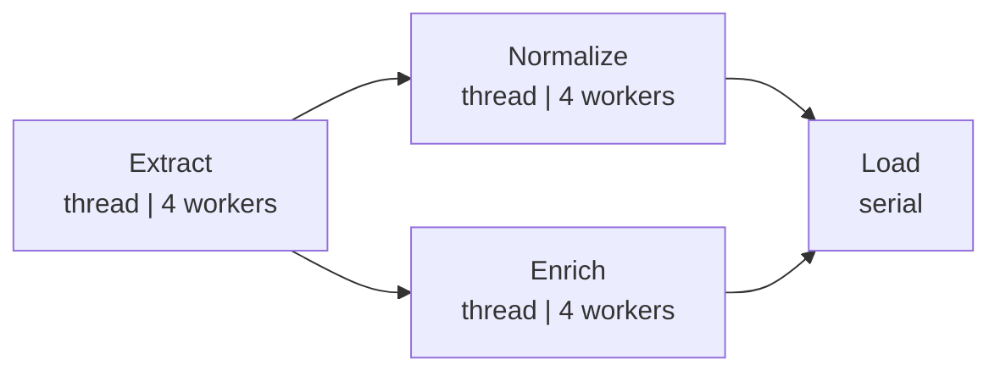
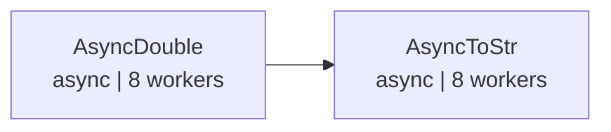

# demo/demo_graph.py

> 📅 Last Updated: 2026/10/30

## Objective

Demonstrates advanced graph topology construction in CelestialFlow's `TaskGraph`: a fan-out/fan-in ETL pipeline and an asynchronous staged pipeline.

## Demo Scenarios

### `demo_etl_fan_out_fan_in`
ETL pipeline with fan-out/fan-in topology:



ASCII supplementary diagram:

```
Extract ──┬── Normalize ──┬── Load
          └── Enrich ─────┘
```

- `Extract` → Generates records by ID (thread mode, 4 workers)
- `Normalize` → Normalizes record values (thread mode, 4 workers)
- `Enrich` → Adds category labels to records (thread mode, 4 workers)
- `Load` → Saves records (serial mode)

**Graph structure**: DAG, one-to-many fan-out + many-to-one fan-in
**Graph mode**: `graph_mode="thread"`

### `demo_async_pipeline`
Two-stage async pipeline:



ASCII supplementary diagram:

```
AsyncDouble ──> AsyncToStr
```

- `AsyncDouble` → Async doubles the input (async mode, 8 workers)
- `AsyncToStr` → Async converts result to string (async mode, 8 workers)

**Graph structure**: DAG, linear two-stage
**Graph mode**: `graph_mode="async"`

## Key Configuration

- Each Stage explicitly specifies its execution mode via `TaskExecutor(..., execution_mode="thread" | "async")`
- The ETL and async pipelines specify graph mode via `TaskGraph(..., graph_mode="thread")` and `graph_mode="async"` respectively
- `execution_mode="async"` is used for coroutine task functions (`async_double`, `async_to_str`)

## Potential Issues

1. **No assertions**: Demo script; does not verify result correctness.
2. **ETL functions include sleep**: `extract_record` (0.5s), `transform_normalize`/`transform_enrich` (0.3s), `load_record` (0.2s); full execution takes some time.

## How to Run

```bash
python demo/demo_graph.py
```

> **Note**: The current `__main__` will call `demo_etl_fan_out_fan_in()` and `asyncio.run(demo_async_pipeline())` in sequence; both demo scenarios will run.

## Expected Behavior

The script registers no observer and has no `print` statements, so during execution it **will not output task-level logs or summary statistics to the terminal**; execution can only be confirmed through external observation (for example, reporting to celestialflow-web, which this demo does not enable) or by adding your own logging to the task functions in `demo_utils`.

### ETL Pipeline (`demo_etl_fan_out_fan_in`)

Executes Extract → Normalize/Enrich → Load in sequence; each task function only performs `sleep` and data transformation internally. When the input is `list(range(1, 16))`, Extract processes 15 records, Normalize and Enrich each receive 15, and the Load node receives a total of 30 tasks (15 × 2 downstream). For example, Extract produces `{'id': 1, 'value': 10, 'label': 'item_1'}`, Normalize appends `normalized: 0.1`, and Enrich appends `category: 'odd'`.

### Async Pipeline (`demo_async_pipeline`)

Two-stage sequential execution: the 20 tasks from `list(range(1, 21))` are first handed to `AsyncDouble`, whose results then flow into `AsyncToStr`. Based on the 0.3s sleep in `async_double` and the 0.2s sleep in `async_to_str`, the total time is estimated at about 1–2 seconds (`AsyncDouble` with 8 concurrent, `AsyncToStr` with 8 concurrent).

## Dependencies

- `celestialflow` (`TaskGraph`, `TaskExecutor`)
- `demo_utils` (`extract_record`, `transform_normalize`, `transform_enrich`, `load_record`, `async_double`, `async_to_str`)
- `python-dotenv`
- `celestialtree` (module-level `import`; the script cannot start if it is missing; `graph.set_ctree(...)` is commented out by default, so the server is not required)
