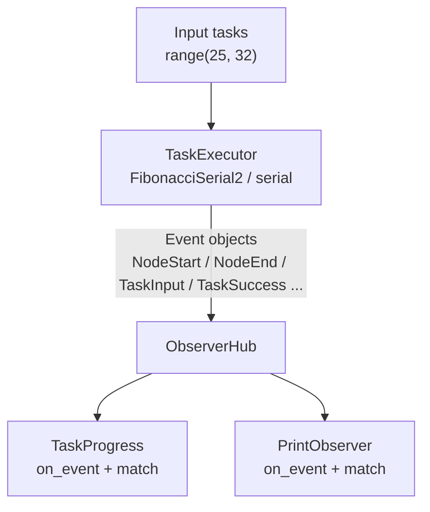

# demo/demo_observer.py

> 📅 Last Updated: 2026/11/13

## Objective

Demonstrate how to register different types of observers for `TaskExecutor` in CelestialFlow.

This file showcases two approaches simultaneously:

- Using the custom `TaskProgress` defined in this file (inherits `Observer`, a `tqdm`-based progress bar observer)
- Directly using the built-in `PrintObserver` of `celestialflow` (pass `name` at construction as the output prefix; the example passes `executor.get_name()`)

## Demo Content

The current demo contains two entry functions:

| Function | Description |
|------|------|
| `demo_progress_observer` | Create `TaskExecutor`, register `TaskProgress`, display progress bar |
| `demo_print_observer` | Create `TaskExecutor`, register the built-in `PrintObserver(executor.get_name())`, print observer lifecycle logs |

The roles of the two observer types:



## Key Configuration

- `execution_mode="serial"`
- `max_workers=6`
- `max_retries=1`
- Both examples register observers via `executor.add_observer(...)`

Observer overview:

| Observer | Source | Purpose |
|----------|------|------|
| `TaskProgress` | Locally defined in this file | Display execution progress using `tqdm`, suitable for CLI interactive scenarios |
| `PrintObserver` | Built into `celestialflow` (`celestialflow.observer.core_print`) | Outputs each event's count in `on_event`, with the constructor argument `name` as the output prefix |

`PrintObserver` only implements the unified `on_event(event)`, using `match event` to maintain counts by event type and print them (`name` is the prefix passed at construction):

| Event | Output / Purpose |
|------|------|
| `NodeStartEvent` | Prints `[{name}] start total={total}` |
| `TaskInputEvent` | Accumulates `total` and prints `[{name}] total={total}(+1)` |
| `TaskSuccessEvent` | Accumulates successes and prints `[{name}] succeeded={n}(+1), total={total}` |
| `TaskFailEvent` | Accumulates failures and prints `[{name}] failed={n}(+1), total={total}` |
| `TaskSkipEvent` | Accumulates skips and prints `[{name}] skipped={n}(+1), total={total}` |
| `NodeEndEvent` | Prints `[{name}] finish total=..., skipped=..., succeeded=..., failed=...` |

`TaskRetryEvent`, termination signal events, and graph events are not among the branches above and are ignored by the `match` fallback branch.
The `Observer` base class currently only provides `on_event` and `handle_exception`; there are no per-event callbacks anymore.

## Potential Issues

1. **`__main__` runs both `demo_progress_observer` and `demo_print_observer`**: Both observers execute in sequence, first showing the tqdm progress bar, then outputting logs.
2. **Current example only shows the success path**: `test_task` is currently `range(25, 32)`, so runtime will typically only see output corresponding to `TaskInputEvent`, `NodeStartEvent`, `TaskSuccessEvent`, and `NodeEndEvent`.
3. **Order of `TaskInputEvent` and `NodeStartEvent`**: `run()` injects all tasks before starting the executor, so by the time `NodeStartEvent` arrives, `total` has already accumulated to its final value (`PrintObserver` prints several `total=...(+1)` lines first, then `start total=7`). `TaskProgress` also relies on this, creating the progress bar from the accumulated `_total` on `NodeStartEvent`.
4. **No assertions**: This is a demo script. It does not validate result values; it only demonstrates observer invocation timing.
5. **Computation time varies with input**: The current Fibonacci is iterative O(n); single-task time grows linearly with `n`, but the difference between `fibonacci(31)` and `fibonacci(25)` is still at the microsecond level and will not significantly affect total duration.

## How to Run

```bash
python demo/demo_observer.py
```

## Expected Behavior

After running, it prints observer lifecycle logs similar to the following:

### `demo_progress_observer`

When running `demo_progress_observer()`, the terminal will show a progress bar similar to this (`TaskProgress` does not set `desc`, so there is no prefix):

```text
 0%|          | 0/7 [00:00<?, ?it/s]100%|████████████████████████████| 7/7 [00:00<00:00, ...it/s]
```

### `demo_print_observer`

When running `demo_print_observer()`, it prints observer lifecycle logs similar to the following (the prefix is `FibonacciSerial2` returned by `executor.get_name()`):

```text
[FibonacciSerial2] total=1(+1)
[FibonacciSerial2] total=2(+1)
...
[FibonacciSerial2] total=7(+1)
[FibonacciSerial2] start total=7
[FibonacciSerial2] succeeded=1(+1), total=7
[FibonacciSerial2] succeeded=2(+1), total=7
...
[FibonacciSerial2] succeeded=7(+1), total=7
[FibonacciSerial2] finish total=7, skipped=0, succeeded=7, failed=0
```

If you want to observe events such as failures, skips, and retries, you can change the input back to a list containing exception values, duplicate values, or illegal inputs, for example:

```python
test_task = list(range(25, 32)) + [0, 27, None, 0, ""]
```

This makes it easier to trigger `TaskFailEvent` / `TaskSkipEvent`; but note:

- `TaskProgress`'s `on_event` only `match`es `NodeStartEvent` / `TaskInputEvent` / `TaskSuccessEvent` / `TaskFailEvent` / `TaskSkipEvent` / `NodeEndEvent`, and does not handle `TaskRetryEvent`.
- `PrintObserver`'s `on_event` likewise only handles `NodeStartEvent` / `NodeEndEvent` / `TaskInputEvent` / `TaskSuccessEvent` / `TaskFailEvent` / `TaskSkipEvent`, and its fallback branch ignores `TaskRetryEvent`. The `Observer` base class itself only provides `on_event` and `handle_exception`, so neither of this demo's observers produces output for retry events.

## Dependencies

- `celestialflow` (`Observer`, `PrintObserver`, `TaskExecutor`; `TaskProgress` is locally defined by `demo_observer.py` in the same directory of this repository)
- `demo_utils` (`fibonacci`)
- `tqdm` (dependency for the `TaskProgress` progress bar)
