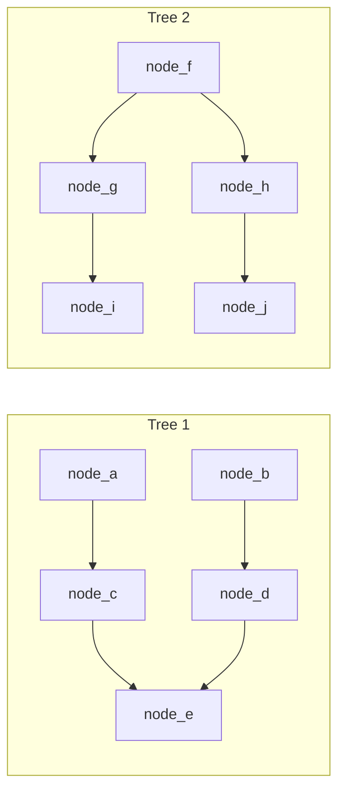
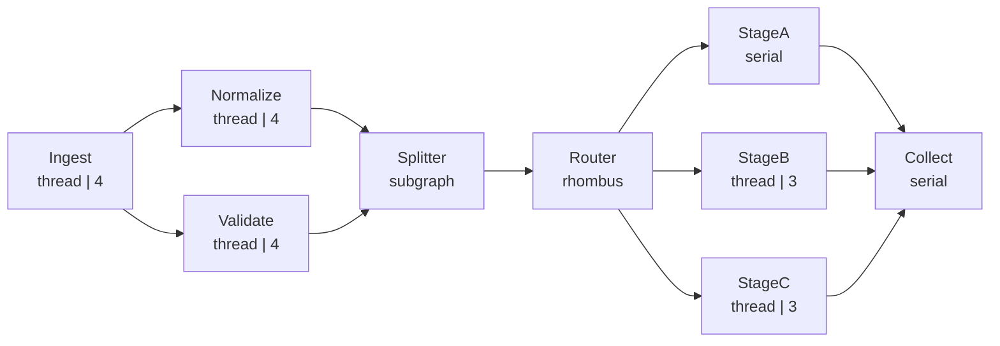

# demo/demo_web.py

> 📅 Last Updated: 2026/10/30

## Objective

This file contains two demos: `demo_forest()` (two independent tree-shaped DAGs) and `demo_topology_topology()` (a 6-layer complex task graph with fan-out/fan-in, `TaskSplitter`, and `TaskRouter`). Both explicitly pass `report=ReportConfig(...)` when calling `graph.run(...)`, so the framework pushes status, structure, errors, and lifecycle data to celestialflow-web on a fixed cadence for observing task execution.

## Demo Scenarios

### Forest (`demo_forest`)

Two mutually non-interfering tree-shaped DAGs coexist in the same `TaskGraph`:



- Tree 1: `node_a → node_c → node_e`, `node_b → node_d → node_e`
- Tree 2: `node_f → node_g → node_i`, `node_f → node_h → node_j`
- All nodes use `add_one_sleep` (`execution_mode="thread"`, `max_workers=2`), with graph mode `graph_mode="thread"`
- Initial tasks are injected into `node_a` (`1..10`), `node_b` (`11..20`), and `node_f` (`21..30`)
- Explicit reporting at runtime: `graph.run(init_tasks, report=ReportConfig("http://localhost:5005/"))`

### Complex Topology (`demo_topology_topology`)

> The graph name of this demo is `demo_web_topology`, and the function name is `demo_topology_topology`.



ASCII supplementary diagram:

```
Ingest ──┬── Normalize ──┐
         └── Validate ───┴── Splitter ── Router ──┬── StageA ──┐
                                                  ├── StageB ──┴── Collect
                                                  └── StageC ──┘
```

- `Ingest` → Injects 24 seed tasks (thread mode, 4 workers)
- `Normalize` → Normalizes and scales task values; `7` fails 3 times in a row and then **fails after retries are exhausted**, while `11` fails once and then succeeds on retry (thread mode, 4 workers, `max_retries=2`)
- `Validate` → Validates tasks; `11` directly throws a **non-retryable** `RuntimeError` (thread mode, 4 workers)
- `Splitter` → Splits the iterable results passed in from upstream into individual items (each task is split into 2~3 items)
- `Router` → Dispatches items to `StageA` / `StageB` / `StageC` by `item % 3`; the three downstream edges have different transfer volumes
- `StageA` (serial) / `StageB`, `StageC` (thread, 3 workers) → three parallel processing branches
- `Collect` → Aggregates the outputs of the three stages (serial)

**Graph structure**: DAG, multi-layer fan-out/fan-in + split + route
**Graph mode**: `graph_mode="thread"`, with serial / thread execution modes mixed inside nodes

## How Reporting Works

Reporting is enabled by explicitly passing `ReportConfig` at the run entry point; the framework no longer implicitly reads reporting settings from the host project's configuration file:

```python
from celestialflow import ReportConfig

graph.run(init_tasks, report=ReportConfig("http://localhost:5005/"))
```

- `ReportConfig` is exported at the `celestialflow` package level; the constructor argument `url` must be an address starting with `http` / `https`; validation happens at construction (an invalid address raises `ConfigurationError`), and a trailing `/` is stripped.
- Omitting `report` (or passing `None`) means no reporting; both demos can still run independently without a web service.
- When `url` is omitted, the default address `http://127.0.0.1:5005` is used.

The reporting code in `demo_topology_topology` is exactly the same as in `demo_forest`:

```python
seeds = [*range(1, 21), 3, 5, 8, 12]
graph.run({"Ingest": seeds}, report=ReportConfig("http://localhost:5005/"))
```

## What Can Be Observed on the Web

| Dimension | Observation Content |
|------|---------|
| Structure graph | A nine-node multi-layer topology; `Splitter` is displayed as a subgraph and `Router` as a rhombus; with edge labels enabled, you can observe the cumulative/incremental transfer volume of each edge |
| Node status cards | Each node's in-progress/success/failure counts, along with the different execution modes (serial / thread) and parallelism |
| Error logs | Two kinds of errors: `Normalize`'s `ValueError` (fails after retries) and `Validate`'s `RuntimeError` (non-retryable) |
| Progress bars | The proportion of segments such as success / failure / skip |
| Lifecycle | Retry counts (`retry_times`) persisted along with failure records |

## Key Configuration

- Each Stage explicitly specifies its execution mode via `TaskExecutor(..., execution_mode="thread" | "serial")`
- `normalize.set_retry_exceptions(ValueError)` specifies retryable exceptions; `max_retries=2` provides two retry opportunities
- `Ingest` injects 24 seed tasks, of which `3`, `5`, `8`, and `12` duplicate earlier seed values; since the demo does not configure `skip_func`, these duplicate values are not deduplicated and still enter each node as ordinary tasks
- The graph mode is `graph_mode="thread"`, allowing mixed execution modes inside nodes
- Reporting is explicitly enabled via `report=ReportConfig(...)` (see "How Reporting Works" above)

## Key Implementation

- `_metrics_of(target)`: Looks up the `MetricsObserver` from the run object's `ObserverHub` (`target.observers._snapshot()`) and returns it; this helper function is still defined in this file, but both demos no longer call it (the script no longer prints a "per-node counts" summary), so you can reuse it directly if you need to read metrics manually.
- `make_flaky(fail_map)`: Builds a task function that "raises `ValueError` for the first `fail_map[n]` times, then succeeds", used to create retryable failures.
- `make_stage_task(prefix)`: Builds a stage task function that returns `f"{prefix}({x})"`.

## Potential Issues

1. **No assertions**: Demo script; does not verify result correctness.
2. **Task functions include sleep**: Sleep across stages ranges from 0.02s (`route_task`) to 1s (`ingest_task`); full execution is expected to take tens of seconds.
3. **Depends on the web service**: The reporting address points to `http://localhost:5005/`; when celestialflow-web is not started, both reporting and injection pulling will fail, and connection error tracebacks will appear in the console (the push thread and the metronome will catch and print them, without affecting task execution); to run fully offline, simply remove the `report=` argument.
4. **Failures in the Normalize / Validate nodes**: `Normalize`'s `7` and `Validate`'s `11` create failure paths; the script does not depend on external services at startup and can run independently.

## How to Run

```bash
python demo/demo_web.py
```

`__main__` runs `demo_forest()` and `demo_topology_topology()` in sequence; the two execute independently.

> Start celestialflow-web (listening on port `5005` by default) before running, otherwise the reporting address that `report=ReportConfig(...)` points to will be unavailable.

## Expected Behavior

Both demos **no longer print** a per-node count summary to the terminal (that logic was removed along with the reporting redesign); only the framework's own logs will appear in the terminal, plus connection error tracebacks when the web service is unavailable. Execution results need to be observed on the celestialflow-web dashboard:

```
Ingest → Normalize / Validate → Splitter → Router → StageA / StageB / StageC → Collect
```

> If the web service is not started, the script still completes local computation, but the reported data cannot be displayed.

## Dependencies

- `celestialflow` (`TaskGraph`, `TaskExecutor`, `TaskSplitter`, `TaskRouter`, `ReportConfig`)
- `demo_utils` (`add_one_sleep`)
- External service: celestialflow-web (reporting target, default `http://localhost:5005/`)
