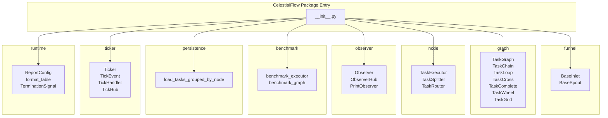

# src/celestialflow/__init__.py

> 📅 Last Updated: 2026/10/30

## Introduction

The project root entry point, which centrally exports all public APIs from submodules. Users can simply `from celestialflow import ...` to access all core functionality.

The package-level `__all__` contains **25** symbols. Symbols from each subpackage are re-exported via the corresponding package's `__init__.py`; `benchmark_executor` / `benchmark_graph` / `format_table` / `TerminationSignal` / `load_tasks_grouped_by_node` are imported directly from `util_*` modules by file (they are utility functions and types that have been stably promised as public API).

## Module Grouping

Grouped by source module, with a description of each group's primary purpose.

---

### funnel — Data Inlet

Provides task data inlet and outlet abstractions, used to connect external data sources with the task graph.

| Exported Symbol | Description |
|-----------------|-------------|
| `BaseInlet` | Data inlet base class, defining a unified data pull/push interface |
| `BaseSpout` | Data outlet base class, defining a unified data output interface |

---

### graph — Task Graph Core

Provides various topology structure definitions, supporting DAG construction, dependency connections, and execution scheduling. `TaskGraph` defaults to `graph_mode="serial"`, while predefined structures default to `graph_mode="thread"`.

| Exported Symbol | Description |
|-----------------|-------------|
| `TaskGraph` | General task graph container, supports arbitrary DAG topologies |
| `TaskChain` | Linear chain structure (preceding node → succeeding node) |
| `TaskCross` | Layered cross structure (fully connected between adjacent layers) |
| `TaskGrid` | Two-dimensional grid structure (each node connects to its right and lower neighbors) |
| `TaskLoop` | Cyclic structure, nodes connected head-to-tail to form a closed loop |
| `TaskWheel` | Wheel structure: a center node connects to a ring, and the ring nodes are connected head-to-tail to form a closed loop |
| `TaskComplete` | Complete graph structure, each node connects to all other nodes |

> `TaskLoop` / `TaskWheel` are cyclic structures. `TaskGraph._build_analysis()` raises `ConfigurationError` when `graph_mode="serial"` and the graph is not a DAG, so these two structures should use the default `graph_mode="thread"` (or explicitly specify `"async"`).

---

### node — Task Execution Layer

Provides task executors, route dispatch, and task splitting capabilities for the execution layer.

| Exported Symbol | Description |
|-----------------|-------------|
| `TaskExecutor` | General task executor, supports serial / thread / async execution modes; can be directly connected to `TaskGraph` as a graph node |
| `TaskSplitter` | Task splitter, splits a single input into multiple sub-tasks |
| `TaskRouter` | Route dispatcher, distributes tasks to different downstream based on rules |

> Note: Internal abstract classes such as `BaseTaskNode` and `TaskDispatch` are not exported through the package root or `celestialflow.node`; external code should only depend on `TaskExecutor` / `TaskSplitter` / `TaskRouter` listed in the table above.

---

### observer — Observability

Provides observer pattern support for monitoring task execution. The package root only exports the observer protocol, the hub, and the console observer; the metrics observer `MetricsObserver` must be imported from `celestialflow.observer`.

| Exported Symbol | Description |
|-----------------|-------------|
| `Observer` | Observer base class, defines on_node_start / on_task_success / on_task_fail and other callback interfaces |
| `ObserverHub` | Observer hub, broadcasts events to a group of child observers |
| `PrintObserver` | print-based console progress observer; a name prefix must be passed at construction; counters are thread-safe |

---

### benchmark — Benchmark

Provides performance benchmarking capabilities for executors and task graphs. Both are `async` functions.

| Exported Symbol | Description |
|-----------------|-------------|
| `benchmark_executor` | Multi-mode benchmark testing for sync/async `TaskExecutor` |
| `benchmark_graph` | `graph_mode × execution_mode` benchmark testing for the entire task graph |

---

### persistence — Persistence

Provides SQLite-based record querying functionality.

| Exported Symbol | Description |
|-----------------|-------------|
| `load_tasks_grouped_by_node` | Creates and closes its own connection, reading records in the specified states grouped by node; signature is `(db_path, statuses=("failed", "pending")) -> dict[str, list[dict[str, Any]]]` |

> The package root only re-exports `load_tasks_grouped_by_node`; other sqlite query utilities (such as `load_task_error_records`) should be imported directly from `celestialflow.persist.util_sqlite`.

---

### ticker — Timed Driving

Provides Ticker-based scheduled task event driving.

| Exported Symbol | Description |
|-----------------|-------------|
| `Ticker` | Event generator that fires periodically |
| `TickEvent` | Event object produced by a single tick |
| `TickHandler` | Callback interface type for handling `TickEvent` |
| `TickHub` | Hub that broadcasts tick events to a group of `TickHandler` |

---

### runtime — Runtime Utilities

Provides runtime helper types, configuration objects, and utility functions.

| Exported Symbol | Description |
|-----------------|-------------|
| `ReportConfig` | Remote reporting configuration (`frozen` dataclass); validates and normalizes `url` at construction; passed to the graph run entry as the `report=` argument |
| `format_table` | Formatted table output, for console display of comparison data |
| `TerminationSignal` | Termination signal, used to control the end of graph execution flow |

---

## `__all__` List

Complete public API list (currently 25 symbols, matching the source `__all__` item by item):

```python
__all__ = [
    "BaseInlet",
    "BaseSpout",
    "Observer",
    "ObserverHub",
    "PrintObserver",
    "ReportConfig",
    "TaskChain",
    "TaskComplete",
    "TaskCross",
    "TaskExecutor",
    "TaskGraph",
    "TaskGrid",
    "TaskLoop",
    "TaskRouter",
    "TaskSplitter",
    "TaskWheel",
    "TerminationSignal",
    "TickEvent",
    "TickHandler",
    "TickHub",
    "Ticker",
    "benchmark_executor",
    "benchmark_graph",
    "format_table",
    "load_tasks_grouped_by_node",
]
```

## Usage Examples

The following examples demonstrate how to import from the package entry and use CelestialFlow's core functionality to build and execute task graphs.

```python
from celestialflow import TaskGraph, TaskExecutor
from celestialflow.observer import MetricsObserver


# 1. Define task processing functions
def double(x: int) -> int:
    return x * 2


def add_one(x: int) -> int:
    return x + 1


# 2. Create TaskExecutor nodes (func is required, execution_mode defaults to "serial")
stage_a = TaskExecutor("StageA", func=double, execution_mode="serial")
stage_b = TaskExecutor("StageB", func=add_one, execution_mode="serial")

# 3. Build the DAG graph
graph = TaskGraph(name="DemoGraph")
graph.set_nodes([stage_a, stage_b])
graph.connect([stage_a], [stage_b])

# 4. Register a graph-level metrics observer to read run results
metrics = MetricsObserver()
graph.add_observer(metrics)

# 5. Execute the graph: keys are node names, values are that node's initial tasks
graph.run({stage_a.get_name(): [1, 2, 3, 4, 5]})

# 6. Inspect each node's metrics snapshot
for node_name, node_metrics in metrics.get_graph_metrics().items():
    print(
        node_name,
        node_metrics.status,
        node_metrics.external_input,
        node_metrics.succeeded,
        node_metrics.failed,
    )
```

> A `TaskGraph` instance is a one-shot object: it should not be reused after a single `run()` / `run_async()`. To execute again, rebuild the graph and nodes.

### Using TaskExecutor Independently

`TaskExecutor` can run independently of the graph structure, suitable for single-step task execution:

```python
from celestialflow import TaskExecutor

# Create an executor and pass a data iterator
executor = TaskExecutor("Adder", func=lambda x: x + 10, execution_mode="serial")
executor.run([1, 2, 3])

# Get (task, result) pairs of successful tasks
for task, result in executor.get_success_pairs():
    print(f"Task: {task} -> Result: {result}")

# Get (task, PersistedError) pairs of failed tasks
print("Failures:", len(executor.get_error_pairs()))
```

### Using Predefined Graph Structures

```python
from celestialflow import TaskChain, TaskExecutor
from celestialflow.observer import MetricsObserver

nodes = [
    TaskExecutor("S1", func=lambda x: x * 2),
    TaskExecutor("S2", func=lambda x: x + 1),
    TaskExecutor("S3", func=lambda x: x**2),
]

# Predefined structures default to graph_mode "thread"
chain = TaskChain(name="DemoChain", nodes=nodes)
metrics = MetricsObserver()
chain.add_observer(metrics)

chain.run({nodes[0].get_name(): [1, 2, 3]})

for node_name, node_metrics in metrics.get_graph_metrics().items():
    print(node_name, node_metrics.status, node_metrics.succeeded)
```

### Enabling Remote Reporting

`ReportConfig` is only used as the `report=` argument of the graph run entry; omitting it (`None`) disables reporting. `TaskExecutor.run()` does not accept a `report` argument.

```python
from celestialflow import ReportConfig, TaskExecutor, TaskGraph

graph = TaskGraph(name="ReportedGraph")
worker = TaskExecutor("Worker", func=lambda x: x + 1)
graph.set_nodes([worker])

# url must be an http/https address; a trailing "/" is stripped, and an invalid address raises ConfigurationError at construction
config = ReportConfig("http://127.0.0.1:5005")
graph.run({worker.get_name(): [1, 2, 3]}, report=config)
```

> The example assumes a working reporting service exists at `127.0.0.1:5005`; it only demonstrates how the `report=` argument is wired. `run_async()` also accepts `report`.

## Module Dependency Graph



> Dependency direction note: `ReportConfig` comes from the re-export of `celestialflow.runtime`; `benchmark_*`, `format_table`, `TerminationSignal`, and `load_tasks_grouped_by_node` are imported directly by the package root file by file, without going through the corresponding subpackage's `__init__.py`. `benchmark` sits at the top of the dependency chain and is not imported by any other submodule.

## Notes

- **The package root only exports public API**: `__all__` does not include symbols such as `MetricsObserver`, `DEFAULT_REPORT_URL`, and `TaskEnvelope`; import them from the corresponding subpackage instead (e.g., `from celestialflow.observer import MetricsObserver`).
- **One-shot objects**: `run()` / `run_async()` of `TaskGraph` / `TaskExecutor` are one-shot calls; to execute repeatedly you must rebuild the instance. This is also exactly why `celestialflow.benchmark` needs cloning utilities.
- **Run entry arguments**: `TaskGraph.run()` / `run_async()` have the signature `(init_tasks_dict, *, if_put_signal=True, log_level=DEFAULT_LOG_LEVEL, report=None)`; `TaskExecutor.run()` / `run_async()` only have `if_put_signal` and `log_level`, and do not support `report`.
- **No built-in status snapshot method**: `TaskGraph` does not provide `get_status_snapshot()`; for runtime statistics, register `MetricsObserver` via `add_observer()`, and obtain structural information via `get_nodes()` / `get_edges()` / `get_node_meta()`.
