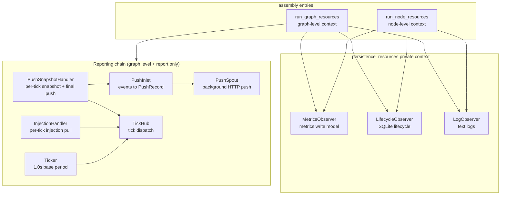

# src/celestialflow/assembly/__init__.py

> 📅 Last Updated: 2026/11/13

`assembly` is CelestialFlow's **runtime resource assembly module**. It centrally creates, registers, starts, and reclaims the global observers, background spouts, remote reporting channel, and ticker required by a single run, avoiding `TaskGraph.run()` and `TaskExecutor.run()` each re-implementing lifecycle management.

The module itself has only two public entry points: `run_graph_resources` (graph-level run) and `run_node_resources` (single-node run). Both are `contextmanager`s: they complete resource assembly and produce the lifecycle database path when entering the `with` block, and perform teardown in a fixed order when exiting.

> The package-level `__init__.py` only re-exports these two functions from `core_run.py`; private helpers such as `_persistence_resources` are not exposed. `assembly` is also not re-exported by `celestialflow/__init__.py`; import it from `celestialflow.assembly` when needed.

## Exported Symbols

```python
__all__ = [
    "run_graph_resources",
    "run_node_resources",
]
```

| Exported Symbol | Source | Description |
|---------|------|------|
| `run_graph_resources` | `core_run.py` | Graph-level resource context: metrics, lifecycle, log, and optionally remote reporting, task injection, and the ticker |
| `run_node_resources` | `core_run.py` | Single-node resource context: metrics, lifecycle, log, without graph structure or reporting |

## Assembly Scope

| Resource | `run_graph_resources` | `run_node_resources` |
|------|:---------------------:|:--------------------:|
| `MetricsObserver` (metrics write model) | ✅ Created and registered internally | ✅ Created and registered internally |
| `LifecycleObserver` + `LifecycleSpout` | ✅ | ✅ |
| `LogObserver` + `LogSpout` | ✅ | ✅ |
| `PushInlet` + `PushSpout` | ✅ Only when `report is not None` | ❌ |
| `PushSnapshotHandler` | ✅ Only when `report is not None` | ❌ |
| `InjectionHandler` + `InjectionTarget` | ✅ Only when `report is not None` | ❌ |
| `Ticker` (default 1-second base period) | ✅ Only when `report is not None` | ❌ |
| `requests.Session` (shared by reporting and injection) | ✅ Only when `report is not None` | ❌ |

> The `MetricsObserver` here is a **write-only model**: it is registered into the `ObserverHub` passed by the caller and driven by node events for counting; its read-only view is passed to `LogObserver` and `PushSnapshotHandler` for log aggregation and status snapshots.

## Structural Relationships



## Usage Examples

The example below directly uses the two assembly entry points, creates a minimal graph object satisfying the `InjectionTarget` protocol, and observes the lifecycle database path produced by the context:

```python
from collections.abc import Iterable, Mapping
from typing import Any

from celestialflow.assembly import run_graph_resources, run_node_resources
from celestialflow.observer import ObserverHub


class DemoGraph:
    """Minimal implementation satisfying the InjectionTarget protocol."""

    def inject_tasks(self, tasks: Mapping[str, Iterable[Any]]) -> None:
        for node, values in tasks.items():
            print(f"inject {list(values)} -> {node}")

    def inject_terminations(self, nodes) -> None:
        print(f"terminate {list(nodes)}")


# Graph level: remote reporting is disabled by default
graph_hub = ObserverHub()
with run_graph_resources(graph_hub, DemoGraph(), log_level="info") as db_path:
    print("Graph-level lifecycle database:", db_path)

# Node level: no InjectionTarget, no reporting
node_hub = ObserverHub()
with run_node_resources(node_hub, log_level="warning") as db_path:
    print("Node-level lifecycle database:", db_path)
```

After running, the following will be generated in the current working directory:

- `lifecycles/<date>/flow_lifecycle(<time>).sqlite3`
- `logs/flow_log(<date>).log`

## Notes

1. **Every entry appends observers**: `MetricsObserver`, `LifecycleObserver`, and `LogObserver` are all newly created by the entry and `add_observer()`-ed to the passed hub. Do not enter the context repeatedly on the same hub, otherwise duplicate counting and duplicate writes will occur.
2. **`log_level` is normalized first**: case-insensitive, leading/trailing whitespace removed; an invalid level throws `InvalidOptionError`, and a non-string throws `ConfigurationError`.
3. **The return value may be `None`**: The context produces `lifecycle.db_path`, typed `Path | None`; it is the actual path after a normal startup.
4. **Only the graph-level entry handles reporting**: `run_node_resources` does not accept a `report` argument at all, and standalone nodes do not participate in remote reporting or task injection.
5. **The teardown order is fixed**: The graph-level context stops the ticker first, then lifecycle / log, and finally stops the push spout and closes the HTTP session; see [`core_run.md`](./core_run.md) for details.
