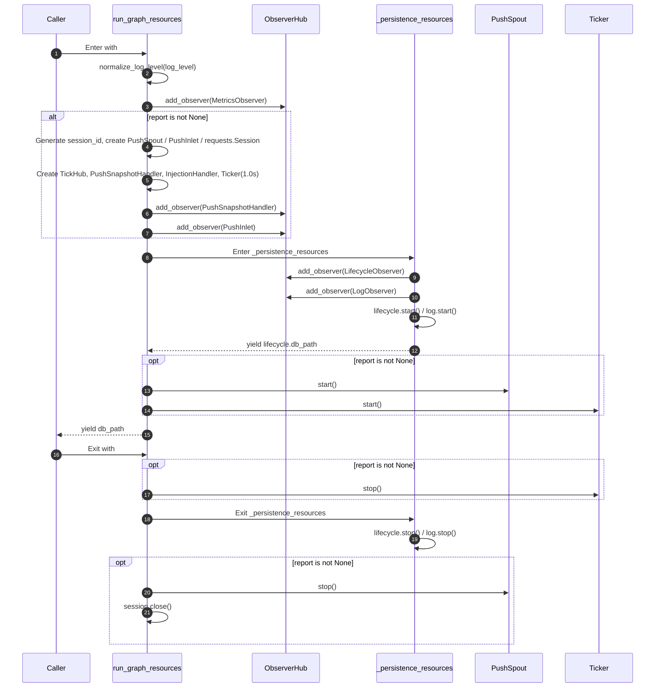
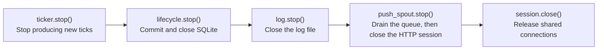

# src/celestialflow/assembly/core_run.py

> 📅 Last Updated: 2026/11/13

`core_run.py` implements the two kinds of runtime resource assembly contexts of CelestialFlow:

- `run_graph_resources`: serves `TaskGraph.run()` / `TaskGraph.run_async()`, assembling metrics, lifecycle, and log, and additionally assembling remote reporting, task injection, and the ticker when a `ReportConfig` is passed;
- `run_node_resources`: serves `TaskExecutor.run()` / `TaskExecutor.run_async()`, assembling only metrics, lifecycle, and log, without involving graph structure or reporting.

Both entries reuse the common logic of "create and register lifecycle / log observers → start → produce the database path → stop" through the private context `_persistence_resources()`.

## Public Functions

```python
@contextmanager
def run_graph_resources(
    observers: ObserverHub,
    injection_target: InjectionTarget,
    *,
    log_level: str = DEFAULT_LOG_LEVEL,
    report: ReportConfig | None = None,
) -> Generator[Path | None, None, None]: ...


@contextmanager
def run_node_resources(
    observers: ObserverHub,
    *,
    log_level: str = DEFAULT_LOG_LEVEL,
) -> Generator[Path | None, None, None]: ...
```

### Parameter Description

| Parameter | Applicable Entry | Type | Default | Description |
|------|---------|------|--------|------|
| `observers` | Both | `ObserverHub` | Required | Observer hub within the run scope; the entry appends metrics, persistence, and reporting observers to it |
| `injection_target` | Graph-level | `InjectionTarget` | Required | Task injection target, usually `TaskGraph` itself; must implement `inject_tasks()` and `inject_terminations()` |
| `log_level` | Both | `str` | `DEFAULT_LOG_LEVEL` (`"INFO"`) | Filter level of `LogObserver`; normalized to uppercase by `normalize_log_level()` on entry |
| `report` | Graph-level | `ReportConfig \| None` | `None` | Remote reporting configuration; `None` means completely disabling reporting, injection, and the ticker |

### Return Value and Exceptions

- Return value (`with ... as db_path`): `Path | None`, the SQLite file path created after the lifecycle spout starts; it is not `None` after a normal startup.
- `InvalidOptionError`: `log_level` is not in the allowed set of `LEVEL_DICT`.
- `ConfigurationError`: `log_level` is not a string (thrown by `normalize_log_level()`).
- Exceptions thrown inside the context body continue to propagate outward after resource cleanup completes.

## Private Helper: `_persistence_resources`

```python
@contextmanager
def _persistence_resources(
    observers: ObserverHub,
    metrics_view: MetricsObserver,
    log_level: str,
) -> Generator[Path | None, None, None]: ...
```

Responsibilities:

1. Create `LifecycleObserver()` and `LogObserver(metrics_view, log_level)`;
2. Register both to `observers` in the order **lifecycle → log**;
3. Call `lifecycle.start()` and `log.start()` in sequence, then `yield lifecycle.db_path`;
4. Call `lifecycle.stop()` and `log.stop()` in sequence in `finally`.

> `run_graph_resources` / `run_node_resources` no longer create `LifecycleSpout` / `LogSpout` / `LifecycleInlet` / `LogInlet` themselves. These objects are fully encapsulated inside the `LifecycleObserver` / `LogObserver` facades, and the assembly entries only interact with the observer facades.

## Graph-Level Resource Assembly Order



### Registration Order (When `report` Is Not `None`)

| Order | Observer | Purpose |
|:----:|--------|------|
| 1 | `MetricsObserver` | Metrics write model, read by logs and snapshots |
| 2 | `PushSnapshotHandler` | Listens for `GraphEndEvent` to push the final-state snapshot |
| 3 | `PushInlet` | Converts graph start, graph end, and task failure events into push records |
| 4 | `LifecycleObserver` | Writes the task lifecycle to SQLite |
| 5 | `LogObserver` | Writes runtime logs to a text file |

> **Why must the snapshot handler be registered before `PushInlet`?** `ObserverHub` dispatches events synchronously in registration order. When `GraphEndEvent` is received, the `PushSnapshotHandler` enqueues the final-state snapshot first, and only then does `PushInlet` enqueue `graph_end` (the session shutdown notification). The push spout's queue is FIFO, so the server is guaranteed to receive the final-state snapshot before `shutdown_session`, and there is no race where "the session has ended but the final state has not arrived yet".

## Teardown Order

When exiting the `with` block, resources are reclaimed in the following order:



| Order | Operation | Reason |
|:----:|------|------|
| 1 | `ticker.stop()` | Cut off the time-driven source first, to avoid producing further snapshots or injection requests during teardown |
| 2 | `lifecycle.stop()` | Commit remaining transactions and close the SQLite connection |
| 3 | `log.stop()` | Close the log file handle |
| 4 | `push_spout.stop()` | The spout's `stop()` sends a termination signal first; final-state snapshots / shutdown notifications already in the queue are processed before exit |
| 5 | `session.close()` | Close the `requests.Session` shared by reporting and injection |

> Note: `ticker.stop()` is in the **inner** `finally` of `_persistence_resources`, while `push_spout.stop()` / `session.close()` are in the **outer** `finally`. Therefore, whether an exception is thrown in the context body, during ticker startup, or during persistence resource startup, already-created resources are reclaimed in the relative order described above.

## Usage Examples

### Graph-Level: Reporting Disabled

```python
from collections.abc import Iterable, Mapping
from pathlib import Path
from typing import Any

from celestialflow.assembly import run_graph_resources
from celestialflow.observer import ObserverHub


class DemoGraph:
    """Minimal graph object satisfying the InjectionTarget protocol."""

    def inject_tasks(self, tasks: Mapping[str, Iterable[Any]]) -> None:
        print("Task injection:", {node: list(values) for node, values in tasks.items()})

    def inject_terminations(self, nodes) -> None:
        print("Terminator injection:", list(nodes))


hub = ObserverHub()
graph = DemoGraph()
with run_graph_resources(hub, graph, log_level="info") as db_path:
    assert db_path is None or Path(db_path).exists()
    graph.inject_tasks({"A": [1, 2, 3]})
    graph.inject_terminations(["A"])
```

### Graph-Level: Reporting Enabled

```python
from celestialflow.assembly import run_graph_resources
from celestialflow.observer import ObserverHub
from celestialflow.runtime import ReportConfig


class DemoGraph:
    def inject_tasks(self, tasks) -> None:
        print("Task injection:", tasks)

    def inject_terminations(self, nodes) -> None:
        print("Terminator injection:", list(nodes))

    def start(self) -> None:
        print("Graph starts executing")


graph = DemoGraph()

# Assume a reporting service exists at 127.0.0.1:5005; when the service is unavailable,
# push failures are only printed as tracebacks in the PushSpout background thread and
# will not interrupt task graph execution.
with run_graph_resources(
    ObserverHub(),
    injection_target=graph,
    log_level="debug",
    report=ReportConfig("http://127.0.0.1:5005"),
) as db_path:
    graph.start()
```

After reporting is enabled, the ticker uses `1.0s` as the base period:

| Handler | `tick_period` | Actual Period | Behavior |
|--------|:-------------:|:--------:|------|
| `PushSnapshotHandler` | 1 | 1 second | Reads the whole-graph metrics and pushes a status snapshot; additionally pushes the final state when the graph ends |
| `InjectionHandler` | 5 | 5 seconds | Pulls tasks and terminators from `/api/pull_injection` and injects them |

### Node-Level

```python
from celestialflow.assembly import run_node_resources
from celestialflow.observer import ObserverHub

hub = ObserverHub()
with run_node_resources(hub, log_level="warning") as db_path:
    print("lifecycle database:", db_path)
```

## Notes

1. **Do not enter the same hub repeatedly**: Each entry appends new metrics / lifecycle / log observers, so repeated entry doubles counts and duplicates logs.
2. **The reporting chain is "assembled on demand"**: When `report=None`, no `PushSpout`, `PushInlet`, `PushSnapshotHandler`, `InjectionHandler`, `Ticker`, or `requests.Session` is created, and there is no network IO at all.
3. **The injection target is only used at graph level**: `run_node_resources` does not accept `injection_target`, so a standalone running node will not be injected with tasks remotely.
4. **`PushSpout` starts before `Ticker`**: This ensures the push channel is ready when the first tick arrives.
5. **Teardown may throw exceptions**: `stop()` of the spout / ticker throws `RuntimeStateError` if the background thread does not exit on time; in that case the remaining cleanup is still carried out by the outer `finally`.
6. **The database path comes from the lifecycle spout**: `db_path` becomes available only after `lifecycle.start()`, so it can be obtained as soon as the context is entered; the path remains readable after exit.
