# src/celestialflow/funnel/__init__.py

> 📅 Last Updated: 2026/11/13

The Funnel module provides CelestialFlow's queue communication infrastructure, serving as the underlying base class for `LogSpout`/`LogInlet` and `LifecycleSpout`/`LifecycleInlet` in the Persistence module.

It is not only usable as low-level infrastructure, but can also be used independently of `TaskGraph` / `BaseTaskNode` to build lightweight producer-consumer pipelines.

## Exported Symbols

| Exported Symbol | Source Module | Description |
|-----------------|---------------|-------------|
| `BaseInlet` | `core_inlet` | Base class for all inlet classes, providing queue write functionality |
| `BaseSpout` | `core_spout` | Base class for all spout classes, providing background thread listening and queue consumption |

## File Descriptions

### Core Components

1. **core_inlet.py** (`BaseInlet`)
   - **Purpose**: Base class for all inlet classes, providing queue write functionality
   - **Key Features**: Associates with a spout via `bind_spout()`, writes to the queue using the public method `send()`

2. **core_spout.py** (`BaseSpout`)
   - **Purpose**: Base class for all spout classes, providing background thread listening and queue consumption
   - **Key Features**: Background thread listening, lifecycle hooks, graceful start/stop, pending counter

3. **util_count.py** (`PendingCounter`)
   - **Purpose**: Thread-safe pending counter
   - **Key Features**: Cooperates with `BaseSpout` / `BaseInlet` to count records that have not finished processing

## Inheritance Relationships

```mermaid
classDiagram
    class BaseSpout {
        +Queue _queue
        +PendingCounter _counter
        +Thread _thread
        +start() None
        +stop() None
        +get_queue() Queue
        +get_counter() PendingCounter
        +get_pending_count() int
        +_before_start() None
        +_handle_record(record) None
        +_after_stop() None
    }
    class BaseInlet {
        +bind_spout(spout) Self
        +send(record) None
    }
    class PendingCounter {
        +increment() int
        +decrement() int
        +get_count() int
    }
    class LogSpout {
    }
    class LifecycleSpout {
    }
    class LogInlet {
    }
    class LifecycleInlet {
    }

    BaseSpout <|-- LogSpout
    BaseSpout <|-- LifecycleSpout
    BaseInlet <|-- LogInlet
    BaseInlet <|-- LifecycleInlet
    BaseSpout "1" --> "1" PendingCounter
```



## Module Relationships

### External Relationships
- **With Persistence Module**: `LogSpout`/`LogInlet`, `LifecycleSpout`/`LifecycleInlet` all inherit from the base classes in this module
- **With Runtime Module**: Uses `TerminationSignal` as the stop signal, `CelestialFlowError` as the exception type that subclasses must override

## Usage Examples

The following examples demonstrate the basic usage patterns of `BaseInlet` and `BaseSpout`.

### BaseSpout + BaseInlet Collaboration

```python
from celestialflow.funnel import BaseSpout, BaseInlet


# 1. Custom Spout: print received records to console
class PrintSpout(BaseSpout):
    def _handle_record(self, record):
        print(f"Spout received: {record}")


# 2. Create a Spout and use BaseInlet directly: send() is already a public method
spout = PrintSpout()
inlet = BaseInlet().bind_spout(spout)

# 3. Start the background listening thread
spout.start()

# 4. Send records through the Inlet
inlet.send("Hello, World!")
inlet.send({"key": "value"})
inlet.send(42)

# 5. Stop the Spout
spout.stop()
print("Spout stopped")
```

> You can also subclass `BaseInlet` to add semantic methods, but **do not** override `send()` and then call back into `self.send(...)`, as that causes infinite recursion; the correct approach is to add a new method that delegates to `self.send(...)`:

```python
from celestialflow.funnel import BaseInlet


class EventInlet(BaseInlet):
    def graph_start(self, graph_name: str) -> None:
        self.send({"type": "graph_start", "graph": graph_name})
```

### Using BaseSpout Custom Hooks

```python
from celestialflow.funnel import BaseSpout


class FileSpout(BaseSpout):
    def __init__(self, filename: str):
        super().__init__()
        self.filename = filename

    def _before_start(self):
        print(f"Opening file: {self.filename}")

    def _handle_record(self, record):
        print(f"Processing record: {record}")

    def _after_stop(self):
        print(f"Closing file: {self.filename}")


spout = FileSpout("records.log")
spout.start()
spout.get_queue().put("record1")
spout.get_queue().put("record2")
spout.stop()
```

## Notes

1. **Binding Style**: `BaseInlet` associates with `BaseSpout` via `bind_spout()`, rather than holding the queue directly.
2. **Pending Counter**: `BaseSpout` internally maintains a `PendingCounter`; `get_pending_count()` can query the number of records that have not yet finished processing.
3. **Exception Isolation**: A single record processing failure prints the traceback and continues, without terminating the background thread.
4. **`start()` is idempotent**: When the background thread is already alive, `BaseSpout.start()` returns immediately; it neither creates a new thread nor calls `_before_start()` again.
