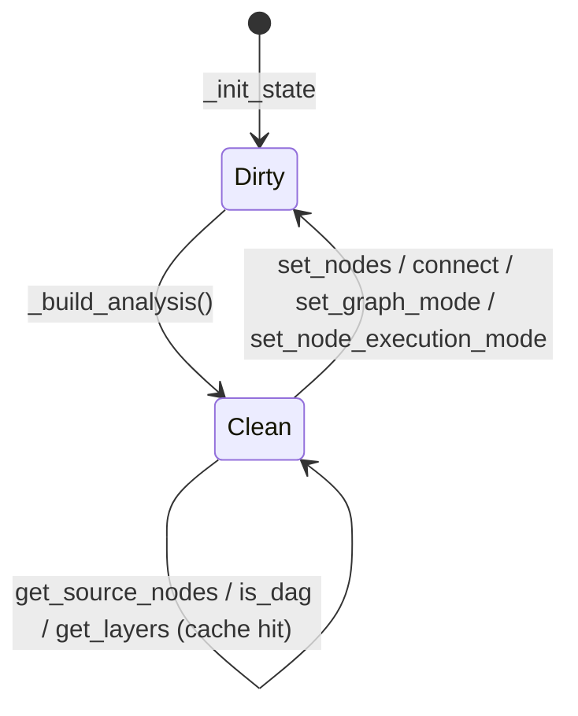
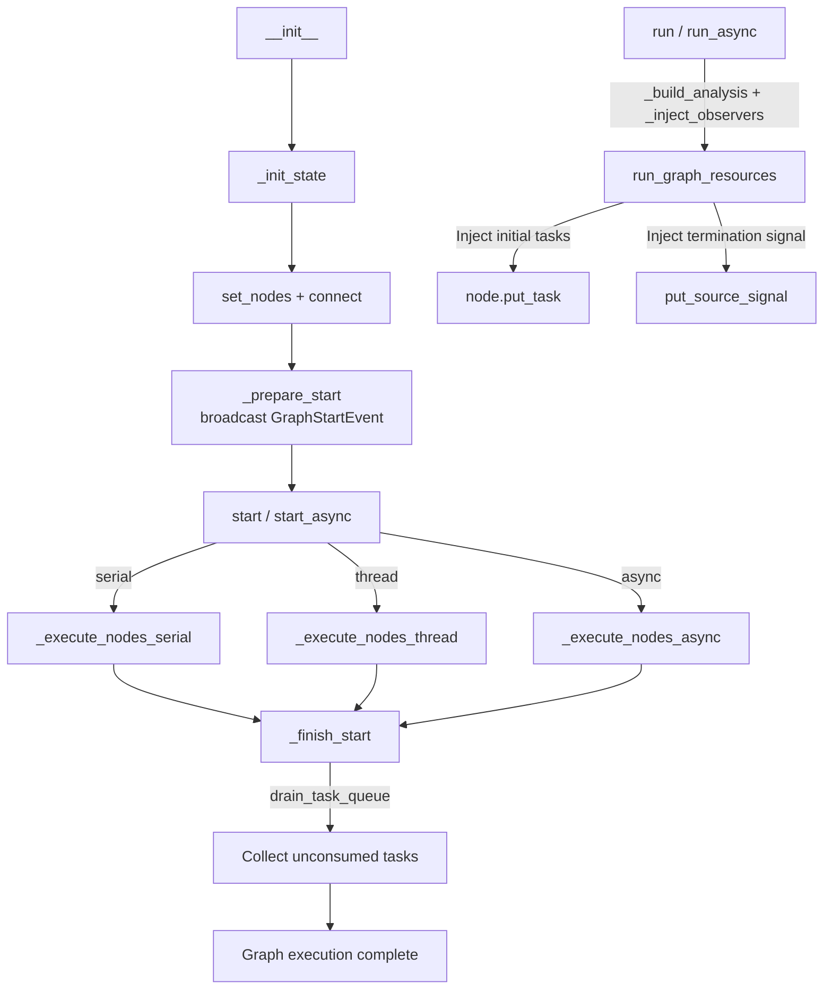

# src/celestialflow/graph/core_graph.py

> 📅 Last Updated: 2026/10/30

`TaskGraph` is CelestialFlow's core scheduler, responsible for managing a set of task nodes (`BaseTaskNode` derivative objects; the public API includes `TaskExecutor`, `TaskSplitter`, `TaskRouter`), their dependency relationships, execution flow, and lifecycle.

> Note: `TaskGraph` is a single-use object. After a single `start()` / `start_async()` / `run()` completes, the current instance is not guaranteed to be safely reset and restarted. If you need to re-execute the same workflow, create a new `TaskGraph` and new associated task nodes.

## Key Data Structures

`TaskGraph` internally uses `node_dict: dict[str, AnyTaskNode]` to maintain the mapping for all nodes. Queue connections are established during the `connect()` phase via each node's `connect_to()`. Graph analysis is based on an internally maintained `OrderGraph` instance (`self.order_graph`), whose `out_edges` / `in_edges` are reference views of the in/out adjacency lists.

All graph analysis results are **private fields** and can only be accessed through public methods:

| Private Field | Type | Corresponding Public Accessor |
|---------------|------|-------------------------------|
| `_source_names` | `list[str]` | `get_source_nodes()` |
| `_is_dag` | `bool` | `is_dag()` |
| `_layers_dict` | `dict[int, list[str]]` | `get_layers()` |
| `_analysis_dirty` | `bool` | none (internal cache invalidation flag) |

> These are no longer public attributes. The old syntax `graph.source_names`, `graph.is_dag`, and `graph.layers_dict` no longer works; in particular, `is_dag` is now a **method call** `graph.is_dag()` — do not use it as a boolean attribute (without parentheses you get a bound method object, which is always truthy).

## Lazy Graph Analysis Rebuild

`TaskGraph` does not compute graph analysis results at construction time; instead it uses a "lazy + dirty flag" strategy:

- `_init_state()` initializes `_analysis_dirty` to `True`.
- `get_source_nodes()` / `is_dag()` / `get_layers()` all call `_build_analysis()` before returning; the latter only actually recomputes when `_analysis_dirty is True`, otherwise it returns the cache directly.
- Any construction-phase operation that may change the graph structure or the semantics of the analysis sets `_analysis_dirty` to `True`:
  - `set_nodes()` (nodes added)
  - `connect()` (edges added)
  - `set_graph_mode()` (the semantics of cycle detection under `serial` mode change accordingly)
  - `set_node_execution_mode()` (node execution mode changes)
- After `_build_analysis()` finishes computing, it sets `_analysis_dirty` back to `False`.
- `run()` / `run_async()` call `_build_analysis()` once before starting, so the serial execution phase can use the already-built `_layers_dict` directly.



## Initialization

```python
class TaskGraph:
    def __init__(self, name: str, graph_mode: str = "serial"): ...
```

### Parameters

- **name**: Task graph name (required)
- **graph_mode**: Graph execution mode
  - `serial` (default): Serial execution, runs layer by layer in topological order (`get_layers()`)
  - `thread`: Thread-based concurrent execution, each node launched in its own thread
  - `async`: Async concurrent execution, must be called in the context of a running event loop (see [`start_async`](#start_async))

`__init__` calls `_set_name`, `set_graph_mode`, `set_ctree(LocalEventClient())`, and `_init_state()` in sequence.

## Graph Construction

### set_nodes

```python
def set_nodes(self, nodes: list[AnyTaskNode]) -> None:
    """
    Add nodes to the task graph. Registers nodes, writes them into the OrderGraph, and injects graph-level event clients.

    :param nodes: List of nodes to add
    :raises DuplicateNodeError: If node names are duplicated
    """
```

After registration, `_analysis_dirty` is set to `True`, and the analysis is only recomputed on the next read of the analysis results.

### connect

```python
def connect[R](
    self,
    from_nodes: list[AnyTaskNode],
    to_nodes: list[AnyTaskNode],
) -> None:
    """
    Establish a hyperedge: every node in from_nodes connects to every node in to_nodes.
    Internally calls from_node.connect_to(to_node) to complete queue connections, and adds edges to order_graph.

    :param from_nodes: Upstream node list
    :param to_nodes: Downstream node list
    :raises NodeNotFoundError: If any endpoint node is not registered
    """
```

After connecting, `_analysis_dirty` is likewise set to `True`.

## Configuration Methods

### _set_name

```python
def _set_name(self, name: str) -> None:
    """Set the task graph name."""
```

### set_graph_mode

```python
def set_graph_mode(self, graph_mode: str) -> None:
    """
    Set the graph execution mode, allowed values are 'serial', 'thread', or 'async'.

    :raises InvalidOptionError: graph_mode is not in the valid set
    """
```

After a successful set, `_analysis_dirty` is set to `True`.

### set_node_execution_mode

```python
def set_node_execution_mode(self, execution_mode: str) -> None:
    """
    Batch-set execution_mode ('serial', 'thread', or 'async') for all nodes.
    Only sets _analysis_dirty to True; the actual graph analysis recomputation happens
    on the next read of the analysis results.
    """
```

### set_ctree

```python
def set_ctree(self, ctree_client: EventClient) -> None:
    """
    Set the shared event client for the task graph.
    Once set, it is synchronized down to all current nodes in the graph.
    """
```

> By default, `TaskGraph` internally uses `LocalEventClient()` to generate local incrementing event IDs, so the core execution pipeline works correctly even without installing `celestialtree`.
>
> If you wish to report events to CelestialTree, you need to first install `celestialtree` separately, then construct the corresponding client instance and pass it to `set_ctree()`.

## Observers

### add_observer

```python
def add_observer(self, observer: Observer) -> None:
    """
    Register a graph-level observer.

    A graph-level observer receives events from all nodes in the graph; this registration
    only takes effect on the run() / run_async() path (these two entry points inject the
    graph-level hub into each node).
    """
```

The graph-level observer is injected into each node via `_inject_observers()`. What is injected is the hub object itself, so adding/removing observers on the graph-level hub at runtime immediately takes effect on all nodes. The injection must be completed before the initial tasks are fed in, otherwise the input events of the initial tasks will not be dispatched to the graph-level observers.

### get_observers

```python
def get_observers(self) -> ObserverHub:
    """Return the graph-level observer hub, so that collaborators other than nodes can publish events as observers."""
```

## Graph Analysis

### _build_analysis

```python
def _build_analysis(self) -> None:
    """
    Analyze the task graph on demand, computing source nodes, DAG status, and layer information.

    :raises ConfigurationError: Triggered in serial mode when the graph contains a cycle (non-DAG)
    """
```

Behavior highlights:

1. When `_analysis_dirty is False`, return immediately without recomputing.
2. Execute in order `source_nodes()` → `is_dag()` (module-level functions in `util_order_graph`) → `compute_node_levels()` → `cluster_by_value_sorted()`, writing the results into `_source_names` / `_is_dag` / `_layers_dict`.
3. Set `_analysis_dirty` to `False`.
4. If the graph contains a cycle and `graph_mode == "serial"`, raise `ConfigurationError`, suggesting switching to `thread` or `async`.

> This method is an idempotent "cache rebuild entry point" and should not be called directly from outside; for public reads use `get_source_nodes()` / `is_dag()` / `get_layers()`.

### put_source_signal

```python
def put_source_signal(self) -> None:
    """Put the termination signal into the queue of all source nodes."""
```

Iterates over `_source_names` and calls `put_signal()` on the corresponding node in `node_dict`. Since `run()` / `run_async()` / `start()` have already triggered `_build_analysis()`, the source node list read here is a valid cache.

## Starting Execution

### run

```python
def run(
    self,
    init_tasks_dict: dict[str, Iterable[Any]],
    *,
    if_put_signal: bool = True,
    log_level: str = DEFAULT_LOG_LEVEL,  # default "INFO"
    report: ReportConfig | None = None,
) -> None:
    """
    Run the task graph. Flow:
    1. Call _build_analysis() to build (or reuse) the graph analysis cache
    2. Call _inject_observers() to inject the graph-level observer hub
    3. Within the run_graph_resources context, inject each task in init_tasks_dict into its node (node.put_task)
    4. When if_put_signal=True, automatically inject termination signals into source nodes
    5. Call start() to launch execution
    """
```

Parameter descriptions:

| Parameter | Type | Default | Description |
|-----------|------|:-------:|-------------|
| `init_tasks_dict` | `dict[str, Iterable[Any]]` | required | Keys are node names, values are iterables of tasks for that node |
| `if_put_signal` | `bool` | `True` | Whether to automatically send the termination signal to source nodes after injecting tasks |
| `log_level` | `str` | `DEFAULT_LOG_LEVEL` (`"INFO"`) | Log filter level for `LogInlet`; case-insensitive, leading/trailing whitespace is ignored |
| `report` | `ReportConfig \| None` | `None` | Remote reporting configuration; `None` means no reporting |

- `raises InvalidOptionError`: When `log_level` is not in the allowed set of levels (raised by `normalize_log_level()` inside `run_graph_resources`).
- Runtime exceptions are collected into `error_list` and finally raised as `ExceptionGroup("Errors occurred during run", ...)`.

```python
from celestialflow import TaskExecutor, TaskGraph
from celestialflow.runtime import ReportConfig

node = TaskExecutor("S1", func=lambda x: x + 1)
graph = TaskGraph(name="MyGraph", graph_mode="thread")
graph.set_nodes([node])

graph.run(
    {node.get_name(): [1, 2, 3]},
    log_level="DEBUG",
    report=ReportConfig(url="http://127.0.0.1:5005"),  # pass None to disable reporting
)
```

Runtime observer injection, global funnel observer registration, and the start/stop of the `lifecycle` / `log` spouts are all managed uniformly by the `run_graph_resources` context. When `report` is enabled, that context also registers `PushInlet` / `PushSnapshotHandler`, starts `PushSpout` and the ticker, pushes state snapshots per tick, and pulls pending tasks to inject from the remote end.

### run_async

```python
async def run_async(
    self,
    init_tasks_dict: dict[str, Iterable[Any]],
    *,
    if_put_signal: bool = True,
    log_level: str = DEFAULT_LOG_LEVEL,
    report: ReportConfig | None = None,
) -> None:
    """Async version of run(); calls start_async() after injection. Parameter meanings are the same as run()."""
```

### restore_db

```python
def restore_db(
    self,
    db_path: str | Path,
    statuses: Iterable[str] | None = None,
    *,
    filter_by_error_type: bool = False,
    if_put_signal: bool = True,
    log_level: str = DEFAULT_LOG_LEVEL,
    report: ReportConfig | None = None,
) -> None:
    """
    Read tasks from the sqlite persistence database, group them by the node names recorded in the
    persisted records, and then start the task graph.

    :param db_path: Path to the sqlite database file
    :param statuses: Record status filter list, defaults to ``["failed", "pending"]``
    :param filter_by_error_type: Whether to filter ``error_type`` by each node's
        ``retry_exceptions``, default ``False``
    :param if_put_signal: Whether to re-send the termination signal to all source nodes after restoring task injection, default True
    :param log_level: Log filter level, defaults to ``DEFAULT_LOG_LEVEL``
    :param report: Remote reporting configuration; ``None`` means no reporting, default ``None``
    """
```

Restore flow:

1. Call `load_tasks_grouped_by_node(db_path, statuses)` (from `persist.util_sqlite`) to obtain `{node name: [records, ...]}`.
2. While iterating over each group of records, if the node name is not in `self.node_dict`, `continue` and skip it — that is, **tasks are no longer replayed for nodes that no longer exist in the graph**, avoiding injection failures caused by stale records after topology changes.
3. When `filter_by_error_type=True`, filter `error_type` by `node.get_retry_error_type_names()`; records with `status == "pending"` are always kept.
4. Aggregate into `tasks` and then reuse `run()`, passing `if_put_signal` / `log_level` / `report` through unchanged.

> Since step 2 only skips instead of raising an error, if the node names in the database do not match the current graph during recovery, the extra records are silently discarded; please verify that the graph structure matches the persisted data.

### Lifecycle Constraints

- `TaskGraph` internally establishes runtime queue connections, predecessor bindings, thread references, and state snapshots during the startup process.
- These runtime resources are designed to serve a single complete execution and are not guaranteed to be safely cleared and reused after the run ends.
- If you need to rerun the same topology, it is recommended to re-instantiate the graph object and node objects, rather than calling `run()` again on the same instance.

```python
from celestialflow import TaskExecutor, TaskGraph

node_a = TaskExecutor("A", func=lambda x: x + 1)
node_b = TaskExecutor("B", func=lambda x: x * 2)

graph = TaskGraph(name="MyGraph", graph_mode="thread")
graph.set_nodes(nodes=[node_a, node_b])
graph.connect([node_a], [node_b])
graph.run({node_a.get_name(): [1, 2, 3, 4, 5]})
```

### start

```python
def start(self) -> None:
    """
    Start the task graph (sync entry).
    Selects _execute_nodes_serial() or _execute_nodes_thread() according to graph_mode;
    other modes raise InvalidOptionError.
    Exceptions during startup and finalization are aggregated and raised as an ExceptionGroup.
    """
```

`start()` first records `start_perf = time.perf_counter()`, then calls `_prepare_start()`, and finally calls `_finish_start(start_perf)` in `finally`.

### start_async

```python
async def start_async(self) -> None:
    """
    Async start of the task graph. Requires graph_mode='async', otherwise raises InvalidOptionError.
    Differences from the synchronous start():
    - Nodes in async execution mode go through coroutines (node.start_async()) and will not call asyncio.run again inside the node;
    - Nodes in serial / thread execution mode run in separate threads via asyncio.to_thread.
    """
```

### _prepare_start / _finish_start

```python
def _prepare_start(self) -> None:
    """
    Pre-start preparation: broadcast the on_graph_start event to the graph-level observer hub.
    start_time takes time.time() at the moment of the call; is_dag is fetched on the fly via self.is_dag().
    """


def _finish_start(self, start_perf: float) -> list[Exception]:
    """
    Post-start finalization: iterates over all nodes calling drain_task_queue() to collect unconsumed tasks,
    broadcasts the on_graph_end event, cleans up thread references, and returns the collected exception list.
    """
```

The `GraphStartEvent` fields broadcast by `_prepare_start()`: `graph`, `graph_mode`, `start_time` (`time.time()`), `is_dag` (`self.is_dag()`), `nodes`, `edges`, `source_nodes`, `node_meta`. The event does **not** contain `class_name`; the node class name only appears in each item of `node_meta`. `start_time` is taken via `time.time()` only when execution actually begins, and `TaskGraph` no longer maintains a `self.start_time` instance field.

In `_finish_start()`, `elapsed` is computed as `time.perf_counter() - start_perf`, and `self.threads` is cleared after finishing.

The start/stop of the `lifecycle` / `log` related spouts and ticker is managed uniformly by the outer `run_graph_resources`; this method is only responsible for the graph object's own finalization logic.

### _execute_nodes_serial / _execute_nodes_thread / _execute_nodes_async

```python
def _execute_nodes_serial(self) -> None:
    """Execute serially layer by layer, node by node, in topological order (self._layers_dict) (layers in ascending order, within a layer in registration order)."""


def _execute_nodes_thread(self) -> None:
    """Each node is launched in its own daemon thread; all threads are joined at the end."""


async def _execute_nodes_async(self) -> None:
    """Concurrent execution across the entire graph (asyncio.gather)."""
```

`_execute_nodes_serial()` reads `_layers_dict` directly and relies on `_build_analysis()` having already finished computing before `start()` (the `is_dag()` call inside `_prepare_start()` triggers it).

### _execute_node / _execute_node_async

```python
def _execute_node(self, node: AnyTaskNode) -> None:
    """
    Execute a single node on the sync graph start path.
    - async nodes go through asyncio.run(node.start_async())
    - other nodes go through node.start()
    """


async def _execute_node_async(self, node: AnyTaskNode) -> None:
    """
    Async execution of a single node: async goes through coroutine; others go through asyncio.to_thread(node.start).
    """
```

## Query Interface

| Method | Return Type | Description |
|--------|-------------|-------------|
| `get_nodes()` | `list[str]` | All node names in registration order |
| `get_edges()` | `dict[str, list[str]]` | Outgoing edge adjacency list (shares reference with the internal `OrderGraph`, caller should treat as read-only) |
| `get_node_meta()` | `dict[str, dict[str, Any]]` | Build-time metadata for each node |
| `get_source_nodes()` | `list[str]` | List of source node names (triggers graph analysis on demand before returning) |
| `is_dag()` | `bool` | Whether it is a directed acyclic graph (triggers graph analysis on demand before returning) |
| `get_layers()` | `dict[int, list[str]]` | `{layer: list of node names}` (triggers graph analysis on demand before returning) |
| `get_order_graph()` | `OrderGraph` | Internal ordered directed graph instance |
| `get_observers()` | `ObserverHub` | Graph-level observer hub |

```python
from celestialflow import TaskExecutor, TaskGraph

a = TaskExecutor("A", func=lambda x: x + 1)
b = TaskExecutor("B", func=lambda x: x * 2)
graph = TaskGraph(name="Demo", graph_mode="thread")
graph.set_nodes([a, b])
graph.connect([a], [b])

print(graph.get_source_nodes())  # ['A']
print(graph.is_dag())  # True (note that this is a method call)
print(graph.get_layers())  # {0: ['A'], 1: ['B']}
```

> Semantic detail: `get_source_nodes()` returns "one representative node per source SCC" (obtained via `util_order_graph.source_nodes()`), so a cyclic graph will not return all nodes on the cycle; in `get_layers()` nodes within the same SCC share the same layer. The `list` / `dict` returned by all three are the cache objects themselves; callers should treat them as read-only.

### Injection Interface

```python
def inject_tasks(self, tasks: Mapping[str, Sequence[Any]]) -> None:
    """
    Write injected tasks into the pending queue by node name. First best-effort inject tasks into
    existing nodes, then uniformly report errors for unknown nodes.

    :raises UnknownNodeError: There exists a target node not present in the graph
    """


def inject_terminations(self, nodes: Sequence[str]) -> None:
    """
    Inject termination signals into the specified nodes. First best-effort inject into existing nodes,
    then uniformly report errors for unknown nodes.

    :raises UnknownNodeError: There exists a target node not present in the graph
    """
```

> `inject_tasks` / `inject_terminations` adopt a "best-effort injection first, centralized error reporting later" strategy, so a single unknown node will not cause the tasks/termination signals of other nodes to be dropped. These two interfaces are the landing points for runtime remote injection (`PushInlet` in `run_graph_resources`).

### get_node_meta Description

Returns build-time metadata for each node. These fields are fixed during runtime, reported once along with the graph structure, and do not enter each round of state push:

```python
{
    node_name: {
        "class_name": ...,  # Node class name
        "execution_mode": ...,  # Execution mode
        "max_workers": ...,  # Maximum concurrent worker count
    }
}
```

### Graph-Level Events (Observers)

`TaskGraph` broadcasts `GraphStartEvent` and `GraphEndEvent` to the observer hub during `_prepare_start()` / `_finish_start()`. The graph analysis information (graph name, mode, start time, `is_dag`, node/edge/source node lists, node metadata, etc.) is reported all at once in the start event; for runtime monitoring, it is recommended to register graph-level observers via `add_observer()` rather than relying on polling individual nodes.

| Event | Fields |
|-------|--------|
| `GraphStartEvent` | `graph`, `graph_mode`, `start_time`, `is_dag`, `nodes`, `edges`, `source_nodes`, `node_meta` |
| `GraphEndEvent` | `graph`, `end_time`, `elapsed` |

## Lifecycle Diagram



## Graph Execution Modes in Detail

### serial mode

```
Run layer by layer in topological order of get_layers() → node.start() synchronously → data flows through queues → stop when termination signal arrives
```

- Run synchronously layer by layer (topological order), within layer by registration order
- Default mode
- If the graph contains a cycle, `ConfigurationError` is raised in `_build_analysis()`

### thread mode

```
Launch a separate thread for each node → node.start() → join all threads
```

- Maximize parallelism
- Suitable for: CPU/IO mixed concurrent pipelines

### async mode

```
Execute all nodes asynchronously (asyncio.gather) → must be called in an existing event loop via start_async()
```

- Concurrent coroutine execution across the graph
- Nodes under `serial` / `thread` modes run in independent threads via `asyncio.to_thread` to avoid blocking the event loop
- Suitable for: integration with other async systems

## Notes for Non-DAG Graphs

For cyclic graphs (`TaskLoop` / `TaskWheel`, etc.), if `graph_mode='serial'` and the graph contains a cycle (non-DAG),
`_build_analysis` raises `ConfigurationError`, prompting to switch to `thread` or `async` mode.

When using cyclic graphs in `thread` / `async` modes, it is recommended to set `if_put_signal=False` in `run`,
and let an external component explicitly inject `TerminationSignal` to control stop timing; otherwise the termination signal may cause some nodes to exit prematurely before receiving upstream data.

```python
# Cyclic graph: run() blocks forever; termination must be injected when the external condition is met
# loop = TaskLoop(name="Loop", nodes=[n1, n2, n3])
# loop.run({n1.get_name(): tasks}, if_put_signal=False)
# In another thread or callback:
# loop.inject_terminations([n1.get_name(), n2.get_name(), n3.get_name()])
```

## Usage Examples

### Minimal Runnable Example

```python
from celestialflow import TaskExecutor, TaskGraph


def stage_a(x: int) -> int:
    return x + 1


def stage_b(x: int) -> int:
    return x * 2


a = TaskExecutor("A", func=stage_a)
b = TaskExecutor("B", func=stage_b)

graph = TaskGraph(name="Demo", graph_mode="thread")
graph.set_nodes([a, b])
graph.connect([a], [b])

graph.run({a.get_name(): [1, 2, 3]})

print(graph.get_source_nodes())
print(graph.is_dag())
print(graph.get_layers())
```

### Enabling Remote Reporting and Log Level

```python
from celestialflow import TaskExecutor, TaskGraph
from celestialflow.runtime import ReportConfig

a = TaskExecutor("A", func=lambda x: x + 1)
graph = TaskGraph(name="Reported", graph_mode="thread")
graph.set_nodes([a])

graph.run(
    {a.get_name(): [1, 2, 3]},
    log_level="DEBUG",
    report=ReportConfig(),  # defaults to http://127.0.0.1:5005
)
```

> As long as `report` is not `None`, reporting is enabled: there must actually be a receiving service at that address (otherwise push failures are recorded as `ReporterError`), and `ReportConfig` validates the address when constructed (anything other than `http` / `https` raises `ConfigurationError`).

## Unconsumed Task Handling

In `_finish_start()`, all remaining tasks are collected by iterating over `node_dict` and calling each node's `drain_task_queue()`,
marking them as `UnconsumedError` and recording failure information to the date-organized sqlite persistence file
via the persistence layer (lifecycle / log).
