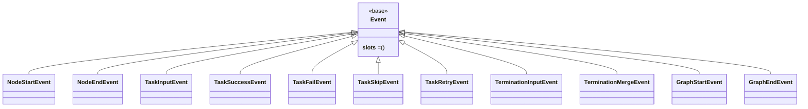

# src/celestialflow/observer/core_event.py

> 📅 Last Updated: 2026/11/13

`core_event.py` defines **all event types** in the observer system. They serve as the input parameters of `Observer.on_event()`, describing the various changes of the task / node / task graph lifecycle. All events inherit from the unified base class `Event` and are read-only `dataclass`es with `frozen=True, slots=True`.

## Class Hierarchy



`Event` provides only a type marker, using `__slots__ = ()` and carrying no state; each concrete event is itself a `slots` data class, so inheriting it brings no additional `__dict__` overhead.

## Event Overview

| Event | Fields | Trigger Timing |
|------|------|----------|
| `NodeStartEvent` | `node`, `execution_mode`, `max_workers`, `start_time` | Node starts |
| `NodeEndEvent` | `node`, `execution_mode`, `max_workers`, `elapsed`, `end_time` | Node ends |
| `TaskInputEvent` | `node`, `task`, `task_repr`, `input_id`, `from_node` | A task enters the node's input queue |
| `TaskSuccessEvent` | `node`, `task`, `task_repr`, `result`, `result_repr`, `elapsed`, `task_id`, `success_id` | A task is processed successfully |
| `TaskFailEvent` | `node`, `task`, `task_repr`, `exception`, `task_id`, `error_id` | A task finally fails |
| `TaskSkipEvent` | `node`, `task`, `task_repr`, `task_id`, `skip_id` | A task is skipped |
| `TaskRetryEvent` | `node`, `task`, `task_repr`, `exception`, `task_id`, `retry_times` | A task fails but triggers a retry |
| `TerminationInputEvent` | `node`, `termination_id` | A termination signal enters the input queue |
| `TerminationMergeEvent` | `node`, `parent_ids`, `termination_id` | Multiple termination signals are merged |
| `GraphStartEvent` | `graph`, `graph_mode`, `start_time`, `is_dag`, `nodes`, `edges`, `source_nodes`, `node_meta` | Task graph starts |
| `GraphEndEvent` | `graph`, `end_time`, `elapsed` | Task graph ends |

`TaskInputEvent.from_node` is the only field with a default value (`None`); all other fields are required.

## Field Descriptions

### Common Fields

- `node`: node name, identifying the node to which the event belongs.
- `task`: the raw task data (`Any`); `task_repr` is its readable string representation.

### Event ID Fields

- `input_id`: the current input event ID.
- `task_id`: the task input event ID (corresponding to `TaskInputEvent.input_id`).
- `success_id` / `error_id` / `skip_id`: the event IDs of the success / error / skip events respectively.
- `termination_id`: the termination-signal event ID.
- `parent_ids`: the list of termination-signal event IDs participating in the merge (`list[int]`).

### Task Source

- `from_node`: the upstream source node name; `None` indicates external direct injection. This field is the basis on which `MetricsObserver` distinguishes external injection from upstream delivery, and `LogObserver` also uses it to decide the source text in logs (`"external"`).

### Lifecycle Timestamps

- `start_time`: the wall-clock time (seconds) when the node / task graph starts, carried by `NodeStartEvent` / `GraphStartEvent`.
- `end_time`: the wall-clock time (seconds) when the node / task graph ends, carried by `NodeEndEvent` / `GraphEndEvent`.
- `elapsed`: the running duration (seconds) of the node / task graph / a single task.

Timestamps are written once when the event is constructed; downstream observers (such as `MetricsObserver`) read the event fields directly instead of sampling `time.time()` themselves.

### Graph Metadata (`GraphStartEvent`)

- `graph`: the task graph name.
- `graph_mode`: the task graph run mode.
- `start_time`: the task graph start time.
- `is_dag`: whether it is a DAG task graph.
- `nodes`: the task graph node name list.
- `edges`: the task graph edge adjacency list (`{from_name: [to_name, ...]}`).
- `source_nodes`: the source node name list.
- `node_meta`: build-time metadata of each node.

`GraphStartEvent`'s `nodes` / `edges` / `source_nodes` are handed by `LogObserver` to `persist.util_render.render_structure_list` to be rendered as tree text and written to the log.

## Definition Example

```python
from dataclasses import dataclass
from typing import Any


class Event:
    """Base class of all observed events."""

    __slots__ = ()


@dataclass(frozen=True, slots=True)
class TaskSuccessEvent(Event):
    node: str
    task: Any
    task_repr: str
    result: Any
    result_repr: str
    elapsed: float
    task_id: int
    success_id: int
```

All concrete events use `frozen=True, slots=True`, i.e. they are immutable (fields cannot be changed after construction, and are hashable) and save memory via `__slots__`.

## Usage Example

```python
from celestialflow.observer import (
    Event,
    Observer,
    ObserverHub,
    TaskFailEvent,
    TaskSuccessEvent,
)


class MyObserver(Observer):
    def on_event(self, event: Event) -> None:
        match event:
            case TaskSuccessEvent():
                print(f"{event.node} succeeded: {event.result_repr}")
            case TaskFailEvent():
                print(f"{event.node} failed: {event.exception}")
            case _:
                pass


hub = ObserverHub()
hub.add_observer(MyObserver())
```

## Notes

1. **Read-only events**: events are all immutable `dataclass`es; observers should not modify the internal fields of an event.
2. **Constructed by the framework**: events are constructed by nodes / task graphs at the corresponding timing and `hub.on_event(...)` is called to broadcast them; they generally do not need to be constructed manually (in tests they can be constructed and delivered to observers directly).
3. **Unified base class**: All events inherit from `Event`, so an observer can write just one `def on_event(self, event: Event)` entry point and then dispatch by concrete type.
