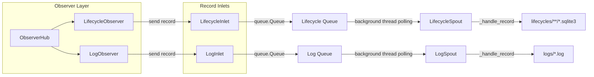

# src/celestialflow/persist/__init__.py

> 📅 Last Updated: 2026/11/13

The `persist` module is CelestialFlow's **persistence module**, providing the recording, writing, and querying of task Lifecycle and runtime Logs.

The module uses a three-layer "**observer + inlet + listener**" structure:

- `LifecycleObserver` / `LogObserver` are `Observer` subclasses that consume observed events and translate them into records, and are also responsible for starting/stopping spouts and exposing paths;
- `LifecycleInlet` / `LogInlet` inherit only from `BaseInlet`, providing `send(record)` to put records into the queue of a bound spout;
- `LifecycleSpout` / `LogSpout` take records from the queues in background threads and persist them to disk.

## Exported Symbols

The module-level `__all__` exports the following in full:

```python
__all__ = [
    "InsertRecord",
    "LifecycleInlet",
    "LifecycleObserver",
    "LifecycleRecord",
    "LifecycleSpout",
    "LogInlet",
    "LogObserver",
    "LogRecord",
    "LogSpout",
    "PromoteFailedRecord",
    "PromoteSkippedRecord",
    "PromoteSuccessRecord",
    "UpdateRetryRecord",
]
```

| Exported Symbol | Source Module | Description |
|---------|---------|------|
| `LifecycleObserver` | `core_lifecycle` | Lifecycle observer (facade) that translates events into lifecycle records, manages spout start/stop, and exposes `db_path` |
| `LifecycleInlet` | `core_lifecycle` | Lifecycle record inlet; `send(record)` delivers to the bound spout |
| `LifecycleSpout` | `core_lifecycle` | Lifecycle listener that writes records to SQLite in a background thread |
| `LifecycleRecord` | `core_lifecycle` | Union type of lifecycle records (a `type` alias for the five kinds such as `InsertRecord`) |
| `InsertRecord` | `core_lifecycle` | The pending record written when a new task enters a node |
| `PromoteSuccessRecord` | `core_lifecycle` | Promote a pending record to `success` and write the result |
| `PromoteFailedRecord` | `core_lifecycle` | Promote a pending record to `failed` |
| `PromoteSkippedRecord` | `core_lifecycle` | Promote a pending record to `skipped` |
| `UpdateRetryRecord` | `core_lifecycle` | Update a pending record's retry count and latest error |
| `LogObserver` | `core_log` | Log observer (facade) that translates events into log records, manages spout start/stop, and exposes `log_path` |
| `LogInlet` | `core_log` | Log record inlet; `send(record)` delivers to the bound spout |
| `LogSpout` | `core_log` | Log listener that writes logs to text files under the `logs/` directory |
| `LogRecord` | `core_log` | A single log record (`timestamp` / `level` / `message`) |

> The module `__init__` only exports symbols from `core_*` files; the utility functions `util_payload` / `util_sqlite` / `util_render` are not exported here and must be imported from the corresponding modules as needed.

## File Descriptions

1. **core_lifecycle.py** (`LifecycleObserver` / `LifecycleInlet` / `LifecycleSpout` / record types)
   - **Purpose**: Persistence of task lifecycle, uniformly recording the task's pending / success / failed / skipped states and retry information.
   - **Write method**: `LifecycleObserver.on_event()` constructs a `LifecycleRecord` dataclass according to the event type and enqueues it via `LifecycleInlet.send()`; `LifecycleSpout._handle_record()` executes the corresponding SQLite write operation according to the record type.
   - **Storage format**: SQLite database (WAL mode), files located under the `lifecycles/` directory.

2. **core_log.py** (`LogObserver` / `LogInlet` / `LogSpout` / `LogRecord`)
   - **Purpose**: Runtime log collection and persistence.
   - **Write method**: `LogObserver.on_event()` handles graph / node / task / termination-signal events and generates `LogRecord`s, writes node summaries based on `metrics_view`, and then enqueues them via `LogInlet.send()`; `LogSpout` writes logs to text files under the `logs/` directory.
   - **Log format**: Each line contains `timestamp level message`.

3. **util_payload.py**
   - **Purpose**: Recursively converts task data into JSON-friendly persisted structures.
   - **Key function**: `to_persisted_payload(task)` — passes through basic types, recursively converts containers, and degrades other types to `str()`.

4. **util_sqlite.py**
   - **Purpose**: SQLite database connection management and record CRUD operation utilities.
   - **Key functions**: `connect_db`, `normalize_record`, `row_to_record_dict`, `insert_record`, `promote_record_to_{success,skipped,failed}_by_event_id`, `update_retry_by_event_id`, `delete_record_by_event_id`, `load_tasks_grouped_by_node`, `load_task_{error,result}_records`. Write-side functions reuse the `conn` passed in by the caller; read-side functions establish and close their own connections.

5. **util_render.py**
   - **Purpose**: Graph structure rendering utility, rendering nodes / edges / source nodes into framed, tree-shaped text.
   - **Key function**: `render_structure_list(nodes, edges, source_nodes)`.

## Module Relationships

### Internal Relationships
- `LifecycleObserver` / `LogObserver` inherit from `observer.Observer`, each internally creating and binding an inlet and a spout, and putting records into the spout queue.
- `LifecycleInlet` / `LogInlet` inherit only from `funnel.BaseInlet` and provide only `send(record)`; they no longer consume events directly.
- `LifecycleSpout` / `LogSpout` inherit from `funnel.BaseSpout`, consuming the queue and persisting to disk.

### External Relationships
- **With the Observer module**: `LifecycleObserver` / `LogObserver` are `Observer` subclasses, registered into `ObserverHub` and started/stopped uniformly by `run_graph_resources` / `run_node_resources` (`assembly/core_run.py`).
- **With the Node module**: `BaseTaskNode.get_success_pairs()` / `get_error_pairs()` obtain `db_path` via `observers.find(LifecycleObserver)` before reading records, so they work both when running independently and under graph scheduling.
- **With the Runtime module**: `LogObserver` references `runtime.util_constant.LEVEL_DICT` for level filtering and `runtime.util_types.MetricsView` to read node summaries.
- **With the Funnel module**: Reuses the `BaseInlet` / `BaseSpout` base classes to implement thread-safe queues and consuming threads.

## Architecture Features

### Producer-Consumer Pattern



### File Naming Convention

| Persistence Type | File Path Pattern |
|-----------|-------------|
| Log | `logs/flow_log({date}).log` |
| Lifecycle | `./lifecycles/{date}/flow_lifecycle({time}).sqlite3` |

### Batch Refresh Strategy

- Log files are written with **line buffering** (`buffering=1`), so readers can see newly appended logs in a timely manner.
- Lifecycle SQLite writes use **immediate commit**: `LifecycleSpout._handle_record()` calls `commit()` immediately after a record actually changes, with `_after_stop()` performing one more `commit()` as a safety net.
- Global spouts do not start/stop with individual executors; instead they are started and stopped uniformly by `run_graph_resources` / `run_node_resources` for the entire runtime, avoiding frequent file handle opens/closes.

## Usage Example

### Assembling onto an Observer Hub (Recommended)

```python
from celestialflow.observer import MetricsObserver, ObserverHub
from celestialflow.persist import LifecycleObserver, LogObserver

metrics_view = MetricsObserver()
hub = ObserverHub()
hub.add_observer(metrics_view)

lifecycle = LifecycleObserver()
log = LogObserver(metrics_view, log_level="INFO")
hub.add_observer(lifecycle)
hub.add_observer(log)

lifecycle.start()
log.start()
try:
    # ... run the task graph or a single node ...
    print(lifecycle.db_path, log.log_path)
finally:
    log.stop()
    lifecycle.stop()
```

### Using Only the Record Inlets

```python
from celestialflow.persist import InsertRecord, LifecycleInlet, LifecycleSpout

spout = LifecycleSpout()
spout.start()
inlet = LifecycleInlet().bind_spout(spout)

inlet.send(InsertRecord(event_id=1, ts=0.0, node="StageA", task="hello"))

spout.stop()
```

## Notes

1. **Event consumption happens at the observer layer**: `LifecycleInlet` / `LogInlet` no longer consume events; they only provide `send(record)`. Translating events into records is the responsibility of `LifecycleObserver` / `LogObserver`.
2. **Constructor parameters**: `LogObserver` requires `metrics_view` (`MetricsView`) and an optional `log_level` (default `runtime.util_log_level.DEFAULT_LOG_LEVEL`) at construction time.
3. **Path exposure**: `LifecycleObserver.db_path` / `LogObserver.log_path` are `None` before the spout starts.
4. **`__all__` only contains core symbols**: utility functions are located in `util_*` files and must be imported from `celestialflow.persist.util_xxx` as needed.
