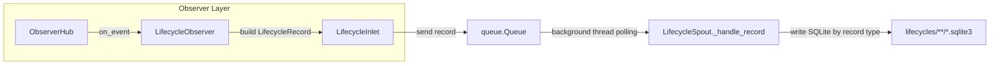

# src/celestialflow/persist/core_lifecycle.py

> 📅 Last Updated: 2026/11/13

`persist/core_lifecycle.py` is responsible for task Lifecycle persistence: it records the state transitions of a task throughout its lifecycle (pending → success / failed / skipped, as well as retry count updates), and writes the data into SQLite database files under the `lifecycles/` directory.

The core components are the record types `InsertRecord` / `PromoteSuccessRecord` / `PromoteFailedRecord` / `UpdateRetryRecord` / `PromoteSkippedRecord`, the listener `LifecycleSpout`, the inlet `LifecycleInlet`, and the observer facade `LifecycleObserver`.

## Architecture Design

### Data Flow



The system uses a **Producer-Consumer** pattern:

1. **LifecycleObserver (observer + translator)**: inherits `Observer`, translates observed events into the corresponding record dataclasses in `on_event()` and puts them into a thread-safe queue via `LifecycleInlet.send()`; it is also responsible for the spout's `start()` / `stop()` and exposes `db_path`.
2. **LifecycleInlet (record inlet)**: inherits only `BaseInlet`, provides a typed `send(record)`, and does not consume events directly or operate on the database.
3. **LifecycleSpout (consumer)**: inherits `BaseSpout`, runs in an independent background thread, and executes the corresponding SQLite write operation according to the concrete record type.

## Record Types

All records are read-only `dataclass`es with `frozen=True, slots=True`, and can be dispatched by type using `match`.

### InsertRecord

The pending record written when a new task enters a node.

| Field | Type | Description |
|------|------|------|
| `event_id` | `int` | Task input event ID (`TaskInputEvent.input_id`) |
| `ts` | `float` | Record timestamp |
| `node` | `str` | Node name |
| `task` | `Any` | The JSON-friendly payload of the task (already processed by `to_persisted_payload`) |

### PromoteSuccessRecord

Promotes a pending record to success and writes the task result.

| Field | Type | Description |
|------|------|------|
| `event_id` | `int` | Task input event ID (`TaskSuccessEvent.task_id`) |
| `ts` | `float` | Record timestamp |
| `result` | `Any` | The JSON-friendly payload of the task result |

### PromoteFailedRecord

Promotes a pending record to failed.

| Field | Type | Description |
|------|------|------|
| `event_id` | `int` | Task input event ID (`TaskFailEvent.task_id`) |
| `error_id` | `int` | Final failure event ID (`TaskFailEvent.error_id`) |
| `ts` | `float` | Record timestamp |
| `error_type` | `str` | Exception type name (`type(exception).__name__`) |
| `error_message` | `str` | Exception message (`str(exception)`) |

### UpdateRetryRecord

Updates a pending record's retry count and latest failure information.

| Field | Type | Description |
|------|------|------|
| `event_id` | `int` | Task input event ID (`TaskRetryEvent.task_id`) |
| `ts` | `float` | Record timestamp |
| `retry_times` | `int` | Number of retries so far (`TaskRetryEvent.retry_times`) |
| `error_type` | `str` | Latest exception type name |
| `error_message` | `str` | Latest exception message |

### PromoteSkippedRecord

Promotes a pending record to skipped.

| Field | Type | Description |
|------|------|------|
| `event_id` | `int` | Task input event ID (`TaskSkipEvent.task_id`) |
| `skip_id` | `int` | Skip event ID (`TaskSkipEvent.skip_id`) |
| `ts` | `float` | Record timestamp |

### LifecycleRecord

```python
type LifecycleRecord = (
    InsertRecord
    | PromoteSuccessRecord
    | PromoteFailedRecord
    | UpdateRetryRecord
    | PromoteSkippedRecord
)
```

Both `LifecycleInlet.send()` and `LifecycleSpout._handle_record()` accept this union type, and `match` decides the write semantics according to the concrete type.

## LifecycleSpout

`LifecycleSpout` inherits `BaseSpout` and is responsible for managing the creation and writing of the SQLite database file.

### Initialization and Startup

```python
class LifecycleSpout(BaseSpout):
    def __init__(self) -> None:
        """Initialize the lifecycle record listener."""
        super().__init__()

        self.db_path: Path | None = None
        self._conn: sqlite3.Connection | None = None
```

After startup (`_before_start()`), a `flow_lifecycle({time}).sqlite3` file is created under the `./lifecycles/{date}/` directory and a sqlite connection is established. The time part is taken from `%H-%M-%S-%f` and truncated to milliseconds, avoiding multiple runs within the same second overwriting each other.

```python
from celestialflow.persist import LifecycleSpout

lifecycle_spout = LifecycleSpout()
lifecycle_spout.start()
print(lifecycle_spout.db_path)  # ./lifecycles/2026-11-13/flow_lifecycle(....).sqlite3
lifecycle_spout.stop()
```

`_after_stop()` calls `commit()` first and then closes the connection, ensuring remaining transactions are flushed to disk.

### _handle_record Record Types

`LifecycleSpout._handle_record(record: LifecycleRecord)` executes different operations based on the record type:

| Record | Underlying Call | Description |
|------|---------|------|
| `InsertRecord` | `insert_record` | A new task enters a node; writes a `pending` record (`task_json` is the payload) |
| `PromoteSuccessRecord` | `promote_record_to_success_by_event_id` | Promotes the pending record to `success`; writes the result JSON and clears the error fields |
| `PromoteFailedRecord` | `promote_record_to_failed_by_event_id` | Promotes the pending record to `failed`; switches to `error_id` and writes the error type and message |
| `UpdateRetryRecord` | `update_retry_by_event_id` | Keeps the pending state, only updates `retry_times` and the error type / message of the most recent failure |
| `PromoteSkippedRecord` | `promote_record_to_skipped_by_event_id` | Promotes the pending record to `skipped`; switches to `skip_id` and clears the error fields |

Records of other types do not hit any branch, `changed` stays `False`, and therefore no write occurs.

Write semantics:

- If the connection is not initialized (`_conn is None`), raise `InitializationError`;
- Each underlying write function returns a `bool` indicating "whether the record was actually changed"; `commit()` is called only when `changed` is `True`.

### File Path

Lifecycle data is saved under `./lifecycles/` by default, archived by date:

```text
./lifecycles/
└── 2026-11-13/
    └── flow_lifecycle(14-30-05-123).sqlite3
```

## LifecycleInlet

```python
class LifecycleInlet(BaseInlet):
    def send(self, record: LifecycleRecord) -> None: ...
```

- It inherits only `BaseInlet` and is **no longer an `Observer`**, so it does not consume events;
- `send()` delegates to `BaseInlet.send()`, putting the record into the queue of the bound spout;
- Calling `send()` without a bound spout causes `BaseInlet` to raise `InitializationError`;
- `bind_spout(spout)` comes from `BaseInlet` and returns `self` to support chained calls.

```python
lifecycle_inlet = LifecycleInlet().bind_spout(lifecycle_spout)
```

## LifecycleObserver

```python
class LifecycleObserver(Observer):
    def __init__(self) -> None: ...

    @property
    def db_path(self) -> Path | None: ...
    def start(self) -> None: ...
    def stop(self) -> None: ...
    def on_event(self, event: Event) -> None: ...
```

- `__init__` internally creates a `LifecycleSpout` and constructs `LifecycleInlet().bind_spout(spout)`;
- `db_path` passes through the spout's database path; it is `None` before the spout starts;
- `start()` / `stop()` start / stop the spout's background write loop respectively;
- `on_event()` generates records according to the event type; events it does not care about fall into `case _: pass` and are ignored.

### Mapping from Events to Records

| Event | Generated Record | Field Sources |
|------|-----------|---------|
| `TaskInputEvent` | `InsertRecord` | `event_id=event.input_id`, `node=event.node`, `task=to_persisted_payload(event.task)` |
| `TaskSuccessEvent` | `PromoteSuccessRecord` | `event_id=event.task_id`, `result=to_persisted_payload(event.result)` |
| `TaskFailEvent` | `PromoteFailedRecord` | `event_id=event.task_id`, `error_id=event.error_id`, `error_type=type(event.exception).__name__`, `error_message=str(event.exception)` |
| `TaskSkipEvent` | `PromoteSkippedRecord` | `event_id=event.task_id`, `skip_id=event.skip_id` |
| `TaskRetryEvent` | `UpdateRetryRecord` | `event_id=event.task_id`, `retry_times=event.retry_times`, latest error type / message |

Notes:

- The `ts` of every record is `datetime.now().timestamp()` at record construction time;
- Only `TaskInputEvent` / `TaskSuccessEvent` / `TaskFailEvent` / `TaskSkipEvent` / `TaskRetryEvent` produce records; node / graph / termination-signal events are ignored;
- Retry records keep the `pending` state and are ultimately promoted by success / failure / skip records;
- `LifecycleObserver` only writes to the queue and does not operate on the database directly; all I/O is performed in the background thread of `LifecycleSpout`.

## Usage Example

### Through the Observer Facade (Recommended)

```python
from celestialflow.observer import TaskInputEvent, TaskSuccessEvent
from celestialflow.persist import LifecycleObserver

observer = LifecycleObserver()
observer.start()
try:
    observer.on_event(
        TaskInputEvent(node="StageA", task="hello", task_repr="'hello'", input_id=1)
    )
    observer.on_event(
        TaskSuccessEvent(
            node="StageA",
            task="hello",
            task_repr="'hello'",
            result="HELLO",
            result_repr="'HELLO'",
            elapsed=0.01,
            task_id=1,
            success_id=2,
        )
    )
finally:
    observer.stop()

print(observer.db_path)  # ./lifecycles/2026-11-13/flow_lifecycle(...).sqlite3
```

In actual usage, `LifecycleObserver` is registered into the hub and started/stopped uniformly by `run_graph_resources` / `run_node_resources` in `assembly/core_run.py`, and produces `db_path` when the context is entered.

### Delivering Records Manually

```python
from celestialflow.persist import InsertRecord, LifecycleInlet, LifecycleSpout

spout = LifecycleSpout()
spout.start()
inlet = LifecycleInlet().bind_spout(spout)

inlet.send(InsertRecord(event_id=1, ts=0.0, node="StageA", task={"x": 1}))

spout.stop()
```

To read persisted records, use the read functions of `util_sqlite`: `load_tasks_grouped_by_node` (read records of the given statuses grouped by node), `load_task_error_records` (read the `(task, (error_type, error_message))` pairs of a node), and `load_task_result_records` (read the `(task, result)` pairs of a node).

## Notes

1. **SQLite storage**: uses WAL mode + `check_same_thread=False`, supporting cross-thread read/write (see `util_sqlite.connect_db`).
2. **Commit on demand**: `commit()` only happens after the underlying write operation actually modifies a record; `_after_stop()` performs one more fallback commit.
3. **Inlet only writes the queue**: `LifecycleInlet` does not directly operate on the database, nor does it consume events; all I/O is performed in the background thread of `LifecycleSpout`.
4. **Observer and inlet are now split**: in historical versions `LifecycleInlet` was also an `Observer` and overrode `on_task_*`; now event consumption is uniformly done by `LifecycleObserver.on_event()`, and `LifecycleInlet` only keeps `send(record)`.
5. **Cross-package imports**: `Event` / `Observer` / the various `*Event` classes are imported uniformly through the package-level `from ..observer import (...)` statement, following the cross-package import rule for `core_*`.
