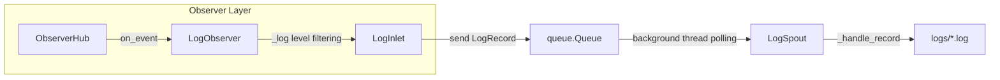

# src/celestialflow/persist/core_log.py

> 📅 Last Updated: 2026/11/13

`persist/core_log.py` provides a thread-safe logging system that, via a producer-consumer pattern, uniformly collects, formats, and persists logs to text files under the `logs/` directory.

The core components are the record type `LogRecord`, the listener `LogSpout`, the inlet `LogInlet`, and the observer facade `LogObserver`.

## Architecture Design

### Data Flow



### Log Level Filtering

`LogObserver._log()` performs two-stage filtering before writing to the queue:

1. The level must be a known key in `LEVEL_DICT` (otherwise it returns immediately);
2. The level's numeric value must not be lower than the `log_level` threshold (otherwise it is dropped).

### Observer and Inlet Split

`LogObserver` inherits `Observer` and wires the logging system into the event bus:

1. **LogObserver (observer + translator)**:
   - Generates logs by event type in `on_event()` (graph / node / task / termination signal);
   - When recording node start/stop, reads node summaries through `metrics_view` (input totals, success / failure / skip counts);
   - Is responsible for the spout's `start()` / `stop()` and exposes `log_path`.

2. **LogInlet (record inlet)**:
   - Inherits only `BaseInlet`, provides a typed `send(record)`, and does not consume events or write files.

3. **LogSpout (consumer)**:
   - Inherits `BaseSpout`, runs in an independent background thread;
   - Takes `LogRecord`s from the queue and formats each as one line written to the file.

## Log Levels

The system supports the following standard log levels (higher value = higher priority, see `runtime.util_constant.LEVEL_DICT`):

| Level | Value | Description |
|------|----|------|
| TRACE | 0 | Most detailed trace information, such as termination signal merging |
| DEBUG | 10 | Debug information, such as task input, termination signal input |
| SUCCESS | 20 | Key operation successes, such as task completion |
| INFO | 30 | General information, such as node / graph start-stop, graph structure printing |
| WARNING | 40 | Warnings, such as task retry |
| ERROR | 50 | Error information, such as task failure |
| CRITICAL | 60 | Critical errors (currently unused by the built-in event handling) |

## LogRecord

```python
@dataclass(frozen=True, slots=True)
class LogRecord:
    timestamp: str
    level: str
    message: str
```

| Field | Description |
|------|------|
| `timestamp` | Formatted timestamp (`%Y-%m-%d %H:%M:%S`) |
| `level` | The uppercased log level |
| `message` | The log message |

## LogSpout

`LogSpout` inherits `BaseSpout` and is responsible for log file configuration and write thread management.

### Initialization and Startup

```python
from celestialflow.persist import LogSpout

spout = LogSpout()
spout.start()
print(spout.log_path)  # logs/flow_log(2026-11-13).log
spout.stop()
```

- `log_path` is `None` before `start()`;
- After startup, logs are written to `logs/flow_log({date}).log`, opened in append mode (`"a"`) with UTF-8;
- Line buffering is used (`buffering=1`), so readers can see newly appended logs in a timely manner;
- `_handle_record()` assembles the record into `"{timestamp} {level} {message}\n"` and writes it to the file; if the file handle is not initialized, it raises `InitializationError`;
- `_after_stop()` closes the file handle.

### File Path

```text
logs/
└── flow_log(2026-11-13).log
```

## LogInlet

```python
class LogInlet(BaseInlet):
    def send(self, record: LogRecord) -> None: ...
```

- It inherits only `BaseInlet` and is **no longer an `Observer`**, so it does not consume events;
- `send()` delegates to `BaseInlet.send()` to put the record into the queue of the bound spout; raises `InitializationError` when no spout is bound;
- Bind via `bind_spout(spout)`, which returns `self` to support chained calls.

```python
log_inlet = LogInlet().bind_spout(log_spout)
```

## LogObserver

```python
class LogObserver(Observer):
    def __init__(
        self,
        metrics_view: MetricsView,
        log_level: str = DEFAULT_LOG_LEVEL,
    ) -> None: ...

    @property
    def log_path(self) -> Path | None: ...
    def start(self) -> None: ...
    def stop(self) -> None: ...
    def on_event(self, event: Event) -> None: ...
```

### Constructor Parameters

| Parameter | Type | Description |
|------|------|------|
| `metrics_view` | `MetricsView` | **Required**; metric read-only view, used to record node summaries at node start/stop |
| `log_level` | `str` | Minimum log level, default `runtime.util_log_level.DEFAULT_LOG_LEVEL` (`"INFO"`); the passed value is only `upper()`-cased, and an invalid level raises `InvalidOptionError` |

`__init__` creates a `LogSpout` and `LogInlet().bind_spout(spout)`. `log_level` is not `strip()`-ed; if normalization is needed, call `normalize_log_level()` at the assembly entry.

### Event Handling and Log Levels

`on_event()` dispatches by event type; events it does not care about fall into `case _: pass`:

#### Task Graph (Graph)

| Event | Log Level | Description |
|------|---------|------|
| `GraphStartEvent` | INFO | Records task graph startup and structure information (rendered via `util_render`, written line by line) |
| `GraphEndEvent` | INFO | Records task graph completion and elapsed time (`Use {elapsed:.2f}s.`) |

#### Node (Node)

| Event | Log Level | Description |
|------|---------|------|
| `NodeStartEvent` | INFO | Records node startup, reads the input task count from `metrics_view`, and outputs the execution mode and concurrency |
| `NodeEndEvent` | INFO | Records node completion, and outputs success / failure / skip statistics and elapsed time from `metrics_view` |

#### Task (Task)

| Event | Log Level | Description |
|------|---------|------|
| `TaskInputEvent` | DEBUG | Records a task entering the input queue and its source (`from_node` is written as `external` when it is `None`) |
| `TaskSuccessEvent` | SUCCESS | Records a successful task completion together with the result and elapsed time |
| `TaskSkipEvent` | SUCCESS | Records a task being skipped |
| `TaskRetryEvent` | WARNING | Records a task that failed but triggered a retry (including the retry count so far) |
| `TaskFailEvent` | ERROR | Records a task that failed and cannot be retried (newlines in the exception message are replaced with spaces) |

#### Termination Signal (Termination)

| Event | Log Level | Description |
|------|---------|------|
| `TerminationInputEvent` | DEBUG | Records termination signal input |
| `TerminationMergeEvent` | TRACE | Records termination signal merge (including the parent ID list) |

> Tasks and results in logs use the events' own `task_repr` / `result_repr`; event IDs are appended at the end in the form `[task_id->success_id*]`, making it easy to correlate them with ctree events.

## Usage Example

### Through the Observer Facade (Recommended)

```python
from celestialflow.observer import MetricsObserver, NodeStartEvent
from celestialflow.persist import LogObserver

metrics_view = MetricsObserver()
log = LogObserver(metrics_view, log_level="DEBUG")
log.start()
try:
    log.on_event(NodeStartEvent(node="NodeA", execution_mode="thread", max_workers=4, start_time=1.0))
finally:
    log.stop()

print(log.log_path)  # logs/flow_log(2026-11-13).log
```

In actual usage, `LogObserver` is registered into the hub and started/stopped uniformly by `run_graph_resources` / `run_node_resources` in `assembly/core_run.py`.

### Delivering Records Manually

```python
from celestialflow.persist import LogInlet, LogRecord, LogSpout

spout = LogSpout()
spout.start()
inlet = LogInlet().bind_spout(spout)

inlet.send(LogRecord(timestamp="2026-11-13 10:00:00", level="INFO", message="hello"))

spout.stop()
```

Recording logs through events (rather than generic `info()` / `debug()`) ensures the generated logs are structured, readable, and easy to parse by machines.

## Notes

1. **The constructor requires `metrics_view`**: `LogObserver(metrics_view, log_level)` must be passed a metric read-only view, used for the summary output at node start/stop.
2. **Event consumption happens at the observer layer**: `LogInlet` only provides `send(record)`; the per-event callbacks such as `on_graph_*` / `on_node_*` / `on_task_*` no longer exist, and all logic is concentrated in `LogObserver.on_event()`.
3. **`log_level` is only uppercased**: it is not `strip()`-ed at construction; if you need to ignore case and leading/trailing whitespace, call `normalize_log_level()` first.
4. **Line-buffered writes**: the log file is opened with `buffering=1`, so writes are immediately visible.
