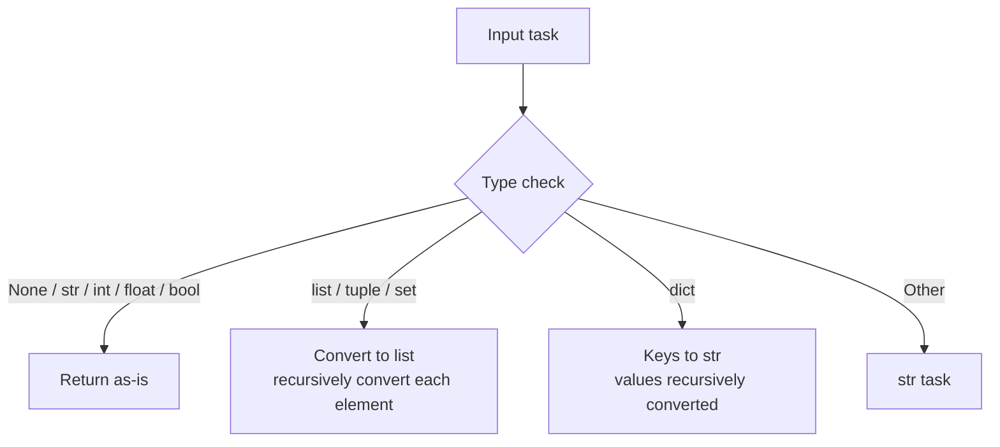

# src/celestialflow/persist/util_payload.py

> 📅 Last Updated: 2026/11/13

`persist/util_payload.py` provides a persistence serialization utility for task data, recursively converting arbitrary Python objects into JSON-friendly structures.

## Core Function

### to_persisted_payload

```python
def to_persisted_payload(task: Any) -> Any:
    """
    Convert a task into a JSON-friendly persistable structure.

    :param task: Task data to be serialized
    :return: A JSON-friendly persistable structure
    """
```

**Conversion Rules:**

| Input Type | Output | Description |
|---------|------|------|
| `None` / `str` / `int` / `float` / `bool` | Returned as-is | Already JSON-native types |
| `list` / `tuple` / `set` | `list` | Recursively convert each element |
| `dict` | `dict` | Keys converted to `str`, values recursively converted |
| Other types | `str(task)` | Converted to string representation |



## Usage Examples

### Primitive Types Pass Through Directly

```python
from celestialflow.persist.util_payload import to_persisted_payload

print(to_persisted_payload(42))  # 42
print(to_persisted_payload("hello"))  # "hello"
print(to_persisted_payload(True))  # True
print(to_persisted_payload(None))  # None
```

### Compound Types Recursively Converted

```python
from celestialflow.persist.util_payload import to_persisted_payload

# List
result = to_persisted_payload([1, "a", True])
print(result)  # [1, 'a', True]

# Nested dict
result = to_persisted_payload({"score": 95, "tags": ["a", "b"]})
print(result)  # {'score': 95, 'tags': ['a', 'b']}


# Custom object
class MyTask:
    def __str__(self):
        return "MyTask(id=1)"


result = to_persisted_payload(MyTask())
print(result)  # "MyTask(id=1)"
```

### Usage in LifecycleObserver

`to_persisted_payload` is called automatically by `LifecycleObserver.on_event()`: when handling `TaskInputEvent` it fills `InsertRecord.task` with `to_persisted_payload(event.task)`, and when handling `TaskSuccessEvent` it fills `PromoteSuccessRecord.result` with `to_persisted_payload(event.result)`. The task and result therefore end up in SQLite in a JSON-friendly form.

```python
from celestialflow.persist.util_payload import to_persisted_payload

payload = to_persisted_payload({"x": 1, "obj": object()})
print(payload["x"])  # 1
print(type(payload["obj"]))  # <class 'str'>
```

> Normal usage requires no manual call: just register `LifecycleObserver` on the `ObserverHub`, or deliver events directly to its `on_event()`.

## Notes

- The serialization strategy is **best-effort**: for objects that cannot be directly JSON-serialized, it falls back to `str()` string representation.
- The conversion result is finally written by `LifecycleSpout` via the `util_sqlite` layer as `json.dumps` into the SQLite `task_json` / `result_json` fields.
- This module is only responsible for data format conversion; it does not involve any file I/O.
- The conversion result may itself still be a nested structure; `dict` keys are uniformly converted to `str`, and the order of `set` is not guaranteed.