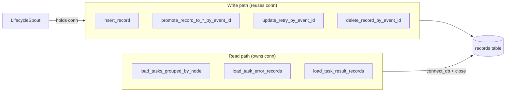

# src/celestialflow/persist/util_sqlite.py

> 📅 Last Updated: 2026/10/30

`persist/util_sqlite.py` provides SQLite database connection management and record read/write utilities, serving as the underlying storage engine for `LifecycleSpout`.

Functions are divided into two categories by **ownership of the connection lifecycle**:

- **Write operations that reuse the caller's connection**: they explicitly receive a `sqlite3.Connection`, and the caller (`LifecycleSpout`) is responsible for opening / `commit()` / closing it;
- **Read operations that own their connection**: they call `connect_db()` internally and `close()` in a `finally` block.

The two conversion utilities (`normalize_record` / `row_to_record_dict`) do not touch connections.

## Core Function Overview

| Function | Signature Highlights | Description |
|------|---------|------|
| `connect_db` | `(db_path) -> Connection` | Create a connection, configure PRAGMAs, and ensure the table structure and indexes |
| `normalize_record` | `(record) -> dict \| None` | Normalize into a sqlite-writable parameter dictionary; returns `None` when `event_id` is missing |
| `row_to_record_dict` | `(row) -> dict` | Restore a `sqlite3.Row` into an outward-facing record dictionary |
| `insert_record` | `(conn, record) -> bool` | Insert a pending record |
| `promote_record_to_success_by_event_id` | `(conn, event_id, result, *, ts) -> bool` | Promote to `success` and write the result |
| `promote_record_to_failed_by_event_id` | `(conn, event_id, new_event_id, *, ts, error_type="", error_message="") -> bool` | Promote to `failed` and switch to the error event ID |
| `promote_record_to_skipped_by_event_id` | `(conn, event_id, new_event_id, *, ts) -> bool` | Promote to `skipped` and switch to the skipped event ID |
| `update_retry_by_event_id` | `(conn, event_id, *, ts, retry_times, error_type="", error_message="") -> bool` | Keep pending, update the retry count and the most recent error |
| `delete_record_by_event_id` | `(conn, event_id) -> bool` | Delete a record by `event_id` |
| `load_tasks_grouped_by_node` | `(db_path, statuses=("failed", "pending")) -> dict[str, list[dict]]` | Read records of the given statuses grouped by node |
| `load_task_error_records` | `(db_path, node) -> list[tuple[task, (error_type, error_message)]]` | Read the failed tasks and errors of a node as pairs |
| `load_task_result_records` | `(db_path, node) -> list[tuple[task, result]]` | Read the successful tasks and results of a node as pairs |

> The private helper `_ensure_table(conn)` is only called by `connect_db` and is not exposed.



## Database Table Structure

```sql
CREATE TABLE IF NOT EXISTS records (
    id INTEGER PRIMARY KEY AUTOINCREMENT,
    event_id INTEGER NOT NULL,
    ts REAL,
    node TEXT NOT NULL,
    status TEXT NOT NULL,
    error_type TEXT NOT NULL DEFAULT '',
    error_message TEXT NOT NULL DEFAULT '',
    task_json TEXT NOT NULL,
    result_json TEXT NOT NULL DEFAULT 'null',
    retry_times INTEGER NOT NULL DEFAULT 0
)
```

> Backward compatibility with old databases: `_ensure_table` checks the `retry_times` column and automatically runs `ALTER TABLE` to add it if missing.

**Indexes:**

- `idx_records_event_id` (UNIQUE): fast lookup by `event_id`, also guaranteeing that one event ID has only one record
- `idx_records_status_id`: composite queries by `(status, id)`

> The `node` field in the table identifies the node to which a task belongs (a business field that must be explicitly written by the caller).

## Connection Management

### connect_db

```python
def connect_db(db_path: str | Path) -> sqlite3.Connection:
```

- First calls `mkdir(parents=True, exist_ok=True)` to create the parent directory;
- Automatically configures PRAGMAs:
  - `journal_mode=WAL` — writes do not block reads
  - `synchronous=NORMAL` — balances performance and safety
  - `foreign_keys=ON` — enables foreign key constraints
- `check_same_thread=False` — allows cross-thread use (the spout uses only a single consumer thread);
- `row_factory = sqlite3.Row`, so query results can be accessed by column name;
- Finally calls `_ensure_table(conn)` to create the table, add missing columns, create indexes, and `commit()`.

> This function **only creates** the connection; closing and committing are the caller's responsibility.

## Record Serialization

### normalize_record

```python
def normalize_record(record: dict[str, Any]) -> dict[str, Any] | None:
```

- Returns `None` when `event_id` is missing (non-business records are ignored).
- Business records must explicitly provide `node`, `status`, and `task_json`.
- The output is a standard parameter dictionary: `event_id` / `node` / `status` / `error_type` / `error_message` / `ts` / `task_json` / `result_json` / `retry_times`, where `task_json` / `result_json` are the result of `json.dumps(..., ensure_ascii=False)`.
- Defaults: `error_type` / `error_message` are empty strings, `ts` is `0.0`, and `retry_times` is `0`.

### row_to_record_dict

```python
def row_to_record_dict(row: sqlite3.Row) -> dict[str, Any]:
```

Converts a sqlite row into an outward-facing record dictionary (`id` / `event_id` / `ts` / `node` / `status` / `error_type` / `error_message` / `task_json` / `result_json` / `retry_times`), where `task_json` / `result_json` are restored via `json.loads`.

## Write Operations (reusing the caller's connection)

The following functions receive `conn`, **do not commit or close**, and the caller must `commit()` itself after the change. Return values are all `bool`, indicating whether a record was actually affected (`cursor.rowcount > 0`; `insert_record` returns `True` after a successful INSERT, and `False` when a metadata record is ignored).

| Function | Behavior |
|------|------|
| `insert_record(conn, record)` | INSERT after normalization; relies on the `event_id` unique index, so a duplicate write raises `sqlite3.IntegrityError` |
| `promote_record_to_success_by_event_id(conn, event_id, result, *, ts)` | `status='success'`, writes `ts` and `result_json`, and clears `error_type` / `error_message` |
| `promote_record_to_failed_by_event_id(conn, event_id, new_event_id, *, ts, error_type="", error_message="")` | `status='failed'`, writes `ts` and the error info, and switches `event_id` to `new_event_id` |
| `promote_record_to_skipped_by_event_id(conn, event_id, new_event_id, *, ts)` | `status='skipped'`, writes `ts`, switches `event_id`, and clears the error fields |
| `update_retry_by_event_id(conn, event_id, *, ts, retry_times, error_type="", error_message="")` | Only updates `retry_times` / `ts` / the error info, and **does not change** `status` (stays pending) |
| `delete_record_by_event_id(conn, event_id)` | `DELETE FROM records WHERE event_id = ?` |

> `promote_*` / `update_retry` all locate records by `event_id`. Since success / skip / failure switch the `event_id`, the same pending record can be located by different IDs at different stages.

## Read Operations (owning the connection)

The following functions call `connect_db(db_path)` internally and `close()` in a `finally` block, so the caller does not need to manage connections.

### load_tasks_grouped_by_node

```python
def load_tasks_grouped_by_node(
    db_path: str | Path,
    statuses: Iterable[str] = ("failed", "pending"),
) -> dict[str, list[dict[str, Any]]]:
```

- When `statuses` is empty, returns `{}` directly;
- Reads with `ORDER BY node ASC, id ASC`;
- Returns `{node_name: [{"task_json": task, "error_type": str, "status": str}, ...]}`, where `task_json` has already been restored to a Python object via `json.loads`.

### load_task_error_records

```python
def load_task_error_records(
    db_path: str | Path, node: str
) -> list[tuple[Any, tuple[str, str]]]:
```

Reads the records with `status='failed'` in the specified node, returning `[(task, (error_type, error_message)), ...]` ordered by `id ASC`.

### load_task_result_records

```python
def load_task_result_records(db_path: str | Path, node: str) -> list[tuple[Any, Any]]:
```

Reads the records with `status='success'` in the specified node, returning `[(task, result), ...]` ordered by `id ASC`.

## Usage Examples

### Basic Write and Read

```python
from celestialflow.persist.util_sqlite import (
    connect_db,
    insert_record,
    load_task_result_records,
    promote_record_to_success_by_event_id,
)

# 1. Create a connection (auto-configuration + table creation)
conn = connect_db("test_data.sqlite3")

# 2. Write a pending record (requires passing conn)
record = {
    "event_id": 1,
    "ts": 0.0,
    "node": "StageA",
    "status": "pending",
    "task_json": {"x": 1},
}
insert_record(conn, record)

# 3. Promote to success after the task succeeds
promote_record_to_success_by_event_id(conn, 1, {"y": 2}, ts=0.0)
conn.commit()
conn.close()

# 4. On reads, the functions manage the connection themselves
for task, result in load_task_result_records("test_data.sqlite3", node="StageA"):
    print(task, "->", result)
```

### Loading Grouped by Node

```python
from celestialflow.persist.util_sqlite import load_tasks_grouped_by_node

grouped = load_tasks_grouped_by_node(
    "lifecycles/2026-10-30/flow_lifecycle(10-00-00-123).sqlite3",
    ("failed", "pending"),
)
for node_name, items in grouped.items():
    print(node_name, len(items))
```

### Reading Task Error / Result Pairs

```python
from celestialflow.persist.util_sqlite import (
    load_task_error_records,
    load_task_result_records,
)

db_path = "lifecycles/2026-10-30/flow_lifecycle(10-00-00-123).sqlite3"
errors = load_task_error_records(
    db_path, node="StageA"
)  # [(task, (error_type, error_message))]
results = load_task_result_records(db_path, node="StageA")  # [(task, result)]
```

## Notes

1. **Connection ownership**: write operations (`insert` / `promote_*` / `update_retry` / `delete`) require the caller to pass in `conn` and to `commit()` manually; the three `load_*` read functions establish and close connections internally.
2. **Uniqueness**: `insert_record` uses a plain `INSERT`, and the `event_id` unique index guarantees that one event ID corresponds to exactly one record; a duplicate insert raises `sqlite3.IntegrityError`, which the caller must handle.
3. **Filtering rule**: `normalize_record` filters out records missing `event_id` (returning `None`), and `insert_record` then returns `False`.
4. **JSON fields**: `task_json` and `result_json` are `json.dumps`-serialized strings in the database; `row_to_record_dict` and the various `load_*` functions restore them with `json.loads` when reading.
5. **`retry_times`**: maintained by `update_retry_by_event_id`, recording the number of retries before a task is promoted.
6. **Business fields are explicitly written**: `node` and `status` are business fields that must be explicitly provided by the caller (such as `LifecycleInlet`) when writing a record; `normalize_record` does not make default inferences.
