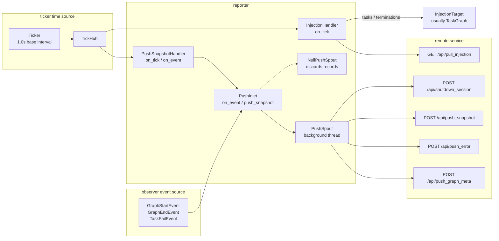

# src/celestialflow/reporter/__init__.py

> 📅 Last Updated: 2026/11/13

`reporter` is CelestialFlow's **remote reporting and task injection module**. It pushes the framework's internal observation events, metric snapshots, and failure information to a remote service, and pulls tasks and termination signals pending injection from the remote service on each tick.

The module consists of three parts:

| File | Role |
|------|------|
| [`core_push.py`](./core_push.md) | `PushRecord`, `PushSpout`, `NullPushSpout`, `PushInlet`: event / snapshot → HTTP push records |
| [`core_snapshot.py`](./core_snapshot.md) | `PushSnapshotHandler`, `to_status_snapshot()`: read metrics per tick and build status snapshots |
| [`core_inject.py`](./core_inject.md) | `InjectionTarget`, `InjectionHandler`: pull remote injections per tick |

## Exported Symbols

```python
__all__ = [
    "InjectionHandler",
    "InjectionTarget",
    "NullPushSpout",
    "PushInlet",
    "PushSnapshotHandler",
    "PushSpout",
]
```

| Exported Symbol | Source | Description |
|---------|------|------|
| `InjectionHandler` | `core_inject.py` | Tick handler that pulls tasks and termination signals from `/api/pull_injection` every 5 ticks |
| `InjectionTarget` | `core_inject.py` | Injection target protocol, requiring only `inject_tasks()` and `inject_terminations()` |
| `NullPushSpout` | `core_push.py` | Null push spout that discards records right after consuming them; useful for tests or placeholders that only care about enqueue semantics |
| `PushInlet` | `core_push.py` | Observer + inlet that converts events and snapshots into `PushRecord` and enqueues them |
| `PushSnapshotHandler` | `core_snapshot.py` | Both a tick handler and an observer: pushes snapshots per tick and pushes a final-state snapshot when the graph ends |
| `PushSpout` | `core_push.py` | Background-thread spout that calls the corresponding HTTP endpoint based on `PushRecord.kind` |

> Although `PushRecord`, `PushKind`, and `to_status_snapshot()` are defined in `core_*` files, they are not re-exported by the package-level `__init__.py`; import them from the concrete module when needed, for example `from celestialflow.reporter.core_push import PushRecord`.

## Data Flow



## Endpoint Overview

| Method | Endpoint | Trigger Source | Main Payload |
|------|------|---------|---------|
| `POST` | `/api/push_graph_meta` | `PushInlet` receives a `GraphStartEvent` | Session ID, graph name, graph mode, start time, whether DAG, nodes, edges, source nodes, node metadata |
| `POST` | `/api/push_error` | `PushInlet` receives a `TaskFailEvent` | Session ID, `event_id`, node, task payload, exception type, exception message, timestamp |
| `POST` | `/api/push_snapshot` | `PushInlet.push_snapshot()` (called per tick by `PushSnapshotHandler`) | Session ID, node status snapshot, send time |
| `POST` | `/api/shutdown_session` | `PushInlet` receives a `GraphEndEvent` | Session ID only; the server marks the session as finished based on it |
| `GET` | `/api/pull_injection` | `InjectionHandler.on_tick()` | Query parameter `session_id`; the response contains `tasks` and `terminations` |

## Usage Example

### Disabling Reporting: Using `NullPushSpout` as a Placeholder

```python
from celestialflow.observer import GraphEndEvent, GraphStartEvent
from celestialflow.reporter import NullPushSpout, PushInlet

spout = NullPushSpout()
inlet = PushInlet().bind_spout(spout)
spout.start()

inlet.on_event(
    GraphStartEvent(
        graph="Demo",
        graph_mode="thread",
        start_time=0.0,
        is_dag=True,
        nodes=["A"],
        edges={"A": []},
        source_nodes=["A"],
        node_meta={"A": {}},
    )
)
inlet.on_event(GraphEndEvent(graph="Demo", end_time=1.0, elapsed=1.0))

spout.stop()
```

`NullPushSpout` does not establish an HTTP session and discards every record, so this example can run offline.

### Automatic Wiring by the Assembly Entry

Production code usually does not need manual assembly: when `report` is not `None`, `assembly.run_graph_resources()` automatically creates and registers `PushInlet`, `PushSpout`, `PushSnapshotHandler`, `InjectionHandler`, and `Ticker`:

```python
from celestialflow.assembly import run_graph_resources
from celestialflow.observer import ObserverHub
from celestialflow.runtime import ReportConfig


class DemoGraph:
    def inject_tasks(self, tasks) -> None:
        print("remote tasks:", tasks)

    def inject_terminations(self, nodes) -> None:
        print("remote terminations:", list(nodes))

    def run(self, init_tasks) -> None:
        print("local initial tasks:", init_tasks)


graph = DemoGraph()
init_tasks = {"A": [1, 2, 3]}

with run_graph_resources(
    ObserverHub(),
    injection_target=graph,
    report=ReportConfig("http://127.0.0.1:5005"),
):
    graph.run(init_tasks)
```

## Notes

1. **Push failures are not fatal**: the background thread of `PushSpout` catches the push exception of a single record and prints the traceback; that record is discarded and the thread keeps consuming subsequent records.
2. **The reporting session identifier is opaque**: `assembly` generates `session_id` with `uuid4().hex` and uses it for pushing, shutdown notification, and injection pulling alike; callers need not care about its format.
3. **Order of snapshots and the shutdown notification**: graph-level assembly registers `PushSnapshotHandler` before `PushInlet`, ensuring that the final-state snapshot triggered by `GraphEndEvent` is enqueued first and `shutdown_session` afterwards.
4. **Not exported through the package root**: `from celestialflow import PushInlet` fails; import from `celestialflow.reporter` or its concrete submodules.
