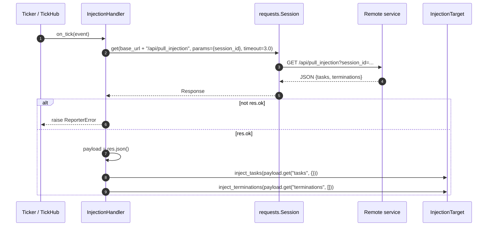

# src/celestialflow/reporter/core_inject.py

> 📅 Last Updated: 2026/11/13

`core_inject.py` implements **remote task injection**: as a tick handler, `InjectionHandler` pulls tasks and termination signals pending injection from the remote service every fixed number of ticks and hands them to an `InjectionTarget` (usually a `TaskGraph`).

## Core Objects

| Object | Type | Responsibility |
|------|------|------|
| `InjectionTarget` | `Protocol` | Minimal interface of an injection target: only two injection methods are required |
| `InjectionHandler` | `TickHandler` subclass | Performs a GET on the injection endpoint every `tick_period=5` ticks and calls the target |
| `_PULL_TIMEOUT` | Module constant | Timeout of a single pull, `3.0` seconds |

## InjectionTarget

```python
class InjectionTarget(Protocol):
    def inject_tasks(self, tasks: Mapping[str, Iterable[Any]]) -> None: ...

    def inject_terminations(self, nodes: Sequence[str]) -> None: ...
```

| Method | Parameter | Description |
|------|------|------|
| `inject_tasks` | `Mapping[str, Iterable[Any]]` | Mapping from node names to task iterables; each value is iterated only once |
| `inject_terminations` | `Sequence[str]` | Sequence of node names that need a termination signal injected |

> This protocol deliberately exposes only injection semantics, not node containers or persistence details, decoupling the reporting module from the graph structure. `TaskGraph` happens to implement these two methods, so it can be used directly as the `target`.

## InjectionHandler

```python
class InjectionHandler(TickHandler):
    tick_period: int = 5

    def __init__(
        self,
        base_url: str,
        session_id: str,
        target: InjectionTarget,
        session: requests.Session,
    ) -> None: ...

    def on_tick(self, event: TickEvent) -> None: ...
```

| Parameter | Description |
|------|------|
| `base_url` | Base address of the remote service, e.g. `http://127.0.0.1:5005` |
| `session_id` | Reporting session identifier, submitted as the `session_id` query parameter |
| `target` | Injection target, usually the task graph |
| `session` | Reused HTTP session, owned and closed by the caller (`assembly`); the handler does not close it |

### Tick Scaling

`tick_period = 5` means "run once every 5 ticks". The actual period is determined by the base interval of the `Ticker`:

| `Ticker.interval` | Actual Pull Period |
|:-----------------:|:------------:|
| `1.0` seconds (`assembly` default) | 5 seconds |
| `0.5` seconds | 2.5 seconds |
| `2.0` seconds | 10 seconds |

The filter uses `TickHandler.should_tick()`: `(seq - 1) % tick_period == 0`, so ticks 1, 6, 11… hit (the phase is anchored at `seq == 1`).

### Single-Tick Flow



### Expected Response Structure

```json
{
  "tasks": {
    "A": [1, 2, 3],
    "B": ["x"]
  },
  "terminations": ["A"]
}
```

- `tasks`: defaults to `{}`;
- `terminations`: defaults to `[]`;
- Both keys are decided by the server; the handler only extracts them and hands them to the target as-is.

### Exception Semantics

| Situation | Behavior |
|------|------|
| HTTP response is not 2xx | Raises `ReporterError("Failed to pull task injection: <status>")` |
| Connection failure / timeout | The `requests` exception itself is raised as-is |
| `inject_tasks()` raises | The exception is raised as-is, and `inject_terminations()` is **not** executed |
| Handler raises | The exception isolation of `TickHub` / `Ticker` hands it to `handler.handle_exception()` (prints a traceback by default); subsequent ticks continue |

> The handler itself has no retry or deduplication logic: a failed pull only affects the current tick, and the next tick requests again. The server should make the injection endpoint idempotent per `session_id`, or handle duplicate deliveries itself.

## Usage Example

The example below replaces the HTTP session and the graph with minimal stubs to demonstrate one pull and injection; the example can run offline:

```python
from collections.abc import Iterable, Mapping, Sequence
from typing import Any

from celestialflow.reporter import InjectionHandler
from celestialflow.ticker import TickEvent


class StubResponse:
    ok = True
    status_code = 200

    def json(self) -> dict[str, Any]:
        return {
            "tasks": {"A": [1, 2]},
            "terminations": ["A"],
        }


class StubSession:
    """Minimal requests.Session stand-in, for demonstration only."""

    def get(self, url, params=None, timeout=None):
        print("GET", url, params, timeout)
        return StubResponse()


class DemoGraph:
    """Minimal implementation satisfying the InjectionTarget protocol."""

    def inject_tasks(self, tasks: Mapping[str, Iterable[Any]]) -> None:
        print("tasks:", {node: list(values) for node, values in tasks.items()})

    def inject_terminations(self, nodes: Sequence[str]) -> None:
        print("terminations:", list(nodes))


handler = InjectionHandler(
    base_url="http://127.0.0.1:5005",
    session_id="session-1",
    target=DemoGraph(),
    session=StubSession(),  # use requests.Session() in production
)

# seq=5 hits the tick of tick_period=5
handler.on_tick(
    TickEvent(
        seq=5,
        interval=1.0,
        scheduled_at=4.0,
        fired_at=4.0,
        wall_time=0.0,
        drift=0.0,
        skipped=0,
    )
)
```

Output:

```text
GET http://127.0.0.1:5005/api/pull_injection {'session_id': 'session-1'} 3.0
tasks: {'A': [1, 2]}
terminations: ['A']
```

## Notes

1. **Session reuse**: `requests.Session` is created by `assembly.run_graph_resources()` and passed to both `PushSpout` and `InjectionHandler`; the handler only uses it and never closes it.
2. **The `event` parameter is unused**: the trigger rhythm of `on_tick(event)` is fully controlled by `tick_period`; the handler does not read any field of `TickEvent`.
3. **The `inject_tasks` parameter type of `target` is `Mapping[str, Iterable[Any]]`**: values may be any iterable such as a range, a generator, or a list, but are consumed only once.
4. **Injection failures are not rolled back automatically**: if `inject_tasks()` raises after partially injecting, the already-injected tasks remain in the graph; this is the semantics of the target object itself and the handler does not intervene.
5. **Graph level only**: `run_node_resources()` does not assemble the injection handler; a standalone node does not pull tasks from the remote service.
