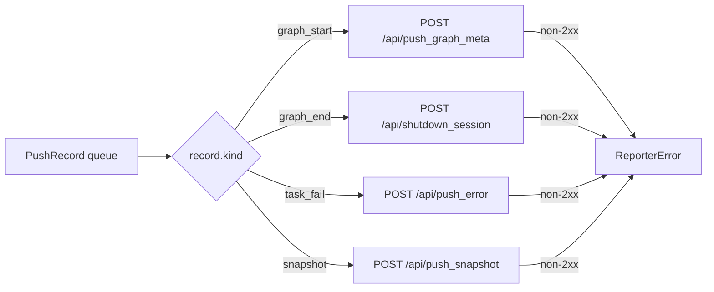

# src/celestialflow/reporter/core_push.py

> 📅 Last Updated: 2026/11/13

`core_push.py` defines CelestialFlow's **push channel**: it represents graph start, graph end, task failure, and status snapshots uniformly as `PushRecord`, and the background-thread `PushSpout` calls a different HTTP endpoint for each record type.

This file contains four core objects:

| Object | Type | Responsibility |
|------|------|------|
| `PushKind` | Type alias | Record type: `"graph_start"` / `"graph_end"` / `"task_fail"` / `"snapshot"` |
| `PushRecord` | `frozen` + `slots` data class | One record to be pushed; fields are grouped by event type |
| `PushSpout` | `BaseSpout` subclass | Continuously consumes the queue in the background and pushes HTTP requests by `kind` |
| `NullPushSpout` | `BaseSpout` subclass | Null implementation that discards records right after consuming them |
| `PushInlet` | `BaseInlet` + `Observer` | Converts observation events and status snapshots into `PushRecord` and enqueues them via `send()` |

## PushRecord

```python
type PushKind = Literal["graph_start", "graph_end", "task_fail", "snapshot"]


@dataclass(frozen=True, slots=True)
class PushRecord:
    kind: PushKind
    # GraphStartEvent fields
    graph: str = ""
    graph_mode: str = ""
    start_time: float = 0.0
    is_dag: bool = False
    nodes: list[str] = field(default_factory=list[str])
    edges: dict[str, list[str]] = field(default_factory=dict[str, list[str]])
    source_nodes: list[str] = field(default_factory=list[str])
    node_meta: dict[str, dict[str, Any]] = field(default_factory=dict[str, dict[str, Any]])
    # GraphEndEvent fields
    end_time: float = 0.0
    elapsed: float = 0.0
    # TaskFailEvent fields
    event_id: int = 0
    node: str = ""
    task_json: Any = None
    error_type: str = ""
    error_message: str = ""
    ts: float = 0.0
    # status snapshot field
    snapshot: dict[str, dict[str, Any]] = field(default_factory=dict[str, dict[str, Any]])
```

`kind` determines which fields are valid; the remaining fields keep their default values:

| `kind` | Valid Fields | Corresponding Event / Source |
|--------|---------|----------------|
| `"graph_start"` | `graph`, `graph_mode`, `start_time`, `is_dag`, `nodes`, `edges`, `source_nodes`, `node_meta` | `GraphStartEvent` |
| `"graph_end"` | `graph`, `end_time`, `elapsed` | `GraphEndEvent` |
| `"task_fail"` | `event_id`, `node`, `task_json`, `error_type`, `error_message`, `ts` | `TaskFailEvent` |
| `"snapshot"` | `snapshot` | `PushInlet.push_snapshot()` (called per tick by `PushSnapshotHandler`) |

> The `graph` field is used by both `graph_start` and `graph_end`. Although a `graph_end` record carries `end_time` / `elapsed`, the current shutdown notification of `PushSpout` submits only `session_id`; these two fields do not appear in the request body of `/api/shutdown_session`.

## PushSpout

```python
class PushSpout(BaseSpout):
    def __init__(
        self,
        session_id: str,
        base_url: str,
        timeout: float = 3.0,
    ) -> None: ...
```

| Parameter | Description |
|------|------|
| `session_id` | Reporting session identifier, submitted with every record; the wire field name is `session_id` |
| `base_url` | Base address of the remote service, e.g. `http://127.0.0.1:5005` |
| `timeout` | Timeout of a single HTTP request in seconds, default `3.0` |

Lifecycle:

- `_before_start()`: creates the reused `requests.Session`.
- `_after_stop()`: closes and clears that session.
- If the spout is not started (`_session is None`), `_handle_record()` returns immediately and the record is silently discarded.

### Push Dispatch Table



| `kind` | Endpoint | Request Body Fields | Failure Exception |
|--------|------|-----------|---------|
| `graph_start` | `/api/push_graph_meta` | `session_id`, `graph`, `graph_mode`, `start_time`, `is_dag`, `nodes`, `edges`, `source_nodes`, `node_meta` | `ReporterError("Failed to push graph meta: <status>")` |
| `graph_end` | `/api/shutdown_session` | `session_id` | `ReporterError("Failed to notify shutdown: <status>")` |
| `task_fail` | `/api/push_error` | `session_id`, `event_id`, `node`, `task_json`, `error_type`, `error_message`, `ts` | `ReporterError("Failed to push error: <status>")` |
| `snapshot` | `/api/push_snapshot` | `session_id`, `snapshot`, `timestamp` (the `time.time()` at send time) | `ReporterError("Failed to push snapshot: <status>")` |

> `ReporterError` is caught by the background loop of `BaseSpout` and printed with a traceback; it does **not** terminate the thread. That record is discarded and subsequent records keep being pushed.

## NullPushSpout

`NullPushSpout` is the null implementation of `PushSpout`: `_handle_record()` simply `return None`, establishes no HTTP session, and sends no request. It is used in scenarios that need only "enqueue semantics" without the network (for example tests or placeholders).

```python
class NullPushSpout(BaseSpout):
    def _handle_record(self, _record: PushRecord) -> None:
        return None
```

## PushInlet

`PushInlet` inherits both `BaseInlet` and `Observer`:

- As an `Observer`, it implements `on_event(event)` and uses `match event` to convert the three event types into `PushRecord`;
- As a `BaseInlet`, it binds a push spout via `bind_spout(spout)` and enqueues with `send(record)` inherited from `BaseInlet`;
- It provides `push_snapshot(snapshot)` so that `PushSnapshotHandler` can push status snapshots directly per tick.

### Event Mapping

| Event | Generated Record | Description |
|------|-----------|------|
| `GraphStartEvent` | `kind="graph_start"` | Graph metadata, nodes/edges/source nodes, node metadata |
| `GraphEndEvent` | `kind="graph_end"` | Session shutdown notification; after receiving it the server marks the session as finished, but session data and the error store are kept |
| `TaskFailEvent` | `kind="task_fail"` | `task_json` is converted by `to_persisted_payload(event.task)`; `error_type` is the exception class name, `error_message` is `str(exception)`, `ts` is the current wall-clock time |
| Other events | None | `case _: pass`, silently ignored |

> In `PushInlet`, `GraphEndEvent` only produces `graph_end` (the shutdown notification). The same event is also used by `PushSnapshotHandler` to push one final-state snapshot; the two are independent observers, see [`core_snapshot.md`](./core_snapshot.md) for details.

## Usage Example

The example below uses a subclass of `NullPushSpout` to print record contents without sending any network request:

```python
from celestialflow.observer import GraphEndEvent, GraphStartEvent, TaskFailEvent
from celestialflow.reporter import NullPushSpout, PushInlet


class PrintSpout(NullPushSpout):
    """Prints record contents but sends no HTTP request."""

    def _handle_record(self, record) -> None:
        print(f"kind={record.kind}, graph={record.graph}, node={record.node}")


spout = PrintSpout()
inlet = PushInlet().bind_spout(spout)
spout.start()

inlet.on_event(
    GraphStartEvent(
        graph="Demo",
        graph_mode="thread",
        start_time=0.0,
        is_dag=True,
        nodes=["A"],
        edges={"A": []},
        source_nodes=["A"],
        node_meta={"A": {}},
    )
)
inlet.on_event(
    TaskFailEvent(
        node="A",
        task=1,
        task_repr="1",
        exception=ValueError("bad value"),
        task_id=1,
        error_id=2,
    )
)
inlet.push_snapshot({"A": {"status": 2, "tasks_succeeded": 0}})
inlet.on_event(GraphEndEvent(graph="Demo", end_time=2.0, elapsed=2.0))

spout.stop()
```

Output (same order as enqueueing):

```text
kind=graph_start, graph=Demo, node=
kind=task_fail, graph=, node=A
kind=snapshot, graph=, node=
kind=graph_end, graph=Demo, node=
```

## Notes

1. **Records are immutable**: `PushRecord` is a `frozen=True, slots=True` data class and cannot be modified after construction; the sending thread only reads it.
2. **Failed pushes lose records**: there is currently no retry queue; a single failure only prints a traceback and discards the record.
3. **The session is managed by the spout**: `PushSpout` creates the `requests.Session` on `start()` and closes it on `stop()`; callers must not reuse its internal session.
4. **Record order is queue order**: `BaseSpout.stop()` puts the termination signal at the tail of the queue, so records enqueued before calling `stop()` are fully processed first.
5. **`push_snapshot` performs no network IO**: it only wraps the snapshot into a `PushRecord` and enqueues it; the actual sending is done in the `PushSpout` background thread.
