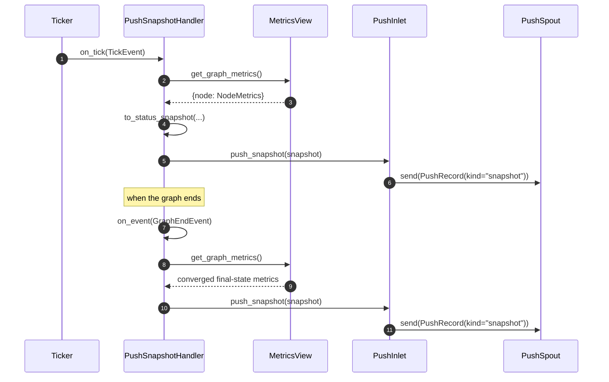

# src/celestialflow/reporter/core_snapshot.py

> 📅 Last Updated: 2026/11/13

`core_snapshot.py` converts **graph-level metric snapshots** into reporting payloads and hands them to the push channel. It is the intersection of "time-driven" and "event-driven":

- As a `TickHandler`, it reads the whole-graph metrics per tick (every tick by default, base interval 1 second) and pushes them;
- As an `Observer`, it pushes one **final-state snapshot** when the graph ends.

This file performs no network IO at all: it only projects metrics and enqueues them; the actual HTTP sending is done by `PushSpout`.

## to_status_snapshot

```python
def to_status_snapshot(
    metrics: Mapping[str, NodeMetrics],
) -> dict[str, dict[str, Any]]: ...
```

Projects `{node name: NodeMetrics}` into `{node name: status dict}`. The field mapping is as follows:

| `NodeMetrics` Field | Snapshot Key | Description |
|--------------------|--------|------|
| `start_time` | `start_time` | Wall-clock time when the node entered the running state |
| `end_time` | `end_time` | Wall-clock time when the node exited the running state |
| `status` | `status` | `NodeStatus` (an `IntEnum`), serialized as an integer in JSON |
| `input_total` | `tasks_input` | Total number of input tasks (external injection + upstream) |
| `succeeded` | `tasks_succeeded` | Number of succeeded tasks |
| `failed` | `tasks_failed` | Number of failed tasks |
| `skipped` | `tasks_skipped` | Number of skipped tasks |
| `processed` | `tasks_processed` | Number of processed tasks |
| `pending` | `tasks_pending` | Number of pending tasks |
| `upstream_counts` | `upstream_counts` | Number of tasks provided by each upstream node |
| `downstream_counts` | `downstream_counts` | Number of tasks sent to each downstream node |

> `external_input` and `upstream_input` do not enter the snapshot separately; their information is already aggregated in `tasks_input`.

Example output:

```python
{
    "A": {
        "start_time": 100.0,
        "end_time": 100.1,
        "status": 2,
        "tasks_input": 1,
        "tasks_succeeded": 1,
        "tasks_failed": 0,
        "tasks_skipped": 0,
        "tasks_processed": 1,
        "tasks_pending": 0,
        "upstream_counts": {},
        "downstream_counts": {},
    }
}
```

## PushSnapshotHandler

```python
class PushSnapshotHandler(TickHandler, Observer):
    def __init__(self, metrics_view: MetricsView, inlet: PushInlet) -> None: ...
    def on_tick(self, event: TickEvent) -> None: ...
    def on_event(self, event: Event) -> None: ...
    def _push_snapshot(self) -> None: ...
```

| Parameter | Type | Description |
|------|------|------|
| `metrics_view` | `MetricsView` | Read-only view of the metrics, usually a `MetricsObserver` instance |
| `inlet` | `PushInlet` | Push inlet already bound to a `PushSpout` |

### Two Trigger Paths



| Method | Trigger Condition | Behavior |
|------|---------|------|
| `on_tick(event)` | Every hit tick (`tick_period` inherited from `TickHandler`, default 1) | Calls `_push_snapshot()` |
| `on_event(event)` | `GraphEndEvent` only | Pushes one final-state snapshot; other events `case _: pass` |
| `_push_snapshot()` | Internal method | `to_status_snapshot(metrics_view.get_graph_metrics())` → `inlet.push_snapshot(...)` |

### Why a Supplementary Push Is Needed When the Graph Ends

Snapshots are produced only on ticks, and graph finalization stops the ticker immediately, so state changes **between the last tick and graph end** are not captured by any tick, for example:

- All nodes eventually enter `NodeStatus.STOPPED`;
- The success / failure / skip counts of the last batch of tasks;
- The final `tasks_pending` dropping to zero.

`GraphEndEvent` is triggered after all nodes have finished, during graph finalization, when the metrics have converged to their final values; one supplementary push on that event is enough for the server to obtain the complete final state.

> The enqueue order of the final-state snapshot depends on the observer registration order of `assembly`: `PushSnapshotHandler` is registered before `PushInlet`, so `GraphEndEvent` first triggers the final-state snapshot and then `graph_end` (`shutdown_session`). Both enter the same FIFO queue, so the server receives the snapshot first and the shutdown notification afterwards.

## Usage Example

The example below uses a real `MetricsObserver` to produce metrics and observes the enqueue result through the queue of `PushSpout` (the spout is not started, so no network request is sent):

```python
from celestialflow.observer import (
    GraphEndEvent,
    MetricsObserver,
    NodeEndEvent,
    NodeStartEvent,
    TaskInputEvent,
    TaskSuccessEvent,
)
from celestialflow.reporter import PushInlet, PushSnapshotHandler, PushSpout
from celestialflow.ticker import TickEvent

# 1. Fill the metrics write model with events
metrics = MetricsObserver()
metrics.on_event(
    NodeStartEvent(node="A", execution_mode="serial", max_workers=1, start_time=100.0)
)
metrics.on_event(TaskInputEvent(node="A", task=1, task_repr="1", input_id=1))
metrics.on_event(
    TaskSuccessEvent(
        node="A",
        task=1,
        task_repr="1",
        result=2,
        result_repr="2",
        elapsed=0.1,
        task_id=1,
        success_id=1,
    )
)
metrics.on_event(
    NodeEndEvent(
        node="A",
        execution_mode="serial",
        max_workers=1,
        elapsed=0.1,
        end_time=100.1,
    )
)

# 2. Assemble the snapshot handler (the spout is not started here; only the queue is observed)
spout = PushSpout(session_id="demo", base_url="http://127.0.0.1:5005")
inlet = PushInlet().bind_spout(spout)
handler = PushSnapshotHandler(metrics, inlet)

# 3. Simulate one tick plus one graph end
tick = TickEvent(
    seq=1,
    interval=1.0,
    scheduled_at=0.0,
    fired_at=0.0,
    wall_time=0.0,
    drift=0.0,
    skipped=0,
)
handler.on_tick(tick)
handler.on_event(GraphEndEvent(graph="Demo", end_time=100.2, elapsed=0.2))

# 4. Inspect the two enqueued snapshot records
for _ in range(2):
    record = spout.get_queue().get()
    node = record.snapshot["A"]
    print(record.kind, node["status"], node["tasks_succeeded"], node["tasks_processed"])
```

Output:

```text
snapshot 2 1 1
snapshot 2 1 1
```

## Notes

1. **Read-only view**: the handler only calls `MetricsView.get_graph_metrics()` and does not modify the metrics; it can safely share the same `MetricsObserver` with a log observer.
2. **No network IO**: both `on_tick` / `on_event` only enqueue; network failures are handled by the background thread of `PushSpout`.
3. **`tick_period` is adjustable**: every tick is pushed by default; if the server is under heavy load, `handler.set_tick_period(n)` can lower the frequency (with a base interval of 1 second, that means once every `n` seconds).
4. **The final-state snapshot does not replace tick snapshots**: it supplements the final state only once and does not backfill historical intermediate states.
5. **The snapshot structure is a plain dict**: the `snapshot` field can be serialized directly by the `requests` JSON encoder; although `status` is a `NodeStatus`, as an `IntEnum` it is encoded as an integer.
