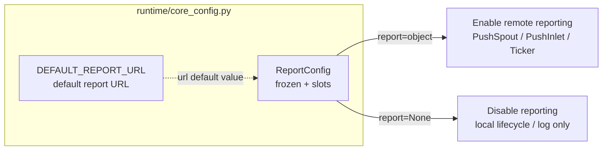

# src/celestialflow/runtime/core_config.py

> 📅 Last Updated: 2026/10/30

`runtime/core_config.py` defines the runtime configuration types **explicitly passed in by the run entry points**. It does not read the host project's `pyproject.toml` — whether reporting is enabled and where it reports are entirely decided by the caller.

## Purpose

- Provides the default report URL constant `DEFAULT_REPORT_URL`
- Provides the immutable configuration object `ReportConfig`, which validates and normalizes the URL at construction time
- Unifies the `report` argument type of `run()` / `run_async()` / `restore_db()`



## Core Objects

### DEFAULT_REPORT_URL

```python
DEFAULT_REPORT_URL = "http://127.0.0.1:5005"
```

The default report URL used when `ReportConfig` does not explicitly specify one.

### ReportConfig

```python
@dataclass(frozen=True, slots=True)
class ReportConfig:
    url: str = DEFAULT_REPORT_URL
```

| Member | Type | Description |
|------|------|------|
| `url` | `str` | Base URL of the report service; must be `http` / `https`; a trailing `/` is stripped |

Characteristics:

- **`frozen=True`**: Cannot be assigned after construction, so the configuration object can safely be shared across multiple run entry points
- **`slots=True`**: Adding attributes dynamically is not allowed
- **`__post_init__` performs validation and normalization**, so an illegal URL raises **at construction time** rather than after runtime resources (`PushSpout`, `Ticker`) have started

### Validation Rules

`__post_init__()` processes `url` in the following order:

| Step | Check | On Failure |
|:----:|------|--------|
| 1 | `url` must be a `str` | `ConfigurationError` |
| 2 | `url.strip().rstrip("/")` must not be empty | `ConfigurationError` |
| 3 | The `scheme` from `urllib.parse.urlsplit` must be `http` / `https`, and `netloc` must be non-empty | `ConfigurationError` |
| 4 | After validation passes, write the normalized result back via `object.__setattr__(self, "url", url)` | — |

Normalization only does two things: strips leading/trailing whitespace and strips **all** consecutive trailing `/`. For example, `" http://127.0.0.1:5005/// "` → `"http://127.0.0.1:5005"`.

> Note: Strings lacking a scheme such as `"127.0.0.1:5005"` are rejected (`urlsplit` sees an empty scheme); they must be written as `"http://127.0.0.1:5005"`.

## Semantics: Passing an Object = Enable Reporting, Passing None = Disable

The `report` argument of the run entry points (`TaskGraph.run()` / `run_async()` / `restore_db()`) defaults to `None`:

| `report` value | Behavior |
|---------------|------|
| A `ReportConfig(...)` instance | Enable remote reporting: creates `PushSpout`, `PushInlet`, `PushSnapshotHandler`, `InjectionHandler`, and `Ticker`; pushes status snapshots to `report.url` per tick and pulls injected tasks from the remote side |
| `None` (default) | Assembles only the local `MetricsObserver` / `LifecycleSpout` / `LogSpout`, without issuing any network request |

Since the default value is `None`, **not passing `report` means reporting is disabled**; there is no implicit behavior such as "reporting starts automatically once a URL is configured".

## Usage Examples

### 1. Enabling Reporting with the Default URL

```python
from celestialflow import TaskExecutor, TaskGraph
from celestialflow.runtime import ReportConfig

graph = TaskGraph(name="ReportDemo")
graph.set_nodes([TaskExecutor("worker", lambda x: x * 2)])

# Passing a ReportConfig object enables reporting; by default it reports to http://127.0.0.1:5005
graph.run({"worker": [1, 2, 3]}, report=ReportConfig())
```

### 2. Specifying a Custom URL / Disabling Reporting

```python
from celestialflow import TaskExecutor, TaskGraph
from celestialflow.runtime import ReportConfig

# Custom URL; the argument can be passed positionally or by keyword
with_report = ReportConfig("https://flow.example.com/api/")
print(f"Normalized URL: {with_report.url}")  # https://flow.example.com/api

graph = TaskGraph(name="CustomReportDemo")
graph.set_nodes([TaskExecutor("worker", lambda x: x)])
graph.run({"worker": [1]}, report=with_report)

# Not passing report (equivalent to report=None) fully disables reporting
graph_local = TaskGraph(name="LocalOnlyDemo")
graph_local.set_nodes([TaskExecutor("worker", lambda x: x)])
graph_local.run({"worker": [2]})
```

### 3. Handling Illegal URLs

```python
from celestialflow.runtime import ReportConfig
from celestialflow.runtime.util_errors import ConfigurationError

for bad_url in ["", "   ", "127.0.0.1:5005", "ftp://127.0.0.1:5005", 5005]:
    try:
        ReportConfig(url=bad_url)  # type: ignore[arg-type]
    except ConfigurationError as exc:
        print(f"{bad_url!r} -> {exc}")
```

## Notes

- `ReportConfig` is a **read-only** configuration: to change the URL, create a new instance; the `url` field cannot be modified.
- Validation happens **at construction time**; placing `ReportConfig(...)` inside a try block lets you catch configuration errors before runtime resources start.
- At runtime, the `[tool.celestialflow]` section of `pyproject.toml` is **not** read: the report URL is provided only by this object, and whether reporting is enabled depends solely on whether `report` is `None`.
- Both `DEFAULT_REPORT_URL` and `ReportConfig` are exported by `celestialflow.runtime`; `ReportConfig` is also re-exported by the package root (`from celestialflow import ReportConfig` also works), while `DEFAULT_REPORT_URL` can only be imported from `celestialflow.runtime`.
- The default value and validation of the log level are not in this file; see `runtime/util_log_level.py`.
