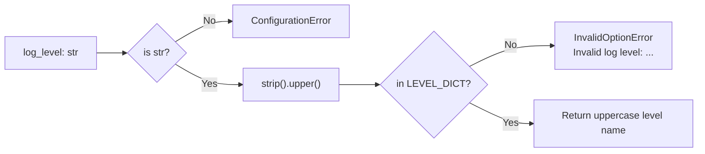

# src/celestialflow/runtime/util_log_level.py

> 📅 Last Updated: 2026/10/30

`runtime/util_log_level.py` provides the default log level and normalization validation, **for internal use by the run entry points only**; it does not belong to the public configuration API.

## Purpose

- Defines `DEFAULT_LOG_LEVEL`, the value used when a run entry point does not explicitly specify a log level
- Provides `normalize_log_level()`: normalizes a user-supplied level name into the uppercase key in `LEVEL_DICT`, and raises an exception on illegal input

> This file is a `util_*` module and is **not** in the `__all__` of `celestialflow.runtime/__init__.py`; it must be imported via the full path:
> `from celestialflow.runtime.util_log_level import DEFAULT_LOG_LEVEL, normalize_log_level`.

## Core Objects

### DEFAULT_LOG_LEVEL

```python
DEFAULT_LOG_LEVEL = "INFO"
```

The default value used when a run entry point does not explicitly specify a log level. It is used as a default argument in several signatures:

| Where used | Description |
|----------|------|
| `log_level` of `TaskGraph.run()` / `run_async()` / `restore_db()` | Graph-level run entry |
| `log_level` of nodes such as `BaseTaskNode.run()` | Single-node run entry |
| `LogInlet.__init__()` | Default value for the log filter construction |
| `assembly.core_run.run_graph_resources()` / `run_node_resources()` | Runtime resource assembly |

### normalize_log_level

```python
def normalize_log_level(log_level: str) -> str: ...
```

Validates and normalizes the log level:

1. `log_level` must be a `str`, otherwise `ConfigurationError` is raised
2. Performs `strip().upper()`, so leading/trailing whitespace is ignored and the value is case-insensitive
3. If the result is not among the keys of `LEVEL_DICT` (see `runtime/util_constant.py`), raises `InvalidOptionError("log level", ...)`
4. Returns the normalized **uppercase** level name

The legal keys of `LEVEL_DICT` are: `TRACE` / `DEBUG` / `SUCCESS` / `INFO` / `WARNING` / `ERROR` / `CRITICAL`.



```python
def normalize_log_level(log_level: str) -> str:
    """
    Validates and normalizes the log level.

    :param log_level: The log level to validate
    :return: The normalized log level (uppercase)
    :rtype: str
    :raises ConfigurationError: When ``log_level`` is not a string
    :raises InvalidOptionError: When ``log_level`` is not in the allowed set of levels
    """
```

## Usage Examples

### 1. Normalizing a Log Level

```python
from celestialflow.runtime.util_log_level import DEFAULT_LOG_LEVEL, normalize_log_level

print(DEFAULT_LOG_LEVEL)  # INFO

print(normalize_log_level("info"))  # INFO
print(normalize_log_level("  Debug "))  # DEBUG
print(normalize_log_level("WARNING"))  # WARNING
```

### 2. Handling Illegal Input

```python
from celestialflow.runtime.util_errors import ConfigurationError, InvalidOptionError
from celestialflow.runtime.util_log_level import normalize_log_level

for bad_level in ["VERBOSE", ""]:
    try:
        normalize_log_level(bad_level)
    except InvalidOptionError as exc:
        print(f"{bad_level!r} is not a valid level, allowed values: {exc.allowed}")

try:
    normalize_log_level(30)  # type: ignore[arg-type]
except ConfigurationError as exc:
    print(f"Type error: {exc}")
```

### 3. Passing It to a Graph Run Entry

```python
from celestialflow import TaskExecutor, TaskGraph
from celestialflow.runtime.util_log_level import DEFAULT_LOG_LEVEL, normalize_log_level

graph = TaskGraph(name="LogLevelDemo")
graph.set_nodes([TaskExecutor("worker", lambda x: x)])

level = normalize_log_level("debug")  # normalize before handing it to the run entry
graph.run({"worker": [1, 2, 3]}, log_level=level)

# The default value can also be used directly
graph_default = TaskGraph(name="LogLevelDefaultDemo")
graph_default.set_nodes([TaskExecutor("worker", lambda x: x)])
graph_default.run({"worker": [4]}, log_level=DEFAULT_LOG_LEVEL)
```

## Notes

- The run entry point calls `normalize_log_level()` once more internally, so passing `"debug"` directly also works; calling it in advance only lets you catch the error before runtime resources start.
- `InvalidOptionError` is a subclass of `ConfigurationError`, so catching `ConfigurationError` covers both "wrong type" and "illegal value".
- The mapping from log level names to numeric values is defined by `LEVEL_DICT` in `runtime/util_constant.py`; this file only performs normalization and is not responsible for numeric comparison.
- The log level is **not** read implicitly from `pyproject.toml`; it can only be passed explicitly through the `log_level` argument of a run entry point, and `DEFAULT_LOG_LEVEL` is used when omitted.
