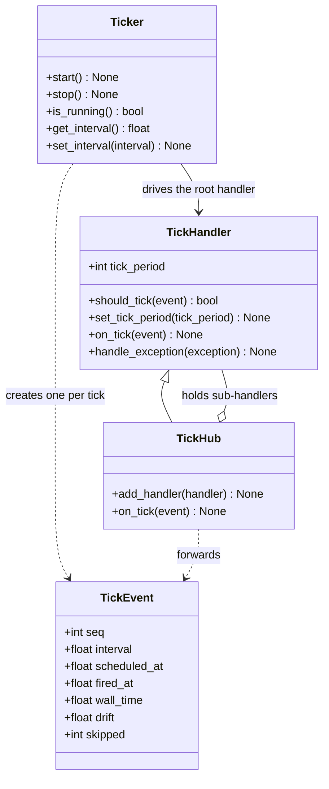
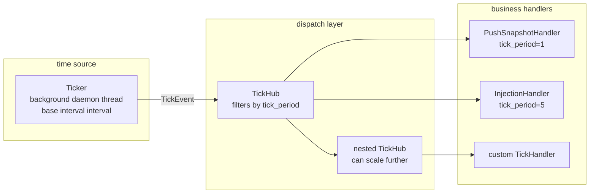

# src/celestialflow/ticker/__init__.py

> 📅 Last Updated: 2026/11/13

`ticker` is CelestialFlow's **time-driven module**: it produces ticks at a fixed base interval in a dedicated background thread and dispatches them scaled by the `tick_period` declared by each handler. It is independent of the event-driven `observer` / `funnel` and can be combined on demand where used.

A typical use is the reporting chain of `reporter`: `PushSnapshotHandler` pushes a status snapshot every tick, and `InjectionHandler` pulls remote injections every 5 ticks.

## Exported Symbols

```python
__all__ = [
    "TickEvent",
    "TickHandler",
    "TickHub",
    "Ticker",
]
```

| Symbol | Source | Description |
|------|------|------|
| `TickEvent` | `core_event.py` | Immutable timing snapshot of one tick (sequence number, interval, scheduled/actual fire time, drift, skipped count) |
| `TickHandler` | `core_handler.py` | Base class of tick handlers, declaring `tick_period` and providing `should_tick()` / `on_tick()` / `handle_exception()` |
| `TickHub` | `core_hub.py` | Tick dispatch hub, itself also a `TickHandler`, forwarding ticks after filtering by each sub-handler's `tick_period` |
| `Ticker` | `core_ticker.py` | Time source and background thread, producing `TickEvent` at the base interval and driving the root handler |

> Although `validate_tick_period()` is defined in `core_handler.py`, it is not re-exported by the package-level `__init__.py`; import it from `celestialflow.ticker.core_handler` when needed.

## Class Relationships



## Layered Structure



`Ticker` knows only one root handler; `TickHub` is responsible for broadcasting. A handler can be either a leaf or another `TickHub`, forming a tree-shaped tick dispatch structure.

## Tick Scaling

All handlers share the same `Ticker.interval` base interval, but each declares "run once every how many ticks" through `tick_period`:

```text
actual period = Ticker.interval × handler.tick_period
```

| `Ticker.interval` | `tick_period` | Actual Period | Hit `seq` |
|:-----------------:|:-------------:|:--------:|:------------:|
| 1.0 seconds | 1 | 1 second | 1, 2, 3, 4, … |
| 1.0 seconds | 2 | 2 seconds | 1, 3, 5, 7, … |
| 1.0 seconds | 5 | 5 seconds | 1, 6, 11, 16, … |
| 0.5 seconds | 5 | 2.5 seconds | 1, 6, 11, 16, … |

> The filter formula is `(seq - 1) % tick_period == 0`, so **tick 1 always hits**; after changing it at runtime via `set_tick_period()`, the phase is re-anchored to `seq == 1`.

## Usage Example

The example below starts a ticker with a base interval of 0.1 seconds and lets two handlers run every tick and every 2 ticks respectively. The example finishes in about 0.5 seconds:

```python
import time

from celestialflow.ticker import TickEvent, TickHandler, TickHub, Ticker


class RecordingHandler(TickHandler):
    def __init__(self, name: str, tick_period: int = 1) -> None:
        self.name = name
        self.tick_period = tick_period
        self.hits: list[int] = []

    def on_tick(self, event: TickEvent) -> None:
        self.hits.append(event.seq)
        print(f"{self.name}: seq={event.seq}, skipped={event.skipped}")


hub = TickHub()
every = RecordingHandler("every", tick_period=1)
every_other = RecordingHandler("every-other", tick_period=2)
hub.add_handler(every)
hub.add_handler(every_other)

ticker = Ticker(0.1, hub, name="demo-ticker")
ticker.start()
time.sleep(0.55)
ticker.stop()

print("every:", every.hits)
print("every-other:", every_other.hits)
```

Possible output (the exact tick count depends on scheduling):

```text
every: seq=1, skipped=0
every-other: seq=1, skipped=0
every: seq=2, skipped=0
every: seq=3, skipped=0
every-other: seq=3, skipped=0
every: seq=4, skipped=0
every: seq=5, skipped=0
every-other: seq=5, skipped=0
every: [1, 2, 3, 4, 5]
every-other: [1, 3, 5]
```

## File Descriptions

| File | Key Content |
|------|---------|
| [`core_event.py`](./core_event.md) | Meaning of the seven `TickEvent` fields, the difference between monotonic and wall-clock time |
| [`core_handler.py`](./core_handler.md) | Filter formula, runtime speed adjustment, and exception handling contract of `TickHandler` |
| [`core_hub.py`](./core_hub.md) | Registration, cycle detection, copy-on-write, per-handler exception isolation |
| [`core_ticker.py`](./core_ticker.md) | Background loop, scheduled-time anchoring, skipping instead of catching up, start/stop semantics |

## Notes

1. **Handlers run serially**: within one tick, all hit handlers execute inline in registration order in the `Ticker` background thread; a slow handler delays subsequent ticks, so for asynchronous decoupling implement the handler as "write queue + independent consumer".
2. **No catch-up**: when a tick's processing overruns and several periods are missed, `Ticker` only records the missed count in `TickEvent.skipped` and then re-anchors from the current moment; it never back-fills bursts.
3. **Exception isolation has two layers**: an exception thrown by a handler's `on_tick()` is handed to its own `handle_exception()`; if that raises again, it is handed to the `handle_exception()` of the root handler (usually `TickHub`) as the final fallback.
4. **Independent of observer**: `ticker` does not depend on `observer` / `funnel`; objects such as `PushSnapshotHandler` that inherit both base classes are composed where used.
5. **Exported at the package root**: `Ticker` / `TickEvent` / `TickHandler` / `TickHub` are also re-exported by `celestialflow/__init__.py`, so you can use `from celestialflow import Ticker` directly.
