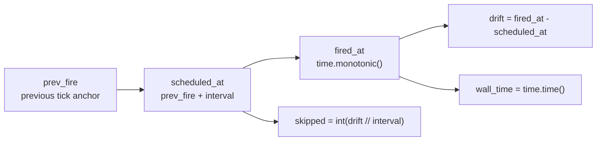

# src/celestialflow/ticker/core_event.py

> 📅 Last Updated: 2026/11/13

`core_event.py` defines `TickEvent`: an **immutable timing snapshot** constructed by `Ticker` on every fire and handed to handlers. Handlers use it to determine the current tick sequence number, read the base interval, or diagnose scheduling drift and skipped ticks.

## TickEvent

```python
@dataclass(frozen=True, slots=True)
class TickEvent:
    seq: int
    interval: float
    scheduled_at: float
    fired_at: float
    wall_time: float
    drift: float
    skipped: int
```

| Field | Type | Unit | Description |
|------|------|------|------|
| `seq` | `int` | — | Tick sequence number, monotonically increasing from `1`; the filter basis of `TickHandler.should_tick()` |
| `interval` | `float` | seconds | The **base interval** used by this tick (not the scaled actual period) |
| `scheduled_at` | `float` | monotonic seconds | Scheduled fire time |
| `fired_at` | `float` | monotonic seconds | Actual fire time |
| `wall_time` | `float` | Unix seconds | Wall-clock time of the actual fire time (`time.time()`) |
| `drift` | `float` | seconds | How much later than scheduled, i.e. `fired_at - scheduled_at` |
| `skipped` | `int` | ticks | Number of base periods skipped because the previous tick's processing overran |

## Time Base



- Except for `wall_time`, all time fields are based on `time.monotonic()` and are **not affected by system wall-clock adjustments (NTP, manual time changes)**.
- `wall_time` is only used for external display or for aligning with business time; it does not participate in scheduling calculations.
- `drift` is usually a very small positive number (thread wake-up overhead); if the processing of a tick takes longer than one period, `drift` grows noticeably and `skipped` becomes greater than 0.
- `skipped` means "the number of complete base periods skipped outright instead of catching up". For example, with `interval=1.0` and an actual lateness of `2.3` seconds, `skipped=2`, and the next tick's anchor advances directly to `scheduled_at + 2 × interval`.

## Relationship with `tick_period`

`interval` is always the base interval of the `Ticker` and is **never** rewritten by a handler's `tick_period`. When a handler sees `seq=6` with `tick_period=5`, 5 base periods (about 5 × `interval` seconds) have actually elapsed.

```text
Ticker.interval = 1.0
handler.tick_period = 5

seq:      1    2    3    4    5    6    7 ...
handler:  ✅   -    -    -    -    ✅   -  ...
event.interval = 1.0 (the same on every tick)
```

## Usage Example

`TickEvent` is usually created by `Ticker`; tests or manual handler driving can construct it directly:

```python
from celestialflow.ticker import TickEvent

event = TickEvent(
    seq=6,
    interval=1.0,
    scheduled_at=5.0,
    fired_at=5.05,
    wall_time=1_700_000_000.0,
    drift=0.05,
    skipped=0,
)

print(event.seq)                     # 6
print(event.interval)                # 1.0
print(round(event.drift, 3))         # 0.05
print(event.wall_time)               # 1700000000.0
```

Reading tick information inside a handler:

```python
from celestialflow.ticker import TickEvent, TickHandler


class DriftMonitor(TickHandler):
    tick_period = 10

    def on_tick(self, event: TickEvent) -> None:
        if event.skipped:
            print(f"tick {event.seq} skipped {event.skipped} periods")
        if event.drift > event.interval / 2:
            print(f"tick {event.seq} drift is large: {event.drift:.3f}s")
```

## Notes

1. **Immutable**: `frozen=True, slots=True`; handlers cannot modify event fields; compute derived state yourself.
2. **`seq` starts at 1**: the filter formula `(seq - 1) % tick_period == 0` relies on this, and tick 1 always hits.
3. **`interval` is the base interval**: do not multiply it by `tick_period` to infer historical time; the scheduling anchors are given by `scheduled_at` / `fired_at`.
4. **`skipped` counts only whole periods**: a delay shorter than one period shows up in `drift`, not in `skipped`.
5. **`wall_time` may move backwards**: if the host adjusts the system time, `wall_time` may not be monotonic; `seq`, `scheduled_at`, and `fired_at` are unaffected.
