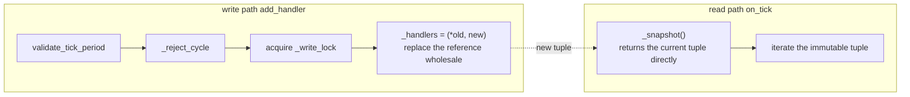
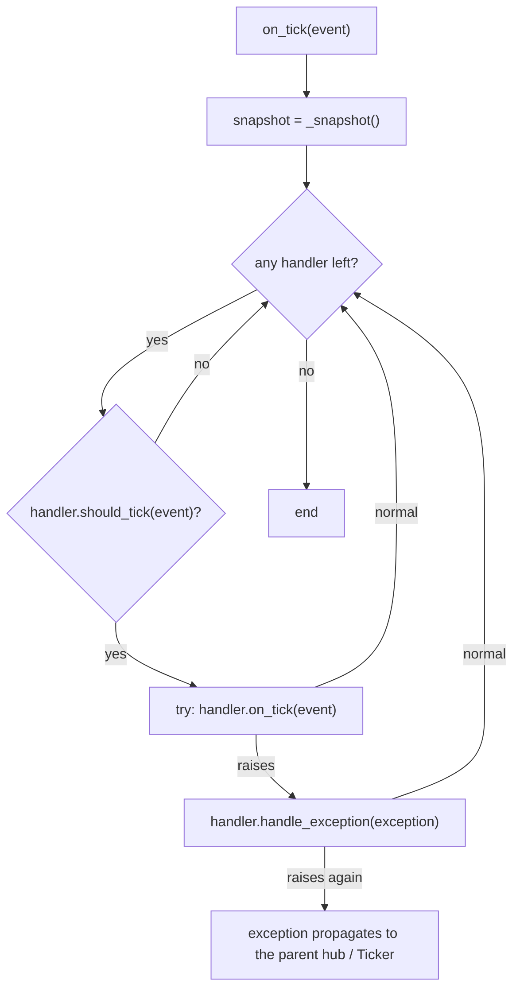

# src/celestialflow/ticker/core_hub.py

> 📅 Last Updated: 2026/11/13

`core_hub.py` defines `TickHub`: the tick **dispatch center**. It is itself a `TickHandler`, so it can serve as the root handler of a `Ticker` or be nested inside another `TickHub`; on every tick it filters by each sub-handler's own `tick_period` before forwarding.

## TickHub

```python
class TickHub(TickHandler):
    def __init__(self) -> None: ...
    def add_handler(self, handler: TickHandler) -> None: ...
    def on_tick(self, event: TickEvent) -> None: ...
```

| Member | Description |
|------|------|
| `_handlers` | Tuple of current sub-handlers, copy-on-write |
| `_write_lock` | Mutex for the write path |
| `add_handler(handler)` | Validates `tick_period` and cycle references, then appends |
| `on_tick(event)` | Forwards hit ticks to sub-handlers in registration order |

### Registration

`add_handler()` performs the following in order:

1. `validate_tick_period(handler)`: `tick_period` must be `>= 1`;
2. `_reject_cycle(handler)`: rejects registrations that would create a hub cycle;
3. Replaces the whole tuple with `(*self._handlers, handler)` under the protection of `_write_lock`.

> There is currently no `remove_handler()`; once registered, a handler always participates in dispatch. Registering the same instance twice is not deduplicated, so it is called multiple times per tick.

### Cycle Detection

`_reject_cycle()` searches downward only along **nested `TickHub`s**:

- `handler is self` → `ConfigurationError("cannot register a TickHub into itself")`;
- If `handler` is not a `TickHub`, it passes immediately (an ordinary handler holds no other hub, so no cycle can form);
- Otherwise a stack-based DFS visits all nested hubs inside `handler`; if `self` is encountered, it raises:
  `ConfigurationError("cyclic TickHub registration detected: ...")`.

This prevents hub cycles such as A → B → A from recursing infinitely during dispatch.

### Copy-on-Write



- The tuple is immutable and writers replace the reference wholesale;
- The read path `_snapshot()` neither locks nor copies;
- Therefore, adding handlers during dispatch does not break the current iteration, and iterators always see some complete version.

### Dispatch and Exception Isolation



| Scenario | Result |
|------|------|
| A sub-handler's `on_tick()` raises | That handler's own `handle_exception()` is called and the other handlers continue |
| That handler's `handle_exception()` also raises | The exception escapes `TickHub.on_tick()` |
| `TickHub` is driven by a `Ticker` | `Ticker` catches the escaping exception and calls this hub's `handle_exception()` as the fallback; the tick loop continues |
| `TickHub` is nested inside another hub | The parent hub catches it and calls this hub's `handle_exception()` as the fallback |

### Nesting and Whole-Subtree Scaling

`TickHub` inherits `TickHandler.tick_period` (default `1`). The parent also performs `should_tick()` before calling a sub-hub's `on_tick()`, so setting `tick_period` on a sub-hub can **lower the trigger frequency of its whole subtree at once**:

```text
Ticker(interval=1.0)
└── root Hub (tick_period=1)
    ├── handler A (tick_period=1)   → every 1 second
    └── sub Hub (tick_period=5)     → entered once every 5 seconds
        ├── handler B (tick_period=1) → effectively 5 seconds
        └── handler C (tick_period=2) → effectively 10 seconds
```

## Usage Example

The example below calls `on_tick()` directly to validate filtering by `tick_period` and the behavior of nested hubs:

```python
from celestialflow.ticker import TickEvent, TickHandler, TickHub


class Collector(TickHandler):
    def __init__(self, name: str, tick_period: int = 1) -> None:
        self.name = name
        self.tick_period = tick_period
        self.hits: list[int] = []

    def on_tick(self, event: TickEvent) -> None:
        self.hits.append(event.seq)


def make_event(seq: int) -> TickEvent:
    return TickEvent(
        seq=seq,
        interval=1.0,
        scheduled_at=float(seq - 1),
        fired_at=float(seq - 1),
        wall_time=0.0,
        drift=0.0,
        skipped=0,
    )


every = Collector("every", tick_period=1)
every_other = Collector("every-other", tick_period=2)

root = TickHub()
root.add_handler(every)
root.add_handler(every_other)

for seq in range(1, 7):
    root.on_tick(make_event(seq))

print(every.hits)        # [1, 2, 3, 4, 5, 6]
print(every_other.hits)  # [1, 3, 5]
```

Cycle references are rejected:

```python
from celestialflow.runtime.util_errors import ConfigurationError
from celestialflow.ticker import TickHub

outer = TickHub()
inner = TickHub()
outer.add_handler(inner)

try:
    inner.add_handler(outer)
except ConfigurationError as exc:
    print(exc)
# cyclic TickHub registration detected: ...
```

## Notes

1. **Registration order is execution order**: handlers hit within the same tick execute serially in `add_handler()` order.
2. **Exceptions do not interrupt the remaining handlers**: a single handler's failed `on_tick()` only affects itself.
3. **`handle_exception()` should not raise again**: if it does, the exception escapes the current hub; although the parent / `Ticker` provides another fallback, the dispatch of the remaining handlers in the current tick is lost.
4. **Cycle detection only looks at hubs**: an ordinary handler holding a hub reference internally is not detected; avoid driving the parent hub in reverse from a custom handler.
5. **Copy-on-write suits read-heavy, write-light workloads**: frequent `add_handler()` calls at runtime create new tuples but never block ongoing reads.
