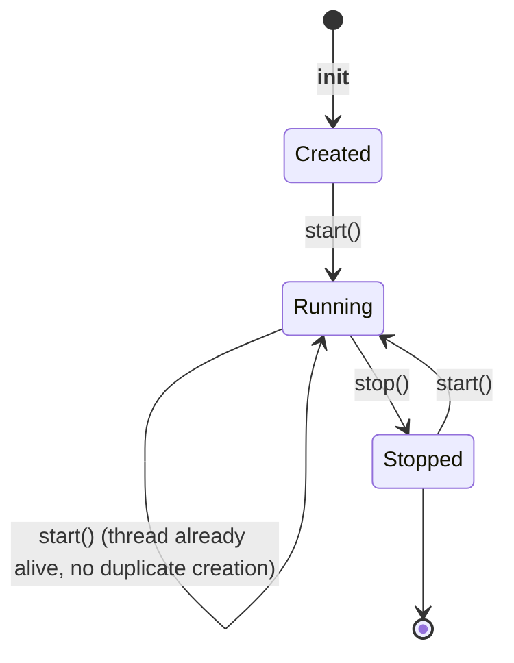
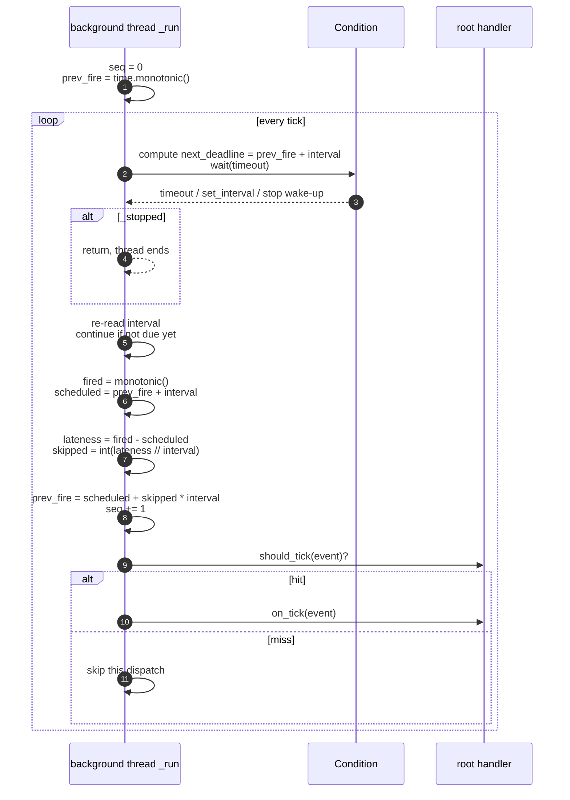

# src/celestialflow/ticker/core_ticker.py

> 📅 Last Updated: 2026/11/13

`core_ticker.py` defines `Ticker`: a time-driven ticker. In a dedicated daemon thread it anchors scheduled fire times on `time.monotonic()`, constructs a `TickEvent` on every tick, and hands it to the root handler (usually a `TickHub`).

## Ticker

```python
class Ticker:
    def __init__(
        self,
        interval: float,
        handler: TickHandler,
        *,
        name: str = "ticker",
    ) -> None: ...

    def start(self) -> None: ...
    def stop(self) -> None: ...
    def is_running(self) -> bool: ...
    def get_interval(self) -> float: ...
    def set_interval(self, interval: float) -> None: ...
```

| Parameter | Description |
|------|------|
| `interval` | Base interval in seconds, must be positive |
| `handler` | Root handler, usually a `TickHub` |
| `name` | Background thread name, default `"ticker"` |

Construction-time validation:

- `interval <= 0` → `ConfigurationError("ticker interval must be positive, got ...")`;
- `handler.tick_period < 1` → `validate_tick_period()` raises `ConfigurationError`.

## Lifecycle



| Method | Behavior |
|------|------|
| `start()` | Calls `_before_start()` first; if the background thread does not exist or has died, resets `_stopped=False` under the protection of a `Condition`, then creates and starts the daemon thread |
| `stop()` | Returns immediately if never started (`_thread is None`); otherwise sets `_stopped=True` and calls `notify_all()` to wake the waiting thread, then `join(timeout=5.0)`; if the thread is still alive it raises `RuntimeStateError`, finally sets `_thread=None` and calls `_after_stop()` |
| `is_running()` | `_thread is not None and _thread.is_alive()` |
| `get_interval()` | Reads the current base interval under the protection of the `Condition` |
| `set_interval(interval)` | Validates that it is positive, then updates the interval under the protection of the `Condition` and calls `notify_all()`; it takes effect from the next tick |

> Every call to `start()` executes `_before_start()`, even when the thread is already running. If a custom subclass performs resource initialization in that hook, it must guarantee idempotency.

## Scheduling Algorithm



### Key Points

| Behavior | Description |
|------|------|
| **The first tick is delayed by one period** | `prev_fire` is initialized to the current `monotonic()` when the thread starts, so the first fire happens `interval` seconds later |
| **Scheduled-time anchoring** | The target time of each tick is `prev_fire + interval`, not "actual end time of the previous tick + interval" |
| **No catch-up** | If processing causes `lateness > 0`, then `skipped = int(lateness // interval)` and `prev_fire` advances directly to `scheduled + skipped × interval`; missed ticks are not back-filled in bursts |
| **Delay shorter than one period** | `skipped=0`, and the delay only shows up in `TickEvent.drift` |
| **Dynamic speed adjustment** | `set_interval()` wakes the wait; the loop re-reads `_interval` and recomputes the deadline, taking effect from the next tick |
| **Inline execution** | The root handler runs synchronously in the current thread; a slow handler delays subsequent ticks |

### Skipped-Tick Example

```text
interval = 1.0
prev_fire = 0.0

scheduled 1.0s, actually fired at 1.2s: lateness=0.2, skipped=0
    prev_fire = 1.0, next tick scheduled at 2.0s

scheduled 2.0s, actually fired at 4.3s (handler took 3.1s): lateness=2.3, skipped=2
    prev_fire = 2.0 + 2×1.0 = 4.0, next tick scheduled at 5.0s
    —— the 2 periods between 2.0~4.0 are skipped outright
```

## Exception Isolation

The execution order of `_dispatch()`:

1. `handler.should_tick(event)` returns `False` → the handler is not called for the current tick;
2. Otherwise `try: handler.on_tick(event)`;
3. After catching an exception, call `handler.handle_exception(exception)`.

Failure isolation has two layers:

| Layer | Behavior |
|------|------|
| First layer | An exception thrown by a handler's `on_tick()` is handed to its own `handle_exception()` |
| Second layer | If `handle_exception()` raises again, the exception escapes `_dispatch()`; the root handler is usually a `TickHub`, and `Ticker` catches the exception and calls that hub's `handle_exception()` as the fallback, so the tick loop continues |
| Thread termination | If the root handler is not a `TickHub` and its `handle_exception()` also raises, the exception terminates the background thread |

> `_run()` does not wrap another `try` around `_dispatch()`, so the second-layer fallback relies entirely on the root handler's `handle_exception()`.

## Usage Example

```python
import time

from celestialflow.ticker import TickEvent, TickHandler, TickHub, Ticker


class Collector(TickHandler):
    def __init__(self) -> None:
        self.seqs: list[int] = []

    def on_tick(self, event: TickEvent) -> None:
        self.seqs.append(event.seq)


handler = Collector()
hub = TickHub()
hub.add_handler(handler)

ticker = Ticker(0.1, hub, name="demo-ticker")
print(ticker.is_running())  # False
ticker.start()
print(ticker.is_running())  # True

time.sleep(0.35)
ticker.stop()
print("ticks fired:", len(handler.seqs))
print("sample intervals:", handler.seqs[:5])
```

Dynamic speed adjustment:

```python
import time

from celestialflow.ticker import TickEvent, TickHandler, TickHub, Ticker


class Collector(TickHandler):
    def __init__(self) -> None:
        self.times: list[float] = []

    def on_tick(self, event: TickEvent) -> None:
        self.times.append(event.fired_at)


handler = Collector()
hub = TickHub()
hub.add_handler(handler)

ticker = Ticker(0.2, hub)
ticker.start()
time.sleep(0.25)
ticker.set_interval(0.1)   # use the new interval from the next tick
time.sleep(0.25)
ticker.stop()

print("base interval:", ticker.get_interval())
```

## Notes

1. **Daemon thread**: the `Ticker` thread is `daemon=True`, so it does not block main-program exit; still, normal finalization should call `stop()` explicitly.
2. **Stop timeout**: `join` waits at most `5.0` seconds; if a handler blocks for a long time, `stop()` raises `RuntimeStateError` and does not execute `_after_stop()`; calling `stop()` again retries.
3. **Repeated `start()` is safe**: no second thread is created while the thread is alive; `_before_start()` is still called.
4. **The thread object is not reusable after `stop()`**: `stop()` sets `_thread` to `None`, so calling `start()` again creates a new thread; `seq` also restarts from `1`.
5. **Handlers run serially**: for concurrent consumption, let `on_tick()` only write to a queue and process it in an independent consumer.
6. **Decoupled from `funnel`**: `Ticker` does not depend on `BaseSpout` / `BaseInlet`; when asynchronous persistence or pushing is needed, compose the corresponding objects inside the handler.
