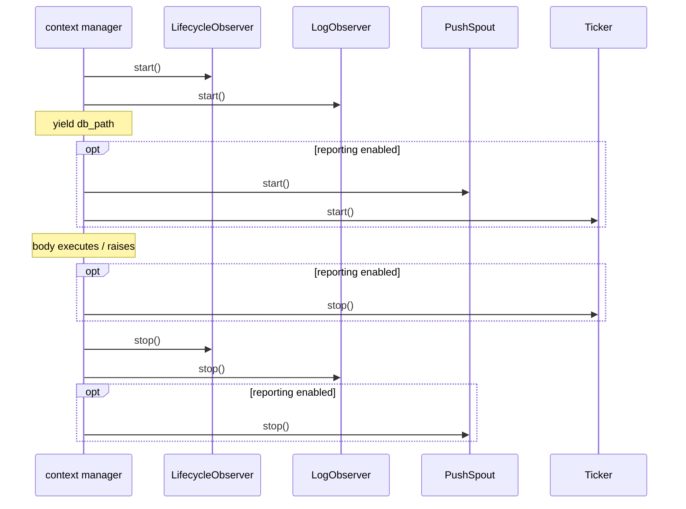

# tests/assembly/test_run.py

> 📅 Last Updated: 2026/11/13

## Purpose

Validates the resource assembly, production, and cleanup semantics of the two runtime resource context managers in `celestialflow.assembly.core_run` — `run_graph_resources` and `run_node_resources`:

- On entering the context, start the persistence observers and produce the lifecycle sqlite database path;
- Construct and register `LogObserver` according to `log_level`;
- The graph entry assembles the push channel, the snapshot handler, and the snapshot ticker when `report` is present, and creates no push resources at all when `report is None`;
- On exit (including when the context body raises), stop the ticker, the push spout, and the lifecycle / log observers in the correct order.

> The current implementation assembles `LifecycleObserver` and `LogObserver` uniformly through the private `_persistence_resources`, and no longer creates `LifecycleSpout` / `LogSpout` / `LifecycleInlet` / `LogInlet` directly. The tests assert start/stop and registration at the observer level, not the old inlet/spout pairing.

## Core Test Objects

| Object | Source | Description |
|------|------|------|
| `run_graph_resources(observers, injection_target, *, log_level, report)` | `celestialflow.assembly.core_run` | Graph runtime resource entry, produces `db_path` |
| `run_node_resources(observers, *, log_level)` | `celestialflow.assembly.core_run` | Single-node runtime resource entry, produces `db_path` |
| `_persistence_resources(observers, metrics_view, log_level)` | `celestialflow.assembly.core_run` (private) | Creates and starts `LifecycleObserver` / `LogObserver`; on exit stops lifecycle before log |
| `LifecycleObserver` / `LogObserver` | `celestialflow.persist.core_lifecycle` / `celestialflow.persist.core_log` | Persistence observers assembled by the entry under test |
| `MetricsObserver` / `ObserverHub` | `celestialflow.observer` | Metrics write model and observer container |
| `PushSpout` / `PushInlet` / `PushSnapshotHandler` | `celestialflow.reporter` | Push channel and observers when reporting is enabled |
| `Ticker` / `ReportConfig` / `DEFAULT_REPORT_URL` | `celestialflow.ticker` / `celestialflow.runtime.core_config` | Snapshot ticker and reporting configuration |
| `InvalidOptionError` | `celestialflow.runtime.util_errors` | Expected exception for an illegal `log_level` |

## Key Fixtures and Stubs

| Name | Type | Purpose |
|------|------|------|
| `tmp_path` + `monkeypatch.chdir(tmp_path)` | pytest built-in | Switches the working directory to a temporary directory so that sqlite files under `./lifecycles/...` land in the temporary path |
| `ObserverHub._snapshot()` | Internal interface of the library under test | Reads the tuple of currently registered observers, used to assert count, type, and registration order |
| `_InjectionTarget` | In-test stub | Minimal implementation satisfying the `InjectionTarget` protocol; both `inject_tasks` / `inject_terminations` are no-ops |
| `_RecordingLifecycleObserver` / `_RecordingLogObserver` | In-test subclasses | Override `stop()` to append `'lifecycle'` / `'log'` to the `stopped` list after calling `super().stop()` |
| `_RecordingPushSpout` | In-test subclass | Overrides `__init__` to record the construction count (`used.append('push')`) and the actual `base_url` |
| `_RecordingTicker` | In-test subclass | Overrides `start()` / `stop()` to record `'ticker-start'` / `'ticker-stop'` |
| `monkeypatch.setattr(core_run, ...)` | pytest built-in | Replaces `LifecycleObserver` / `LogObserver` / `PushSpout` / `Ticker` in the `core_run` module namespace, thereby intercepting construction inside the entry under test |

## Test Coverage Matrix

### `TestGraphRunResources` — graph entry

| Case | Coverage Goal |
|------|---------|
| `test_yields_db_path_and_registers_observers` | Yields an existing sqlite path on entry; registers 3 observers by default (metrics + lifecycle + log) |
| `test_stops_spouts_on_exit` | Both the lifecycle and log observers are `stop()`ped on exit |
| `test_cleans_up_when_body_raises` | When the context body raises `RuntimeError`, the exception propagates outward and the persistence observers are still cleaned up |
| `test_uses_push_spout_when_report_enabled` | When `ReportConfig(url=...)` is passed, a `PushSpout` is created and uses that address |
| `test_no_push_spout_when_report_disabled` | When `report` is not passed, no push spout is created at all |
| `test_uses_default_url_when_report_enabled_without_url` | `ReportConfig()` constructs `PushSpout` with `DEFAULT_REPORT_URL` |
| `test_registers_snapshot_handler_before_push_inlet` | `PushSnapshotHandler` is registered before `PushInlet`, ensuring the final-state snapshot is enqueued before the shutdown notification |
| `test_starts_and_stops_snapshot_ticker_when_report_enabled` | When reporting is enabled: construct the spout → start the ticker → stop the ticker on exit |
| `test_log_level_argument` | `log_level='error'` is normalized to `'ERROR'` and passed to `LogObserver` |
| `test_rejects_invalid_log_level` | An illegal level (`'VERBOSE'`) raises `InvalidOptionError` |

### `TestNodeRunResources` — node entry

| Case | Coverage Goal |
|------|---------|
| `test_registers_metrics_and_inlets` | The node entry creates `MetricsObserver` internally, registering 3 observers together with lifecycle / log, and produces `db_path` |
| `test_log_level_argument` | `LogObserver.log_level == 'ERROR'` |
| `test_rejects_invalid_log_level` | An illegal level raises `InvalidOptionError` |
| `test_stops_spouts_on_exit` | Both lifecycle / log are stopped on exit |

## Key Behavior Details

### Observer Registration Order

The registration order of the graph entry is fixed:

1. `MetricsObserver` (created inside the entry)
2. `LifecycleObserver`
3. `LogObserver`
4. `PushSnapshotHandler` (only when reporting is enabled)
5. `PushInlet` (only when reporting is enabled)

`test_registers_snapshot_handler_before_push_inlet` takes the list of observer type names from `_snapshot()` and asserts that the index of `PushSnapshotHandler` is smaller than that of `PushInlet`. This order corresponds to the implementation in `core_run` that calls `observers.add_observer(snapshot_handler)` before `observers.add_observer(push_inlet)`: when `GraphEndEvent` is dispatched, the snapshot record is enqueued first and the `/api/shutdown_session` shutdown record follows.

### Resource Start/Stop Order



- The ticker is stopped first inside `try/finally`; only afterwards does `_persistence_resources` exit and stop lifecycle / log, and finally the outermost `finally` stops `push_spout` and closes the `requests.Session`. This prevents the tick thread from continuing to enqueue after the observers/spout have been closed.
- The assertion of `test_starts_and_stops_snapshot_ticker_when_report_enabled` is `events == ['push', 'ticker-start', 'ticker-stop']`. Note that `_RecordingPushSpout` records `'push'` only at **construction**, not on `start()`; `_RecordingTicker` records start/stop. The assertion therefore proves "construct the spout first, then start/stop the ticker".
- The stop order is asserted in `test_stops_spouts_on_exit` with `set(stopped) == {'lifecycle', 'log'}`, which only verifies that both are cleaned up and does not constrain their relative order (the implementation is lifecycle → log).

### `db_path` Production

Both `run_graph_resources` / `run_node_resources` yield `lifecycle.db_path` as the context value. `LifecycleObserver.start()` triggers `_before_start()` of its internal spout, creating the database at `./lifecycles/<YYYY-MM-DD>/flow_lifecycle(<HH-MM-SS-milliseconds>).sqlite3` and assigning it to `db_path`. After `monkeypatch.chdir(tmp_path)`, the tests assert `db_path is not None` and `Path(db_path).exists()`.

### Reporting Configuration Branches

| `report` Value | Push Resources Created |
|---------------|----------------|
| `None` (default) | No `PushSpout`, no `PushInlet`, no `PushSnapshotHandler`, no `Ticker` |
| `ReportConfig()` | `PushSpout(session_id, DEFAULT_REPORT_URL)` + `PushInlet` + `PushSnapshotHandler` + `Ticker(1.0, hub, name="report")` |
| `ReportConfig(url=...)` | Same as above, with `base_url` using the explicit address |

The tests replace `core_run.PushSpout` with a recording subclass to observe construction calls and the actual URL; no real HTTP request is sent. The `requests.Session` created inside `PushSpout` is closed on exit.

### Log Level

Both entries call `normalize_log_level(log_level)` first: it strips whitespace and converts to uppercase, and raises `InvalidOptionError` for illegal values. Therefore `log_level='error'` finally results in `LogObserver.log_level == 'ERROR'`. The assertion for `run_node_resources` is inside the context body, whereas `run_graph_resources` filters `LogObserver` instances inside the context body.

## How to Run

```bash
# Run all
uv run pytest tests/assembly/test_run.py -v

# Graph entry only
uv run pytest tests/assembly/test_run.py -k "TestGraphRunResources" -v

# Node entry only
uv run pytest tests/assembly/test_run.py -k "TestNodeRunResources" -v

# Reporting-related only
uv run pytest tests/assembly/test_run.py -k "report or push or ticker" -v
```

## Notes

- The tests do not start a real task graph; they only validate resource assembly and lifecycle. The injection target uses the `_InjectionTarget` no-op implementation.
- All replacements are applied to the `core_run` module namespace (`monkeypatch.setattr(core_run, 'Ticker', ...)`), so references inside the entry under test are intercepted; replacing `celestialflow.ticker.Ticker` directly has no effect.
- The event order assertion relies on the implementation detail that "`PushSpout` is constructed before `Ticker`, and `push_spout.start()` is called before `ticker.start()`"; if the assembly order is changed, the case must be updated accordingly.
- See `src/celestialflow/assembly/core_run.py` for the implementation, and `docs/zh-CN/src/assembly/core_run.md` for resource semantics.
