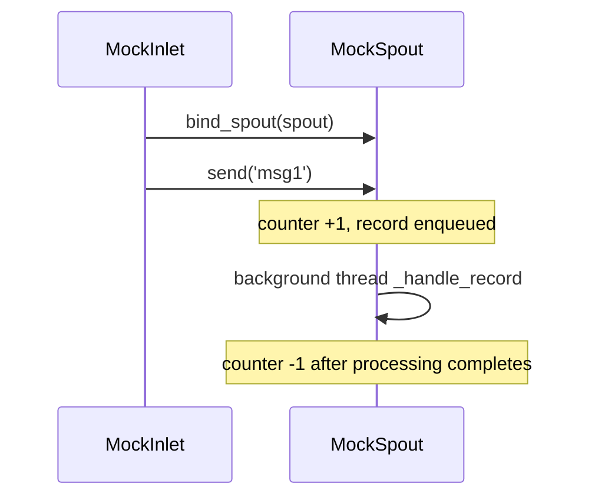

# tests/funnel/test_inlet.py

> 📅 Last Updated: 2026/11/13

## Purpose

Verifies the minimal responsibility of `celestialflow.funnel.core_inlet.BaseInlet`: placing records into the queue of the bound spout via `send(record)`, advancing the pending count, and finally having them consumed by a running `BaseSpout` subclass.

## Coverage Points

- `MockInlet.send()` reuses `BaseInlet.send()` directly to place records into the target queue.
- `MockSpout` consumes both string and dictionary messages from the queue.
- When the consumer is not started, records still enter the queue and `get_pending_count()` increases, for subsequent reads.
- `bind_spout()` returns an inlet that shares the queue / counter with the target spout, while its own type remains the subclass (`MockInlet`).

## Test Coverage Matrix

| Test Class | Case | Coverage Target |
|--------|------|----------|
| `TestBaseInlet` | `test_inlet_to_spout_communication` | After starting the spout, the inlet sends `'msg1'` and `{'key': 'val'}` in order; they are eventually consumed in order and the pending count drops to zero |
| `TestBaseInlet` | `test_send_puts_record_into_queue` | When the spout is not started, `send()` puts the raw record into `get_queue()`, and `get_pending_count() == 1` |
| `TestBaseInlet` | `test_bind_spout_creates_bound_inlet` | `bind_spout()` returns a `MockInlet` instance, and after sending it shares the same spout's queue and counter |

## Key Behavior



- `send()` increments `PendingCounter` before enqueueing, and rolls the count back if enqueueing fails; it raises `InitializationError` when no spout is bound.
- `get_pending_count()` counts records that are "enqueued but not yet fully processed", so it includes records already dequeued and still being processed.

## How to Run

```bash
pytest tests/funnel/test_inlet.py -v
pytest tests/funnel/test_inlet.py -k "communication" -v
```

## Notes

- `wait_until` comes from the root-level `tests/conftest.py` and is used to wait for background consumption to finish, avoiding fixed `sleep`.
- All records are passed through in place; `BaseInlet` performs no serialization or conversion.
