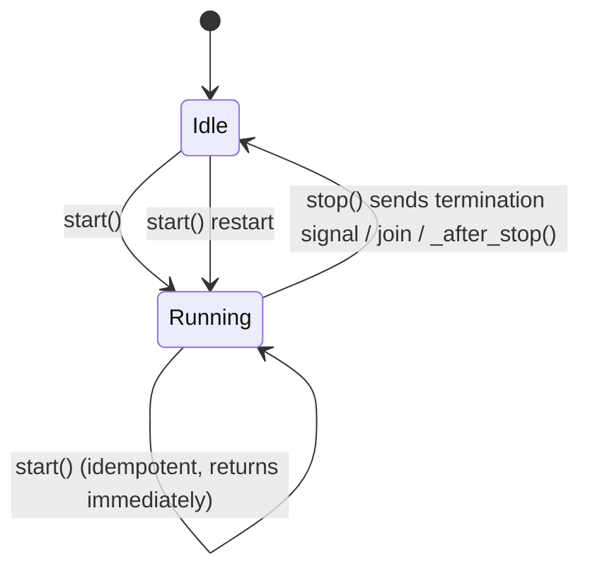

# tests/funnel/test_spout.py

> 📅 Last Updated: 2026/11/13

## Purpose

Verifies the lifecycle hooks, start idempotency, termination signal handling, and abstract method constraints of `celestialflow.funnel.core_spout.BaseSpout`, ensuring that the background listener thread can start, stop, and restart as expected and consume records enqueued before stopping.

## Coverage Points

- `start()` calls `_before_start()` on the first start; repeated `start()` does not re-execute `_before_start()` (idempotent).
- `stop()` sends the termination signal, waits for the thread to end, and triggers `_after_stop()`; no new records are consumed after stopping.
- `stop()` supports repeated calls, and repeated calls do not raise an exception.
- After `stop()`, `start()` can be called again; the restarted spout still consumes new records.
- The base class raises `CelestialFlowError` when `_handle_record()` is not implemented.

## Test Coverage Matrix

| Test Class | Case | Coverage Target |
|--------|------|----------|
| `TestBaseSpout` | `test_start_is_idempotent` | Calling `start()` twice in a row executes `_before_start()` only once |
| `TestBaseSpout` | `test_base_spout_lifecycle` | `start()` triggers `_before_start()` and data enqueued before stopping is consumed; `stop()` triggers `_after_stop()`, and data enqueued afterwards is no longer consumed |
| `TestBaseSpout` | `test_spout_termination_signal` | Both records before the termination signal are fully processed; after `stop()` the pending count is zero and repeated `stop()` is safe |
| `TestBaseSpout` | `test_spout_can_restart_after_stop` | After `stop()`, calling `start()` again recreates the background thread and continues consuming `"second"` |
| `TestBaseSpout` | `test_spout_not_implemented_error` | Raises `CelestialFlowError` when `_handle_record()` is not overridden, with a message containing `_handle_record must be implemented` |

## Key Flow



- `start()` first checks whether `_thread` is alive and returns immediately when it is; otherwise it executes `_before_start()` and creates the daemon thread.
- `stop()` writes `TERMINATION_SIGNAL` to the queue and calls `join(timeout=5)`; if the timeout elapses without exit, it raises `RuntimeStateError`. New records in the queue after termination are not consumed (`get_pending_count()` stays at 1).
- A single failed record in the background loop only prints a traceback and does not kill the thread; the pending count is decremented regardless of success.

## How to Run

```bash
pytest tests/funnel/test_spout.py -v
pytest tests/funnel/test_spout.py -k "lifecycle or termination or idempotent" -v
```

## Notes

- `wait_until` and `assert_stays_true` come from the root-level `tests/conftest.py`; they are used to wait for consumption to finish and to verify that nothing is consumed after stopping, respectively.
- `assert_stays_true` samples continuously within `duration=0.3`, avoiding timing misses caused by a single one-off check.
