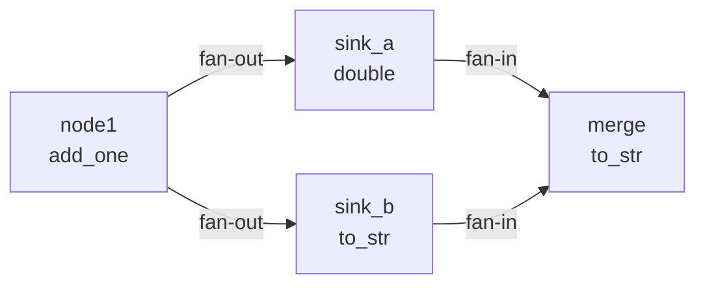

# tests/graph/test_graph.py

> 📅 Last Updated: 2026/11/13

## Purpose
Comprehensively validates the core functionality of `TaskGraph` and its various topology subclasses (`TaskChain`, `TaskCross`, `TaskGrid`), covering synchronous/asynchronous/threaded execution, task and termination signal injection, error propagation, SQLite replay, runtime snapshot counts, topology analysis, the execution mode matrix, source node derivation (including SCC), and cyclic graph behavior.

## Core Test Objects
- `TaskGraph`: General-purpose task graph container
- `TaskChain`, `TaskCross`, `TaskGrid`: Predefined topology structures
- `TaskExecutor`: Graph node definition
- `TaskGraph.inject_tasks` / `inject_terminations`: Entries for injecting tasks and termination signals by node name
- `run` / `run_async` / `start` / `start_async` / `restore_db`: Graph run entries

## Test Scope

### Summary Table

| Test Class | Case Count | Coverage Points |
|--------|--------|--------|
| `TestTaskGraphBasic` | 12 | set_ctree updates existing nodes, unknown node name lookup error, two-node DAG, read-only mapping and one-shot iterable input, `ExceptionGroup` from unknown node injection, fan-out, fan-in, error propagation, DB replay, DB error type filtered replay, DB keeps pending records, unified exception group after finish |
| `TestTaskGraphSnapshotCounts` | 3 | fan-in upstream counts, fan-out downstream counts, metrics derivation of `processed`/`pending` |
| `TestTaskGraphAsync` | 6 | async mode two-node, fan-out, fan-in, error propagation, async execution_mode, unified exception group after async finish |
| `TestTaskGraphStructure` | 3 | Chain, Cross, Grid structures |
| `TestTaskGraphAnalysis` | 5 | Node metadata, getters build analysis on demand, auto-rebuild cache after structure change, DAG detection, layer computation |
| `TestNodeExecutionMatrix` | 7 | serial/thread/async graph_mode × serial/thread/async execution_mode |
| `TestTaskGraphThread` | 6 | thread mode two-node, fan-out, fan-in, error propagation, lambda, linear chain dispatch |
| `TestSourceNodes` | 5 | Linear graph source, fan-in source, diamond graph source, single-source SCC representative, multi-source SCC returns one representative each |
| `TestCyclicGraph` | 3 | Cyclic graph raises in serial mode, cyclic is_dag detection, same level within cycle + tail level |
| `TestTaskGraphReporterCapabilities` | 3 | `inject_tasks` / `inject_terminations` injection and unknown-node handling |
| **Total** | **53** | |

> **Note**: The statistics here cover test classes in `test_graph.py`. Dedicated tests for `TaskLoop` and `TaskWheel` are in `test_structure.py`.

### Key Test Flows

#### Basic Topology Execution


- **Two-node DAG** (`test_graph_dag_two_nodes`): Verifies the A→B data flow is correct, and both nodes succeed with 3 each.
- **Read-only mapping and generator input** (`test_run_accepts_mapping_of_iterables`): `run()` accepts read-only mappings such as `MappingProxyType`, and values may be one-shot iterables such as generators (each value is iterated only once); both nodes succeed with 3 each.
- **Unknown nodes produce an exception group** (`test_run_raises_exception_group_for_unknown_node`): `run({"s1": [1], "missing": [2]})` raises an `ExceptionGroup` containing exactly one `UnknownNodeError`, whose message contains the unknown node name `missing`.
- **Fan-out** (`test_graph_fan_out`): One upstream distributes to multiple downstreams, `sink_a` and `sink_b` each succeed with 2.
- **Fan-in** (`test_graph_fan_in`): Multiple upstreams converge to one downstream, the merge node receives 4 tasks.
- **Error propagation** (`test_graph_error_propagation`): Verifies that `50` triggers a `ValueError` without blocking the flow, and downstream only receives successful tasks (node1: 2 succeeded / 1 failed, node2: 2 succeeded / 0 failed).
- **DB replay** (`test_graph_restore_db`): `restore_db` by default reads `failed` and `pending` records and replays them grouped by node name.
- **DB error type filtering** (`test_graph_restore_db_filters_error_type_when_enabled`): `restore_db(..., statuses=["failed"], filter_by_error_type=True)` filters `error_type` by each node's `retry_exceptions`.
- **DB keeps pending records** (`test_graph_restore_db_filter_keeps_pending_records`): When filtering is enabled, `pending` records continue to be replayed.
- **Unknown node name error** (`test_graph_node_lookup_unknown_node_raises`): Simulates the branch where a node name lookup fails — after `graph.node_dict.get("unknown_node")` returns `None`, `NodeNotFoundError` is raised explicitly and captured by `pytest.raises`. This case validates the exception type convention rather than the automatic raising behavior of some graph API (unknown nodes on the `run` path are covered by `UnknownNodeError` + `ExceptionGroup`).
- **set_ctree updates existing nodes** (`test_set_ctree_updates_existing_nodes`): When `set_nodes` is called before `set_ctree`, existing nodes should also share the same event client.
- **Unified exception group after finish** (`test_start_raises_exception_group_after_finish`): Synchronous `start` raises the collected `ExceptionGroup` in a unified manner after `_finish_start`.

#### Snapshot Edge Counts (`TestTaskGraphSnapshotCounts`)
- `test_fan_in_upstream_counts`: Via `metrics_of(graph).get_node_metrics("merge").upstream_counts`, verifies the fan-in node records the number of tasks provided by each upstream (`{"src_a": 2, "src_b": 2}`), and the upstream nodes' `downstream_counts` correspond accordingly.
- `test_fan_out_downstream_counts`: The fan-out node's node metrics `downstream_counts` records the number sent to each downstream, and the downstream nodes' `upstream_counts` correspond accordingly.
- `test_snapshot_restores_processed_and_pending`: After the graph runs, the node metrics snapshot derives `processed` / `pending` / `succeeded` (`processed == 3`, `pending == 0`).

#### Async and Concurrency (`TestTaskGraphAsync`)
- Two-node, fan-out, fan-in, and error propagation in async mode share the same semantics as synchronous mode.
- `test_graph_async_execution_mode`: Verifies the `graph_mode="async"` + `execution_mode="async"` combination.
- `test_start_async_raises_exception_group_after_finish`: Asynchronous `start_async` raises a unified exception group after finish.

#### Execution Mode Matrix (`TestNodeExecutionMatrix`)
Covers all **7 combinations** of `graph_mode` × `execution_mode`:

| Case | graph_mode | execution_mode |
|------|-----------|----------------|
| `test_serial_serial` | serial | serial |
| `test_serial_thread` | serial | thread |
| `test_thread_serial` | thread | serial |
| `test_thread_thread` | thread | thread |
| `test_async_serial` | async | serial |
| `test_async_thread` | async | thread |
| `test_async_async` | async | async |

Each case uses a two-node DAG with 5 input tasks, verifying both nodes succeed with 5 each.

#### Graph Structure Analysis (`TestTaskGraphAnalysis`)
- **Node metadata** (`test_get_node_meta_covers_all_nodes`): `get_node_meta()` gives build-time metadata such as `class_name` and `execution_mode` for each node.
- **On-demand build** (`test_getters_build_analysis_on_demand`): When `build` is not called explicitly, `get_nodes()`, `get_edges()`, `get_source_nodes()`, `is_dag()`, and `get_layers()` can all be called directly; each builds the analysis cache on demand.
- **Auto-rebuild cache** (`test_getters_refresh_analysis_after_connect`): After `connect`, getters should automatically rebuild the analysis cache, and source nodes and levels update accordingly (`s1` is at level 0, `s2` at level 1).
- **DAG detection** (`test_dag_detection`): The `is_dag()` method should correctly reflect whether the graph has a cycle.
- **Layer computation** (`test_layer_computation`): The levels of a linear chain A→B→C obtained via `get_layers()` are {A:0, B:1, C:2}.

#### Complex Structures (`TestTaskGraphStructure`)
| Structure | Node Count | Covered Scenario |
|------|--------|---------|
| Chain | 3-chain | Linear pipeline, each node succeeds with 2 |
| Cross | 2×3 layered fully-connected | Each layer2 node receives 1 result from each of the 2 layer1 nodes |
| Grid | 2×2 grid | The top-left root processes 2 tasks, the rest accumulate by propagation |

#### Thread Mode (`TestTaskGraphThread`)
Verifies two-node serial, fan-out, fan-in, error propagation, lambda function support, and linear chain dispatch under `graph_mode="thread"`.

#### Source Node Derivation (`TestSourceNodes`)
5 cases covering the following scenarios:

| Case | Topology | Expected Result |
|------|------|-------------|
| `test_source_nodes_linear` | A→B→C | `[A]` |
| `test_source_nodes_fan_in` | A→C, B→C | `{A, B}` |
| `test_source_nodes_diamond` | A→{B,C}→D | `[A]` |
| `test_source_nodes_cycle_returns_one_source_scc_member` | s1→s2→s3→s1 | 1 representative within the cycle |
| `test_source_nodes_returns_one_member_per_source_scc` | Two disjoint cycles converge to s5 | 1 representative per source SCC |

#### Cyclic Graph (`TestCyclicGraph`)
| Case | Verification Point |
|------|--------|
| `test_cyclic_serial_graph_raises` | Calling `get_source_nodes()` in serial graph_mode on a cyclic graph should raise `ConfigurationError` (matches `"TaskGraph contains a cycle while graph_mode='serial'"`) |
| `test_cyclic_is_dag_false` | `is_dag()` for s1→s2→s3→s1 should return `False` |
| `test_cyclic_layers` | In `get_layers()`, nodes within the cycle (s1,s2,s3) share the same level, tail s4 is at cycle level + 1 |

#### Injection Capabilities (`TestTaskGraphReporterCapabilities`)
- `test_inject_tasks_injects_valid_nodes_and_raises_for_missing`: `graph.inject_tasks({"s1": [1, 2], "missing": [9]})` first injects tasks for the existing node `s1`, then raises `UnknownNodeError` for the unknown node; the injected tasks remain in the queue and are later consumed by `graph.run({})`, with `s1` succeeding 2 tasks.
- `test_inject_tasks_with_only_valid_nodes_does_not_raise`: Raises nothing when all target nodes exist; after `run({})`, `s1` succeeds 2 tasks.
- `test_inject_terminations_injects_valid_nodes_and_raises_for_missing`: `graph.inject_terminations(["s1", "missing"])` first injects a termination signal for `s1` (via the node-side `put_signal()`), then raises `UnknownNodeError` for the unknown node. The case registers an `Observer` subclass that overrides the unified `on_event` entry, matches `TerminationInputEvent` with `match event`, records `event.node`, and finally asserts that only `"s1"` received the termination signal.

## Important Details

### Run and Injection Semantics
The execution order of `run()` / `run_async()` is: `_build_analysis()` → `_inject_observers()` → `inject_tasks(init_tasks_dict)` → `inject_terminations(self._source_names)` when `if_put_signal` is true → `start()` / `start_async()`.

- The signature of `inject_tasks` is `Mapping[str, Iterable[Any]]`, and each value is iterated only once, so `tuple`, generators, and `MappingProxyType` can all be passed directly.
- Both injection methods follow a "inject as much as possible first, then report errors uniformly" strategy: a single unknown node does not cause tasks or termination signals of the remaining nodes to be dropped, and `UnknownNodeError` is raised at the end (the message lists all unknown nodes).
- `run` / `run_async` collect exceptions raised during injection or execution into `ExceptionGroup("Errors occurred during run", [...])`, so callers see an aggregate exception rather than a bare `UnknownNodeError`.
- Termination signals are injected into the source node list obtained during the analysis phase (`self._source_names`), and the node side uniformly goes through `put_signal()`; there is no separate source-signal write interface on the graph.

### Termination Signal Behavior
- Cyclic graphs use `run()` to start and inject tasks (`run` defaults to `if_put_signal=True`, automatically emitting a termination signal for the source node) to ensure test exit.
- Calling `get_source_nodes()` in serial graph_mode on a cyclic graph triggers `ConfigurationError` (see `test_cyclic_serial_graph_raises`).

### Database Replay
- For replay cases, the module-level helper `_insert_records(sqlite_path, records)` connects and creates tables via `connect_db`, then calls `insert_record(conn, record)` one by one, skipping `sqlite3.IntegrityError` caused by duplicate `event_id`, and finally commits and closes the connection in one go.
- `restore_db(db_path, statuses=None, *, filter_by_error_type=False, if_put_signal=True, log_level=DEFAULT_LOG_LEVEL, report=None)`: `statuses` defaults to `["failed", "pending"]`; `filter_by_error_type` is a keyword-only argument that, when enabled, filters `error_type` by each node's `get_retry_error_type_names()`, but `pending` records are always kept; during replay, node names that are not present in the graph are skipped outright.

### Lambda Support
Lambda functions can be used as task functions in thread mode (`test_graph_thread_with_lambda`).

### Test Fixtures and Patching
- `tmp_path`: The 3 DB replay cases create their sqlite files under the pytest temporary directory, so they do not pollute each other.
- `monkeypatch`: `test_start_raises_exception_group_after_finish` and `test_start_async_raises_exception_group_after_finish` inject a raising function via `monkeypatch.setattr(graph, "_prepare_start", crash_prepare)` and replace `_finish_start` with a lambda returning `[RuntimeError("finish failed")]`; since `_prepare_start` raises first, `start()` / `start_async()` never execute any node, and the case focuses on the exception collection order (`["prepare failed", "finish failed"]`).
- `metrics_of` (defined in `tests/conftest.py`): Retrieves the metrics observer from the hub via `node.observers.find(MetricsObserver)`; all success/failure/count assertions in this file read through it.
- Module-level task functions: synchronous `add_one` / `double` / `to_str` / `add_offset_10`, asynchronous `async_add_one` / `async_double` / `async_to_str` / `async_add_offset_10`; the offset versions raise `ValueError` when `x > 30` to manufacture failed tasks, and the `*_10` wrappers satisfy the executor's "single-argument callable" constraint.
- `_insert_records(sqlite_path, records)`: Reuses `connect_db` / `insert_record` to write directly to the database, skipping `sqlite3.IntegrityError` caused by duplicate `event_id`, and returns the number of records actually written.

## Dependencies

| Dependency | Description |
|------|------|
| `pytest` | Test framework |
| `celestialflow` | `TaskGraph`, `TaskChain`, `TaskCross`, `TaskGrid`, `TaskExecutor` |
| `celestialflow.persist.util_sqlite` | `connect_db`, `insert_record` (DB replay cases write test records) |
| `celestialflow.runtime.util_errors` | `ConfigurationError`, `NodeNotFoundError`, `UnknownNodeError` |
| `celestialflow.runtime.util_event` | `LocalEventClient` (`set_ctree` case) |
| `celestialflow.observer` | `Event`, `Observer`, `TerminationInputEvent` (the Reporter injection cases dispatch by event type through the unified `on_event` entry) |
| Standard library | `sqlite3` (`IntegrityError` deduplication), `types.MappingProxyType` (read-only mapping input case) |
| `conftest` | `metrics_of` (retrieves the metric observer from the node hub snapshot for assertions) |

## How to Run

```bash
# Run all
uv run pytest tests/graph/test_graph.py -v

# Structure tests only (includes multithreading)
uv run pytest tests/graph/test_graph.py::TestTaskGraphStructure -v

# Analysis tests only (fastest, no task execution)
uv run pytest tests/graph/test_graph.py::TestTaskGraphAnalysis -v

# Snapshot count tests only
uv run pytest tests/graph/test_graph.py::TestTaskGraphSnapshotCounts -v

# Injection capability tests only
uv run pytest tests/graph/test_graph.py::TestTaskGraphReporterCapabilities -v
```

## Performance Reference

| Test | Duration |
|------|------|
| `TestTaskGraphBasic` | < 0.5s (DB replay cases about 0.1s, the rest < 0.05s) |
| `TestTaskGraphSnapshotCounts` | < 0.1s |
| `TestTaskGraphAsync` | < 0.1s |
| `TestTaskGraphStructure` | < 0.1s |
| `TestTaskGraphAnalysis` | < 0.1s |
| `TestNodeExecutionMatrix` | < 0.1s |
| `TestTaskGraphThread` | < 0.1s |
| `TestSourceNodes` | < 0.1s |
| `TestCyclicGraph` | < 0.1s |
| `TestTaskGraphReporterCapabilities` | < 0.1s |

> The entire file (53 cases) completes in about 1s on the current development machine.

## Related Files

- `src/celestialflow/graph/core_graph.py`: `TaskGraph` implementation
- `src/celestialflow/graph/core_structure.py`: Graph structure subclasses
- `tests/graph/test_structure.py`: TaskLoop / TaskWheel dedicated tests