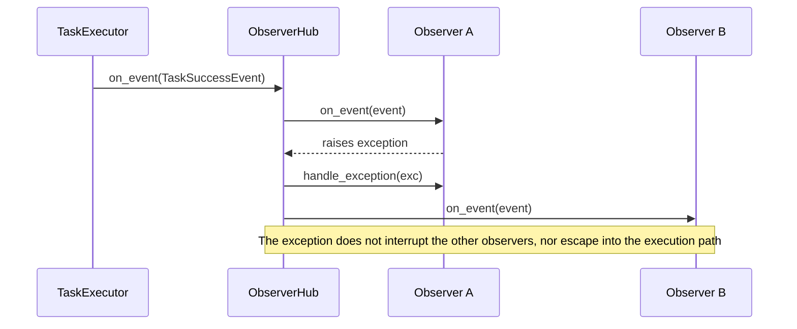

# tests/observer/test_observer.py

> 📅 Last Updated: 2026/11/13

## Purpose

Validates the unified event model in `celestialflow.observer` (the `Event` base class + `Observer.on_event(event)`), the observer distribution center `ObserverHub` (including `find()` lookup), and the contract between the built-in `PrintObserver` and running nodes / task graphs (`TaskExecutor` / `TaskGraph` / `TaskChain`): ensuring that all kinds of events in the task execution lifecycle are correctly delivered to observers, that the hub isolates exceptions from individual observers, and that graph-level observers receive all node events as well as the graph start / end events.

## Core Test Objects

| Class / Object | Source | Description |
|-----------|------|------|
| `Event` | `celestialflow.observer` | Immutable base class of all observation events (`__slots__ = ()`); it carries no state itself |
| `Observer` | `celestialflow.observer` | Observer base class with only two callbacks, `on_event(event)` and `handle_exception(exception)`; subclasses dispatch by event type with `match` inside `on_event` |
| `ObserverHub` | `celestialflow.observer` | Is itself an `Observer`, broadcasting `on_event` in registration order; provides `add_observer()`, `find(type)`, and `handle_exception()`; rejects cyclic registration |
| `PrintObserver` | `celestialflow` (also exported by `celestialflow.observer`) | Built-in standard-output observer with the constructor argument `name`; maintains `total` / `succeeded` / `failed` / `skipped` counts |
| `MetricsObserver` | `celestialflow.observer` | Metrics observer; tests read node metrics via `metrics_of(executor)` |
| `TaskExecutor` / `TaskGraph` / `TaskChain` | `celestialflow` | Runtime hosts that push events to `observers.on_event(...)` during the lifecycle |
| Event types | `celestialflow.observer` | `NodeStartEvent` / `NodeEndEvent` / `TaskInputEvent` / `TaskSuccessEvent` / `TaskFailEvent` / `TaskSkipEvent` / `TaskRetryEvent` / `TerminationInputEvent` / `TerminationMergeEvent` / `GraphStartEvent` / `GraphEndEvent` |

## Test Helper Objects

| Object | Description |
|------|------|
| `RecordingObserver` | Inherits `Observer`, overrides `on_event()` to append every received event to the `events` list, for assertions filtered by type |
| `_only(events, event_type)` | Filters the events of the specified type (`isinstance`) out of the event list |
| `CountObserver` / `SkipObserver` / `Counter` / `Tagged` etc. | Local observers defined inside the cases that only care about specific event types via `match` |
| `RetryOnceThenSucceed` | Retryable function object that raises `ValueError` on the first call and returns `x + 1` on the second |

## Test Coverage Matrix

### `TestExecutorObserver` — Executor Events

| Case | Coverage Target |
|------|---------|
| `test_observer_receives_full_lifecycle` | Serial execution of 3 tasks: 1 `NodeStartEvent`, 3 `TaskInputEvent`, 3 `TaskSuccessEvent`, 1 `NodeEndEvent`; external input has `from_node is None`; `NodeEndEvent` is the last event received |
| `test_task_success_event_carries_payload_and_ids` | `TaskSuccessEvent` carries `task` / `result` / `node`, and `success_id > task_id` |
| `test_print_observer` | `PrintObserver("PrintObserverTest")` outputs `[PrintObserverTest] start` / `finish`, with `total=3` / `succeeded=2` / `failed=1` |
| `test_observer_with_errors` | Of 3 tasks, 2 succeed and 1 fails; the `TaskSuccessEvent` / `TaskFailEvent` counts are accurate |
| `test_observer_receives_skip_callback` | With `skip_func=lambda x: x == 0`, 1 `TaskSkipEvent` is received |
| `test_no_observer_works` | The executor runs normally without an attached observer, and `metrics_of(executor).get_node_metrics(name).succeeded == 3` |
| `test_multiple_observers` | Two observers receive the same events at the same time |
| `test_task_input_reports_upstream_source` | Tasks dispatched by an upstream node in a task graph trigger `TaskInputEvent` with `node == "down"` and `from_node == "up"` |

### `TestExtendedObserver` — Retry and Termination Signals

| Case | Coverage Target |
|------|---------|
| `test_observer_receives_retry_and_termination_events` | With `max_retries=1` + `set_retry_exceptions(ValueError)`, 1 `TaskRetryEvent` (`retry_times == 1`), 1 `TerminationInputEvent`, and 1 `TerminationMergeEvent` are received |

### `TestObserverHub` — Distribution and Lookup

| Case | Coverage Target |
|------|---------|
| `test_hub_explicitly_overrides_every_observer_method` | Prevents forwarding drift: every `on_*` method in `Observer` (currently only `on_event`) must be explicitly defined in `ObserverHub` |
| `test_hub_isolates_observer_exception` | When one observer raises `RuntimeError` on a `TaskSuccessEvent`, the remaining observers still receive all events; the exception is printed to stderr via `handle_exception` |
| `test_hub_handle_exception_backstops_failing_observer_handler` | When an observer's `handle_exception` itself raises, the hub's `handle_exception` provides the backstop; both `observer boom` and `handler boom` appear on stderr, and distribution is not interrupted |
| `test_hub_rejects_cyclic_registration` | Rejects both a hub registering itself and a cycle A→B followed by B→A, raising `ConfigurationError` in each case |
| `test_find_returns_direct_observer` | `find(RecordingObserver)` hits an instance registered directly at this level |
| `test_find_returns_none_when_missing` | `find()` returns `None` when no type matches |
| `test_find_recurses_into_nested_hub` | When the match only exists in a nested hub, `find()` searches recursively and returns that instance |
| `test_find_prefers_direct_registration_over_nested` | An observer registered directly at this level takes precedence over an instance of the same type in a nested hub |
| `test_find_matches_subclass` | `find()` matches with `isinstance`, so subclass instances also hit |
| `test_find_returns_first_registered_match` | With multiple matches at the same level, the first registered instance is returned |

### `TestGraphObserver` — Graph-Level Observers

| Case | Coverage Target |
|------|---------|
| `test_graph_observer_receives_all_nodes` | The graph-level observer receives the start / end events of both the `up` / `down` nodes; in `TaskInputEvent`, `("up", None)` and `("down", "up")` each appear 2 times; 4 `TaskSuccessEvent` in total |
| `test_node_local_observer_runs_before_graph_observer` | Within the same node, the node-local observer receives events before the graph-level observer (order `["node", "graph"]`) |
| `test_graph_hub_is_injected_as_object` | The hub object itself is injected: graph-level observers registered after `run` also take effect; the case verifies this by manually triggering `node.observers.on_event(TaskSuccessEvent(...))` |
| `test_run_async_injects_graph_observers` | The `run_async` path also completes graph-level observer injection |
| `test_graph_observer_receives_graph_events` | 1 `GraphStartEvent` and 1 `GraphEndEvent` are received; the start event carries `graph` / `graph_mode` / `is_dag` / `nodes` / `edges` / `source_nodes` / `node_meta`, where `node_meta["only"]["class_name"] == "TaskExecutor"` |
| `test_structure_supports_graph_observer` | Structure classes such as `TaskChain` also support graph-level observers |
| `test_graph_rejects_cycle_between_graph_and_node_hub` | After registering a node hub into the graph hub, injection during `graph.run()` raises `ConfigurationError` due to the cyclic reference |

## Event Distribution and Lookup Flow

```mermaid
flowchart LR
    Node[TaskExecutor] -->|on_event| NH[node ObserverHub]
    Graph[TaskGraph] -->|inject hub| NH
    NH -->|direct registration| L[node-local observer]
    NH -->|nested hub| GH[graph-level ObserverHub]
    GH --> G[graph-level observer]
    Q[hub.find(type)] -->|this level first| NH
    NH -->|recurse on miss| GH
```



## Test Focus

- **Unified entry point**: All events are distributed via `on_event(event)`, and observers handle concrete event types with `match`; there are no longer per-event callback methods.
- **Event ordering**: `NodeStartEvent` comes first and `NodeEndEvent` last; node-local observers run before graph-level observers.
- **Payload and IDs**: Success events carry the task, the result, and independent `task_id` / `success_id` (incrementing).
- **Cause tracing**: Tasks dispatched upstream identify their source node via `TaskInputEvent.from_node`.
- **Hub exception isolation**: An exception thrown by a single observer (including `handle_exception` itself throwing) does not affect the other observers and does not interrupt distribution.
- **Lookup semantics**: `find()` prefers the current level, follows registration order, recurses into nested hubs, and matches with `isinstance`.
- **Cycle protection**: Observer hubs reject registrations that would form cyclic references.

## How to Run

```bash
# Run all
pytest tests/observer/test_observer.py -v

# Executor observer tests only
pytest tests/observer/test_observer.py -k "Executor" -v

# ObserverHub tests only (including find)
pytest tests/observer/test_observer.py -k "Hub" -v

# Graph observer tests only
pytest tests/observer/test_observer.py -k "Graph" -v
```

## Performance Reference

| Test | Duration |
|------|------|
| `TestExecutorObserver` | < 1.0s |
| `TestExtendedObserver` | < 0.5s |
| `TestObserverHub` | < 0.5s |
| `TestGraphObserver` | < 1.0s (includes graph construction and running) |

## Notes

- `test_print_observer` captures standard output via `redirect_stdout(io.StringIO())`, asserts the output contains `[PrintObserverTest] start` / `finish`, and reads the observer's `total` / `succeeded` / `failed` counters; `PrintObserver` also maintains a `skipped` count.
- `test_hub_isolates_observer_exception` and `test_hub_handle_exception_backstops_failing_observer_handler` capture the error tracebacks forwarded by the hub via `redirect_stderr`.
- Most executor cases use `execution_mode="serial"` to make it convenient to assert events in sequence.
- The observer pattern is the foundation for the framework's monitoring, logging, and progress bar implementations; `PrintObserver.__init__(name)` requires a node name, used to prefix the output with `[name]`.
