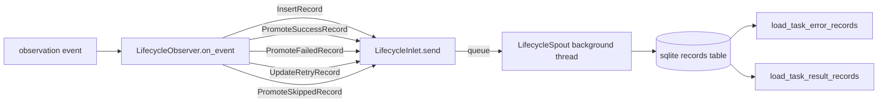

# tests/persist/test_lifecycle.py

> 📅 Last Updated: 2026/11/13

## Purpose

Verifies the lifecycle persistence capability of `LifecycleObserver` in `celestialflow.persist.core_lifecycle`: the observer translates `TaskInputEvent` / `TaskSuccessEvent` / `TaskFailEvent` / `TaskRetryEvent` / `TaskSkipEvent` into dataclass records, delivers them to the background `LifecycleSpout` via `LifecycleInlet.send()`, and finally writes them to the sqlite file; it also validates task-error / task-result readback, retry-count persistence, and automatic column addition for old databases.

## Core Test Objects

| Class / Object | Source | Description |
|-----------|------|------|
| `LifecycleObserver` | `celestialflow.persist.core_lifecycle` | Observer facade: internally creates and binds `LifecycleSpout` and `LifecycleInlet`, provides `start()` / `stop()` / `db_path`, and translates events into lifecycle records in `on_event(event)` |
| `LifecycleRecord` | `celestialflow.persist.core_lifecycle` | Record union type whose members are the following 5 immutable dataclasses |
| `InsertRecord` | `celestialflow.persist.core_lifecycle` | `TaskInputEvent` → writes one `pending` record (`event_id` / `ts` / `node` / `task`) |
| `PromoteSuccessRecord` | `celestialflow.persist.core_lifecycle` | Promotes pending to `success` and writes the result (keeping the original `event_id`) |
| `PromoteFailedRecord` | `celestialflow.persist.core_lifecycle` | Promotes pending to `failed`, switches `event_id` to the failure event's `error_id`, and writes the error type / message |
| `PromoteSkippedRecord` | `celestialflow.persist.core_lifecycle` | Promotes pending to `skipped` and switches `event_id` to the skip event's `skip_id` |
| `UpdateRetryRecord` | `celestialflow.persist.core_lifecycle` | Updates the pending record's retry count and latest error message; the status remains `pending` |
| `LifecycleSpout` / `LifecycleInlet` | `celestialflow.persist.core_lifecycle` | Background sqlite writer and record entry point; assembled internally by `LifecycleObserver`, so tests do not instantiate them directly |
| `load_task_error_records` / `load_task_result_records` | `celestialflow.persist.util_sqlite` | Reads task-error / task-result pairs per node |
| `connect_db` | `celestialflow.persist.util_sqlite` | Establishes a connection and handles table structure upgrades (e.g., adding a `retry_times` column for old databases) |
| Event types | `celestialflow.observer` | `TaskInputEvent` / `TaskSuccessEvent` / `TaskFailEvent` / `TaskRetryEvent` / `TaskSkipEvent` |

## Record Mapping

| Event | Record Produced | Storage Semantics |
|------|-----------|---------|
| `TaskInputEvent` | `InsertRecord(event_id=event.input_id, ts, node, task)` | Inserts a new row with `status="pending"` |
| `TaskSuccessEvent` | `PromoteSuccessRecord(event_id=event.task_id, ts, result)` | `status="success"`, keeps the original `event_id`, clears the error fields, and writes `result_json` |
| `TaskFailEvent` | `PromoteFailedRecord(event_id=event.task_id, error_id=event.error_id, ts, error_type, error_message)` | `status="failed"`, with `event_id` replaced by `error_id` |
| `TaskRetryEvent` | `UpdateRetryRecord(event_id=event.task_id, ts, retry_times, error_type, error_message)` | Only updates `retry_times` / the latest error / `ts`; the status remains `pending` |
| `TaskSkipEvent` | `PromoteSkippedRecord(event_id=event.task_id, skip_id=event.skip_id, ts)` | `status="skipped"`, with `event_id` replaced by `skip_id` and the error fields cleared |

## Test Coverage Matrix

| Test Class | Case Count | Coverage Target |
|--------|--------|---------|
| `TestLifecyclePersistence` | 5 | Full lifecycle persistence, success result persistence, retry count persistence, skip persistence, old database column addition |

## Key Test Scenarios

### `test_lifecycle_persistence`

Covers the two chains `TaskInputEvent` → `TaskFailEvent` and `TaskInputEvent` → `TaskSuccessEvent` (nodes s1 / s2).

- Calls `LifecycleObserver.start()` to start the background writer thread and create the `.sqlite3` file.
- s1: the input (`input_id=1`) is written as pending, then the failure event (`task_id=1`, `error_id=21`) promotes the record to failed; the final stored `event_id` is 21, bound to `("ValueError", "oops")`.
- s2: after the input (`input_id=2`), the success event (`task_id=2`, `success_id=3`) promotes the record to success, keeping `event_id=2` and writing the result `"ok2"`.
- Calls `stop()` in `finally` to ensure the transaction is committed and the connection closed.
- Asserts that `db_path` exists and has the `.sqlite3` suffix; `load_task_error_records(db_path, "s1")` returns `[("data1", ("ValueError", "oops"))]`.
- Directly queries the `records` table sorted by `id`, verifying that the `event_id` sequence is `[21, 2]` (checking `node` / `status` / `error_type` / `error_message` / `task_json` / `result_json` field by field), and that the `ts` of both records is greater than 0.

### `test_success_persistence`

- Sends input + success events for s1 and s2 respectively (results 100 / 200).
- Asserts that `load_task_result_records(db_path, "s1")` returns `[("task1", 100)]`.

### `test_retry_persistence`

- s1: input → two `TaskRetryEvent`s (`retry_times` 1, 2) → success event; promotion to success clears the error message and keeps `retry_times == 2`.
- s2: input → two `TaskRetryEvent`s → failure event; the failed record keeps the latest error message (`ValueError` / `final boom`) with `retry_times == 2`.
- Asserts that `(event_id, status, retry_times)` in the `records` table is `[(1, "success", 2), (22, "failed", 2)]`; the error fields of the success record are empty, and the failed record's `result_json` is `null`.

### `test_skip_persistence`

- s1: input (`input_id=1`) + skip event (`task_id=1`, `skip_id=31`); the record is promoted to `skipped` and `event_id` switches to 31.
- s2: input + success event, as a control.
- Asserts that `[(event_id, status)]` is `[(31, "skipped"), (2, "success")]`; the skip record's error fields are empty and its `result_json` is `null`.

### `test_old_db_gets_retry_times_column`

- Manually creates a `records` table without the `retry_times` column.
- After calling `connect_db(db_path)`, asserts via `PRAGMA table_info(records)` that the `retry_times` column has been automatically added.

## Data Flow



## How to Run

```bash
# Run all
pytest tests/persist/test_lifecycle.py -v

# Match by keyword
pytest tests/persist/test_lifecycle.py -k "lifecycle" -v
pytest tests/persist/test_lifecycle.py -k "success" -v
pytest tests/persist/test_lifecycle.py -k "retry" -v
pytest tests/persist/test_lifecycle.py -k "skip" -v
```

## Notes

- Tests use `monkeypatch.chdir(tmp_path)` to switch the working directory to a temporary directory; the sqlite file is written under `lifecycles/<date>/` inside the temporary directory and cleaned up automatically after the test ends.
- Every case explicitly calls `start()` / `stop()` on the observer; `stop()` commits the remaining transaction and closes the sqlite connection.
- The stored `event_id` of failed / skipped records is replaced by the event ID carried by the final-status event (`error_id` / `skip_id`), keeping subsequent error query / push semantics consistent.
- `LifecycleInlet` / `LifecycleSpout` are created as an internal pair by `LifecycleObserver`; tests never touch the queue directly, and all enqueuing goes through `LifecycleInlet.send(record)`.
- The related implementation is in `src/celestialflow/persist/core_lifecycle.py`.
