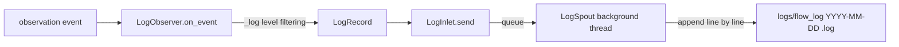

# tests/persist/test_log.py

> 📅 Last Updated: 2026/11/13

## Purpose

Verifies the log persistence capability of `LogObserver` in `celestialflow.persist.core_log`: the observer translates graph / node / task / termination-signal events into `LogRecord`s, delivers them to the background `LogSpout` via `LogInlet.send()`, and writes them asynchronously to the log file; the tests also verify log-level filtering and the `[task_id->event_id*]` event ID markers.

## Core Test Objects

| Class / Object | Source | Description |
|-----------|------|------|
| `LogObserver` | `celestialflow.persist.core_log` | Observer facade: the constructor arguments are `metrics_view` and `log_level`; it internally creates and binds `LogSpout` / `LogInlet`, provides `start()` / `stop()` / `log_path`, and logs by event type in `on_event(event)` |
| `LogRecord` | `celestialflow.persist.core_log` | Immutable dataclass: `timestamp` / `level` / `message` |
| `LogInlet` | `celestialflow.persist.core_log` | Record entry point that only provides `send(record)`, putting the record into the queue of the bound spout |
| `LogSpout` | `celestialflow.persist.core_log` | Background thread that consumes the queue and writes records line by line as `"{timestamp} {level} {message}"` into the log file; the path is obtained via `log_path` |
| `MetricsObserver` | `celestialflow.observer` | Passed in as the `MetricsView`, used by `LogObserver` to read task-count statistics when nodes start / end |
| Event types | `celestialflow.observer` | `GraphStartEvent` / `TaskRetryEvent` / `GraphEndEvent` / `NodeStartEvent` / `TaskSkipEvent` |

## Events and Log Levels

| Event | Level | Key Content |
|------|:----:|---------|
| `GraphStartEvent` | `INFO` | Graph name, `graph_mode`, and structure lines expanded via `render_structure_list()` |
| `GraphEndEvent` | `INFO` | Graph name and elapsed time |
| `NodeStartEvent` | `INFO` | Node name, `input_total` read from `metrics_view`, `execution_mode-max_workers` |
| `NodeEndEvent` | `INFO` | Node name, execution mode, elapsed time, success / failure / skip counts |
| `TaskInputEvent` | `DEBUG` | Task representation, source (`from_node` or `external`), `[input_id*]` |
| `TaskSuccessEvent` | `SUCCESS` | Task representation, result, elapsed time, `[task_id->success_id*]` |
| `TaskFailEvent` | `ERROR` | Exception type and message, `[task_id->error_id*]` |
| `TaskSkipEvent` | `SUCCESS` | Task representation, `[task_id->skip_id*]` |
| `TaskRetryEvent` | `WARNING` | Retry count, exception type, `[task_id*]` |
| `TerminationInputEvent` | `DEBUG` | `[termination_id*]` |
| `TerminationMergeEvent` | `TRACE` | `[parent_ids->termination_id*]` |

> `LogObserver` discards event logs below `log_level`; `log_level` is `upper()`-cased and validated at construction time, and an invalid value raises `InvalidOptionError`. The default value comes from `celestialflow.runtime.util_log_level.DEFAULT_LOG_LEVEL` (currently `"INFO"`).

## Test Coverage Matrix

| Test Class | Case Count | Coverage Target |
|--------|--------|---------|
| `TestLogPersistence` | 2 | Full log lifecycle, skip log |

## Key Test Scenarios

### `test_log_persistence`

- Constructs `LogObserver(MetricsObserver(), log_level='INFO')` and calls `start()` to start the background writer thread.
- Sequentially sends `GraphStartEvent` (graph name / mode / structure list / node metadata), `TaskRetryEvent` (carrying a `ValueError`), `GraphEndEvent`, and `NodeStartEvent`.
- Uses `wait_until` to poll until the log file exists and contains both the structure line `| node |` and the task representation `hello world`.
- Calls `stop()` in `finally`; finally asserts that both `INFO` and `WARNING` level markers are present in the log file.

### `test_skip_log`

- Constructs `LogObserver(MetricsObserver(), log_level='SUCCESS')`.
- Sends `TaskSkipEvent("node", "hello world", "hello world", 7, 8)`.
- Uses `wait_until` until the log file contains `hello world`.
- Asserts that the log contains `hello world`, `skipped`, `[7->8*]`, and the `SUCCESS` level marker.

## Data Flow



## How to Run

```bash
pytest tests/persist/test_log.py -v
pytest tests/persist/test_log.py -k "log_persistence" -v
pytest tests/persist/test_log.py -k "skip" -v
```

## Notes

- Tests use `monkeypatch.chdir(tmp_path)` to switch the working directory, and logs are written to `logs/flow_log(<date>).log` under the temporary directory.
- The log file path is obtained via the `LogObserver.log_path` property (forwarded from `LogSpout.log_path`); it is `None` before the spout has started.
- `LogInlet` only inherits `BaseInlet` and exposes `send(record)`; events are written to the file asynchronously through the queue, and tests use `wait_until` to avoid thread-timing jitter.
- Both cases pass `log_level` explicitly and do not cover the default-value branch.
- The related implementation is in `src/celestialflow/persist/core_log.py`.
