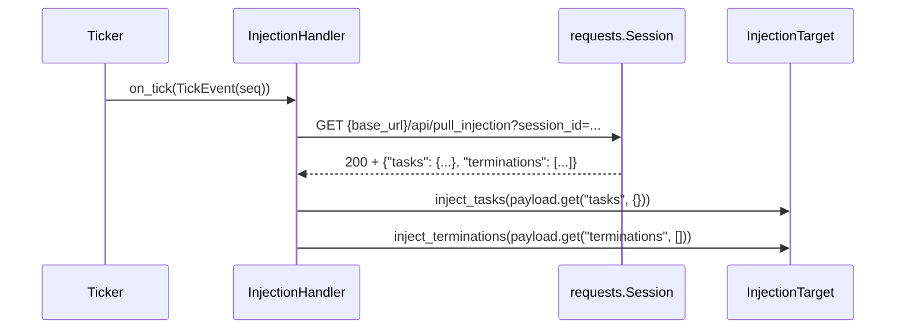

# tests/reporter/test_inject.py

> 📅 Last Updated: 2026/11/13

## Purpose

Verifies the remote injection pull behavior of `celestialflow.reporter.InjectionHandler`: on each tick it GETs `/api/pull_injection` and hands the returned task mapping and termination sequence to `InjectionTarget` in order; it covers the pull-failure, injection-failure, and tick-scaling paths.

## Core Test Objects

| Object | Source | Description |
|------|------|------|
| `InjectionHandler` | `celestialflow.reporter` | Tick handler with `tick_period = 5` |
| `InjectionTarget` | `celestialflow.reporter` | Protocol: `inject_tasks(Mapping[str, Iterable[Any]])` + `inject_terminations(Sequence[str])` |
| `TickEvent` | `celestialflow.ticker` | Constructed directly by the tests, without relying on a real ticker |
| `ReporterError` | `celestialflow.runtime.util_errors` | Expected exception when the pull returns a non-2xx status |

## Key Fixtures and Fakes

| Name | Purpose |
|------|------|
| `FakeResponse` | Simulates a successful response: `ok = True`, `status_code = 200`, and `json()` returns a preset payload |
| `FakeFailResponse` | Simulates a failed response: `ok = False`, `status_code = 500`, and `json()` returns `{}` (which should not be called) |
| `FakeSession` | A `requests.Session` stand-in that records `(url, params, timeout)` triples into `gets` and returns the response passed at construction time |
| `FakeTarget` | An `InjectionTarget` stand-in that appends each injected `tasks` / `terminations` to a list, making it easy to assert "how many injections happened and what the content was" |
| `make_event(seq)` | Builds a `TickEvent` with the given `seq` and all other time fields fixed to `0.0` |
| `RaisingTarget` (local class inside a case) | Inherits `FakeTarget`; `inject_tasks` raises `RuntimeError("unknown node")` |

## Test Coverage Matrix

| Case | Coverage Target |
|------|---------|
| `test_injection_handler_pulls_and_injects` | Pull URL, query parameters, and injection order of tasks and terminations |
| `test_injection_handler_raises_on_pull_failure` | Non-2xx raises `ReporterError` and no injection is performed |
| `test_injection_handler_propagates_inject_failure` | Task injection exceptions propagate upward, and termination injection is not executed |
| `test_injection_handler_tick_period_is_five` | `tick_period == 5`, with hitting ticks at `1, 6, 11, ...` |

## Key Behavior Details

### A Single Successful Pull



- **URL**: `f"{base_url}/api/pull_injection"`.
- **Query parameters**: only `{"session_id": session_id}`; the test asserts `params["session_id"] == "g1"`.
- **Timeout**: the module constant `_PULL_TIMEOUT = 3.0`, which `FakeSession.get` records as the third element (the test only uses `_timeout` as a placeholder and does not assert a specific value).
- **Injection order**: `inject_tasks` first, `inject_terminations` second. If `tasks` injection raises, `terminations` is not executed — `test_injection_handler_propagates_inject_failure` proves this with `target.terminations == []`, while `pytest.raises(RuntimeError, match="unknown node")` confirms the original exception was not wrapped.
- **Default keys**: when the payload is missing, the defaults of `.get("tasks", {})` and `.get("terminations", [])` are used (this file does not cover them directly, but it is part of the contract of the implementation under test).

### Pull Failure

- When `FakeFailResponse.ok is False`, the handler raises `ReporterError("Failed to pull task injection: 500")` before calling `json()`.
- The test asserts `target.tasks == []` and `target.terminations == []`, i.e. the failure path never produces a partial injection.
- The exception is ultimately consumed by the ticker's handler exception-isolation mechanism (`TickHandler.handle_exception`) and does not affect subsequent ticks; the test only verifies that the handler itself raises.

### Tick Scaling

`InjectionHandler.tick_period = 5`, and the base class `should_tick` uses `(event.seq - 1) % tick_period == 0`:

| seq | 1 | 2 | 3 | 4 | 5 | 6 | 7 | 8 | 9 | 10 | 11 |
|-----|---|---|---|---|---|---|---|---|---|----|----|
| Hit | ✅ | ❌ | ❌ | ❌ | ❌ | ✅ | ❌ | ❌ | ❌ | ❌ | ✅ |

When running on `Ticker`'s 1-second base period, this is equivalent to pulling once every 5 seconds. The test directly iterates over `range(1, 12)` calling `should_tick(make_event(seq))`, without starting a ticker.

## How to Run

```bash
# Run all
uv run pytest tests/reporter/test_inject.py -v

# Failure paths only
uv run pytest tests/reporter/test_inject.py -k "failure or propagates" -v
```

## Notes

- All network interaction is replaced by `FakeSession`, so no real HTTP requests are made and running this single file should take well under 1 second.
- `InjectionHandler` does not own the `requests.Session`; closing it is the caller's responsibility (`run_graph_resources`), so the fake session in the tests does not need to be closed.
- `FakeTarget` records the complete object of each injection, so `target.tasks == [{"StageA": [1, 2]}]` simultaneously verifies "injected only once" and "payload passed through unchanged".
- The related implementation is in `src/celestialflow/reporter/core_inject.py`; for the semantics, see `docs/zh-CN/src/reporter/core_inject.md`.
