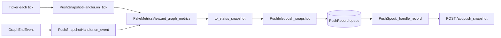

# tests/reporter/test_snapshot.py

> 📅 Last Updated: 2026/11/13

## Purpose

Verifies the status snapshot pipeline of the reporter module:

- `to_status_snapshot()` projects a `NodeMetrics` mapping into a push payload;
- `PushSnapshotHandler.on_tick()` reads the whole-graph metrics on every tick and hands a `kind="snapshot"` record to `PushInlet`;
- `PushSnapshotHandler.on_event(GraphEndEvent)` pushes one final-status snapshot when the graph ends;
- Snapshot records are pushed to `/api/push_snapshot` through `PushSpout`.

## Core Test Objects

| Object | Source | Description |
|------|------|------|
| `to_status_snapshot(metrics)` | `celestialflow.reporter.core_snapshot` | Pure projection function from node metrics to a status dictionary |
| `PushSnapshotHandler` | `celestialflow.reporter` | Both a `TickHandler` and an `Observer` |
| `PushInlet` / `PushSpout` / `PushRecord` | `celestialflow.reporter.core_push` | Snapshot enqueueing and pushing |
| `GraphEndEvent` | `celestialflow.observer` | The event that triggers the final-status push |
| `NodeMetrics` / `NodeStatus` | `celestialflow.runtime.util_types` | Metrics snapshot and node status enum |
| `TickEvent` | `celestialflow.ticker` | Constructed directly, without starting a ticker |

## Key Fixtures and Fakes

| Name | Purpose |
|------|------|
| `FakeMetricsView` | A read-only view stand-in implementing `get_node_metrics()` / `get_graph_metrics()`; `graph_calls` records the number of `get_graph_metrics()` calls |
| `FakePushSession` | A `requests.Session` stand-in that records POSTs; `post()` returns a fixed successful response |
| `make_metrics(node, *, succeeded=0)` | Builds `NodeMetrics` in `NodeStatus.RUNNING`: `start_time=1.0`, `end_time=0.0`, with `external_input` / `input_total` / `succeeded` / `processed` all equal to `succeeded` |
| `make_event(seq)` | Builds a `TickEvent` with fixed time fields |

## Test Coverage Matrix

| Case | Coverage Target |
|------|---------|
| `test_to_status_snapshot_projects_node_metrics` | The key set and field mapping of the projection output |
| `test_handler_enqueues_snapshot_record` | `on_tick` enqueues one `kind="snapshot"` record and reads the whole-graph metrics only once |
| `test_handler_pushes_final_snapshot_on_graph_end` | `GraphEndEvent` triggers one final-status snapshot push |
| `test_spout_pushes_snapshot_to_push_snapshot_endpoint` | The URL and payload of `POST /api/push_snapshot` (`session_id` / `snapshot` / `timestamp`) |

## Key Behavior Details

### Projection Fields

`to_status_snapshot` outputs the following keys for each node:

| Output Key | Source `NodeMetrics` Field |
|--------|------------------------|
| `start_time` | `start_time` |
| `end_time` | `end_time` |
| `status` | `status` (a `NodeStatus` enum; tests compare directly against `NodeStatus.RUNNING`) |
| `tasks_input` | `input_total` |
| `tasks_succeeded` | `succeeded` |
| `tasks_failed` | `failed` |
| `tasks_skipped` | `skipped` |
| `tasks_processed` | `processed` |
| `tasks_pending` | `pending` |
| `upstream_counts` | `upstream_counts` |
| `downstream_counts` | `downstream_counts` |

The tests only assert `start_time` / `end_time` / `status` / `tasks_input` / `tasks_succeeded` / `upstream_counts` / `downstream_counts`; the remaining fields are guaranteed by the same dictionary comprehension.

### Two Trigger Paths



- **Tick path**: `on_tick` → `_push_snapshot()` → `to_status_snapshot(get_graph_metrics())` → `PushInlet.push_snapshot()`. The test asserts `record.kind == "snapshot"`, `record.snapshot["s1"]["tasks_succeeded"] == 2`, and `view.graph_calls == 1`.
- **Graph-end path**: `on_event` uses `match` to handle only `GraphEndEvent` and ignores other events. The test builds `GraphEndEvent(graph="g1", end_time=2.0, elapsed=1.0)` and asserts that a snapshot is enqueued immediately with `graph_calls == 1`.
- The point of the extra push: snapshots are only produced on ticks, but graph teardown stops the ticker first, so the final status between the last tick and graph end (all nodes `STOPPED`, final counts) would not be captured by any tick. `PushSnapshotHandler` only does projection and enqueueing, with no network IO.

### Push Payload

- Endpoint: `{base_url}/api/push_snapshot`.
- Payload: `{"session_id": ..., "snapshot": {...}, "timestamp": time.time()}`.
- The test enqueues directly with `inlet.push_snapshot({"s1": {"status": 1}})`, then calls `spout._handle_record(spout.get_queue().get())`, asserting `payload["snapshot"] == {"s1": {"status": 1}}` and `payload["timestamp"] > 0`.

## How to Run

```bash
# Run all
uv run pytest tests/reporter/test_snapshot.py -v

# Projection function only
uv run pytest tests/reporter/test_snapshot.py -k "status_snapshot" -v

# Handler only
uv run pytest tests/reporter/test_snapshot.py -k "handler" -v

# Endpoint pushing only
uv run pytest tests/reporter/test_snapshot.py -k "endpoint" -v
```

## Notes

- The tests do not start a `Ticker`; they call `on_tick` / `on_event` directly, so there is no timing jitter.
- `FakeMetricsView.graph_calls` is used to confirm that one trigger reads the whole-graph metrics only once, avoiding duplicate snapshots inside the handler that would cause payload inconsistency or extra overhead.
- The handler constructor arguments are `(metrics_view, inlet)`, where `inlet` must already have been `bind_spout`; the tests establish the binding with `PushInlet().bind_spout(spout)`.
- `spout._session` is assigned a fake session directly to bypass `start()`, consistent with the approach in `test_push.py`.
- The related implementation is in `src/celestialflow/reporter/core_snapshot.py`; for the semantics, see `docs/zh-CN/src/reporter/core_snapshot.md`.
