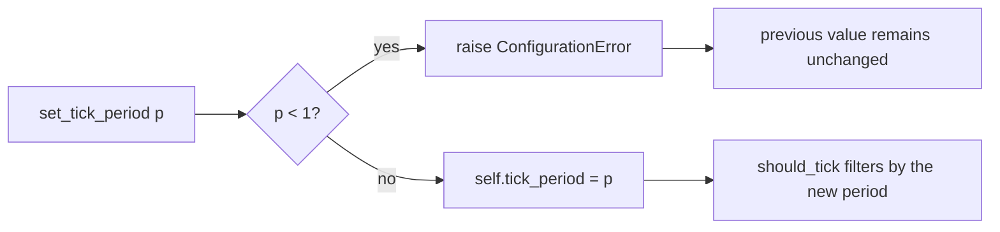

# tests/ticker/test_handler.py

> 📅 Last Updated: 2026/11/13

## Purpose

Verifies the basic tick-filtering semantics of `celestialflow.ticker.TickHandler`: the default `tick_period`, the `should_tick()` behavior after a runtime adjustment, phase re-anchoring, and argument validation for non-positive periods.

## Core Test Objects

| Object | Source | Description |
|------|------|------|
| `TickHandler` | `celestialflow.ticker` | Tick handler base class, with `tick_period: int = 1` |
| `TickHandler.should_tick(event)` | Same as above | The hit condition is `(event.seq - 1) % tick_period == 0` |
| `TickHandler.set_tick_period(period)` | Same as above | Changes the period at runtime; an invalid value raises `ConfigurationError` |
| `TickEvent` | `celestialflow.ticker` | Only `seq` participates in filtering; the tests fill the other time fields with fixed values |
| `ConfigurationError` | `celestialflow.runtime.util_errors` | Expected exception for a non-positive period |

## Key Fixtures and Helper Functions

| Name | Purpose |
|------|------|
| `make_event(seq)` | Builds an event with the given `seq`, `interval=1.0`, `scheduled_at=fired_at=wall_time=float(seq)`, `drift=0.0`, and `skipped=0` |
| `BareHandler` | The minimal subclass that only implements `on_tick` and does not override `tick_period`, used to observe the default value and runtime adjustments |
| `hit_seqs(handler, upto)` | Calls `handler.should_tick(make_event(seq))` for each tick in `1..upto`, returning the list of hit sequence numbers |

> The tests do not start a `Ticker` and do not depend on `TickHub`; they only call the base class methods directly, so they are fully synchronous with no timing jitter.

## Test Coverage Matrix

| Case | Coverage Target |
|------|---------|
| `test_handler_default_tick_period_is_one` | Default `tick_period == 1`, with ticks 1~5 all hitting |
| `test_set_tick_period_takes_effect_on_should_tick` | `set_tick_period(2)` → hits `1,3,5,7`; then setting 3 → hits `1,4,7` |
| `test_set_tick_period_rejects_non_positive` | `set_tick_period(0)` raises `ConfigurationError`, and the previous value `3` remains unchanged |

## Key Behavior Details

### Filtering Formula and Phase

`should_tick` takes the modulus against `seq - 1`, so **the 1st tick hits for any valid period**. After adjusting the period, counting does not restart from the "current tick"; instead it re-anchors to `seq == 1`:

| Period | Hit Sequence Numbers (starting at 1) |
|:----:|------------------|
| 1 | 1, 2, 3, 4, 5, 6, 7 |
| 2 | 1, 3, 5, 7 |
| 3 | 1, 4, 7 |

The test first calls `set_tick_period(2)` and verifies `[1, 3, 5, 7]`, then calls `set_tick_period(3)` and verifies `[1, 4, 7]` — note that the second adjustment happens on the same object without `seq` advancing, and the result is still anchored at `seq == 1`, showing that the phase depends only on `seq` and not on when the call happens.

### Argument Validation

`set_tick_period(0)` checks `< 1` before assignment and raises `ConfigurationError("tick_period must be a positive integer, got 0")`. The test first sets 3, then triggers the exception, and finally asserts `handler.tick_period == 3`, proving that a failing call does not pollute the previous state.



## How to Run

```bash
# Run all
uv run pytest tests/ticker/test_handler.py -v

# Default value only
uv run pytest tests/ticker/test_handler.py -k "default" -v

# Runtime adjustment only
uv run pytest tests/ticker/test_handler.py -k "set_tick_period" -v
```

## Notes

- These cases run in milliseconds and do not wait for any background thread.
- `BareHandler.on_tick` is a no-op and `should_tick` comes from the base class; if the base class changes the filtering formula in the future (e.g., to `seq % period`), the hit-sequence assertions in this file will fail immediately.
- The default behavior of `TickHandler.handle_exception` (printing the traceback) is outside the scope of this file; see `test_hub.md` and `test_ticker.md` for related cases.
- The related implementation is in `src/celestialflow/ticker/core_handler.py`; for the semantics, see `docs/zh-CN/src/ticker/core_handler.md`.
