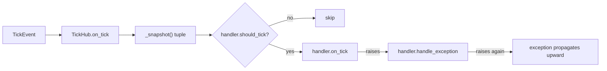

# tests/ticker/test_hub.py

> 📅 Last Updated: 2026/11/13

## Purpose

Verifies the distribution and management semantics of `celestialflow.ticker.TickHub`:

- Fan-out to all registered handlers on the same tick;
- Each handler filters independently by its own `tick_period`;
- A runtime `set_tick_period` immediately affects subsequent distribution;
- Rejects registering itself, rejects hubs that would form a cyclic reference, and rejects invalid `tick_period`;
- When a single handler callback raises, the exception is isolated to that handler's own `handle_exception` and does not block the other handlers.

## Core Test Objects

| Object | Source | Description |
|------|------|------|
| `TickHub` | `celestialflow.ticker` | Is itself a `TickHandler`, holding a tuple of handlers updated via copy-on-write |
| `TickHub.add_handler(handler)` | Same as above | Validates `tick_period`, detects cyclic references, then appends |
| `TickHub.on_tick(event)` | Same as above | Iterates over the snapshot, calls `on_tick` on each one that passes filtering, and hands exceptions to that handler's `handle_exception` |
| `TickHandler` | `celestialflow.ticker` | Handler base class |
| `ConfigurationError` | `celestialflow.runtime.util_errors` | Expected exception when registering an invalid handler |

## Key Fixtures and Fakes

| Name | Purpose |
|------|------|
| `make_event(seq)` | Builds a `TickEvent` with the given `seq` and all other time fields equal to `float(seq)` |
| `RecordingHandler(tick_period=1)` | Assigns `self.tick_period` directly in `__init__` (without going through `set_tick_period`) and appends the hit `event.seq` to `seqs` |
| `FailingHandler` (local class inside a case) | `on_tick` raises `RuntimeError("boom")`, and it overrides `handle_exception` to collect exceptions into `errors` |

## Test Coverage Matrix

| Case | Coverage Target |
|------|---------|
| `test_hub_fans_out_to_all_handlers` | With two handlers registered, both receive `seq == 1` on a single tick |
| `test_hub_filters_by_tick_period` | Handlers with period 1 and period 2 hit respectively: `[1,2,3,4,5]` vs `[1,3,5]` |
| `test_hub_picks_up_runtime_tick_period_change` | After changing to period 3 at runtime, only `4, 7` hit subsequently, for a cumulative `[1,2,3,4,7]` |
| `test_hub_rejects_self_registration` | `hub.add_handler(hub)` raises `ConfigurationError` |
| `test_hub_rejects_cycle_registration` | After `a.add_handler(b)`, `b.add_handler(a)` raises `ConfigurationError` |
| `test_hub_rejects_invalid_tick_period` | Registering a handler with `tick_period=0` raises `ConfigurationError` |
| `test_hub_isolates_handler_exceptions` | The failing handler's exception is collected by itself, and the subsequent handler still receives the tick |

## Key Behavior Details

### Distribution and Filtering

`TickHub.on_tick` iterates over `_snapshot()` (a reference to the current handler tuple) and, for each handler, first calls `should_tick(event)` and calls `on_tick(event)` only on a hit. The hub therefore does not need to count ticks itself; the period semantics are entirely provided by `TickHandler`.

`test_hub_filters_by_tick_period` delivers `seq = 1..5` in a row:

| Handler | `tick_period` | Hit Sequence |
|--------|:-------------:|----------|
| `every` | 1 | 1, 2, 3, 4, 5 |
| `every_other` | 2 | 1, 3, 5 |

### Runtime Adjustment

First delivers `1..3` with period 1, and the handler records `[1,2,3]`; then `handler.set_tick_period(3)` is called and `4..9` are delivered. Since the filtering formula is `(seq - 1) % 3 == 0`, the hits are `4` and `7`, so `seqs == [1, 2, 3, 4, 7]` in the end.



### Registration Validation

- **Invalid period**: `add_handler` first calls `validate_tick_period(handler)`, and `tick_period < 1` raises `ConfigurationError` directly.
- **Self registration**: when `handler is self`, it raises `ConfigurationError("cannot register a TickHub into itself")`.
- **Cyclic reference**: the deep traversal is performed only when the object to register is a `TickHub`. `test_hub_rejects_cycle_registration` first establishes `a → b`, then attempts `b → a`; starting from the pending `a`, it traverses its descendants (including `b`) and finds that `self` (i.e. `b`) is already in the chain, meaning `b → a` would create a cycle, so a cycle error is raised. The traversal uses a `seen` set to avoid repeated visits.
- The tests only cover direct cycles (length 2); indirect cycles are guaranteed by the same traversal logic.

### Exception Isolation

`test_hub_isolates_handler_exceptions` registers `FailingHandler` and `RecordingHandler`, then delivers one tick:

- `FailingHandler.on_tick` raises `RuntimeError("boom")`;
- after catching it, the hub calls `failing.handle_exception(e)`, and the exception is appended to `failing.errors`;
- the loop continues, and `ok.seqs == [1]`.

If `handle_exception` itself raises again, the hub no longer catches it, and the exception propagates upward to the `Ticker` driving it (see the fallback case in `test_ticker.md`).

## How to Run

```bash
# Run all
uv run pytest tests/ticker/test_hub.py -v

# Distribution and filtering only
uv run pytest tests/ticker/test_hub.py -k "fans_out or filters or runtime" -v

# Registration validation only
uv run pytest tests/ticker/test_hub.py -k "rejects" -v

# Exception isolation only
uv run pytest tests/ticker/test_hub.py -k "isolates" -v
```

## Notes

- All cases call `hub.on_tick(...)` directly without starting background threads, and run in milliseconds.
- `RecordingHandler` writes `self.tick_period` directly in `__init__`, bypassing the validation of `set_tick_period`; therefore `tick_period=0` can be constructed, which is used to verify the registration-time validation of `add_handler`.
- The copy-on-write design is not directly asserted for concurrency safety in this file; it is only covered indirectly through registration / distribution behavior.
- The related implementation is in `src/celestialflow/ticker/core_hub.py`; for the semantics, see `docs/zh-CN/src/ticker/core_hub.md`.
