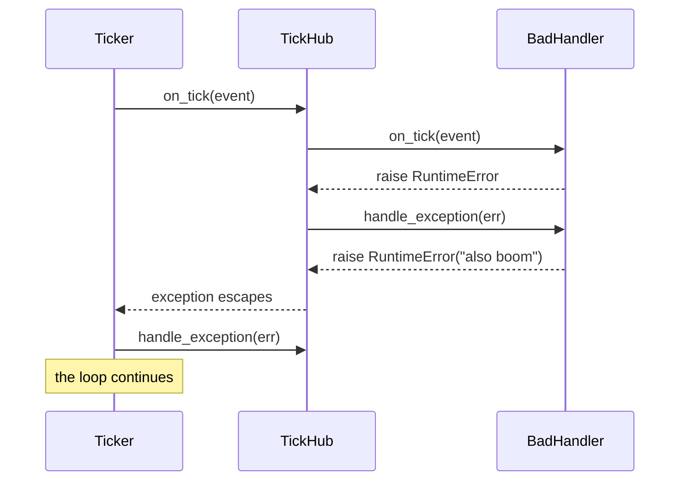

# tests/ticker/test_ticker.py

> 📅 Last Updated: 2026/11/13

## Purpose

Verifies the end-to-end time-driven behavior of `celestialflow.ticker.Ticker`: periodic firing and stopping, `tick_period` scaling, runtime speed adjustment, skipped ticks on overrun, handler exception isolation, the fallback when `TickHub` is the root, and validation of non-positive periods.

> This file is the only test in the ticker area that uses a real background thread and real time, but all periods are on the order of `0.01~0.05` seconds and have explicit timeouts via `wait_until` / `assert_stays_true`, so the whole file should complete within a few seconds.

## Core Test Objects

| Object | Source | Description |
|------|------|------|
| `Ticker(interval, handler, *, name="ticker")` | `celestialflow.ticker` | Background ticker that anchors scheduled times on `time.monotonic()` |
| `Ticker.start()` / `stop()` / `is_running()` | Same as above | Lifecycle control; the first tick fires after one period |
| `Ticker.get_interval()` / `set_interval(v)` | Same as above | Speed adjustment; `set_interval` wakes the wait and re-anchors |
| `TickHandler` / `TickHub` / `TickEvent` | `celestialflow.ticker` | Handler, distribution center, and tick event |
| `ConfigurationError` | `celestialflow.runtime.util_errors` | Expected exception for non-positive periods |

## Key Fixtures and Fakes

| Name | Purpose |
|------|------|
| `wait_until(cond, *, timeout=5.0, ...)` | From `tests/conftest.py`; polls until the background thread produces the expected event, and calls `pytest.fail` on timeout |
| `assert_stays_true(cond, *, duration=0.3, ...)` | Continuously verifies a condition over a period, used to confirm "no more firing after stop" |
| `RecordingHandler(tick_period=1)` | Records received `TickEvent`s into `events` |
| `SlowHandler` (local class inside a case) | `time.sleep(0.05)` on every tick, used to induce skipped ticks on overrun |
| `FailingHandler` (local class inside a case) | Counts and raises `RuntimeError` on every tick, with `handle_exception` collecting the exceptions |
| `BadHandler` + `RecordingHub` (local classes inside a case) | Both `on_tick` and `handle_exception` raise; the hub overrides `handle_exception` to collect fallback exceptions |

## Test Coverage Matrix

| Case | Coverage Target |
|------|---------|
| `test_ticker_fires_periodically_and_stops` | Periodic firing, `seq` incrementing continuously from 1, and no new events after stopping |
| `test_ticker_honors_handler_tick_period` | With handler `tick_period=2`, only odd ticks are received |
| `test_ticker_set_interval_takes_effect` | No events under a 30-second period, but firing starts immediately after `set_interval(0.02)` |
| `test_ticker_reports_skipped_ticks_on_overrun` | `TickEvent.skipped > 0` when a single tick takes longer than the period |
| `test_ticker_isolates_handler_exceptions` | Callback exceptions are handed to its own `handle_exception`, and the tick loop continues |
| `test_ticker_backstops_handler_exception_via_root_hub` | When the child handler's `handle_exception` raises again, the root hub provides the fallback and the thread stays alive |
| `test_ticker_rejects_non_positive_interval` | Non-positive values in the constructor and in `set_interval` both raise `ConfigurationError` |

## Key Behavior Details

### Periodic Firing and Stopping

```python
handler = RecordingHandler()
ticker = Ticker(0.02, handler)

ticker.start()
wait_until(lambda: len(handler.events) >= 3, timeout=2.0)
ticker.stop()

assert not ticker.is_running()
assert [event.seq for event in handler.events] == list(range(1, len(handler.events) + 1))
```

- `start()` creates and starts a daemon thread only when the background thread is not alive; the first tick waits for a full period.
- `stop()` sets the stop flag, calls `notify_all` and `join`s (at most 5 seconds), and clears the thread reference on success.
- After stopping, the test observes for another `0.1` seconds and the event count stays unchanged, proving the loop has exited rather than briefly paused.

### `tick_period` Scaling

In `_dispatch`, `Ticker` first calls `should_tick(event)` on the root handler. `RecordingHandler(tick_period=2)` hits `(seq - 1) % 2 == 0`, i.e. `seq = 1, 3, 5, ...`. After starting, the test waits for at least 2 events and then asserts `all(event.seq % 2 == 1 for event in handler.events)`.

### Runtime Speed Adjustment

```python
ticker = Ticker(30.0, handler)
ticker.start()
assert handler.events == []      # 30-second period, so nothing should fire in a short time
ticker.set_interval(0.02)
wait_until(lambda: len(handler.events) >= 1, timeout=2.0)
```

`set_interval` updates `_interval` under the protection of the condition variable and calls `notify_all`; after being woken, the loop reads the new period and fires immediately if the time is already due, otherwise it waits again. The test finally asserts `ticker.get_interval() == 0.02`.

### Skipped Ticks on Overrun

`SlowHandler.on_tick` sleeps `0.05` seconds on every tick while `Ticker`'s period is `0.01` seconds. The loop computes:

```text
lateness = fired - scheduled
skipped  = int(lateness // interval)   # when lateness > 0
prev_fire = scheduled + skipped * interval
```

Each tick therefore skips several missed periods, and `skipped` is written into `TickEvent`. The test waits for `any(event.skipped > 0)` for at most 3 seconds, and no catch-up re-firing is performed (to avoid a request storm).

### Two-Layer Exception Isolation

| Scenario | Behavior |
|------|------|
| Handler `on_tick` raises | `Ticker._dispatch` catches it and calls that handler's `handle_exception`; the loop continues |
| Handler `handle_exception` also raises, and the root handler is a `TickHub` | The exception escapes from `hub.on_tick`; after catching it, `Ticker._dispatch` calls the **root hub**'s `handle_exception` as the fallback, and the loop continues |
| The root handler is not a `TickHub`, and its `handle_exception` raises again | The exception escapes from `_dispatch` and the background thread terminates (not directly covered by this file) |

`test_ticker_isolates_handler_exceptions` waits for `handler.count >= 3 and len(handler.errors) >= 3`, proving that firing continues after consecutive failures.

In `test_ticker_backstops_handler_exception_via_root_hub`, the child handler `BadHandler` raises `RuntimeError("also boom")` again inside `handle_exception`; the root is `RecordingHub` (which overrides `handle_exception` to collect exceptions), and the test waits for `len(hub.fallbacks) >= 1` and asserts that `ticker.is_running()` is still true.



### Argument Validation

- `Ticker(0.0, handler)` raises `ConfigurationError` at construction time; `interval <= 0` is always rejected.
- `set_interval(-1.0)` likewise raises `ConfigurationError`.
- The constructor also calls `validate_tick_period(handler)`, so an invalid period on the root handler is rejected as well (this file uses `RecordingHandler`'s valid default and does not cover this separately).

## How to Run

```bash
# Run all
uv run pytest tests/ticker/test_ticker.py -v

# Lifecycle only
uv run pytest tests/ticker/test_ticker.py -k "fires or stops" -v

# Speed adjustment and skipped ticks only
uv run pytest tests/ticker/test_ticker.py -k "interval or skipped" -v

# Exception isolation only
uv run pytest tests/ticker/test_ticker.py -k "exception" -v
```

## Notes

- Every background thread is `stop()`ped in `try/finally` to avoid leaking threads after a failing case.
- Assertions do not depend on exact firing counts; they only use stable properties such as `>=` or "all odd"; timeouts are uniformly controlled by `wait_until` to avoid fixed `sleep`s.
- `assert_stays_true(duration=0.1)` is used to confirm no more firing after stopping; if machine scheduling causes false positives, the implementation should be adjusted rather than loosening the assertion.
- `Ticker.stop()` is a no-op for a ticker that has not been started (`_thread is None`); for a thread that cannot exit within 5 seconds it raises `RuntimeStateError`.
- The related implementation is in `src/celestialflow/ticker/core_ticker.py`; for the semantics, see `docs/zh-CN/src/ticker/core_ticker.md`.
