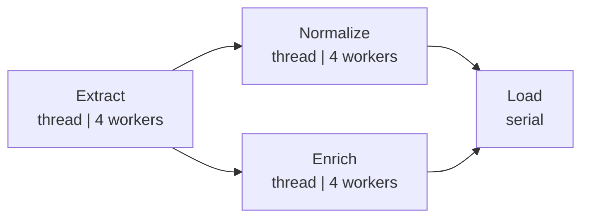
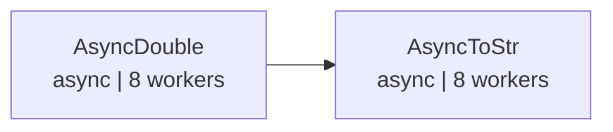

# demo/demo_graph.py

> 📅 最終更新日: 2026/10/30

## 目標

CelestialFlow における `TaskGraph` の高度なグラフトポロジー構築をデモする：ファンアウト/ファンイン（fan-out/fan-in）ETL パイプライン、および非同期ステージ型パイプライン。

## デモシナリオ

### `demo_etl_fan_out_fan_in`
ETL パイプライン、ファンアウト/ファンイン トポロジー：



ASCII 補足図：

```
Extract ──┬── Normalize ──┬── Load
          └── Enrich ─────┘
```

- `Extract` → ID に基づいてレコードを生成（thread モード、4 worker）
- `Normalize` → レコード値を正規化（thread モード、4 worker）
- `Enrich` → レコードに分類ラベルを追加（thread モード、4 worker）
- `Load` → レコードを保存（serial モード）

**グラフ構造**：DAG、一対多ファンアウト + 多対一ファンイン
**グラフモード**：`graph_mode="thread"`

### `demo_async_pipeline`
2 段階の非同期パイプライン：



ASCII 補足図：

```
AsyncDouble ──> AsyncToStr
```

- `AsyncDouble` → 入力を非同期で倍にする（async モード、8 worker）
- `AsyncToStr` → 結果を非同期で文字列に変換（async モード、8 worker）

**グラフ構造**：DAG、線形 2 段階
**グラフモード**：`graph_mode="async"`

## 主要設定

- 各 Stage は `TaskExecutor(..., execution_mode="thread" | "async")` で実行モードを明示的に指定
- ETL パイプラインと非同期パイプラインはそれぞれ `TaskGraph(..., graph_mode="thread")` と `graph_mode="async"` でグラフモードを指定
- `execution_mode="async"` はコルーチンタスク関数（`async_double`、`async_to_str`）に使用

## 発生しうる問題

1. **アサーションなし**：デモスクリプトであり、結果の正確性は検証しない。
2. **ETL 関数に sleep を含む**：`extract_record`（0.5s）、`transform_normalize`/`transform_enrich`（0.3s）、`load_record`（0.2s）があり、完全な実行には一定の時間がかかる。

## 実行方法

```bash
python demo/demo_graph.py
```

> **注意**：現在の `__main__` は `demo_etl_fan_out_fan_in()` と `asyncio.run(demo_async_pipeline())` を順に呼び出し、両方のデモシナリオが実行される。

## 想定される動作

スクリプトはオブザーバーを登録しておらず、`print` 文もないため、実行中に**タスクレベルのログや統計サマリーがターミナルに出力されることはない**。実行過程を確認するには、外部からの観測（例えば celestialflow-web への報告。本デモでは無効）や、`demo_utils` のタスク関数に自分でログを追加する必要がある。

### ETL パイプライン（`demo_etl_fan_out_fan_in`）

Extract → Normalize/Enrich → Load の順に実行され、各タスク関数の内部では `sleep` とデータ変換のみを行う。入力が `list(range(1, 16))` の場合、Extract は 15 件のレコードを処理し、Normalize と Enrich はそれぞれ 15 件を受け取り、Load ノードは合計 30 件のタスク（15 × 2 下流）を受け取る。例えば Extract は `{'id': 1, 'value': 10, 'label': 'item_1'}` を生成し、Normalize が `normalized: 0.1` を、Enrich が `category: 'odd'` を追加する。

### 非同期パイプライン（`demo_async_pipeline`）

2 段階が順次実行される。まず `list(range(1, 21))` の 20 タスクが `AsyncDouble` に渡され、その結果が `AsyncToStr` に流れ込む。`async_double` の 0.3s と `async_to_str` の 0.2s の sleep から見積もると、総所要時間は約 1〜2 秒（`AsyncDouble` は 8 並行、`AsyncToStr` も 8 並行）。

## 依存関係

- `celestialflow`（`TaskGraph`、`TaskExecutor`）
- `demo_utils`（`extract_record`、`transform_normalize`、`transform_enrich`、`load_record`、`async_double`、`async_to_str`）
- `python-dotenv`
- `celestialtree`（モジュールレベルの `import`。存在しない場合スクリプトは起動できない。`graph.set_ctree(...)` はデフォルトでコメントアウトされており、サーバー側は必須ではない）
