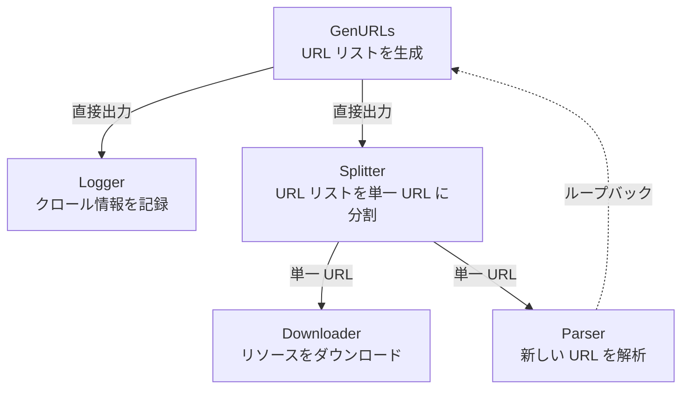
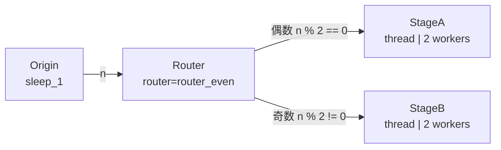

# demo/demo_nodes.py

> 📅 最終更新日: 2026/10/30

## 目標

CelestialFlow における構造型特殊ノードの使用方法をデモする：`TaskSplitter`（タスク分割）と `TaskRouter`（タスクルーティング）、および `BaseTaskNode` 体系下の多ノード協調。循環依存、バッチ分割、条件分岐などのグラフ構造能力を示す。

## デモシナリオ

### `demo_splitter_0`
クローラーワークフローのシミュレーション：



- `GenURLs` → URL リストを生成
- `Logger` → クロール情報を記録
- `Splitter` → URL リストを単一 URL に分割
- `Downloader` → リソースをダウンロード
- `Parser` → 新しい URL を解析し、`GenURLs` にループバック

**グラフ構造**：循環グラフ（`Parser → GenURLs`）

### `demo_splitter_1`
大規模データ分割のデモ：入力 `range(100_000)` がリストにラップされて `TaskSplitter` に渡され、下流が 1 つずつ受信処理することで、一度に大量のタスクをメモリにロードするのを回避する。

### `demo_router_0`
`TaskRouter` が偶奇性に基づいてタスクを異なる下流ノードに振り分けるデモ。



ルーティングロジック：`Origin` ステージは入力整数をそのまま出力するだけであり、`TaskRouter` は `router_even(n) -> dict[str, int]` を保持し、その `func` が偶奇性に基づいてターゲット名からタスクへのマッピングを返し、フレームワークはこれに基づいて元のタスクを `StageA`（偶数）または `StageB`（奇数）に振り分ける。

## 主要設定

- `demo_splitter_0` は `graph.set_graph_mode("thread")` と `graph.set_node_execution_mode("thread")` の 2 つの独立した呼び出しで、各 `TaskExecutor` ノードを `"thread"` モード（`max_workers=4`）に統一設定。`TaskSplitter("Splitter")` には `func` が渡されていない
- `demo_splitter_1` は `TaskChain` を介して間接的に `execution_mode="thread"`、`max_workers=50`（`Process` ステージ）で動作
- `demo_router_0` では `Origin`/`StageA`/`StageB` がいずれも `execution_mode="thread"` を使用し（`max_workers=4` / `2` / `2`）、`Router` は `TaskRouter` ノードであり、自身は `execution_mode` を使用しない
- 各シナリオの `<graph>.set_ctree(ctree_client)` はいずれもコメントアウトされている（`demo_splitter_0` と `demo_router_0`）。`demo_splitter_1` は `chain.set_ctree(ctree_client)` を通じて CelestialTree を有効化している。接続する場合は、まず `celestialtree` を別途インストールし、対応する呼び出しがコメントアウトされていないことを確認すること
- Redis リモート協調のサンプルは `demo_redis.py` に移行済み

## 発生しうる問題

1. **`demo_splitter_0` は現在構築に失敗する**：ソース内の `TaskSplitter("Splitter")` に `func` が渡されていないが、`BaseTaskNode.__init__` は位置引数 `func` を要求するため、`python demo/demo_nodes.py` はグラフ構築段階で `TypeError: ... missing 1 required positional argument: 'func'` を送出し、後続の `graph.set_nodes(...)` と `graph.run(...)` は実行されない。`TaskSplitter` に分割関数（例えば `lambda urls: urls`）を補ってからでないと実行できない。
2. **長時間実行**：`demo_splitter_0` の各ノードには 4〜6 秒のランダム sleep が含まれ、完全な実行には 1 分以上かかる可能性がある。
3. **ループバックが含まれ、自動的に終了しない可能性がある**：`demo_splitter_0` には `Parser → GenURLs` のループバックが存在し、`graph.run(..., if_put_signal=False)` は自動終了シグナルを注入しない。一部の URL（解析に成功した `url_1_1` など）は新しい URL を生成し続けてループするため、長時間新しい出力がない場合は **Ctrl+C** で手動終了することを推奨。
4. **アサーションなし**：デモスクリプトであり、結果の正確性は検証しない。
5. **Redis サンプルの移行**：以前の `demo_redis_ack_*` と `demo_redis_source_0` は [demo_redis.md](https://github.com/Mr-xiaotian/CelestialFlow/blob/main/docs/zh-CN/demo/demo_redis.md) に移行済み。

## 実行方法

```bash
# デフォルトデモ（demo_splitter_0）を実行
python demo/demo_nodes.py

# main() を変更した後、他のシナリオを実行可能
# 例：demo_splitter_0() を demo_router_0() に置き換え
```

> **注意**：現在の `__main__` はデフォルトで `demo_splitter_0()` のみを呼び出す。`demo_splitter_1()` と `demo_router_0()` はいずれも呼び出されない（`demo_router_0()` はソース内でコメントアウトされている）。実行するには、`__main__` 内で手動で呼び出すか、コメントを解除する必要がある。なお `demo_splitter_0()` は現在 `TaskSplitter` に `func` がないため `TypeError` を送出する（「発生しうる問題」の 1 番目を参照）。

## 期待される動作

以下の出力はすべて期待される出力（mock）である：ソースコードはこれらのノードに `PrintObserver` を登録していないため、実際にはフレームワークのログのみが表示され、下記のタスクごとの出力は現れない。

### `demo_splitter_0`（クローラーワークフロー）

URL 生成後に Splitter で分割され、Downloader と Parser が並行処理し、Parser の結果が Generator にループバックされる：

```
[GenURLs] Generated 3 URLs
[Splitter] Splitting 3 URLs...
[Downloader] Downloading url_0...
[Parser] Parsing url_0...
[Logger] Logging: url_0
[Downloader] Downloading url_1...
...
```

> ランダム sleep（4〜6 秒）を含み、総実行時間は 1 分以上かかる可能性がある。

### `demo_router_0`（偶奇ルーティング）

Origin は元の整数のみを生成し、Router が内部で偶奇性に基づいてタスクを StageA（偶数）または StageB（奇数）に振り分ける：

```
[Origin] Input: 0 -> sleep_1(0) -> 0
[Origin] Input: 1 -> sleep_1(1) -> 1
[Router] router_even(0) -> StageA
[Router] router_even(1) -> StageB
[StageA] Received: 0
[StageB] Received: 1
...
```

### `demo_splitter_1`（大規模データ分割）

`range(100000)` をリストにラップして Splitter に渡し、1 つずつ下流に出力して処理する。追加の出力ログはない。

## 依存関係

- `celestialflow`（`TaskGraph`、`TaskExecutor`、`TaskChain`、`TaskSplitter`、`TaskRouter`）
- `demo_utils`
- `python-dotenv`
- `celestialtree`（モジュールレベルの `import`。存在しない場合スクリプトは起動できない。`demo_splitter_1` は実際に `chain.set_ctree(ctree_client)` を呼び出す）
