# demo/demo_utils.py

> 📅 最終更新日: 2026/10/30

## 目標

`demo/` ディレクトリ以下のデモスクリプトに共有のテスト関数とヘルパークラスを提供する。デモコード専用のツールライブラリである。

## 関数とデモファイルの関係

以下の Mermaid 図は `demo_utils.py` の各関数/クラスがどのデモファイルで使用されるかを示す：

```mermaid
flowchart TD
    subgraph Utils["demo_utils.py ツール関数"]
        direction TB
        Fib["fibonacci / fibonacci_async"]
        Sleep1["sleep_1 / sleep_1_async"]
        Compute["square / add_5 / add_10 / add_15 / add_one_sleep"]
        Url["generate_urls_sleep / log_urls_sleep / download_sleep / parse_sleep / download_to_file"]
        ETL["extract_record / transform_normalize / transform_enrich / load_record"]
        Async["async_double / async_to_str"]
        Router["router_even"]
        Misc["no_op / sum_int"]
    end

    ETL --> Graph["demo_graph.py<br/>(demo_etl_fan_out_fan_in)"]
    Async --> Graph
    Async --> GraphAsync["demo_graph.py<br/>(demo_async_pipeline)"]
    Fib --> Executor["demo_executor.py"]
    Fib --> Observer["demo_observer.py"]
    Fib --> Redis0["demo_redis.py<br/>(demo_redis_ack_0)"]
    Sleep1 --> RedisDemo["demo_redis.py<br/>(demo_redis_ack_0/1/2, demo_redis_source_0)"]
    Sleep1 --> StagesRouter0["demo_nodes.py<br/>(demo_router_0)"]
    Url --> StagesSplitter0["demo_nodes.py<br/>(demo_splitter_0)"]
    Url --> Redis2["demo_redis.py<br/>(demo_redis_ack_2)"]
    Router --> StagesRouter0
    Misc --> Redis1["demo_redis.py<br/>(demo_redis_ack_1)"]
    Misc --> StagesSplitter1["demo_nodes.py<br/>(demo_splitter_1)"]
    Misc --> SkipDedup["demo_skip_dedup.py"]
    Compute --> Structure["demo_structure.py"]
    Compute --> Web["demo_web.py<br/>(demo_forest)"]
```



> 図は主要な関数とデモスクリプトの対応関係のみを示し、補助関数や非コア依存は省略している。

## 内容分類

### 汎用計算関数
- `fibonacci` / `fibonacci_async`：反復フィボナッチ O(n)（`bench/bench_execution_mode.py` とアルゴリズム一致）、async 版は 8 ラウンドごとに `await asyncio.sleep(0)` でイベントループを譲渡
- `no_op` / `sum_int` / `add_one` / `sqrt`：基本演算
- `square` / `add_offset` / `add_5` / `add_10` / `add_15` / `add_20` / `add_25` など：1 秒の sleep を含む模擬時間消費タスク
- `neuron_activation`：Sigmoid 活性化関数（ML 推論のシミュレーション）

### Sleep バリアント
- `sleep_1` / `sleep_1_async`：純粋な 1 秒遅延

### sleep 付き演算
- `operate_sleep` / `operate_sleep_A~E`：二項演算 `(a + b, a * b)`、1 秒遅延；現在 `demo/` 配下のスクリプトからは直接参照されていない
- `add_one_sleep`：複数条件の例外境界を含む（`n>30`、`n==0`、`n is None`）。`demo_structure.py`、`demo_web.py` で使用される

### URL 処理関数（demo_nodes 用）
- `generate_urls_sleep` / `log_urls_sleep` / `download_sleep` / `parse_sleep`：まず 4〜6 秒のランダム sleep を行い、その後に対応する純粋ロジック版（`generate_urls` / `log_urls` / `download` / `parse`）を呼び出す。純粋ロジック版は内部で固定ルールに従って `ValueError` を発生させる（`url_3*`、偶数の解析結果など）
- `download_to_file`：実際の HTTP ダウンロードでローカルファイルに保存

### ETL シミュレーション関数（demo_graph 用）
- `extract_record`：ID に基づいてレコード辞書を生成（0.5s sleep 含む）
- `transform_normalize`：レコード値を正規化（0.3s sleep 含む）
- `transform_enrich`：レコードに偶奇分類を追加（0.3s sleep 含む）
- `load_record`：レコード保存をシミュレートし結果文字列を返す（0.2s sleep 含む）

### 非同期補助関数（demo_graph 用）
- `async_double`：入力を非同期で倍にする（0.3s sleep 含む）
- `async_to_str`：入力を非同期でフォーマット済み文字列に変換（0.2s sleep 含む）

### ルーティング補助関数
- `router_even`：`TaskRouter` デモ用のルーティング関数。偶奇性に基づいて `StageA` または `StageB` を返す

## tests/ との関係

本ファイルの docstring はその関数を「テストファイル向け」と宣言しており（Shared helper functions and classes used across test files）、`fibonacci`/`fibonacci_async` は反復 O(n) 版である（`bench/bench_execution_mode.py` と一致）。ただし現在 `tests/` 配下には `demo_utils` に対応するコピーも（`tests/utils/` ディレクトリも）存在せず、`demo_utils` を参照するテストファイルもない。demo_utils は実際には `demo/` 配下のデモスクリプトにのみ提供されている。今後テストでこれらの関数を再利用する場合は、共通ツールを `src/celestialflow/` 配下の独立モジュールに抽出することを推奨する。

## 発生しうる問題

1. **tests/ との同期コピーなし**：現在 `tests/` に同名の `test_utils.py` は存在しない。将来テスト側でこれらの関数をコピーした場合、一方を修正する際に他方を漏らし、デモと単体テストの挙動が分岐しやすくなる。
2. **Windows パスのハードコード**：`download_to_file` のターゲットパスは通常ローカル環境に合わせて調整する必要がある。関連サンプルは `demo_redis.py` にある。
3. **`requests` ネットワーク依存**：`download_to_file` は外部ネットワークアクセスが必要で、隔離されたネットワーク環境では使用できない。

## 実行方法

このファイルは共有モジュールであり、直接実行しない。いずれのパッケージにも属さず、`demo/` ディレクトリでインポートして使用する：

```python
from demo_utils import fibonacci, sleep_1, router_even

print(fibonacci(10))  # 55
print(sleep_1("done"))  # 1 秒後に done を出力
print(router_even(4))  # {'StageA': 4}
```

## 依存

- `requests`
