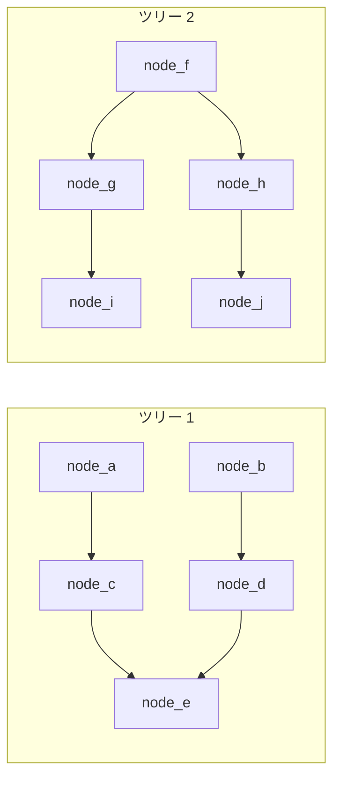
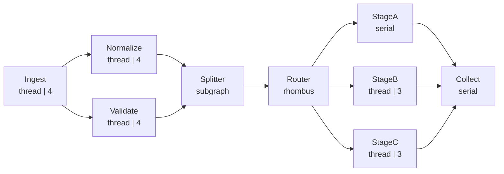

# demo/demo_web.py

> 📅 最終更新日: 2026/10/30

## 目標

本ファイルには 2 つのデモが含まれる：`demo_forest()`（2 つの独立したツリー状 DAG）と `demo_topology_topology()`（6 層で、扇出/扇入、`TaskSplitter`、`TaskRouter` を含む複雑なタスクグラフ）。どちらも `graph.run(...)` 呼び出し時に `report=ReportConfig(...)` を明示的に渡し、フレームワークが一定のテンポで状態・構造・エラー・ライフサイクルデータを celestialflow-web にプッシュして、タスクの実行状況を観察できるようにする。

## デモシナリオ

### 森林（`demo_forest`）

互いに干渉しない 2 つのツリー状 DAG が同じ `TaskGraph` 内に共存する：



- ツリー 1：`node_a → node_c → node_e`、`node_b → node_d → node_e`
- ツリー 2：`node_f → node_g → node_i`、`node_f → node_h → node_j`
- すべてのノードが `add_one_sleep` を使用（`execution_mode="thread"`、`max_workers=2`）、グラフモードは `graph_mode="thread"`
- 初期タスクは `node_a`（`1..10`）、`node_b`（`11..20`）、`node_f`（`21..30`）に注入される
- 実行時に明示的に報告する：`graph.run(init_tasks, report=ReportConfig("http://localhost:5005/"))`

### 複雑トポロジ（`demo_topology_topology`）

> このデモのグラフ名は `demo_web_topology` で、関数名は `demo_topology_topology`。



ASCII 補足図：

```
Ingest ──┬── Normalize ──┐
         └── Validate ───┴── Splitter ── Router ──┬── StageA ──┐
                                                  ├── StageB ──┴── Collect
                                                  └── StageC ──┘
```

- `Ingest` → 24 個のシードタスクを注入（thread モード、4 worker）
- `Normalize` → タスク値を正規化して増幅する；`7` は 3 回連続で失敗した後 **リトライを使い果たして失敗** し、`11` は 1 回失敗した後にリトライで成功する（thread モード、4 worker、`max_retries=2`）
- `Validate` → タスクを検証する；`11` は **リトライ不可** の `RuntimeError` を直接スローする（thread モード、4 worker）
- `Splitter` → 上流から渡されたイテラブルな結果を個別のエントリに分割する（各タスクは 2〜3 個のエントリに分割される）
- `Router` → `item % 3` に従ってエントリを `StageA` / `StageB` / `StageC` に振り分ける。3 本の下流エッジの転送量はそれぞれ異なる
- `StageA`（serial）/ `StageB`、`StageC`（thread、3 worker）→ 3 つの並列処理ブランチ
- `Collect` → 3 つの stage の出力を集約する（serial）

**グラフ構造**：DAG、多層扇出/扇入 + 分割 + ルーティング
**グラフモード**：`graph_mode="thread"`、ノード内部は serial / thread 実行モードが混在

## 報告方法

報告は実行エントリで `ReportConfig` を明示的に渡すことで有効になる。フレームワークはホストプロジェクトの設定ファイルから報告設定を暗黙に読み込まない：

```python
from celestialflow import ReportConfig

graph.run(init_tasks, report=ReportConfig("http://localhost:5005/"))
```

- `ReportConfig` は `celestialflow` パッケージから再エクスポートされており、構築パラメータ `url` は `http` / `https` で始まるアドレスでなければならない。オブジェクトは構築時に検証を行う（不正なアドレスは `ConfigurationError` を送出）。末尾の `/` は取り除かれる。
- `report` を省略する（または `None` を渡す）と報告しない。2 つの demo は web サービスがない場合でも単独で実行できる。
- `url` を省略した場合はデフォルトアドレス `http://127.0.0.1:5005` が使用される。

`demo_topology_topology` の報告コードは `demo_forest` と完全に同じ：

```python
seeds = [*range(1, 21), 3, 5, 8, 12]
graph.run({"Ingest": seeds}, report=ReportConfig("http://localhost:5005/"))
```

## web 側で観察できる内容

| 観点 | 観察内容 |
|------|---------|
| 構造図 | 九ノードの多層トポロジ；`Splitter` は subgraph、`Router` は菱形として表示される。「エッジラベル」を有効にすると、各エッジの累計/増分転送量を観察できる |
| ノード状態カード | 各ノードの処理中/成功/失敗カウント、および異なる実行モード（serial / thread）と並行度 |
| エラーログ | `Normalize` の `ValueError`（リトライ後も失敗）と `Validate` の `RuntimeError`（リトライ不可）の 2 種類のエラー |
| プログレスバー | 成功 / 失敗 / スキップなど各セグメントの比率 |
| ライフサイクル | リトライ回数（`retry_times`）が失敗レコードとともに永続化される |

## 主要設定

- 各 Stage は `TaskExecutor(..., execution_mode="thread" | "serial")` で実行モードを明示的に指定
- `normalize.set_retry_exceptions(ValueError)` でリトライ可能な例外を指定；`max_retries=2` で 2 回のリトライ機会を提供
- `Ingest` は 24 個のシードタスクを注入し、うち `3`、`5`、`8`、`12` は先行するシード値と重複する。demo は `skip_func` を設定していないため、これらの重複値は重複排除されず、通常のタスクとして各ノードに入る
- グラフモードは `graph_mode="thread"` で、ノード内部は実行モードを混在できる
- 報告は `report=ReportConfig(...)` で明示的に有効化する（上文「報告方法」を参照）

## 主要な実装

- `_metrics_of(target)`：実行オブジェクトの `ObserverHub`（`target.observers._snapshot()`）から `MetricsObserver` を検索して返す。この補助関数は本ファイル内に定義が残っているが、2 つの demo はいずれも現在それを呼び出していない（スクリプトはもはや「各ノードのカウント」サマリーを出力しない）。指標を手動で読み取りたい場合はそのまま再利用できる。
- `make_flaky(fail_map)`：「最初の `fail_map[n]` 回は `ValueError` をスローし、その後成功する」タスク関数を構築し、リトライ可能な失敗を生成するために用いる。
- `make_stage_task(prefix)`：`f"{prefix}({x})"` を返す stage タスク関数を構築する。

## 発生しうる問題

1. **アサーションなし**：デモスクリプトであり、結果の正確性は検証しない。
2. **タスク関数に sleep を含む**：各ステージの sleep は 0.02s（`route_task`）から 1s（`ingest_task`）までさまざまで、完全な実行には数十秒かかると見込まれる。
3. **web サービスへの依存**：報告先は `http://localhost:5005/` を指しており、celestialflow-web を起動していないと報告と注入の取得がいずれも失敗し、コンソールに接続エラーのトレースバックが表示される（プッシュスレッドとテンポ設定側が捕捉して出力するため、タスクの実行には影響しない）。完全にオフラインで実行したい場合は `report=` パラメータを外せばよい。
4. **Normalize / Validate の失敗**：`Normalize` の `7` と `Validate` の `11` が失敗パスを生み出す。スクリプト自体は起動時に外部サービスに依存せず、単独で実行できる。

## 実行方法

```bash
python demo/demo_web.py
```

`__main__` は `demo_forest()` と `demo_topology_topology()` を順に実行し、両者は独立して動作する。

> 実行前に celestialflow-web（デフォルトで `5005` ポートをリッスン）を起動しておくこと。そうしないと `report=ReportConfig(...)` が指す報告先は利用できない。

## 想定される動作

2 つの demo はともに**ターミナルに各ノードのカウントサマリーを出力しなくなった**（このロジックは報告方法の改修に伴って削除された）。ターミナルにはフレームワーク自身のログと、web サービスが利用できない場合の接続エラーのトレースバックのみが現れる。実行結果は celestialflow-web のダッシュボードで観察する必要がある：

```
Ingest → Normalize / Validate → Splitter → Router → StageA / StageB / StageC → Collect
```

> web サービスを起動していない場合でも、スクリプトはローカル計算を完了するが、報告データは表示できない。

## 依存関係

- `celestialflow`（`TaskGraph`、`TaskExecutor`、`TaskSplitter`、`TaskRouter`、`ReportConfig`）
- `demo_utils`（`add_one_sleep`）
- 外部サービス：celestialflow-web（報告先、デフォルト `http://localhost:5005/`）
