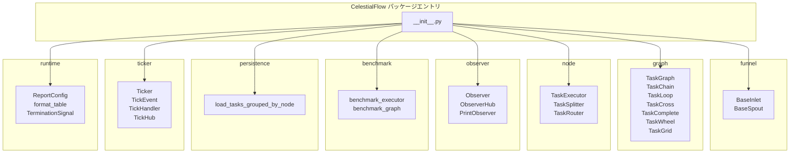

# src/celestialflow/__init__.py

> 📅 最終更新日: 2026/10/30

## 概要

本プロジェクトのルートエントリ。各サブモジュールからすべての公開 API を集約してエクスポートし、ユーザーは `from celestialflow import ...` だけでコア機能すべてにアクセスできる。

パッケージレベルの `__all__` には **25** 個のシンボルがある。各サブパッケージ由来のシンボルは対応するパッケージの `__init__.py` による再エクスポートを経由し、`benchmark_executor` / `benchmark_graph` / `format_table` / `TerminationSignal` / `load_tasks_grouped_by_node` の 5 つはファイル単位で `util_*` モジュールから直接インポートしている（安定した対外約束済みのユーティリティ関数と型である）。

## モジュールグループ

提供元モジュールごとに分類し、各グループの主な用途を説明する。

---

### funnel — データ入口

タスクデータの入口と出口の抽象を提供し、外部データソースとタスクグラフを接続する。

| エクスポートシンボル | 説明 |
|----------|------|
| `BaseInlet` | データ入口基底クラス。統一されたデータ取得/投入インターフェースを定義 |
| `BaseSpout` | データ出口基底クラス。統一されたデータ出力インターフェースを定義 |

---

### graph — タスクグラフコア

複数のトポロジ構造定義を提供し、DAG 構築、依存接続、実行スケジューリングをサポートする。`TaskGraph` のデフォルトは `graph_mode="serial"`、定義済み構造のデフォルトは `graph_mode="thread"`。

| エクスポートシンボル | 説明 |
|----------|------|
| `TaskGraph` | 汎用タスクグラフコンテナ。任意の DAG トポロジをサポート |
| `TaskChain` | 線形チェーン構造（前ノード → 後ノード） |
| `TaskCross` | 層状クロス構造（隣接層の間が完全結合） |
| `TaskGrid` | 二次元グリッド構造（各ノードが右側と下側の隣接ノードに接続） |
| `TaskLoop` | 循環構造。ノードが首尾相接続して閉ループを形成 |
| `TaskWheel` | ホイール構造。中心ノードが 1 つのリングに接続し、リング上のノードが首尾相接続して閉ループを形成 |
| `TaskComplete` | 完全グラフ構造。各ノードが残りすべてのノードに接続 |

> `TaskLoop` / `TaskWheel` は循環構造である。`TaskGraph._build_analysis()` は `graph_mode="serial"` かつグラフが DAG でない場合に `ConfigurationError` を送出するため、これらの構造はデフォルトの `graph_mode="thread"`（または明示的な `"async"`）を使用すべきである。

---

### node — タスク実行層

タスク実行器、ルーティング分散、タスク分割などの実行層機能を提供する。

| エクスポートシンボル | 説明 |
|----------|------|
| `TaskExecutor` | 汎用タスク実行器。serial / thread / async の 3 つの実行モードをサポート；グラフノードとして `TaskGraph` に直接接続可能 |
| `TaskSplitter` | タスクスプリッター。1 つの入力を複数のサブタスクに分割 |
| `TaskRouter` | ルーティング分散器。ルールに基づいてタスクを異なる下流に分散 |

> 注：`BaseTaskNode`、`TaskDispatch` などの内部抽象クラスはパッケージルートからも `celestialflow.node` からもエクスポートされない。外部コードは上表の `TaskExecutor` / `TaskSplitter` / `TaskRouter` のみに依存すべきである。

---

### observer — 可観測性

オブザーバーパターンのサポートを提供し、タスク実行プロセスを監視する。パッケージルートがエクスポートするのはオブザーバープロトコルとハブ、コンソールオブザーバーのみであり、指標オブザーバー `MetricsObserver` は `celestialflow.observer` からインポートする必要がある。

| エクスポートシンボル | 説明 |
|----------|------|
| `Observer` | オブザーバー基底クラス。on_node_start / on_task_success / on_task_fail などのコールバックインターフェースを定義 |
| `ObserverHub` | オブザーバーハブ。イベントを一連の子オブザーバーにブロードキャスト |
| `PrintObserver` | print ベースのコンソール進捗オブザーバー。構築時に名称プレフィックスを渡す必要がある；カウンタはスレッドセーフ |

---

### benchmark — ベンチマークテスト

実行器とタスクグラフのパフォーマンスベンチマーク機能を提供する。いずれも `async` 関数である。

| エクスポートシンボル | 説明 |
|----------|------|
| `benchmark_executor` | 同期/非同期の `TaskExecutor` に対してマルチモードのベンチマークを行う |
| `benchmark_graph` | タスクグラフ全体に対して `graph_mode × execution_mode` のベンチマークを行う |

---

### persistence — 永続化

SQLite ベースのレコード照会機能を提供する。

| エクスポートシンボル | 説明 |
|----------|------|
| `load_tasks_grouped_by_node` | 自身で接続を作成・クローズし、node ごとにグループ化して指定ステータスのレコードを読み取る；シグネチャは `(db_path, statuses=("failed", "pending")) -> dict[str, list[dict[str, Any]]]` |

> パッケージルートが再エクスポートするのは `load_tasks_grouped_by_node` のみである。その他の sqlite 照会ツール（`load_task_error_records` など）は `celestialflow.persist.util_sqlite` から直接インポートすること。

---

### ticker — 定時駆動

Ticker ベースの定時タスクイベント駆動能力を提供する。

| エクスポートシンボル | 説明 |
|----------|------|
| `Ticker` | 周期的にトリガーされるイベントジェネレーター |
| `TickEvent` | 1 回の tick で生成されるイベントオブジェクト |
| `TickHandler` | TickEvent を処理するコールバックインターフェース型 |
| `TickHub` | tick イベントを一連の TickHandler にブロードキャストするハブ |

---

### runtime — ランタイム補助

ランタイム補助型、設定オブジェクト、ユーティリティ関数を提供する。

| エクスポートシンボル | 説明 |
|----------|------|
| `ReportConfig` | リモート報告設定（`frozen` dataclass）。構築時に `url` を検証・正規化する；グラフ実行エントリに `report=` パラメータとして渡す |
| `format_table` | テーブル出力のフォーマット。コンソールでの比較データ表示に使用 |
| `TerminationSignal` | 終了シグナル。グラフ実行フローの終了を制御 |

---

## `__all__` リスト

完全な公開 API リスト（現在 25 シンボル、ソースの `__all__` と項目単位で一致）：

```python
__all__ = [
    "BaseInlet",
    "BaseSpout",
    "Observer",
    "ObserverHub",
    "PrintObserver",
    "ReportConfig",
    "TaskChain",
    "TaskComplete",
    "TaskCross",
    "TaskExecutor",
    "TaskGraph",
    "TaskGrid",
    "TaskLoop",
    "TaskRouter",
    "TaskSplitter",
    "TaskWheel",
    "TerminationSignal",
    "TickEvent",
    "TickHandler",
    "TickHub",
    "Ticker",
    "benchmark_executor",
    "benchmark_graph",
    "format_table",
    "load_tasks_grouped_by_node",
]
```

## 使用例

以下の例は、パッケージエントリからインポートして CelestialFlow のコア機能でタスクグラフを構築・実行する方法を示す。

```python
from celestialflow import TaskGraph, TaskExecutor
from celestialflow.observer import MetricsObserver


# 1. タスク処理関数を定義
def double(x: int) -> int:
    return x * 2


def add_one(x: int) -> int:
    return x + 1


# 2. TaskExecutor ノードを作成（func は必須、execution_mode のデフォルトは "serial"）
stage_a = TaskExecutor("StageA", func=double, execution_mode="serial")
stage_b = TaskExecutor("StageB", func=add_one, execution_mode="serial")

# 3. DAG グラフを構築
graph = TaskGraph(name="DemoGraph")
graph.set_nodes([stage_a, stage_b])
graph.connect([stage_a], [stage_b])

# 4. グラフレベルの指標オブザーバーを登録し、実行結果を読み取る
metrics = MetricsObserver()
graph.add_observer(metrics)

# 5. グラフを実行：キーはノード名、値はそのノードの初期タスク
graph.run({stage_a.get_name(): [1, 2, 3, 4, 5]})

# 6. 各ノードの指標スナップショットを確認
for node_name, node_metrics in metrics.get_graph_metrics().items():
    print(
        node_name,
        node_metrics.status,
        node_metrics.external_input,
        node_metrics.succeeded,
        node_metrics.failed,
    )
```

> `TaskGraph` インスタンスは使い切りオブジェクトである：一度 `run()` / `run_async()` を完了したら再利用すべきではなく、繰り返し実行する場合はグラフとノードを再構築すること。

### TaskExecutor を使用した独立実行

`TaskExecutor` はグラフ構造から切り離して独立実行でき、単一ステップのタスク実行に適している：

```python
from celestialflow import TaskExecutor

# 実行器を作成しデータイテレータを渡す
executor = TaskExecutor("Adder", func=lambda x: x + 10, execution_mode="serial")
executor.run([1, 2, 3])

# 成功タスクの (task, result) ペアを取得
for task, result in executor.get_success_pairs():
    print(f"Task: {task} -> Result: {result}")

# 失敗タスクの (task, PersistedError) ペアを取得
print("Failures:", len(executor.get_error_pairs()))
```

### 定義済みグラフ構造の使用

```python
from celestialflow import TaskChain, TaskExecutor
from celestialflow.observer import MetricsObserver

nodes = [
    TaskExecutor("S1", func=lambda x: x * 2),
    TaskExecutor("S2", func=lambda x: x + 1),
    TaskExecutor("S3", func=lambda x: x**2),
]

# 定義済み構造の graph_mode のデフォルトは "thread"
chain = TaskChain(name="DemoChain", nodes=nodes)
metrics = MetricsObserver()
chain.add_observer(metrics)

chain.run({nodes[0].get_name(): [1, 2, 3]})

for node_name, node_metrics in metrics.get_graph_metrics().items():
    print(node_name, node_metrics.status, node_metrics.succeeded)
```

### リモート報告の有効化

`ReportConfig` はグラフ実行エントリの `report=` パラメータとしてのみ使用する。渡さない（`None`）場合は報告を無効にする。`TaskExecutor.run()` は `report` パラメータを受け付けない。

```python
from celestialflow import ReportConfig, TaskExecutor, TaskGraph

graph = TaskGraph(name="ReportedGraph")
worker = TaskExecutor("Worker", func=lambda x: x + 1)
graph.set_nodes([worker])

# url は http/https アドレスでなければならない；末尾の "/" は取り除かれ、不正なアドレスは構築時に ConfigurationError を送出する
config = ReportConfig("http://127.0.0.1:5005")
graph.run({worker.get_name(): [1, 2, 3]}, report=config)
```

> この例は `127.0.0.1:5005` に利用可能な報告サービスが存在することを前提としており、`report=` パラメータの接続方法を示すためのものにすぎない。`run_async()` も同様に `report` を受け付ける。

## モジュール依存関係



> 依存方向について：`ReportConfig` は `celestialflow.runtime` からの再エクスポートである。`benchmark_*`、`format_table`、`TerminationSignal`、`load_tasks_grouped_by_node` はパッケージルートがファイル単位で直接インポートしており、対応するサブパッケージの `__init__.py` を経由しない。`benchmark` は依存チェーンの最上位にあり、他のサブモジュールからインポートされることはない。

## 注意事項

- **パッケージルートは公開 API のみをエクスポートする**：`__all__` には `MetricsObserver`、`DEFAULT_REPORT_URL`、`TaskEnvelope` などのシンボルは含まれず、対応するサブパッケージからインポートする（例：`from celestialflow.observer import MetricsObserver`）。
- **使い切りオブジェクト**：`TaskGraph` / `TaskExecutor` の `run()` / `run_async()` はいずれも使い切りの呼び出しであり、繰り返し実行するにはインスタンスを再構築する必要がある。これこそが `celestialflow.benchmark` でクローンツールが必要になる理由である。
- **実行エントリのパラメータ**：`TaskGraph.run()` / `run_async()` のシグネチャは `(init_tasks_dict, *, if_put_signal=True, log_level=DEFAULT_LOG_LEVEL, report=None)`；`TaskExecutor.run()` / `run_async()` は `if_put_signal` と `log_level` のみで `report` をサポートしない。
- **組み込みの状態スナップショットメソッドはない**：`TaskGraph` は `get_status_snapshot()` を提供しない。実行時の統計は `add_observer()` で `MetricsObserver` を登録して取得し、構造情報は `get_nodes()` / `get_edges()` / `get_node_meta()` で取得する。
