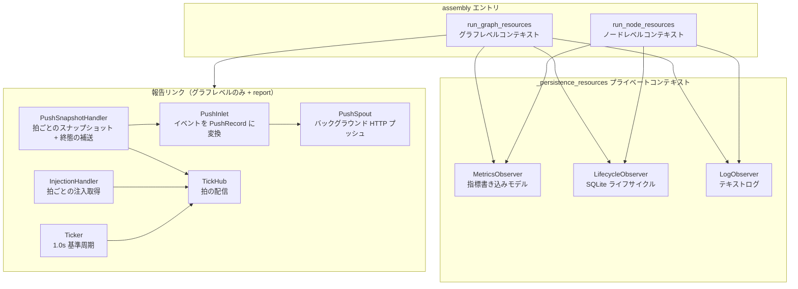

# src/celestialflow/assembly/__init__.py

> 📅 最終更新日: 2026/11/13

`assembly` は CelestialFlow の**実行期リソース装配モジュール**です。1 回の実行に必要なグローバル観測者、バックグラウンド spout、リモート報告チャネル、メトロノームを集中して作成・登録・起動・回収することで、`TaskGraph.run()` と `TaskExecutor.run()` がそれぞれライフサイクル管理を重複実装するのを避けます。

モジュール自体の公開エントリは 2 つだけです：`run_graph_resources`（グラフレベル実行）と `run_node_resources`（単一ノード実行）。どちらも `contextmanager` であり、`with` 進入時にリソース装配を完了して lifecycle データベースパスを産出し、終了時に固定順序で収尾します。

> パッケージレベルの `__init__.py` は `core_run.py` 内のこの 2 関数のみを再エクスポートします。`_persistence_resources` などのプライベート補助は外部に公開されません。また `assembly` は `celestialflow/__init__.py` からも再エクスポートされないため、必要な場合は `celestialflow.assembly` からインポートしてください。

## エクスポートシンボル

```python
__all__ = [
    "run_graph_resources",
    "run_node_resources",
]
```

| エクスポートシンボル | 出典 | 説明 |
|---------|------|------|
| `run_graph_resources` | `core_run.py` | グラフレベルリソースコンテキスト：指標、lifecycle、log。必要に応じてリモート報告、タスク注入、メトロノームを追加 |
| `run_node_resources` | `core_run.py` | 単一ノードリソースコンテキスト：指標、lifecycle、log。グラフ構造と報告には関与しない |

## 装配範囲

| リソース | `run_graph_resources` | `run_node_resources` |
|------|:---------------------:|:--------------------:|
| `MetricsObserver`（指標書き込みモデル） | ✅ 内部で作成・登録 | ✅ 内部で作成・登録 |
| `LifecycleObserver` + `LifecycleSpout` | ✅ | ✅ |
| `LogObserver` + `LogSpout` | ✅ | ✅ |
| `PushInlet` + `PushSpout` | ✅ `report is not None` の場合のみ | ❌ |
| `PushSnapshotHandler` | ✅ `report is not None` の場合のみ | ❌ |
| `InjectionHandler` + `InjectionTarget` | ✅ `report is not None` の場合のみ | ❌ |
| `Ticker`（デフォルト 1 秒基準周期） | ✅ `report is not None` の場合のみ | ❌ |
| `requests.Session`（報告と注入で共用） | ✅ `report is not None` の場合のみ | ❌ |

> ここでの `MetricsObserver` は**書き込み専用モデル**です：呼び出し側が渡した `ObserverHub` に登録され、ノードイベントによってカウントが駆動されます。その読み取り専用ビューは `LogObserver` と `PushSnapshotHandler` に渡され、ログ集約と状態スナップショットに使用されます。

## 構造関係



## 使用例

以下の例では 2 つの装配エントリを直接使用し、`InjectionTarget` プロトコルを満たす最小のグラフオブジェクトを作成して、コンテキストが産出する lifecycle データベースパスを確認します：

```python
from collections.abc import Iterable, Mapping
from typing import Any

from celestialflow.assembly import run_graph_resources, run_node_resources
from celestialflow.observer import ObserverHub


class DemoGraph:
    """InjectionTarget プロトコルを満たす最小実装。"""

    def inject_tasks(self, tasks: Mapping[str, Iterable[Any]]) -> None:
        for node, values in tasks.items():
            print(f"inject {list(values)} -> {node}")

    def inject_terminations(self, nodes) -> None:
        print(f"terminate {list(nodes)}")


# グラフレベル：デフォルトではリモート報告を有効にしない
graph_hub = ObserverHub()
with run_graph_resources(graph_hub, DemoGraph(), log_level="info") as db_path:
    print("グラフレベル lifecycle データベース:", db_path)

# ノードレベル：InjectionTarget なし、報告なし
node_hub = ObserverHub()
with run_node_resources(node_hub, log_level="warning") as db_path:
    print("ノードレベル lifecycle データベース:", db_path)
```

実行後、カレント作業ディレクトリに以下が生成されます：

- `lifecycles/<日付>/flow_lifecycle(<時刻>).sqlite3`
- `logs/flow_log(<日付>).log`

## 注意事項

1. **進入のたびに観測者が追加される**：`MetricsObserver`、`LifecycleObserver`、`LogObserver` はいずれもエントリが新規作成し、渡された hub に `add_observer()` します。同じ hub でコンテキストに繰り返し進入しないでください。そうしないとカウントの重複や重複書き込みが発生します。
2. **`log_level` はまず正規化される**：大文字小文字を区別せず、前後の空白を除去します。不正なレベルは `InvalidOptionError`、文字列以外は `ConfigurationError` を送出します。
3. **戻り値は `None` の可能性がある**：コンテキストが産出するのは `lifecycle.db_path` で、型は `Path | None` です。正常に起動した場合は実際のパスになります。
4. **グラフレベルエントリのみが報告を処理する**：`run_node_resources` は `report` パラメータを一切受け付けず、独立したノードはリモート報告とタスク注入に関与しません。
5. **収尾順序は固定**：グラフレベルコンテキストはまず ticker を停止し、次に lifecycle / log を停止し、最後にプッシュ spout を停止して HTTP セッションをクローズします。詳細は [`core_run.md`](./core_run.md) を参照してください。
