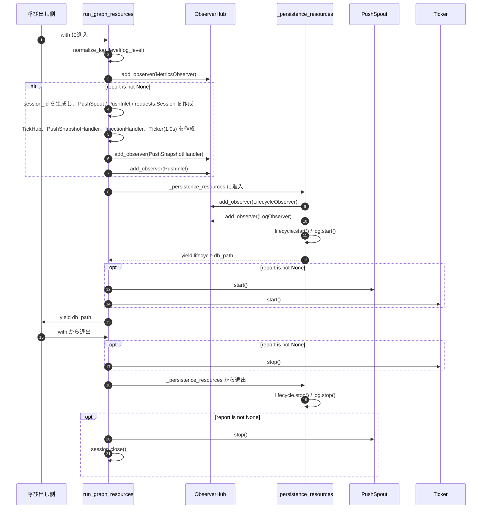
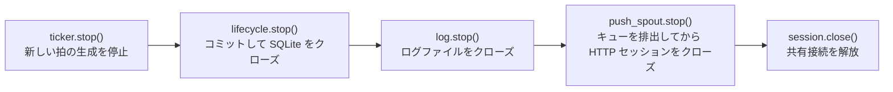

# src/celestialflow/assembly/core_run.py

> 📅 最終更新日: 2026/11/13

`core_run.py` は CelestialFlow の 2 種類の実行期リソース装配コンテキストを実装します：

- `run_graph_resources`：`TaskGraph.run()` / `TaskGraph.run_async()` にサービスし、指標、lifecycle、log を装配し、`ReportConfig` が渡された場合はさらにリモート報告、タスク注入、メトロノームを装配する；
- `run_node_resources`：`TaskExecutor.run()` / `TaskExecutor.run_async()` にサービスし、指標、lifecycle、log のみを装配し、グラフ構造と報告には関与しない。

両エントリはプライベートコンテキスト `_persistence_resources()` を通じて「lifecycle / log 観測者を作成・登録 → 起動 → データベースパスを産出 → 停止」という共通ロジックを再利用します。

## 公開関数

```python
@contextmanager
def run_graph_resources(
    observers: ObserverHub,
    injection_target: InjectionTarget,
    *,
    log_level: str = DEFAULT_LOG_LEVEL,
    report: ReportConfig | None = None,
) -> Generator[Path | None, None, None]: ...


@contextmanager
def run_node_resources(
    observers: ObserverHub,
    *,
    log_level: str = DEFAULT_LOG_LEVEL,
) -> Generator[Path | None, None, None]: ...
```

### パラメータ説明

| パラメータ | 対象エントリ | 型 | デフォルト値 | 説明 |
|------|---------|------|--------|------|
| `observers` | 両方 | `ObserverHub` | 必須 | 実行スコープ内の観測者 hub。エントリは指標、永続化、報告の観測者をこれに追加する |
| `injection_target` | グラフレベル | `InjectionTarget` | 必須 | タスク注入先。通常は `TaskGraph` 自身。`inject_tasks()` と `inject_terminations()` を実装する必要がある |
| `log_level` | 両方 | `str` | `DEFAULT_LOG_LEVEL`（`"INFO"`） | `LogObserver` のフィルタレベル。進入時に `normalize_log_level()` によって大文字に正規化される |
| `report` | グラフレベル | `ReportConfig \| None` | `None` | リモート報告設定。`None` は報告・注入・メトロノームを完全に無効にする |

### 戻り値と例外

- 戻り値（`with ... as db_path`）：`Path | None`、すなわち lifecycle spout 起動後に作成された SQLite ファイルパス。正常に起動した場合は `None` にならない。
- `InvalidOptionError`：`log_level` が `LEVEL_DICT` の許可集合に含まれない。
- `ConfigurationError`：`log_level` が文字列でない（`normalize_log_level()` が送出）。
- コンテキスト本体で送出された例外は、リソース回収を完了した後にそのまま外へ伝播する。

## プライベート補助：`_persistence_resources`

```python
@contextmanager
def _persistence_resources(
    observers: ObserverHub,
    metrics_view: MetricsObserver,
    log_level: str,
) -> Generator[Path | None, None, None]: ...
```

責務：

1. `LifecycleObserver()` と `LogObserver(metrics_view, log_level)` を作成する；
2. 両者を **lifecycle → log** の順で `observers` に登録する；
3. 順に `lifecycle.start()`、`log.start()` を呼び出し、その後 `yield lifecycle.db_path` する；
4. `finally` 内で順に `lifecycle.stop()`、`log.stop()` を呼び出す。

> `run_graph_resources` / `run_node_resources` はもはや `LifecycleSpout` / `LogSpout` / `LifecycleInlet` / `LogInlet` を自身で作成しません。これらのオブジェクトは `LifecycleObserver` / `LogObserver` ファサードの内部に完全に隠蔽されており、装配エントリは観測者ファサードとのみやり取りします。

## グラフレベルリソースの装配順序



### 登録順序（`report` が `None` でない場合）

| 順序 | 観測者 | 役割 |
|:----:|--------|------|
| 1 | `MetricsObserver` | 指標書き込みモデル。ログとスナップショットの読み取り元となる |
| 2 | `PushSnapshotHandler` | `GraphEndEvent` を監視して終態スナップショットを補送 |
| 3 | `PushInlet` | グラフ起動、グラフ終了、タスク失敗イベントをプッシュレコードに変換 |
| 4 | `LifecycleObserver` | タスクライフサイクルを SQLite に書き込む |
| 5 | `LogObserver` | 実行ログをテキストファイルに書き込む |

> **なぜスナップショットハンドラを `PushInlet` より先に登録するのか？** `ObserverHub` は登録順に同期してイベントを配信します。`GraphEndEvent` を受信すると、`PushSnapshotHandler` が先に終態スナップショットをキューに入れ、その後で `PushInlet` が `graph_end`（セッションオフライン通知）をキューに入れます。プッシュ spout のキューは FIFO であるため、サーバーは必ず終態スナップショットを先に受信し、その後で `shutdown_session` を受信します。「セッションはすでに終了したが終態がまだ届いていない」という競合状態は発生しません。

## 収尾順序

`with` から退出する際は以下の順序で回収します：



| 順序 | 操作 | 理由 |
|:----:|------|------|
| 1 | `ticker.stop()` | まず時間駆動源を切断し、収尾中にスナップショットや注入リクエストが生成され続けるのを避ける |
| 2 | `lifecycle.stop()` | 残りのトランザクションをコミットし、SQLite 接続をクローズする |
| 3 | `log.stop()` | ログファイルハンドルをクローズする |
| 4 | `push_spout.stop()` | spout の `stop()` はまず終了シグナルを送信し、キュー内の終態スナップショット / オフライン通知は終了前に処理し終える |
| 5 | `session.close()` | 報告と注入で共用する `requests.Session` をクローズする |

> 注意：`ticker.stop()` は `_persistence_resources` の**内側**の `finally` にあり、`push_spout.stop()` / `session.close()` は**外側**の `finally` にあります。そのためコンテキスト本体、ticker 起動、永続化リソース起動のどの段階で例外が送出されても、すでに作成されたリソースは上記の相対順序で回収されます。

## 使用例

### グラフレベル：報告を無効化

```python
from collections.abc import Iterable, Mapping
from pathlib import Path
from typing import Any

from celestialflow.assembly import run_graph_resources
from celestialflow.observer import ObserverHub


class DemoGraph:
    """InjectionTarget プロトコルを満たす最小のグラフオブジェクト。"""

    def inject_tasks(self, tasks: Mapping[str, Iterable[Any]]) -> None:
        print("タスク注入:", {node: list(values) for node, values in tasks.items()})

    def inject_terminations(self, nodes) -> None:
        print("終了シグナル注入:", list(nodes))


hub = ObserverHub()
graph = DemoGraph()
with run_graph_resources(hub, graph, log_level="info") as db_path:
    assert db_path is None or Path(db_path).exists()
    graph.inject_tasks({"A": [1, 2, 3]})
    graph.inject_terminations(["A"])
```

### グラフレベル：報告を有効化

```python
from celestialflow.assembly import run_graph_resources
from celestialflow.observer import ObserverHub
from celestialflow.runtime import ReportConfig


class DemoGraph:
    def inject_tasks(self, tasks) -> None:
        print("タスク注入:", tasks)

    def inject_terminations(self, nodes) -> None:
        print("終了シグナル注入:", list(nodes))

    def start(self) -> None:
        print("グラフの実行を開始")


graph = DemoGraph()

# 127.0.0.1:5005 で報告サービスが動作していると仮定する。サービスが利用できない場合、
# プッシュ失敗は PushSpout のバックグラウンドスレッドで traceback を出力するだけで、
# タスクグラフの実行は中断されない。
with run_graph_resources(
    ObserverHub(),
    injection_target=graph,
    log_level="debug",
    report=ReportConfig("http://127.0.0.1:5005"),
) as db_path:
    graph.start()
```

報告を有効化すると、メトロノームは `1.0s` を基準周期として動作します：

| ハンドラ | `tick_period` | 実際の周期 | 挙動 |
|--------|:-------------:|:--------:|------|
| `PushSnapshotHandler` | 1 | 1 秒 | グラフ全体の指標を読み取って状態スナップショットをプッシュする。グラフ終了時には終態を追加で補送 |
| `InjectionHandler` | 5 | 5 秒 | `/api/pull_injection` からタスクと終了シグナルを取得して注入 |

### ノードレベル

```python
from celestialflow.assembly import run_node_resources
from celestialflow.observer import ObserverHub

hub = ObserverHub()
with run_node_resources(hub, log_level="warning") as db_path:
    print("lifecycle データベース:", db_path)
```

## 注意事項

1. **同じ hub に繰り返し進入しない**：進入のたびに新しい指標 / lifecycle / log 観測者が追加されるため、繰り返し進入するとカウントが倍増し、ログが重複します。
2. **報告リンクは「オンデマンド装配」**：`report=None` の場合は `PushSpout`、`PushInlet`、`PushSnapshotHandler`、`InjectionHandler`、`Ticker`、`requests.Session` を作成せず、ネットワーク IO も一切発生しません。
3. **注入先はグラフレベルでのみ使用**：`run_node_resources` は `injection_target` を受け取らないため、独立実行するノードにリモートからタスクが注入されることはありません。
4. **`PushSpout` が先に起動し、`Ticker` が後に起動**：最初の拍が到来した時点でプッシュチャネルが準備済みであることを保証します。
5. **収尾段階で例外が発生する可能性がある**：spout / ticker の `stop()` は、バックグラウンドスレッドが期限どおりに終了しない場合に `RuntimeStateError` を送出します。その場合でも後続のクリーンアップは外側の `finally` によって継続されます。
6. **データベースパスは lifecycle spout に由来**：`db_path` は `lifecycle.start()` の後に初めて利用可能になるため、コンテキスト進入時に取得できます。退出後もパスは引き続き読み取れます。
