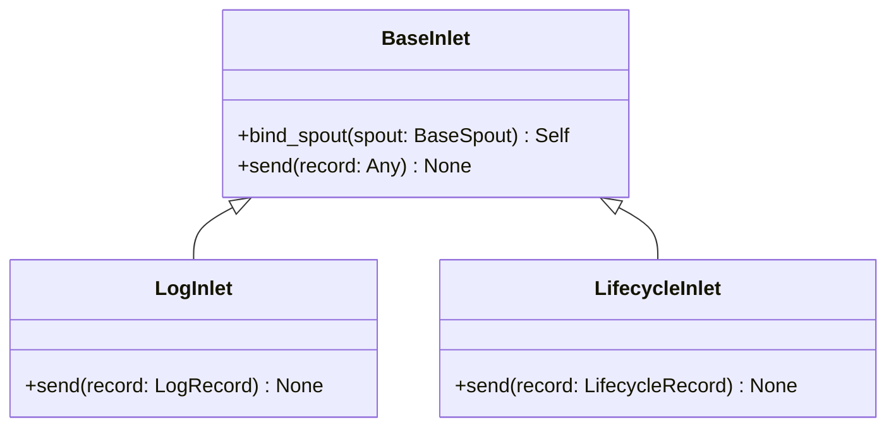

# src/celestialflow/funnel/core_inlet.py

> 📅 最終更新日: 2026/11/13

`BaseInlet` はすべての入口クラス（Inlet）の基底クラスであり、レコードをキューを通じて対応する `BaseSpout` に送信する役割を担います。

## クラス定義

```python
class BaseInlet:
    _queue: Queue[Any]
    _counter: PendingCounter

    def bind_spout(self, spout: BaseSpout) -> Self:
        """
        現在の inlet を指定された spout に関連付ける。

        :param spout: 対象リスナー
        :return: 関連付け済みの inlet インスタンス
        """
        self._queue = spout.get_queue()
        self._counter = spout.get_counter()
        return self

    def send(self, record: Any) -> None:
        """
        レコードを関連付けられた spout のキューに送り込む。

        :param record: 送信するレコード
        :return: ``None``
        """
        if not hasattr(self, "_queue") or not hasattr(self, "_counter"):
            raise InitializationError("inlet is not bound to spout")

        # 先に待処理数を増やしてからエンキューする。エンキューに失敗したら
        # 即座にカウントをロールバックする。
        self._counter.increment()
        try:
            self._queue.put(record)
        except Exception:
            self._counter.decrement()
            raise
```

## コアメソッド

### bind_spout

```python
def bind_spout(self, spout: BaseSpout) -> Self:
```

- 現在の inlet を指定された `BaseSpout` インスタンスに関連付けます。
- 内部で spout の入力キュー（`_queue`）と待処理カウンター（`_counter`）を再利用します。
- 自身を返すため、メソッドチェーンをサポート：`BaseInlet().bind_spout(spout)`。
- 関連付け前に `send()` を呼び出すと `InitializationError` が発生します。

### send（公開）

```python
def send(self, record: Any) -> None:
```

- `record` を spout と共有するキューに入れます。Inlet 唯一の書き込み出口です。
- エンキュー前に `increment()` でカウントを増やし、エンキューに失敗した場合は即座に `decrement()` でロールバックし、例外をそのまま再送出します。
- spout が関連付けられていない場合（`_queue` / `_counter` が欠けている場合）は `InitializationError("inlet is not bound to spout")` を送出します。
- サブクラスは意味付けされたメソッド（例えば `emit()`）を追加し、内部で `self.send(...)` に委譲できます。`send()` をオーバーライドしてから `self.send(...)` を呼び直しては**ならない**。無限再帰になります。

## 継承関係



### 継承関係の説明

| サブクラス | 所在ファイル | 責務 |
|------|---------|------|
| `LogInlet` | `persist/core_log.py` | ログレコードの入口。`send(LogRecord)` を `LogSpout` に転送する。具体的なイベント変換は `LogObserver` が担う |
| `LifecycleInlet` | `persist/core_lifecycle.py` | ライフサイクルレコードの入口。`send(LifecycleRecord)` を `LifecycleSpout` に転送して SQLite に書き込む。具体的なイベント変換は `LifecycleObserver` が担う |

## 使用例

```python
from celestialflow.funnel import BaseSpout, BaseInlet


class MySpout(BaseSpout):
    def __init__(self):
        super().__init__()
        self.received = []

    def _handle_record(self, record):
        self.received.append(record)


class MyInlet(BaseInlet):
    # 意味付けされたメソッドを追加し、内部で公開メソッド send() に委譲する
    def emit(self, data):
        self.send(data)


# 使用
spout = MySpout()
inlet = MyInlet().bind_spout(spout)

spout.start()
inlet.emit("hello")
inlet.emit({"key": "value"})
spout.stop()

print(spout.received)
```

## 注意事項

1. **単方向通信**: Inlet はキューへの書き込みのみ、Spout は消費を担当。両者はキューによって分離されています。
2. **関連付け方式**: キューとカウンターは `BaseSpout` が作成し、`bind_spout()` を通じて Inlet と共有されます。Inlet はキューのライフサイクルを直接担いません。
3. **スレッドセーフ**: `queue.Queue` と `PendingCounter`（内部ロック）を使用してスレッド間の安全な通信を実現します。
4. **未関連付け例外**: `bind_spout()` を呼び出さずに `send()` を呼び出すと、`InitializationError` が発生します。
5. **使用パターン**: 通常、各 `BaseSpout` に 1 つの `BaseInlet` が対応し、プロデューサー・コンシューマーのペアを形成します。
6. **`send()` をオーバーライドして自身に委譲しない**: `send()` は Inlet の最終的な書き込み出口であり、サブクラスは意味付けされたメソッドを追加して `self.send(...)` を呼び出すべきです。
