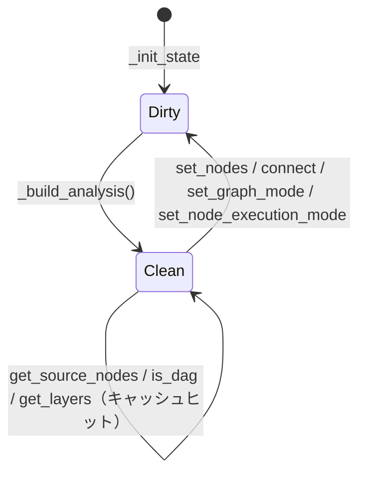
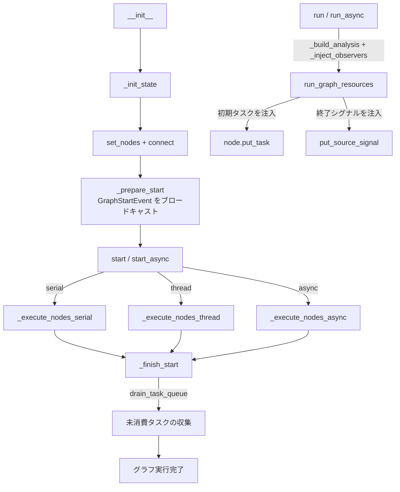

# src/celestialflow/graph/core_graph.py

> 📅 最終更新日: 2026/10/30

`TaskGraph` は CelestialFlow のコアスケジューラであり、一連のタスクノード（`BaseTaskNode` 派生オブジェクト、パブリック API は `TaskExecutor`、`TaskSplitter`、`TaskRouter`）の依存関係、実行フロー、ライフサイクルを管理します。

> 注意: `TaskGraph` は単一回使用のオブジェクトです。一度 `start()` / `start_async()` / `run()` が完了した後、現在のインスタンスが安全にリセットされて再起動できることは保証されません。同じフローを繰り返し実行する必要がある場合は、新しい `TaskGraph` と関連するタスクノードを再作成してください。

## 主要データ構造

`TaskGraph` は内部で `node_dict: dict[str, AnyTaskNode]` を使用して全ノードのマッピングを保持し、キュー接続は `connect()` フェーズでノードの `connect_to()` を通じて確立されます。グラフ分析は内部で維持される `OrderGraph` インスタンス（`self.order_graph`）に基づき、その `out_edges` / `in_edges` は入辺・出辺隣接テーブルの参照ビューです。

グラフ分析結果はすべて**プライベートフィールド**であり、公開メソッドを通じてのみアクセスできます：

| プライベートフィールド | 型 | 対応する公開アクセスメソッド |
|---------|------|------------------|
| `_source_names` | `list[str]` | `get_source_nodes()` |
| `_is_dag` | `bool` | `is_dag()` |
| `_layers_dict` | `dict[int, list[str]]` | `get_layers()` |
| `_analysis_dirty` | `bool` | なし（内部キャッシュ無効化フラグ） |

> これら 3 つのフィールドはもはや公開属性ではありません。旧記法 `graph.source_names`、`graph.is_dag`、`graph.layers_dict` は使用できません。とくに `is_dag` は**メソッド呼び出し** `graph.is_dag()` に変更されているため、ブール属性として扱わないでください（括弧を付けない場合は束縛メソッドオブジェクトが得られ、常に真値となります）。

## グラフ分析の遅延再構築

`TaskGraph` は構築時にグラフ分析結果を計算せず、「遅延 + ダーティフラグ」戦略を採用します：

- `_init_state()` は `_analysis_dirty` を `True` に初期化します。
- `get_source_nodes()` / `is_dag()` / `get_layers()` は返却前に必ず `_build_analysis()` を呼び出します。後者は `_analysis_dirty is True` の場合にのみ実際に再計算し、そうでなければキャッシュをそのまま返します。
- グラフ構造や分析の意味を変えうる構築期の操作は、いずれも `_analysis_dirty` を `True` に設定します：
  - `set_nodes()`（ノード追加）
  - `connect()`（辺追加）
  - `set_graph_mode()`（`serial` モードでの循環検出の意味が変わる）
  - `set_node_execution_mode()`（ノード実行モードの変化）
- `_build_analysis()` は計算完了後に `_analysis_dirty` を `False` に戻します。
- `run()` / `run_async()` は起動前に一度 `_build_analysis()` を呼び出すため、直列実行フェーズでは構築済みの `_layers_dict` をそのまま使用できます。



## 初期化

```python
class TaskGraph:
    def __init__(self, name: str, graph_mode: str = "serial"): ...
```

### パラメータ説明

- **name**: タスクグラフ名（必須）
- **graph_mode**: グラフ実行モード
  - `serial`（デフォルト）: 直列実行。階層（`get_layers()`）のトポロジカル順に従い逐層実行
  - `thread`: スレッド並行実行。各ノードが独立スレッドで起動
  - `async`: 非同期並行実行。実行中のイベントループコンテキストでの呼び出しが必要（[`start_async`](#start_async) 参照）

`__init__` は `_set_name`、`set_graph_mode`、`set_ctree(LocalEventClient())`、`_init_state()` を順に呼び出します。

## グラフ構築

### set_nodes

```python
def set_nodes(self, nodes: list[AnyTaskNode]) -> None:
    """
    ノードをタスクグラフに追加します。ノードを登録し、OrderGraph に書き込み、グラフレベルのイベントクライアントを注入します。

    :param nodes: 追加するノードのリスト
    :raises DuplicateNodeError: ノード名が重複している場合
    """
```

登録完了後、`_analysis_dirty` が `True` に設定され、次に分析結果を読み取る際に再計算されます。

### connect

```python
def connect[R](
    self,
    from_nodes: list[AnyTaskNode],
    to_nodes: list[AnyTaskNode],
) -> None:
    """
    ハイパーエッジ接続を確立します: from_nodes の各ノードが to_nodes の各ノードに接続されます。
    内部で from_node.connect_to(to_node) を呼び出してキュー接続を完了し、order_graph に辺を追加します。

    :param from_nodes: 上流ノードリスト
    :param to_nodes: 下流ノードリスト
    :raises NodeNotFoundError: いずれかの端点ノードが未登録
    """
```

接続完了後も同様に `_analysis_dirty` が `True` に設定されます。

## 設定メソッド

### _set_name

```python
def _set_name(self, name: str) -> None:
    """タスクグラフ名を設定します。"""
```

### set_graph_mode

```python
def set_graph_mode(self, graph_mode: str) -> None:
    """
    グラフ実行モードを設定します。指定可能な値は 'serial'、'thread'、'async' です。

    :raises InvalidOptionError: graph_mode が有効な集合に含まれない場合
    """
```

設定成功後、`_analysis_dirty` が `True` に設定されます。

### set_node_execution_mode

```python
def set_node_execution_mode(self, execution_mode: str) -> None:
    """
    全ノードの execution_mode を一括設定します（'serial'、'thread'、'async'）。
    _analysis_dirty を True にするのみで、実際のグラフ分析の再計算は次に分析結果を読み取る際に発生します。
    """
```

### set_ctree

```python
def set_ctree(self, ctree_client: EventClient) -> None:
    """
    タスクグラフ共有のイベントクライアントを設定します。
    渡されると、現在のグラフ内の全ノードに同期して下位配信されます。
    """
```

> デフォルトでは、`TaskGraph` は内部で `LocalEventClient()` を使用してローカルのインクリメンタルイベント ID を生成するため、`celestialtree` がインストールされていなくても、コア実行リンクは正常に動作します。
>
> イベントを CelestialTree に報告したい場合は、まず `celestialtree` を追加インストールし、対応するクライアントインスタンスを自身で構築して `set_ctree()` に渡す必要があります。

## 観測者

### add_observer

```python
def add_observer(self, observer: Observer) -> None:
    """
    グラフレベル観測者を登録します。

    グラフレベル観測者はグラフ内の全ノードのイベントを受信します。この登録は run() / run_async()
    パスのみで有効です（これらのエントリはグラフレベルの hub を各ノードに注入します）。
    """
```

グラフレベル観測者は `_inject_observers()` によって各ノードに注入されます。注入されるのは hub オブジェクト自体であるため、実行時にグラフレベル hub へ観測者を追加・削除すると即座に全ノードへ反映されます。注入は初期タスクを注入する前に完了している必要があり、そうでなければ初期タスクの入力イベントはグラフレベル観測者へ配信されません。

### get_observers

```python
def get_observers(self) -> ObserverHub:
    """グラフレベル観測者 hub を返します。ノード以外の協作者が観測者としてイベントを公開するために使用します。"""
```

## グラフ分析

### _build_analysis

```python
def _build_analysis(self) -> None:
    """
    タスクグラフをオンデマンドで分析し、ソースノード、DAG かどうか、階層情報を計算します。

    :raises ConfigurationError: serial モードでグラフに環（非 DAG）が含まれる場合に発生
    """
```

挙動の要点：

1. `_analysis_dirty is False` の場合は即座に戻り、再計算しません。
2. 順に `source_nodes()` → `is_dag()`（`util_order_graph` 内のモジュールレベル関数）→ `compute_node_levels()` → `cluster_by_value_sorted()` を実行し、結果を `_source_names` / `_is_dag` / `_layers_dict` に書き込みます。
3. `_analysis_dirty` を `False` に設定します。
4. グラフに環が含まれかつ `graph_mode == "serial"` の場合、`ConfigurationError` を送出し、`thread` または `async` への切り替えを促します。

> このメソッドは冪等な「キャッシュ再構築エントリ」であり、外部から直接呼び出すべきではありません。公開読み取りには `get_source_nodes()` / `is_dag()` / `get_layers()` を使用してください。

### put_source_signal

```python
def put_source_signal(self) -> None:
    """すべてのソースノードのキューに終了シグナルを入れます。"""
```

`_source_names` を反復し、`node_dict` 内の対応するノードに対して `put_signal()` を呼び出します。`run()` / `run_async()` / `start()` がすでに `_build_analysis()` をトリガーしているため、ここで読み取るソースノードリストは有効なキャッシュです。

## 起動実行

### run

```python
def run(
    self,
    init_tasks_dict: dict[str, Iterable[Any]],
    *,
    if_put_signal: bool = True,
    log_level: str = DEFAULT_LOG_LEVEL,  # デフォルト "INFO"
    report: ReportConfig | None = None,
) -> None:
    """
    タスクグラフを実行します。フロー：
    1. _build_analysis() を呼び出してグラフ分析キャッシュを構築（または再利用）
    2. _inject_observers() を呼び出してグラフレベル観測者 hub を注入
    3. run_graph_resources コンテキスト内で、init_tasks_dict 内の各タスクを対応するノードに注入（node.put_task）
    4. if_put_signal=True の場合、ソースノードに自動的に終了シグナルを注入
    5. start() を呼び出して実行を起動
    """
```

パラメータ説明：

| パラメータ | 型 | デフォルト値 | 説明 |
|------|------|:------:|------|
| `init_tasks_dict` | `dict[str, Iterable[Any]]` | 必須 | キーはノード名、値はそのノードのタスクの反復可能オブジェクト |
| `if_put_signal` | `bool` | `True` | タスク注入後にソースノードへ自動的に終了シグナルを補送するかどうか |
| `log_level` | `str` | `DEFAULT_LOG_LEVEL`（`"INFO"`） | `LogInlet` のログフィルタレベル。大文字小文字を区別せず、前後の空白は無視されます |
| `report` | `ReportConfig \| None` | `None` | リモートレポート設定。`None` はレポートなし |

- `raises InvalidOptionError`: `log_level` が許可されたレベルの集合に含まれない場合（`run_graph_resources` 内部の `normalize_log_level()` によって送出）。
- 実行期の例外は `error_list` に収集され、最終的に `ExceptionGroup("Errors occurred during run", ...)` として送出されます。

```python
from celestialflow import TaskExecutor, TaskGraph
from celestialflow.runtime import ReportConfig

node = TaskExecutor("S1", func=lambda x: x + 1)
graph = TaskGraph(name="MyGraph", graph_mode="thread")
graph.set_nodes([node])

graph.run(
    {node.get_name(): [1, 2, 3]},
    log_level="DEBUG",
    report=ReportConfig(url="http://127.0.0.1:5005"),  # None を渡すとレポートなし
)
```

実行期の観測者注入、グローバル funnel 観測者の登録、`lifecycle` / `log` spout の起動停止は `run_graph_resources` コンテキストで一元的に管理されます。`report` を有効化すると、このコンテキストはさらに `PushInlet` / `PushSnapshotHandler` を登録し、`PushSpout` とメトロノームを起動して、拍ごとに状態スナップショットをプッシュし、リモートから注入待ちタスクを取得します。

### run_async

```python
async def run_async(
    self,
    init_tasks_dict: dict[str, Iterable[Any]],
    *,
    if_put_signal: bool = True,
    log_level: str = DEFAULT_LOG_LEVEL,
    report: ReportConfig | None = None,
) -> None:
    """run() の非同期バージョン。注入後に start_async() を呼び出します。パラメータの意味は run() と同じです。"""
```

### restore_db

```python
def restore_db(
    self,
    db_path: str | Path,
    statuses: Iterable[str] | None = None,
    *,
    filter_by_error_type: bool = False,
    if_put_signal: bool = True,
    log_level: str = DEFAULT_LOG_LEVEL,
    report: ReportConfig | None = None,
) -> None:
    """
    sqlite 永続化ライブラリからタスクを読み込み、永続化レコード内のノード名でグループ化してタスクグラフを起動します。

    :param db_path: sqlite データベースファイルパス
    :param statuses: レコードステータスフィルタリスト。デフォルト ``["failed", "pending"]``
    :param filter_by_error_type: 各ノードの ``retry_exceptions`` で ``error_type`` をフィルタリングするかどうか。
        デフォルト ``False``
    :param if_put_signal: 復元タスクの注入後にすべてのソースノードへ終了シグナルを再送するかどうか。デフォルト True
    :param log_level: ログフィルタレベル。デフォルト ``DEFAULT_LOG_LEVEL``
    :param report: リモートレポート設定。``None`` はレポートなし。デフォルト ``None``
    """
```

復元フロー：

1. `load_tasks_grouped_by_node(db_path, statuses)`（`persist.util_sqlite` 由来）を呼び出して `{ノード名: [レコード, ...]}` を取得します。
2. 各グループのレコードを反復する際、ノード名が `self.node_dict` に存在しない場合は `continue` でスキップします。すなわち**もはやグラフ内に存在しないノードへタスクを再生しません**。トポロジ変更後の古いレコードによる注入失敗を回避するためです。
3. `filter_by_error_type=True` の場合、`node.get_retry_error_type_names()` で `error_type` をフィルタリングします。`status == "pending"` のレコードは常に保持されます。
4. `tasks` に集約した後に `run()` を再利用し、`if_put_signal` / `log_level` / `report` をそのまま透過させます。

> ステップ 2 がスキップのみでエラーを出さないため、復元時にデータベース内のノード名が現在のグラフと一致しない場合、余分なレコードは静かに破棄されます。グラフ構造と永続化データが一致していることを自身で確認してください。

### ライフサイクル制約

- `TaskGraph` は起動プロセス中に実行時キュー接続、先行バインディング、スレッド参照、状態スナップショットを確立します。
- これらの実行時リソースは設計上単一の完全実行を対象としており、実行終了後に安全にクリアされて再利用されることは保証されません。
- 同じトポロジを再実行する必要がある場合は、同一インスタンスの `run()` を再度呼び出すのではなく、グラフオブジェクトとノードオブジェクトを再インスタンス化することを推奨します。

```python
from celestialflow import TaskExecutor, TaskGraph

node_a = TaskExecutor("A", func=lambda x: x + 1)
node_b = TaskExecutor("B", func=lambda x: x * 2)

graph = TaskGraph(name="MyGraph", graph_mode="thread")
graph.set_nodes(nodes=[node_a, node_b])
graph.connect([node_a], [node_b])
graph.run({node_a.get_name(): [1, 2, 3, 4, 5]})
```

### start

```python
def start(self) -> None:
    """
    タスクグラフを起動します（同期エントリ）。
    graph_mode に応じて _execute_nodes_serial() または _execute_nodes_thread() を選択します。
    その他のモードでは InvalidOptionError を送出します。
    起動と終了処理の段階で発生した例外は ExceptionGroup として集約されて送出されます。
    """
```

`start()` はまず `start_perf = time.perf_counter()` を記録し、続いて `_prepare_start()` を呼び出し、最後に `finally` 内で `_finish_start(start_perf)` を呼び出します。

### start_async

```python
async def start_async(self) -> None:
    """
    タスクグラフを非同期で起動します。graph_mode='async' が必要。そうでない場合は InvalidOptionError を送出します。
    同期 start() との違い：
    - async 実行モードのノードはコルーチン（node.start_async()）を通り、ノード内部で asyncio.run を再度呼び出しません；
    - serial / thread 実行モードのノードは asyncio.to_thread により独立したスレッドで実行されます。
    """
```

### _prepare_start / _finish_start

```python
def _prepare_start(self) -> None:
    """
    起動前準備：グラフレベル観測者 hub に on_graph_start イベントをブロードキャストします。
    start_time は呼び出し時刻の time.time() を取得し、is_dag は self.is_dag() でその都度取得します。
    """


def _finish_start(self, start_perf: float) -> list[Exception]:
    """
    起動後の終了処理：全ノードを走査して drain_task_queue() を呼び出し未消費タスクを収集し、
    on_graph_end イベントをブロードキャストし、スレッド参照をクリーンアップして、収集した例外リストを返します。
    """
```

`_prepare_start()` がブロードキャストする `GraphStartEvent` のフィールド：`graph`、`graph_mode`、`start_time`（`time.time()`）、`is_dag`（`self.is_dag()`）、`nodes`、`edges`、`source_nodes`、`node_meta`。イベントには `class_name` は**含まれません**。ノードクラス名は `node_meta` の各項目にのみ現れます。`start_time` は実際に実行を開始する時点で `time.time()` を取得し、`TaskGraph` はもはや `self.start_time` インスタンスフィールドを保持しません。

`_finish_start()` の `elapsed` は `time.perf_counter() - start_perf` で計算され、終了後に `self.threads` をクリアします。

`lifecycle` / `log` 関連 spout、メトロノームの起動と停止は外側の `run_graph_resources` によって一元的に管理され、本メソッドはグラフオブジェクト自身の終了ロジックのみを担当します。

### _execute_nodes_serial / _execute_nodes_thread / _execute_nodes_async

```python
def _execute_nodes_serial(self) -> None:
    """階層（self._layers_dict）のトポロジカル順に従い、層ごとに、ノードごとに直列実行（層間は階層の昇順、層内は登録順）。"""


def _execute_nodes_thread(self) -> None:
    """各ノードを独立したデーモンスレッドで起動し、最後に一括 join。"""


async def _execute_nodes_async(self) -> None:
    """グラフ全体を並行実行（asyncio.gather）。"""
```

`_execute_nodes_serial()` は `_layers_dict` を直接読み取り、`start()` より前に `_build_analysis()` が計算を完了していることに依存します（`_prepare_start()` 内の `is_dag()` 呼び出しがトリガーとなります）。

### _execute_node / _execute_node_async

```python
def _execute_node(self, node: AnyTaskNode) -> None:
    """
    同期グラフ起動パスで単一ノードを実行します。
    - async ノードは asyncio.run(node.start_async())
    - その他のノードは node.start()
    """


async def _execute_node_async(self, node: AnyTaskNode) -> None:
    """
    単一ノードを非同期実行：async はコルーチン、それ以外は asyncio.to_thread(node.start)。
    """
```

## 照会インターフェース

| メソッド | 戻り値型 | 説明 |
|------|---------|------|
| `get_nodes()` | `list[str]` | 登録順に全ノード名を返す |
| `get_edges()` | `dict[str, list[str]]` | 出辺隣接テーブル（内部 `OrderGraph` との共有参照。呼び出し側は読み取り専用とすべき） |
| `get_node_meta()` | `dict[str, dict[str, Any]]` | 各ノードの構築期メタ情報 |
| `get_source_nodes()` | `list[str]` | ソースノード名のリスト（返却前にオンデマンドでグラフ分析をトリガー） |
| `is_dag()` | `bool` | 有向非巡回グラフかどうか（返却前にオンデマンドでグラフ分析をトリガー） |
| `get_layers()` | `dict[int, list[str]]` | `{階層: ノード名リスト}`（返却前にオンデマンドでグラフ分析をトリガー） |
| `get_order_graph()` | `OrderGraph` | 内部の順序付き有向グラフインスタンス |
| `get_observers()` | `ObserverHub` | グラフレベル観測者 hub |

```python
from celestialflow import TaskExecutor, TaskGraph

a = TaskExecutor("A", func=lambda x: x + 1)
b = TaskExecutor("B", func=lambda x: x * 2)
graph = TaskGraph(name="Demo", graph_mode="thread")
graph.set_nodes([a, b])
graph.connect([a], [b])

print(graph.get_source_nodes())  # ['A']
print(graph.is_dag())  # True（メソッド呼び出しであることに注意）
print(graph.get_layers())  # {0: ['A'], 1: ['B']}
```

> セマンティクスの詳細：`get_source_nodes()` が返すのは「各ソース SCC の代表ノード 1 つ」です（`util_order_graph.source_nodes()` から取得）。そのため循環を含むグラフでは環上の全ノードは返されません。`get_layers()` では同一 SCC 内のノードが同じ階層を共有します。三者が返す `list` / `dict` はキャッシュオブジェクトそのものであり、呼び出し側は読み取り専用とすべきです。

### 注入インターフェース

```python
def inject_tasks(self, tasks: Mapping[str, Sequence[Any]]) -> None:
    """
    ノード名ごとに注入タスクを実行待ちキューに書き込みます。存在するノードへまず尽力して注入し、その後で未知ノードを一括でエラーにします。

    :raises UnknownNodeError: グラフ内に存在しない対象ノードがある場合
    """


def inject_terminations(self, nodes: Sequence[str]) -> None:
    """
    指定ノードへ終了シグナルを注入します。存在するノードへまず尽力して注入し、その後で未知ノードを一括でエラーにします。

    :raises UnknownNodeError: グラフ内に存在しない対象ノードがある場合
    """
```

> `inject_tasks` / `inject_terminations` は「まず尽力注入、その後一括エラー」戦略を採用しているため、単一の未知ノードがあってもその他のノードのタスク/終了シグナルが破棄されることはありません。これら 2 つのインターフェースは実行期のリモート注入（`run_graph_resources` 内の `PushInlet`）の受け口です。

### get_node_meta の説明

各ノードの構築期メタ情報を返します。これらのフィールドは実行期に固定で、グラフ構造とともに一度だけ報告され、毎回の状態プッシュには含まれません：

```python
{
    node_name: {
        "class_name": ...,  # ノードクラス名
        "execution_mode": ...,  # 実行モード
        "max_workers": ...,  # 最大並行ワーカー数
    }
}
```

### グラフレベルイベント（観測者）

`TaskGraph` は `_prepare_start()` / `_finish_start()` 段階で観測者 hub へ `GraphStartEvent` と `GraphEndEvent` をブロードキャストします。グラフ分析情報（グラフ名、モード、起動時間、`is_dag`、ノード/辺/ソースノードリスト、ノードメタ情報など）は起動イベントで一度だけ報告されます。実行時モニタリングは単一ノードへのポーリングではなく、`add_observer()` でグラフレベル観測者を登録して行うことを推奨します。

| イベント | フィールド |
|------|------|
| `GraphStartEvent` | `graph`、`graph_mode`、`start_time`、`is_dag`、`nodes`、`edges`、`source_nodes`、`node_meta` |
| `GraphEndEvent` | `graph`、`end_time`、`elapsed` |

## ライフサイクル図



## グラフ実行モード詳解

### serial モード

```
get_layers() の階層トポロジカル順に従い、層ごとに node.start() を同期実行 → データがキューを通じてフロー → 終了シグナル到達後に停止
```

- 階層（トポロジカル順）ごとに同期実行。層内は登録順
- デフォルトモード
- グラフに環が含まれる場合は `_build_analysis()` で `ConfigurationError` を送出

### thread モード

```
各ノードに対して独立スレッドを起動 → node.start() → 全スレッドを join
```

- 並列度を最大化
- 適用シーン：CPU/IO 混在型の並行パイプライン

### async モード

```
全ノードを非同期実行（asyncio.gather）→ 既存のイベントループ内で start_async() を呼び出す必要あり
```

- グラフ全体を並行コルーチン実行
- `serial` / `thread` モードのノードは `asyncio.to_thread` により独立スレッドで実行され、イベントループをブロックしない
- 適用シーン：他の非同期システムとの統合が必要な場合

## 非 DAG グラフの注意事項

循環グラフ（`TaskLoop` / `TaskWheel` など）に対し、`graph_mode='serial'` でグラフに循環（非 DAG）がある場合、
`_build_analysis` は `ConfigurationError` を送出し、`thread` または `async` モードへの切り替えを要求します。

`thread` / `async` モードで循環グラフを使用する場合、`run` 実行時に `if_put_signal=False` を設定し、
外部から明示的に `TerminationSignal` を注入して停止タイミングを制御することを推奨します。
そうしないと、終了シグナルによって一部のノードが上流データを受信する前に早期終了する可能性があります。

```python
# 循環グラフ：run() は永久にブロックされるため、外部条件が満たされたときに終了を注入する必要がある
# loop = TaskLoop(name="Loop", nodes=[n1, n2, n3])
# loop.run({n1.get_name(): tasks}, if_put_signal=False)
# 別のスレッドまたはコールバック内で：
# loop.inject_terminations([n1.get_name(), n2.get_name(), n3.get_name()])
```

## 使用例

### 最小実行可能サンプル

```python
from celestialflow import TaskExecutor, TaskGraph


def stage_a(x: int) -> int:
    return x + 1


def stage_b(x: int) -> int:
    return x * 2


a = TaskExecutor("A", func=stage_a)
b = TaskExecutor("B", func=stage_b)

graph = TaskGraph(name="Demo", graph_mode="thread")
graph.set_nodes([a, b])
graph.connect([a], [b])

graph.run({a.get_name(): [1, 2, 3]})

print(graph.get_source_nodes())
print(graph.is_dag())
print(graph.get_layers())
```

### リモートレポートとログレベルの有効化

```python
from celestialflow import TaskExecutor, TaskGraph
from celestialflow.runtime import ReportConfig

a = TaskExecutor("A", func=lambda x: x + 1)
graph = TaskGraph(name="Reported", graph_mode="thread")
graph.set_nodes([a])

graph.run(
    {a.get_name(): [1, 2, 3]},
    log_level="DEBUG",
    report=ReportConfig(),  # デフォルト http://127.0.0.1:5005
)
```

> `report` は `None` でなければレポートが有効になります。そのアドレスで実際に受信サービスが動作している必要があり（そうでなければプッシュ失敗は `ReporterError` として記録されます）、また `ReportConfig` は構築時にアドレスの正当性を検証します（`http` / `https` 以外は `ConfigurationError` を送出）。

## 未消費タスク処理

`_finish_start()` 内で `node_dict` を反復し、各ノードの `drain_task_queue()` を呼び出して全残存タスクを収集し、
それらを `UnconsumedError` としてマークし、永続化層（lifecycle / log）を通じて日付別に組織された sqlite
永続化ファイルに失敗情報を記録します。
