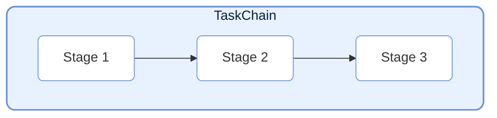
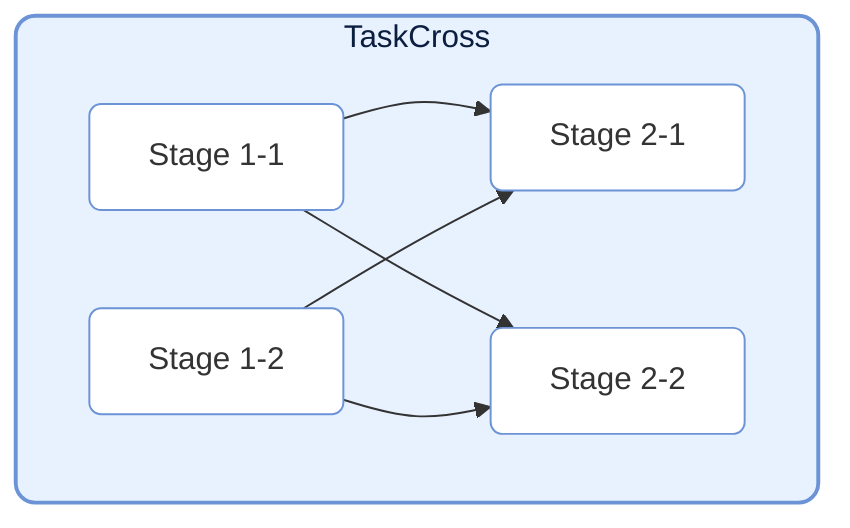
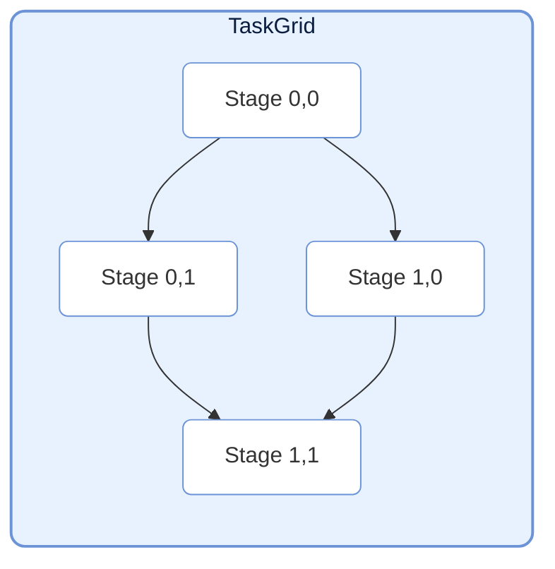
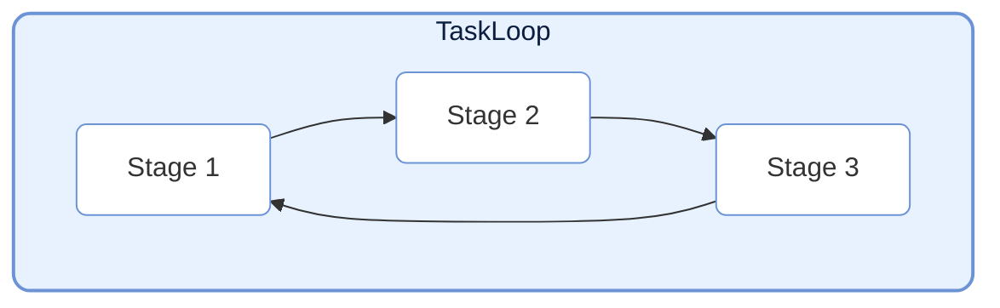
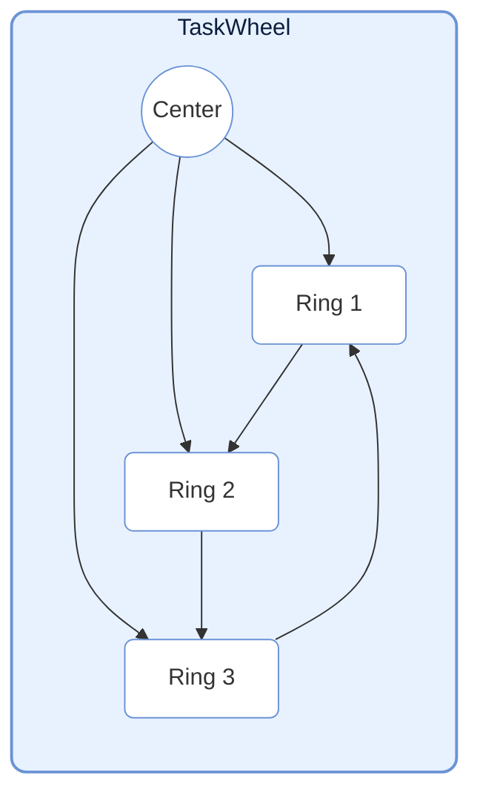
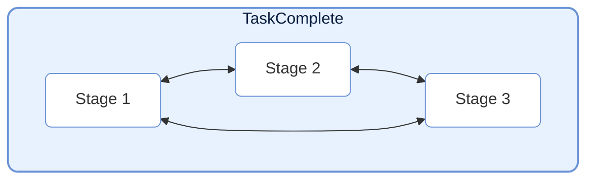

# src/celestialflow/graph/core_structure.py

> 📅 最終更新日: 2026/10/30

`core_structure.py` は 6 種類の事前定義タスクグラフ構造を提供し、ユーザーが一般的なタスクフローの形態を素早く構築できるようにします。すべての構造は `TaskGraph` を継承しているため、同様に `run()` / `run_async()` / `start()` / `start_async()` / `get_*()` などの機能を備えます。

## 構造一覧

| 構造 | 形態 | DAG か | 構築パラメータ | 構築期の検証 |
|------|------|:--------:|----------|------------|
| `TaskChain` | 線形チェーン | はい | `nodes: list[AnyTaskNode]` | `nodes` が空 → `InvalidStructureError` |
| `TaskCross` | 多層全結合 | はい | `layers: list[list[AnyTaskNode]]` | `layers` が空または空の層を含む → `InvalidStructureError` |
| `TaskGrid` | 二次元グリッド | はい | `grid: list[list[AnyTaskNode]]` | `grid` が空 / 先頭行が空 / 各行の長さが不一致 → `InvalidStructureError` |
| `TaskLoop` | 単一閉ループ | いいえ | `nodes: list[AnyTaskNode]` | `nodes` が空 → `InvalidStructureError` |
| `TaskWheel` | 中心 + リング | いいえ | `center: AnyTaskNode, ring: list[AnyTaskNode]` | `ring` が空 → `InvalidStructureError` |
| `TaskComplete` | 完全グラフ | いいえ | `nodes: list[AnyTaskNode]` | ノード数が `< 2` → `InvalidStructureError` |

共通の構築規約：

- すべての構造の `graph_mode` パラメータのデフォルト値は `"thread"` です（注意：`TaskGraph` 自体のデフォルト値は `"serial"`）。`"serial"` / `"thread"` / `"async"` を指定できます。
- 不正な `graph_mode` は `super().__init__()` 内の `set_graph_mode()` によって `InvalidOptionError` が送出されます。
- 構造クラスは `super().__init__()` の後に `set_nodes()` と数回の `connect()` を順に呼び出すため、インスタンス化完了時にはグラフが構築済みであり、`_analysis_dirty` は `True` となり、初回の分析結果読み取り時に必要に応じて再計算されます。
- 渡されたノード以外に、構造クラスは追加のノードオブジェクトを作成しません。すべての検証はコンテナの形状と数のみを確認します。

## Chain（線形チェーン）



`TaskChain` は最もシンプルなタスク構造で、複数のノードを順序通りに接続し、線形のデータフローを形成します。チェーン上のソースノードは 1 つだけです。

```python
from celestialflow import TaskChain, TaskExecutor

stage1 = TaskExecutor("S1", func=lambda x: x + 1)
stage2 = TaskExecutor("S2", func=lambda x: x * 2)
stage3 = TaskExecutor("S3", func=lambda x: x - 3)

chain = TaskChain(
    name="DataPipeline",
    nodes=[stage1, stage2, stage3],
    graph_mode="thread",  # thread: ノード並行実行; serial: ノード直列実行
)

chain.run({stage1.get_name(): [1, 2, 3]})
```

## Cross（クロス層）



`TaskCross` はタスクを「層」で組織化します。各層は複数の並行実行ノードを含み、隣接層間のノードは全結合依存関係を確立します（上位層の各ノードが下位層の全ノードに接続）。エッジが張られるのは**隣接層の間のみ**で、層をまたぐ（例：第 1 層から第 3 層）直接接続はありません。

```python
from celestialflow import TaskCross, TaskExecutor

stage_1_1 = TaskExecutor("S11", func=lambda x: x + 1)
stage_1_2 = TaskExecutor("S12", func=lambda x: x * 2)
stage_2_1 = TaskExecutor("S21", func=lambda x: x - 1)
stage_2_2 = TaskExecutor("S22", func=lambda x: x // 2)

cross = TaskCross(
    name="CrossPipeline",
    layers=[[stage_1_1, stage_1_2], [stage_2_1, stage_2_2]],
    graph_mode="thread",
)
cross.run(
    {
        stage_1_1.get_name(): [1, 2],
        stage_1_2.get_name(): [10, 20],
    }
)
```

## Grid（グリッド）



`TaskGrid` はタスクノードを二次元グリッドに組織化します。各ノードは**右隣**（同一行の `j+1`）と**下隣**（同一列の `i+1`）のノードに接続します。グリッドは矩形である必要があり、つまりすべての行の長さが等しくなければなりません。

```python
from celestialflow import TaskExecutor, TaskGrid

stage_00 = TaskExecutor("S00", func=lambda x: x)
stage_01 = TaskExecutor("S01", func=lambda x: x + 1)
stage_10 = TaskExecutor("S10", func=lambda x: x * 2)
stage_11 = TaskExecutor("S11", func=lambda x: x * x)

grid = TaskGrid(
    name="GridPipeline",
    grid=[[stage_00, stage_01], [stage_10, stage_11]],
    graph_mode="thread",
)
grid.run({stage_00.get_name(): [1, 2]})
```

## Loop（リング）



`TaskLoop` はノードを首尾接続して閉ループを形成します（最後のノードが最初のノードへ戻ります）。デフォルトで `thread` グラフ実行モードを使用します。

> リング構造は DAG ではありません：`graph_mode="serial"` では `_build_analysis()` 段階で `ConfigurationError` が送出されます。`thread` / `async` を使用する場合でも、通常は `if_put_signal=False` とし、外部から終了シグナルを注入して停止タイミングを制御する必要があります。

```python
from celestialflow import TaskExecutor, TaskLoop

stage1 = TaskExecutor("L1", func=lambda x: x + 1)
stage2 = TaskExecutor("L2", func=lambda x: x * 2)
stage3 = TaskExecutor("L3", func=lambda x: x - 1)  # L3 -> L1 で閉ループを形成

loop = TaskLoop(
    name="FeedbackLoop",
    nodes=[stage1, stage2, stage3],
)

# リンググラフはここでは直接 run しません：run は外部から終了シグナルが注入されるまでブロックし続けます
print(loop.get_source_nodes())
print(loop.is_dag())  # False
```

## Wheel（ホイール）



`TaskWheel` は 1 つの中心ノードと 1 つのリング構造を含みます。中心ノードはリング上の各ノードに接続し、リング上のノードは首尾接続されます。ノードの登録順は `[center, *ring]` です。

```python
from celestialflow import TaskExecutor, TaskWheel

center_stage = TaskExecutor("Hub", func=lambda x: {"input": x})
ring_stage1 = TaskExecutor("R1", func=lambda x: x["input"] + 1)
ring_stage2 = TaskExecutor("R2", func=lambda x: x["input"] + 2)
ring_stage3 = TaskExecutor("R3", func=lambda x: x["input"] + 3)

wheel = TaskWheel(
    name="HubAndSpoke",
    center=center_stage,
    ring=[ring_stage1, ring_stage2, ring_stage3],
)

# リンググラフの実行にも外部からの終了注入が必要です。ここでは構造のみを検証
print(wheel.get_nodes())  # ['Hub', 'R1', 'R2', 'R3']
print(wheel.is_dag())  # False
```

## Complete（完全グラフ）



`TaskComplete` は特殊な構造で、各ノードが自身を除く他のすべてのノードに接続します。双方向接続が存在するため必然的にリングを含み、したがって少なくとも 2 つのノードが必要で、`serial` モードでは使用できません。

```python
from celestialflow import TaskComplete, TaskExecutor

stage1 = TaskExecutor("N1", func=lambda x: x**2)
stage2 = TaskExecutor("N2", func=lambda x: x + 1)
stage3 = TaskExecutor("N3", func=lambda x: x // 2)
stage4 = TaskExecutor("N4", func=lambda x: x - 1)

complete = TaskComplete(
    name="FullMesh",
    nodes=[stage1, stage2, stage3, stage4],
)

# 完全グラフはリングを含むため、直接 run するとブロックされます。外部からの終了注入が必要
print(complete.get_nodes())
print(complete.is_dag())  # False
```

## 使用例

以下の例は各事前定義グラフ構造の具体的な構築と実行方法を示します。

### TaskChain 完全例

```python
from celestialflow import TaskChain, TaskExecutor


# 3 つのステージを定義: データクレンジング -> 変換 -> 集約
def clean(data: str) -> str:
    return data.strip()


def transform(data: str) -> int:
    return int(data) * 2


def aggregate(data: int) -> dict:
    return {"original": data // 2, "doubled": data}


# チェーンを構築
s1 = TaskExecutor("Clean", func=clean)
s2 = TaskExecutor("Transform", func=transform)
s3 = TaskExecutor("Aggregate", func=aggregate)
chain = TaskChain(name="ETL", nodes=[s1, s2, s3], graph_mode="thread")

# 起動
chain.run({s1.get_name(): [" 10 ", " 20 ", " 30 "]})

# ノード数と構造を取得
print(f"チェーンのステージ数: {len(chain.get_nodes())}")
print(chain.get_edges())
```

### TaskCross 完全例

```python
from celestialflow import TaskCross, TaskExecutor


# 第 1 層: データ準備
def load_a(x: int) -> int:
    return x + 1


def load_b(x: int) -> int:
    return x * 10


# 第 2 層: 計算分析
def analyze_a(x: int) -> float:
    return x * 1.5


def analyze_b(x: int) -> float:
    return x * 2.0


layer1 = [TaskExecutor("LoadA", func=load_a), TaskExecutor("LoadB", func=load_b)]
layer2 = [TaskExecutor("AnaA", func=analyze_a), TaskExecutor("AnaB", func=analyze_b)]

cross = TaskCross(name="DataAnalysis", layers=[layer1, layer2])
cross.run({layer1[0].get_name(): [1, 2], layer1[1].get_name(): [3, 4]})
print(cross.get_nodes())
print(cross.get_layers())
```

### TaskGrid 完全例

```python
from celestialflow import TaskExecutor, TaskGrid

# 2x2 グリッド
n00 = TaskExecutor("Init", func=lambda x: x)
n01 = TaskExecutor("Add", func=lambda x: x + 1)
n10 = TaskExecutor("Mul", func=lambda x: x * 2)
n11 = TaskExecutor("Square", func=lambda x: x * x)

grid = TaskGrid(name="CalcGrid", grid=[[n00, n01], [n10, n11]])
grid.run({n00.get_name(): [1, 2, 3]})
print(grid.get_nodes())
print(grid.is_dag())  # True
```

### TaskLoop 完全例

```python
from celestialflow import TaskExecutor, TaskLoop

# 3 ノードリング: 各ノードが処理後に結果を次へ渡す
loop_nodes = [
    TaskExecutor("Ring1", func=lambda x: x + 1),
    TaskExecutor("Ring2", func=lambda x: x * 2),
    TaskExecutor("Ring3", func=lambda x: x - 3),  # Ring3 -> Ring1 で閉ループを形成
]

loop = TaskLoop(name="RingLoop", nodes=loop_nodes)

# リンググラフは直接 run できません（永久にブロックされます）。正しい方法は外部条件が満たされたときに終了を注入することです：
# loop.inject_terminations([n.get_name() for n in loop_nodes])
# loop.run({loop_nodes[0].get_name(): [5]}, if_put_signal=False)
print(loop.get_nodes())
print(loop.is_dag())  # False
```

### TaskWheel 完全例

```python
from celestialflow import TaskExecutor, TaskWheel

center = TaskExecutor("Hub", func=lambda x: {"input": x, "processed": x * 10})
ring_nodes = [
    TaskExecutor("Channel1", func=lambda x: x["processed"] + 1),
    TaskExecutor("Channel2", func=lambda x: x["processed"] + 2),
    TaskExecutor("Channel3", func=lambda x: x["processed"] + 3),
]

wheel = TaskWheel(name="HubWheel", center=center, ring=ring_nodes)

# TaskLoop と同様：リンググラフは外部から終了を注入してから run する
print(wheel.get_nodes())
print(wheel.is_dag())  # False
print(wheel.get_layers())  # 同一閉ループ内のノードは階層を共有
```

### TaskComplete 完全例

```python
from celestialflow import TaskComplete, TaskExecutor

nodes = [
    TaskExecutor("N1", func=lambda x: x**2),
    TaskExecutor("N2", func=lambda x: x + 1),
    TaskExecutor("N3", func=lambda x: x // 2),
]

complete = TaskComplete(name="FullConnected", nodes=nodes)

# 完全グラフはリングを含むため、外部から終了を注入してから run する
print(complete.get_nodes())
print(complete.is_dag())  # False
```

## 注意事項

- 構造クラスは「グラフ構築」のみを担当し、実行戦略は担当しません。`graph_mode` と `if_put_signal` はグラフ形態に応じて自身で選択する必要があります。
- `TaskLoop` / `TaskWheel` / `TaskComplete` はいずれもリングを含み、`serial` モードではグラフ分析段階で直接エラーになります。`thread` / `async` モードでは `if_put_signal=False` と外部からの終了注入を組み合わせるべきです。
- `TaskCross` の層間全結合はエッジ数を増幅します：2 層がそれぞれ `m`、`n` ノードの場合 `m * n` 本のエッジが生成され、`TaskComplete` は `n` ノードで `n * (n - 1)` 本のエッジを生成します。大規模に使用する前にキューとメモリのコストを見積もる必要があります。
