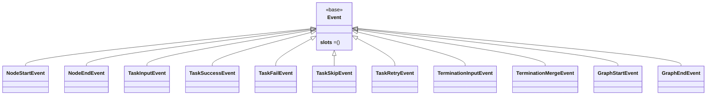

# src/celestialflow/observer/core_event.py

> 📅 最終更新日: 2026/11/13

`core_event.py` は観測者体系における**すべてのイベント型**を定義します。これらは `Observer.on_event()` の引数として、タスク / ノード / タスクグラフのライフサイクルにおけるさまざまな変化を記述します。すべてのイベントは統一基底クラス `Event` を継承し、かつ `frozen=True, slots=True` の読み取り専用 `dataclass` です。

## クラス階層



`Event` は型識別のみを提供し、`__slots__ = ()` を使用して状態を一切持ちません；各具体イベント自身が `slots` データクラスであるため、継承によって追加の `__dict__` オーバーヘッドは発生しません。

## イベント一覧

| イベント | フィールド | トリガー時期 |
|------|------|----------|
| `NodeStartEvent` | `node`、`execution_mode`、`max_workers`、`start_time` | ノード起動 |
| `NodeEndEvent` | `node`、`execution_mode`、`max_workers`、`elapsed`、`end_time` | ノード終了 |
| `TaskInputEvent` | `node`、`task`、`task_repr`、`input_id`、`from_node` | タスクがノードの入力キューに入る |
| `TaskSuccessEvent` | `node`、`task`、`task_repr`、`result`、`result_repr`、`elapsed`、`task_id`、`success_id` | タスクの成功処理 |
| `TaskFailEvent` | `node`、`task`、`task_repr`、`exception`、`task_id`、`error_id` | タスクの最終失敗 |
| `TaskSkipEvent` | `node`、`task`、`task_repr`、`task_id`、`skip_id` | タスクのスキップ |
| `TaskRetryEvent` | `node`、`task`、`task_repr`、`exception`、`task_id`、`retry_times` | タスク失敗だがリトライをトリガー |
| `TerminationInputEvent` | `node`、`termination_id` | 終了シグナルが入力キューに入る |
| `TerminationMergeEvent` | `node`、`parent_ids`、`termination_id` | 複数ソースの終了シグナルがマージされる |
| `GraphStartEvent` | `graph`、`graph_mode`、`start_time`、`is_dag`、`nodes`、`edges`、`source_nodes`、`node_meta` | タスクグラフ起動 |
| `GraphEndEvent` | `graph`、`end_time`、`elapsed` | タスクグラフ終了 |

`TaskInputEvent.from_node` は唯一デフォルト値（`None`）を持つフィールドで、それ以外のフィールドはすべて必須です。

## フィールドの説明

### 共通フィールド

- `node`：ノード名。イベントの属するノードを識別します。
- `task`：元のタスクデータ（`Any`）、`task_repr` はその可読文字列表現。

### イベント ID フィールド

- `input_id`：現在の入力イベント ID。
- `task_id`：タスク入力イベント ID（`TaskInputEvent.input_id` と対応）。
- `success_id` / `error_id` / `skip_id`：成功 / エラー / スキップイベントそれぞれのイベント ID。
- `termination_id`：終了シグナルイベント ID。
- `parent_ids`：マージに参加した終了シグナルイベント ID のリスト（`list[int]`）。

### タスクの発生源

- `from_node`：上流の発生源ノード名。`None` は外部から直接注入されたことを表します。このフィールドは `MetricsObserver` が外部注入と上流配信を区別する根拠であり、`LogObserver` もログ内のソース表記（`"external"`）を決めるために使用します。

### ライフサイクルタイムスタンプ

- `start_time`：ノード / タスクグラフ起動のウォールクロック時刻（秒）。`NodeStartEvent` / `GraphStartEvent` が持ちます。
- `end_time`：ノード / タスクグラフ終了のウォールクロック時刻（秒）。`NodeEndEvent` / `GraphEndEvent` が持ちます。
- `elapsed`：ノード / タスクグラフ / 単一タスク実行の所要時間（秒）。

タイムスタンプはイベント構築時に一度だけ書き込まれ、下流の観測者（`MetricsObserver` など）はイベントフィールドを直接読み取り、自ら `time.time()` でサンプリングすることはありません。

### グラフ元情報（`GraphStartEvent`）

- `graph`：タスクグラフ名。
- `graph_mode`：タスクグラフの実行モード。
- `start_time`：タスクグラフの起動時間。
- `is_dag`：DAG タスクグラフかどうか。
- `nodes`：タスクグラフのノード名リスト。
- `edges`：タスクグラフの辺隣接リスト（`{from_name: [to_name, ...]}`）。
- `source_nodes`：ソースノード名リスト。
- `node_meta`：各ノードの構築期のメタ情報。

`GraphStartEvent` の `nodes` / `edges` / `source_nodes` は `LogObserver` から `persist.util_render.render_structure_list` に渡され、ツリー型テキストにレンダリングされてログへ書き込まれます。

## 定義例

```python
from dataclasses import dataclass
from typing import Any


class Event:
    """すべての観測イベントの基底クラス。"""

    __slots__ = ()


@dataclass(frozen=True, slots=True)
class TaskSuccessEvent(Event):
    node: str
    task: Any
    task_repr: str
    result: Any
    result_repr: str
    elapsed: float
    task_id: int
    success_id: int
```

すべての具体イベントは `frozen=True, slots=True` を使用します。つまり不変（構築後のフィールド変更不可、ハッシュ化可能）かつ `__slots__` によるメモリ節約を実現します。

## 使用例

```python
from celestialflow.observer import (
    Event,
    Observer,
    ObserverHub,
    TaskFailEvent,
    TaskSuccessEvent,
)


class MyObserver(Observer):
    def on_event(self, event: Event) -> None:
        match event:
            case TaskSuccessEvent():
                print(f"{event.node} 成功: {event.result_repr}")
            case TaskFailEvent():
                print(f"{event.node} 失敗: {event.exception}")
            case _:
                pass


hub = ObserverHub()
hub.add_observer(MyObserver())
```

## 注意事項

1. **読み取り専用イベント**：イベントはすべて不変 `dataclass` であり、観測者がイベント内部のフィールドを変更してはなりません。
2. **フレームワークが構築**：イベントはノード / タスクグラフが対応するタイミングで構築し、`hub.on_event(...)` を呼び出してブロードキャストします。一般に手動構築は不要です（テストでは直接構築して観測者へ渡せます）。
3. **統一基底クラス**：すべてのイベントは `Event` を継承するため、観測者は `def on_event(self, event: Event)` という単一のエントリだけを書き、具体型ごとにディスパッチできます。
