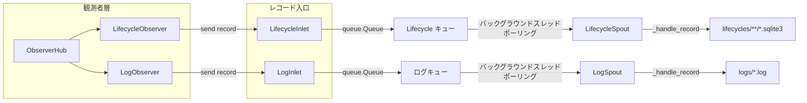

# src/celestialflow/persist/__init__.py

> 📅 最終更新日: 2026/11/13

`persist` モジュールは CelestialFlow の**永続化モジュール**であり、タスクライフサイクル（Lifecycle）と実行ログ（Log）の記録・書き込み・検索機能を提供します。

モジュールは「**観測者 + 入口 + リスナー**」の 3 層構造を採用しています：

- `LifecycleObserver` / `LogObserver` は `Observer` のサブクラスで、観測イベントを消費してレコードへ変換し、同時に spout の起動停止とパス公開を担当します；
- `LifecycleInlet` / `LogInlet` は `BaseInlet` のみを継承し、`send(record)` を提供してレコードをバインド済み spout のキューへ入れます；
- `LifecycleSpout` / `LogSpout` はバックグラウンドスレッドでキューからレコードを取り出してディスクへ書き込みます。

## エクスポートシンボル

モジュールレベルの `__all__` は以下の通り完全にエクスポートします：

```python
__all__ = [
    "InsertRecord",
    "LifecycleInlet",
    "LifecycleObserver",
    "LifecycleRecord",
    "LifecycleSpout",
    "LogInlet",
    "LogObserver",
    "LogRecord",
    "LogSpout",
    "PromoteFailedRecord",
    "PromoteSkippedRecord",
    "PromoteSuccessRecord",
    "UpdateRetryRecord",
]
```

| エクスポートシンボル | ソースモジュール | 説明 |
|---------|---------|------|
| `LifecycleObserver` | `core_lifecycle` | ライフサイクル観測者（ファサード）。イベントをライフサイクルレコードへ変換し、spout の起動停止を管理して `db_path` を公開 |
| `LifecycleInlet` | `core_lifecycle` | ライフサイクルレコードの入口。`send(record)` でバインド済み spout へ送出 |
| `LifecycleSpout` | `core_lifecycle` | ライフサイクルリスナー。バックグラウンドスレッドでレコードを SQLite へ書き込み |
| `LifecycleRecord` | `core_lifecycle` | ライフサイクルレコードの共用型（`InsertRecord` など 5 種類の `type` エイリアス） |
| `InsertRecord` | `core_lifecycle` | 新規タスクがノードに入ったときに書き込む pending レコード |
| `PromoteSuccessRecord` | `core_lifecycle` | pending を `success` に昇格させ、結果を書き込む |
| `PromoteFailedRecord` | `core_lifecycle` | pending を `failed` に昇格させる |
| `PromoteSkippedRecord` | `core_lifecycle` | pending を `skipped` に昇格させる |
| `UpdateRetryRecord` | `core_lifecycle` | pending レコードのリトライ回数と直近のエラーを更新 |
| `LogObserver` | `core_log` | ログ観測者（ファサード）。イベントをログレコードへ変換し、spout の起動停止を管理して `log_path` を公開 |
| `LogInlet` | `core_log` | ログレコードの入口。`send(record)` でバインド済み spout へ送出 |
| `LogSpout` | `core_log` | ログリスナー。ログを `logs/` ディレクトリのテキストファイルへ書き込み |
| `LogRecord` | `core_log` | 単一のログレコード（`timestamp` / `level` / `message`） |

> モジュール `__init__` は `core_*` ファイルのシンボルのみをエクスポートします。ツール関数 `util_payload` / `util_sqlite` / `util_render` はここではエクスポートされず、必要に応じて対応するモジュールからインポートします。

## ファイル説明

1. **core_lifecycle.py**（`LifecycleObserver` / `LifecycleInlet` / `LifecycleSpout` / レコード型）
   - **役割**: タスクライフサイクルの永続化。タスクの pending / success / failed / skipped 状態とリトライ情報を統一的に記録。
   - **書き込み方式**: `LifecycleObserver.on_event()` がイベント型に応じて `LifecycleRecord` dataclass を構築し、`LifecycleInlet.send()` でエンキュー；`LifecycleSpout._handle_record()` がレコード型に応じて対応する SQLite 書き込み操作を実行。
   - **ストレージ形式**: SQLite データベース（WAL モード）、ファイルは `lifecycles/` ディレクトリに配置。

2. **core_log.py**（`LogObserver` / `LogInlet` / `LogSpout` / `LogRecord`）
   - **役割**: 実行ログの収集と永続化。
   - **書き込み方式**: `LogObserver.on_event()` がグラフ / ノード / タスク / 終了シグナルの各イベントを処理して `LogRecord` を生成し、`metrics_view` に基づいてノード集計を書き込み、`LogInlet.send()` でエンキュー；`LogSpout` がログを `logs/` ディレクトリ下のテキストファイルへ書き込み。
   - **ログ形式**: 各行に `timestamp level message` を含みます。

3. **util_payload.py**
   - **役割**: タスクデータを再帰的に JSON フレンドリーな永続化構造へ変換。
   - **主要関数**: `to_persisted_payload(task)` —— 基本型はそのまま透過、コンテナは再帰、それ以外の型は `str()` に低下。

4. **util_sqlite.py**
   - **役割**: SQLite データベースの接続管理とレコード読み書きツール。
   - **主要関数**: `connect_db`、`normalize_record`、`row_to_record_dict`、`insert_record`、`promote_record_to_{success,skipped,failed}_by_event_id`、`update_retry_by_event_id`、`delete_record_by_event_id`、`load_tasks_grouped_by_node`、`load_task_{error,result}_records`。書き込み系の関数は呼び出し側が渡した `conn` を再利用し、読み取り系の関数は自ら接続を確立して閉じます。

5. **util_render.py**
   - **役割**: グラフ構造のレンダリングツール。ノード / 辺 / ソースノードを枠付きのツリー型テキストへレンダリング。
   - **主要関数**: `render_structure_list(nodes, edges, source_nodes)`。

## モジュール連携

### 内部連携
- `LifecycleObserver` / `LogObserver` は `observer.Observer` を継承し、内部でそれぞれ inlet と spout を作成・バインドして、レコードを spout のキューへ入れます。
- `LifecycleInlet` / `LogInlet` は `funnel.BaseInlet` のみを継承し、`send(record)` のみを提供します；イベントを直接消費することはなくなりました。
- `LifecycleSpout` / `LogSpout` は `funnel.BaseSpout` を継承し、キューを消費してディスクへ書き込みます。

### 外部連携
- **Observer モジュールとの連携**: `LifecycleObserver` / `LogObserver` は `Observer` のサブクラスで、`run_graph_resources` / `run_node_resources`（`assembly/core_run.py`）が `ObserverHub` に登録し、一括で起動・停止します。
- **Node モジュールとの連携**: `BaseTaskNode.get_success_pairs()` / `get_error_pairs()` は `observers.find(LifecycleObserver)` で `db_path` を取得してからレコードを読み取るため、単独実行でもグラフスケジューリングでも使用できます。
- **Runtime モジュールとの連携**: `LogObserver` は `runtime.util_constant.LEVEL_DICT` を参照してレベルフィルタリングを行い、`runtime.util_types.MetricsView` を参照してノード集計を読み取ります。
- **Funnel モジュールとの連携**: `BaseInlet` / `BaseSpout` 基底クラスを再利用して、スレッドセーフなキューと消費スレッドを実現します。

## アーキテクチャ特性

### プロデューサー・コンシューマーパターン



### ファイル名の規則

| 永続化タイプ | ファイルパスパターン |
|-----------|-------------|
| ログ | `logs/flow_log({日付}).log` |
| ライフサイクル | `./lifecycles/{日付}/flow_lifecycle({時刻}).sqlite3` |

### バッチフラッシュ戦略

- ログファイルは**行バッファリング**方式（`buffering=1`）で書き込まれ、読み取り側は新規ログを速やかに確認できます。
- Lifecycle SQLite 書き込みは**即時 commit** を採用：`LifecycleSpout._handle_record()` はレコードが実際に変更された直後に `commit()` し、`_after_stop()` でもう一度 `commit()` でフォールバックします。
- グローバル spout は単一のエグゼキュータの起動停止に追随せず、`run_graph_resources` / `run_node_resources` が実行期間全体を通じて起動と停止を一元管理し、ファイルハンドルの頻繁な開閉を避けます。

## 使用例

### 観測者ハブへの組み立て（推奨）

```python
from celestialflow.observer import MetricsObserver, ObserverHub
from celestialflow.persist import LifecycleObserver, LogObserver

metrics_view = MetricsObserver()
hub = ObserverHub()
hub.add_observer(metrics_view)

lifecycle = LifecycleObserver()
log = LogObserver(metrics_view, log_level="INFO")
hub.add_observer(lifecycle)
hub.add_observer(log)

lifecycle.start()
log.start()
try:
    # ... タスクグラフまたは単一ノードを実行 ...
    print(lifecycle.db_path, log.log_path)
finally:
    log.stop()
    lifecycle.stop()
```

### レコード入口のみを使用

```python
from celestialflow.persist import InsertRecord, LifecycleInlet, LifecycleSpout

spout = LifecycleSpout()
spout.start()
inlet = LifecycleInlet().bind_spout(spout)

inlet.send(InsertRecord(event_id=1, ts=0.0, node="StageA", task="hello"))

spout.stop()
```

## 注意事項

1. **イベント消費は観測者層**：`LifecycleInlet` / `LogInlet` はイベントを消費せず、`send(record)` のみを提供します；イベントからレコードへの変換は `LifecycleObserver` / `LogObserver` が担当します。
2. **コンストラクタ引数**：`LogObserver` は構築時に `metrics_view`（`MetricsView`）と省略可能な `log_level`（デフォルト `runtime.util_log_level.DEFAULT_LOG_LEVEL`）を渡す必要があります。
3. **パスの公開**：`LifecycleObserver.db_path` / `LogObserver.log_path` は spout 起動前は `None` です。
4. **`__all__` はコアシンボルのみ**：ツール関数は `util_*` ファイルにあり、必要に応じて `celestialflow.persist.util_xxx` からインポートします。
