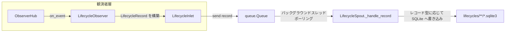

# src/celestialflow/persist/core_lifecycle.py

> 📅 最終更新日: 2026/11/13

`persist/core_lifecycle.py` はタスクライフサイクル（Lifecycle）の永続化を担当します：タスクのライフサイクル全体における状態変化（pending → success / failed / skipped、およびリトライ回数の更新）を記録し、データを `lifecycles/` ディレクトリ下の SQLite データベースファイルへ書き込みます。

中核コンポーネントはレコード型 `InsertRecord` / `PromoteSuccessRecord` / `PromoteFailedRecord` / `UpdateRetryRecord` / `PromoteSkippedRecord`、リスナー `LifecycleSpout`、入口 `LifecycleInlet`、観測者ファサード `LifecycleObserver` です。

## アーキテクチャ設計

### データフロー



システムは **プロデューサー-コンシューマー** パターンを採用しています：

1. **LifecycleObserver（観測者 + 変換器）**：`Observer` を継承し、`on_event()` で観測イベントを対応するレコード dataclass に変換し、`LifecycleInlet.send()` でスレッドセーフなキューに入れます；同時に spout の `start()` / `stop()` を担当し `db_path` を公開します。
2. **LifecycleInlet（レコード入口）**：`BaseInlet` のみを継承し、型付きの `send(record)` を提供します。イベントを直接消費せず、データベースも操作しません。
3. **LifecycleSpout（コンシューマー）**：`BaseSpout` を継承し、独立したバックグラウンドスレッドで動作し、レコードの具体的な型に応じて対応する SQLite 書き込み操作を実行します。

## レコード型

すべてのレコードは `frozen=True, slots=True` の読み取り専用 dataclass であり、`match` で型ごとにディスパッチできます。

### InsertRecord

新規タスクがノードに入ったときに書き込む pending レコード。

| フィールド | 型 | 説明 |
|------|------|------|
| `event_id` | `int` | タスク入力イベント ID（`TaskInputEvent.input_id`） |
| `ts` | `float` | レコードのタイムスタンプ |
| `node` | `str` | ノード名 |
| `task` | `Any` | タスクの JSON フレンドリーなペイロード（`to_persisted_payload` 適用済み） |

### PromoteSuccessRecord

pending レコードを success に昇格させ、タスク結果を書き込みます。

| フィールド | 型 | 説明 |
|------|------|------|
| `event_id` | `int` | タスク入力イベント ID（`TaskSuccessEvent.task_id`） |
| `ts` | `float` | レコードのタイムスタンプ |
| `result` | `Any` | タスク結果の JSON フレンドリーなペイロード |

### PromoteFailedRecord

pending レコードを failed に昇格させます。

| フィールド | 型 | 説明 |
|------|------|------|
| `event_id` | `int` | タスク入力イベント ID（`TaskFailEvent.task_id`） |
| `error_id` | `int` | 最終失敗イベント ID（`TaskFailEvent.error_id`） |
| `ts` | `float` | レコードのタイムスタンプ |
| `error_type` | `str` | 例外型名（`type(exception).__name__`） |
| `error_message` | `str` | 例外メッセージ（`str(exception)`） |

### UpdateRetryRecord

pending レコードのリトライ回数と直近の失敗情報を更新します。

| フィールド | 型 | 説明 |
|------|------|------|
| `event_id` | `int` | タスク入力イベント ID（`TaskRetryEvent.task_id`） |
| `ts` | `float` | レコードのタイムスタンプ |
| `retry_times` | `int` | リトライ済み回数（`TaskRetryEvent.retry_times`） |
| `error_type` | `str` | 直近の例外型名 |
| `error_message` | `str` | 直近の例外メッセージ |

### PromoteSkippedRecord

pending レコードを skipped に昇格させます。

| フィールド | 型 | 説明 |
|------|------|------|
| `event_id` | `int` | タスク入力イベント ID（`TaskSkipEvent.task_id`） |
| `skip_id` | `int` | スキップイベント ID（`TaskSkipEvent.skip_id`） |
| `ts` | `float` | レコードのタイムスタンプ |

### LifecycleRecord

```python
type LifecycleRecord = (
    InsertRecord
    | PromoteSuccessRecord
    | PromoteFailedRecord
    | UpdateRetryRecord
    | PromoteSkippedRecord
)
```

`LifecycleInlet.send()` と `LifecycleSpout._handle_record()` はいずれもこの共用型を受け取り、`match` で具体型に応じて書き込みセマンティクスを決定します。

## LifecycleSpout

`LifecycleSpout` は `BaseSpout` を継承し、SQLite データベースファイルの作成と書き込みを管理します。

### 初期化と起動

```python
class LifecycleSpout(BaseSpout):
    def __init__(self) -> None:
        """ライフサイクルレコードリスナーを初期化します。"""
        super().__init__()

        self.db_path: Path | None = None
        self._conn: sqlite3.Connection | None = None
```

起動後（`_before_start()`）、`./lifecycles/{date}/` ディレクトリ下に `flow_lifecycle({time}).sqlite3` ファイルを作成し、sqlite 接続を確立します。時刻部分は `%H-%M-%S-%f` から取得しミリ秒に切り詰めるため、同一秒内に複数回実行しても互いに上書きされません。

```python
from celestialflow.persist import LifecycleSpout

lifecycle_spout = LifecycleSpout()
lifecycle_spout.start()
print(lifecycle_spout.db_path)  # ./lifecycles/2026-11-13/flow_lifecycle(....).sqlite3
lifecycle_spout.stop()
```

`_after_stop()` はまず `commit()` を実行してから接続を閉じ、残存するトランザクションの永続化を確実にします。

### _handle_record のレコード型

`LifecycleSpout._handle_record(record: LifecycleRecord)` はレコード型に応じて異なる操作を実行します：

| レコード | 基盤呼び出し | 説明 |
|------|---------|------|
| `InsertRecord` | `insert_record` | 新規タスクが node に入り、`pending` レコードを 1 件書き込む（`task_json` がペイロード） |
| `PromoteSuccessRecord` | `promote_record_to_success_by_event_id` | pending を `success` に昇格させ、結果 JSON を書き込んでエラーフィールドをクリア |
| `PromoteFailedRecord` | `promote_record_to_failed_by_event_id` | pending を `failed` に昇格させ、`error_id` に切り替えてエラータイプとメッセージを書き込む |
| `UpdateRetryRecord` | `update_retry_by_event_id` | pending 状態を保ち、`retry_times` と直近の失敗のエラータイプ / メッセージのみを更新 |
| `PromoteSkippedRecord` | `promote_record_to_skipped_by_event_id` | pending を `skipped` に昇格させ、`skip_id` に切り替えてエラーフィールドをクリア |

それ以外の型のレコードはいずれの分岐にも該当せず、`changed` は `False` のままなので書き込みは発生しません。

書き込みセマンティクス：

- 接続が未初期化（`_conn is None`）の場合は `InitializationError` を送出；
- 各基盤書き込み関数は「実際にレコードを変更したか」の `bool` を返し、`changed` が `True` の場合のみ `commit()` します。

### ファイルパス

Lifecycle データはデフォルトで `./lifecycles/` ディレクトリ下に保存され、日付ごとにアーカイブされます：

```text
./lifecycles/
└── 2026-11-13/
    └── flow_lifecycle(14-30-05-123).sqlite3
```

## LifecycleInlet

```python
class LifecycleInlet(BaseInlet):
    def send(self, record: LifecycleRecord) -> None: ...
```

- `BaseInlet` のみを継承し、**もはや `Observer` ではありません**。イベントを消費しません；
- `send()` は `BaseInlet.send()` に転送し、レコードをバインド済み spout のキューへ入れます；
- spout が未バインドの状態で `send()` を呼ぶと、`BaseInlet` が `InitializationError` を送出します；
- `bind_spout(spout)` は `BaseInlet` 由来で、チェーン呼び出しを可能にするため `self` を返します。

```python
lifecycle_inlet = LifecycleInlet().bind_spout(lifecycle_spout)
```

## LifecycleObserver

```python
class LifecycleObserver(Observer):
    def __init__(self) -> None: ...

    @property
    def db_path(self) -> Path | None: ...
    def start(self) -> None: ...
    def stop(self) -> None: ...
    def on_event(self, event: Event) -> None: ...
```

- `__init__` 内部で `LifecycleSpout` を作成し、`LifecycleInlet().bind_spout(spout)` を構築します；
- `db_path` は spout のデータベースパスをそのまま透過し、spout 未起動時は `None`；
- `start()` / `stop()` はそれぞれ spout のバックグラウンド書き込みループを起動 / 停止します；
- `on_event()` はイベント型に応じてレコードを生成し、関心のないイベントは `case _: pass` に落ちて無視されます。

### イベントからレコードへのマッピング

| イベント | 生成されるレコード | フィールドの由来 |
|------|-----------|---------|
| `TaskInputEvent` | `InsertRecord` | `event_id=event.input_id`、`node=event.node`、`task=to_persisted_payload(event.task)` |
| `TaskSuccessEvent` | `PromoteSuccessRecord` | `event_id=event.task_id`、`result=to_persisted_payload(event.result)` |
| `TaskFailEvent` | `PromoteFailedRecord` | `event_id=event.task_id`、`error_id=event.error_id`、`error_type=type(event.exception).__name__`、`error_message=str(event.exception)` |
| `TaskSkipEvent` | `PromoteSkippedRecord` | `event_id=event.task_id`、`skip_id=event.skip_id` |
| `TaskRetryEvent` | `UpdateRetryRecord` | `event_id=event.task_id`、`retry_times=event.retry_times`、直近のエラータイプ / メッセージ |

説明：

- すべてのレコードの `ts` はレコード構築時刻の `datetime.now().timestamp()` を取得します；
- `TaskInputEvent` / `TaskSuccessEvent` / `TaskFailEvent` / `TaskSkipEvent` / `TaskRetryEvent` のみがレコードを生成し、ノード / グラフ / 終了シグナルのイベントは無視されます；
- リトライレコードは `pending` 状態を保ち、最終的には成功 / 失敗 / スキップのレコードによって昇格されます；
- `LifecycleObserver` はキューへの書き込みのみを行い、データベースを直接操作しません；すべての I/O は `LifecycleSpout` のバックグラウンドスレッドで実行されます。

## 使用例

### 観測者ファサード経由（推奨）

```python
from celestialflow.observer import TaskInputEvent, TaskSuccessEvent
from celestialflow.persist import LifecycleObserver

observer = LifecycleObserver()
observer.start()
try:
    observer.on_event(
        TaskInputEvent(node="StageA", task="hello", task_repr="'hello'", input_id=1)
    )
    observer.on_event(
        TaskSuccessEvent(
            node="StageA",
            task="hello",
            task_repr="'hello'",
            result="HELLO",
            result_repr="'HELLO'",
            elapsed=0.01,
            task_id=1,
            success_id=2,
        )
    )
finally:
    observer.stop()

print(observer.db_path)  # ./lifecycles/2026-11-13/flow_lifecycle(...).sqlite3
```

実際の使用では、`LifecycleObserver` は `assembly/core_run.py` の `run_graph_resources` / `run_node_resources` によって hub に登録され、一括で起動・停止され、コンテキスト進入時に `db_path` を生成します。

### 手動でレコードを送出

```python
from celestialflow.persist import InsertRecord, LifecycleInlet, LifecycleSpout

spout = LifecycleSpout()
spout.start()
inlet = LifecycleInlet().bind_spout(spout)

inlet.send(InsertRecord(event_id=1, ts=0.0, node="StageA", task={"x": 1}))

spout.stop()
```

永続化済みレコードを読み取る場合は `util_sqlite` の読み取り関数を使用してください：`load_tasks_grouped_by_node`（指定状態のレコードを node ごとにグループ化して読み取る）、`load_task_error_records`（ある node の `(task, (error_type, error_message))` ペアを読み取る）、`load_task_result_records`（ある node の `(task, result)` ペアを読み取る）。

## 注意事項

1. **SQLite ストレージ**：WAL モード + `check_same_thread=False` を使用し、スレッドを跨いだ読み書きをサポートします（`util_sqlite.connect_db` を参照）。
2. **オンデマンド commit**：基盤の書き込み操作が実際にレコードを変更した場合のみ `commit()` し、`_after_stop()` でもう一度フォールバックコミットを行います。
3. **Inlet はキューへの書き込みのみ**：`LifecycleInlet` はデータベースを直接操作せず、イベントも消費しません；すべての I/O は `LifecycleSpout` のバックグラウンドスレッドで実行されます。
4. **観測者と入口は分離済み**：歴史的なバージョンでは `LifecycleInlet` が同時に `Observer` であり `on_task_*` をオーバーライドしていました；現在はイベント消費を `LifecycleObserver.on_event()` が一元的に担い、`LifecycleInlet` は `send(record)` のみを保持します。
5. **パッケージを跨ぐインポート**：`Event` / `Observer` / 各 `*Event` は統一的に `from ..observer import (...)` のパッケージレベルインポートで取得し、`core_*` のパッケージ間インポート規則に従います。
