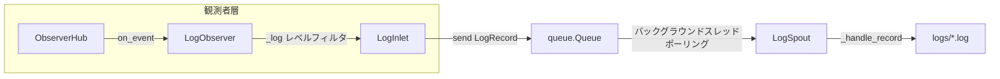

# src/celestialflow/persist/core_log.py

> 📅 最終更新日: 2026/11/13

`persist/core_log.py` はスレッドセーフなログシステムを提供し、プロデューサー-コンシューマーパターンによってログを統一的に収集・フォーマットし、`logs/` ディレクトリ下のテキストファイルへ永続化します。

中核コンポーネントはレコード型 `LogRecord`、リスナー `LogSpout`、入口 `LogInlet`、観測者ファサード `LogObserver` です。

## アーキテクチャ設計

### データフロー



### ログレベルのフィルタリング

`LogObserver._log()` はキューへ書き込む前に 2 段階のフィルタリングを行います：

1. レベルは `LEVEL_DICT` 内の既知のキーであること（そうでなければ直ちに return）；
2. レベルの数値が `log_level` 閾値以上であること（そうでなければ破棄）。

### 観測者と入口の分離

`LogObserver` は `Observer` を継承し、ログシステムをイベントバスに接続します：

1. **LogObserver（観測者 + 変換器）**：
   - `on_event()` 内でイベント型に応じてログ（グラフ / ノード / タスク / 終了シグナル）を生成；
   - ノードの起動停止を記録する際、`metrics_view` を通じてノード集計（入力総数、成功 / 失敗 / スキップ数）を読み取る；
   - spout の `start()` / `stop()` を担当し `log_path` を公開。

2. **LogInlet（レコード入口）**：
   - `BaseInlet` のみを継承し、型付きの `send(record)` を提供。イベントを消費せず、ファイルも書き込みません。

3. **LogSpout（コンシューマー）**：
   - `BaseSpout` を継承し、独立したバックグラウンドスレッドで動作；
   - キューから `LogRecord` を取り出し、1 行にフォーマットしてファイルへ書き込みます。

## ログレベル

システムは以下の標準ログレベルをサポートします（数値が大きいほど優先度が高い、`runtime.util_constant.LEVEL_DICT` を参照）：

| レベル | 値 | 説明 |
|------|----|------|
| TRACE | 0 | 最も詳細なトレース情報。終了シグナルのマージなど |
| DEBUG | 10 | デバッグ情報。タスク入力、終了シグナル入力など |
| SUCCESS | 20 | 重要な操作の成功。タスク完了など |
| INFO | 30 | 一般情報。ノード / グラフの起動停止、グラフ構造の出力など |
| WARNING | 40 | 警告情報。タスクリトライなど |
| ERROR | 50 | エラー情報。タスク失敗など |
| CRITICAL | 60 | 重大エラー（現在の内蔵イベント処理ではこのレベルは使用されません） |

## LogRecord

```python
@dataclass(frozen=True, slots=True)
class LogRecord:
    timestamp: str
    level: str
    message: str
```

| フィールド | 説明 |
|------|------|
| `timestamp` | フォーマット済みタイムスタンプ（`%Y-%m-%d %H:%M:%S`） |
| `level` | 大文字化済みのログレベル |
| `message` | ログメッセージ |

## LogSpout

`LogSpout` は `BaseSpout` を継承し、ログファイルの設定と書き込みスレッドの管理を担当します。

### 初期化と起動

```python
from celestialflow.persist import LogSpout

spout = LogSpout()
spout.start()
print(spout.log_path)  # logs/flow_log(2026-11-13).log
spout.stop()
```

- `log_path` は `start()` 前は `None`；
- 起動後、ログは `logs/flow_log({date}).log` へ書き込まれ、追記モード（`"a"`）と UTF-8 で開かれます；
- 行バッファリング（`buffering=1`）を使用するため、読み取り側は新規ログを速やかに確認できます；
- `_handle_record()` はレコードを `"{timestamp} {level} {message}\n"` に連結してファイルへ書き込みます；ファイルハンドルが未初期化の場合は `InitializationError` を送出；
- `_after_stop()` はファイルハンドルを閉じます。

### ファイルパス

```text
logs/
└── flow_log(2026-11-13).log
```

## LogInlet

```python
class LogInlet(BaseInlet):
    def send(self, record: LogRecord) -> None: ...
```

- `BaseInlet` のみを継承し、**もはや `Observer` ではありません**。イベントを消費しません；
- `send()` は `BaseInlet.send()` に転送してレコードをバインド済み spout のキューへ入れます；spout が未バインドの場合は `InitializationError` を送出；
- `bind_spout(spout)` でバインドし、チェーン呼び出しを可能にするため `self` を返します。

```python
log_inlet = LogInlet().bind_spout(log_spout)
```

## LogObserver

```python
class LogObserver(Observer):
    def __init__(
        self,
        metrics_view: MetricsView,
        log_level: str = DEFAULT_LOG_LEVEL,
    ) -> None: ...

    @property
    def log_path(self) -> Path | None: ...
    def start(self) -> None: ...
    def stop(self) -> None: ...
    def on_event(self, event: Event) -> None: ...
```

### 構築パラメータ

| パラメータ | 型 | 説明 |
|------|------|------|
| `metrics_view` | `MetricsView` | **必須**。指標の読み取り専用ビューで、ノードの起動停止時にノード集計を記録するために使用 |
| `log_level` | `str` | 最低ログレベル。デフォルトは `runtime.util_log_level.DEFAULT_LOG_LEVEL`（`"INFO"`）；渡された値は `upper()` されるだけで、不正なレベルは `InvalidOptionError` を送出 |

`__init__` は `LogSpout` と `LogInlet().bind_spout(spout)` を作成します。`log_level` は `strip()` されないため、正規化が必要な場合は組み立てエントリで `normalize_log_level()` を呼び出してください。

### イベント処理とログレベル

`on_event()` はイベント型ごとにディスパッチし、関心のないイベントは `case _: pass` に落ちます：

#### タスクグラフ (Graph)

| イベント | ログレベル | 説明 |
|------|---------|------|
| `GraphStartEvent` | INFO | タスクグラフの起動と構造情報を記録（`util_render` でレンダリングし、行ごとに書き込み） |
| `GraphEndEvent` | INFO | タスクグラフの終了と経過時間を記録（`Use {elapsed:.2f}s.`） |

#### ノード (Node)

| イベント | ログレベル | 説明 |
|------|---------|------|
| `NodeStartEvent` | INFO | ノード起動を記録し、`metrics_view` から入力タスク数を読み取り、実行モードと並行数を出力 |
| `NodeEndEvent` | INFO | ノード終了を記録し、`metrics_view` から成功 / 失敗 / スキップの統計と経過時間を出力 |

#### タスク (Task)

| イベント | ログレベル | 説明 |
|------|---------|------|
| `TaskInputEvent` | DEBUG | タスクが入力キューに入ったこととソースを記録（`from_node` が `None` の場合は `external` と表記） |
| `TaskSuccessEvent` | SUCCESS | タスクの成功完了と結果、経過時間を記録 |
| `TaskSkipEvent` | SUCCESS | タスクがスキップされたことを記録 |
| `TaskRetryEvent` | WARNING | タスク失敗だがリトライがトリガーされたことを記録（リトライ済み回数を含む） |
| `TaskFailEvent` | ERROR | タスク失敗かつリトライ不可能であることを記録（例外メッセージ内の改行は空白に置換） |

#### 終了シグナル (Termination)

| イベント | ログレベル | 説明 |
|------|---------|------|
| `TerminationInputEvent` | DEBUG | 終了シグナル入力を記録 |
| `TerminationMergeEvent` | TRACE | 終了シグナルのマージを記録（親 ID リストを含む） |

> ログ内のタスクと結果はいずれもイベントが持つ `task_repr` / `result_repr` を使用します；イベント ID は `[task_id->success_id*]` の形式で末尾に付され、ctree イベントとの関連付けが容易になります。

## 使用例

### 観測者ファサード経由（推奨）

```python
from celestialflow.observer import MetricsObserver, NodeStartEvent
from celestialflow.persist import LogObserver

metrics_view = MetricsObserver()
log = LogObserver(metrics_view, log_level="DEBUG")
log.start()
try:
    log.on_event(NodeStartEvent(node="NodeA", execution_mode="thread", max_workers=4, start_time=1.0))
finally:
    log.stop()

print(log.log_path)  # logs/flow_log(2026-11-13).log
```

実際の使用では、`LogObserver` は `assembly/core_run.py` の `run_graph_resources` / `run_node_resources` によって hub に登録され、一括で起動・停止されます。

### 手動でレコードを送出

```python
from celestialflow.persist import LogInlet, LogRecord, LogSpout

spout = LogSpout()
spout.start()
inlet = LogInlet().bind_spout(spout)

inlet.send(LogRecord(timestamp="2026-11-13 10:00:00", level="INFO", message="hello"))

spout.stop()
```

イベント駆動（汎用の `info()` / `debug()` ではなく）でログを記録することで、生成されるログが構造化され、読みやすく、機械解析が容易であることを保証します。

## 注意事項

1. **構築に `metrics_view` が必要**：`LogObserver(metrics_view, log_level)` は指標の読み取り専用ビューを必ず渡す必要があり、ノード起動停止時の集計出力に使用されます。
2. **イベント消費は観測者層**：`LogInlet` は `send(record)` のみを提供します；`on_graph_*` / `on_node_*` / `on_task_*` などの個別コールバックはもはや存在せず、すべてのロジックが `LogObserver.on_event()` に集約されています。
3. **`log_level` は大文字化のみ**：構築時に `strip()` しません；大文字小文字と前後の空白を無視する必要がある場合は、先に `normalize_log_level()` を使用してください。
4. **行バッファリング書き込み**：ログファイルは `buffering=1` で開かれ、書き込み後すぐに確認できます。
